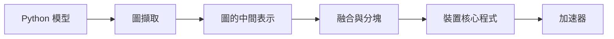

# 編譯器與核心程式

深度學習模型是一張張量運算的圖。要在特定晶片上快速執行，就得把這張圖轉為裝置上的程式碼：編譯器負責這個轉換，而核心程式（kernel）則是在硬體上執行一個（通常已融合的）運算的程式碼。

!!! info "屬於框架與工具"
    本頁位於[框架與工具](../index.zh-TW.md)之下。它比較編譯器與核心程式這一層；每個方法都有自己的頁面，記載詳細內容。

## 概述

這一層由兩種需求驅動。第一，研究者用 Python 撰寫模型，框架必須把它擷取為圖，而不需要人工改寫。第二，新架構或新晶片不應等待專家為每個運算手寫最佳化的核心程式。編譯器透過擷取並改寫程式來滿足第一項需求；核心程式語言則讓工程師以接近硬體的方式撰寫融合運算，而不必寫底層裝置程式碼，來滿足第二項需求。

這些工具所針對的成本是記憶體搬移。許多運算花在慢速與快速記憶體之間搬資料的時間，比計算還多，因此運算的順序與分組，往往比原始的算術量更重要。[FlashAttention](https://arxiv.org/abs/2205.14135) 對注意力運算提出這樣的論點：具 IO 感知的核心程式減少對慢速記憶體的讀寫，並更快計算精確注意力。

## 關鍵概念

- **圖擷取（graph capture）。** 把即時執行的 Python 轉為可供編譯器最佳化的圖。
- **運算融合（operator fusion）。** 把多個運算合併為一個核心程式，使中間結果留在快速記憶體中，而不必回到慢速記憶體。
- **分塊（tiling）。** 把大型張量運算切成能放進晶片上快速記憶體的區塊。
- **降階（lowering）。** 讓圖經過多層中間表示，最後變成裝置程式碼。
- **手寫核心程式。** 由專家為特定晶片撰寫的運算，例如 FlashAttention 所描述的注意力核心程式。

## 運作方式

框架擷取模型，編譯器改寫圖並選定融合與分塊方案，後端則為晶片產生核心程式。每個步驟都可以事先（ahead of time）執行，也可以在第一次呼叫時執行。各系統的階段不同：XLA 透過自己的中間表示降階，TorchInductor 則為 GPU 產生 Triton 程式碼。

## 關鍵方法

以下三個系統是主要範例。每個系統都有自己的頁面，說明設計、程式模型與限制。

- [XLA](xla.zh-TW.md)：線性代數編譯器，官方專案說明它可從 PyTorch、TensorFlow 與 JAX 使用。它建立在 MLIR 之上，支援 GPU、CPU 與機器學習加速器。
- [torch.compile 與 TorchInductor](torch-compile.zh-TW.md)：PyTorch 的圖擷取與預設編譯器。它保留即時執行的程式風格，TorchInductor 在 NVIDIA、AMD 與 Intel GPU 上使用 Triton 核心程式。
- [Triton](triton.zh-TW.md)：以 Python 撰寫分塊 GPU 核心程式的語言。工程師可直接使用它，TorchInductor 也把它當作後端。

更早的系統奠定了這些詞彙。Halide 把影像管線的計算內容與排程分開，後來的編譯器便沿用這種分離。TVM 為多種後端自動搜尋排程。MLIR 提供共用的編譯器基礎架構，XLA 即建立於其上。以上各項均列於下方參考文獻。

## 相關連結

- 晶片端對融合、數值格式與核心程式的觀點，見 [AI 硬體](../../hardware/index.zh-TW.md)及其[協同設計](../../hardware/co-design/index.zh-TW.md)頁。
- 融合注意力與 KV 快取處理，是[推論最佳化](../../inference-optimization/index.zh-TW.md)的核心。
- 模型端的觀點，包括改變核心程式所用數值格式的量化，見[模型壓縮](../../../theory/model-compression/index.zh-TW.md)。

## 應用

核心程式與編譯器工作在單一運算主導成本時最重要，例如長上下文服務中的注意力。當新架構需要快速核心程式，而尚無手工最佳化函式庫時，也很重要。編譯器用於跨多種加速器訓練與服務大型模型，若為每種加速器手寫核心程式並不實際。

## 未解問題

- **手寫核心程式或編譯器。** 手寫核心程式控制力最強，編譯器則能以較少力氣涵蓋更多硬體。兩者的平衡仍在變動。
- **可攜性。** 針對某一晶片調校的核心程式，在另一晶片上可能失去大部分速度，而編譯器能縮小多少差距尚不清楚。
- **可重現性。** 速度提升取決於編譯器與函式庫版本，因此很難跨軟體堆疊比較。

## 參考文獻

### 開創性論文

- Ragan-Kelley, J. et al. (2013). *Halide*. PLDI 2013. https://doi.org/10.1145/2491956.2462176 — 把影像管線的演算法與其排程分開，後來的排程式編譯器沿用了這種分離。
- Chen, T. et al. (2018). *TVM: An Automated End-to-End Optimizing Compiler for Deep Learning*. arXiv:1802.04799. https://arxiv.org/abs/1802.04799 — 描述一個能在多種硬體後端上做圖層級與運算層級最佳化的編譯器。
- Dao, T. et al. (2022). *FlashAttention: Fast and Memory-Efficient Exact Attention with IO-Awareness*. arXiv:2205.14135. https://arxiv.org/abs/2205.14135 — 說明以分塊方式注意力運算，可減少 GPU 記憶體層級之間的讀寫，從而得到較少記憶體搬移的精確注意力。
- Tillet, P., Kung, H. T. & Cox, D. (2019). *Triton: an intermediate language and compiler for tiled neural network computations*. MAPL 2019. https://doi.org/10.1145/3315508.3329973 — 介紹 Triton 分塊核心程式背後的中間語言與編譯器。
- Lattner, C. et al. (2020). *MLIR: A Compiler Infrastructure for the End of Moore's Law*. arXiv:2002.11054. https://arxiv.org/abs/2002.11054 — 描述 MLIR，即 XLA 官方頁面所說其所建立於其上的共用編譯器基礎架構。
- Ansel, J. et al. (2024). *PyTorch 2: Faster Machine Learning Through Dynamic Python Bytecode Transformation and Graph Compilation*. ASPLOS 2024. https://doi.org/10.1145/3620665.3640366 — 描述 PyTorch 2 編譯器背後的圖擷取與編譯設計。

### 文件與說明

- OpenXLA. *XLA: Optimized compiler for machine learning*. https://openxla.org/xla — XLA 的官方說明，包括其支援的框架、後端與最佳化流程。
- PyTorch. *torch.compiler: Compiling PyTorch models*. https://docs.pytorch.org/docs/2.14/user_guide/torch_compiler/torch.compiler.html — TorchDynamo、AOTAutograd、TorchInductor 與預設後端的官方說明。
- Triton contributors. *Triton documentation*. https://triton-lang.org/main/index.html — Triton 的官方文件，它是一種以 Python 為基礎、用於撰寫 GPU 核心程式的環境。
