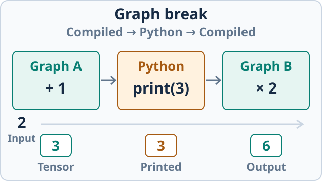
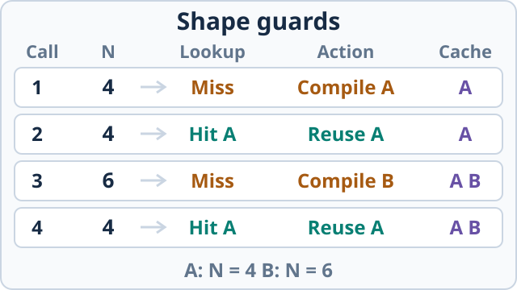

# torch.compile and TorchInductor

`torch.compile` is PyTorch's entry point for compiling a model while keeping the eager Python programming style. It captures the forward program with TorchDynamo, captures the backward pass with AOTAutograd, and hands the graphs to a backend. The default backend is TorchInductor, which generates code for several accelerators and, for NVIDIA, AMD and Intel GPUs, uses OpenAI Triton kernels.

!!! info "Part of Compilers and Kernels"
    This method page belongs to [Compilers and Kernels](index.md). It explains PyTorch's compiler stack in detail; the parent page compares it with the other systems.

## Problem

PyTorch's eager mode is easy to debug, but it runs one operation at a time, so each intermediate result is written to slow memory before the next operation reads it. A compiler can fuse operations, but it must capture a Python program that may branch, call external code and change shape. The problem is to capture the program reliably, without asking the user to rewrite it.

## Core idea

Trace the Python frames that run the model, record the tensor operations as a graph, and compile that graph. When the tracer meets code it cannot capture, it can split the graph, run that region in Python, and resume capture afterward. TorchDynamo does the capture. The official documentation says it "uses a CPython feature called the Frame Evaluation API to safely capture PyTorch graphs."

The design is described in the ASPLOS 2024 paper on PyTorch 2, which covers the graph capture and compilation stack that `torch.compile` uses.

## Procedure

1. The user calls `torch.compile` on a model or function.
2. TorchDynamo captures the forward graph from the Python bytecode.
3. AOTAutograd captures the backward pass ahead of time, so that the compiler can optimise both directions.
4. The backend compiles the graphs. By default this is TorchInductor, which generates code and calls Triton for GPU kernels.
5. Other backends can be selected. The official documentation lists options for this choice.

Where capture fails, the graph is broken into pieces. The official documentation has a separate guide to graph breaks, which is the place to look when a model runs slower than expected.


### Graph break: execution resumes after Python

A graph break is a boundary in capture, not necessarily a failure of the whole compiled function. With `fullgraph=False`, Dynamo can compile a captured region, run a Python operation outside the graph, then resume capture of a subsequent region.[^dynamo-concepts] A deliberately disabled logging function makes this boundary explicit.[^dynamo-disable]

```python
import torch

@torch.compiler.disable
def report(y):
    print(y.item())

@torch.compile(fullgraph=False)
def f(x):
    y = x + 1
    report(y)
    return y * 2

f(torch.tensor(2))  # prints 3; returns tensor(6)
```



*Original animated teaching diagram, CC BY-SA 4.0.* The moving dot marks the execution order of a successfully captured pair of regions. The three results appear only after their respective stages. Printing is a side effect, not an arithmetic logarithm or a new tensor. These are illustrative values, not an execution trace or measured timings. On MkDocs, use the keyboard-accessible **Play/Pause** control; reduced-motion preferences initially show the still. [Static preview for GitHub](../../../assets/concept-animations/dynamo-graph-break-resume-still.svg).

The two compiled regions can each be optimized, but an ordinary fusion cannot cross the Python boundary in this example. The side effect remains observable. Some graph breaks cannot resume capture and instead fall back to eager execution; `fullgraph=True` requires a single capturable graph and raises an error for a graph break. Use `TORCH_LOGS="graph_breaks"` to investigate boundaries.

### Shape guards: reuse versus recompilation

A guard is a runtime condition that must hold for previously compiled code to remain valid. Shape is only one possible condition: dtype, device, stride and Python values may also matter. If no existing compiled variant passes its guards, Dynamo may trace and compile another variant, subject to cache limits.[^dynamo-concepts][^dynamo-recompile]

Consider a fresh one-dimensional function `g(x) = x + 1` compiled with `torch.compile(g, dynamic=False)`. Hold the other guard-relevant properties fixed, assume no eviction or compilation failure, and call it with lengths 4, 4, 6, 4.



*Original animated teaching diagram, CC BY-SA 4.0.* Each moving marker represents a lookup; the revealed row records the outcome and cache after the call. The first miss is an empty cache, whereas the third misses the existing shape guard. A and B name illustrative guarded variants, not GPU kernels. The time spent on each row is schematic, not a measurement of compilation overhead. On MkDocs, use the keyboard-accessible **Play/Pause** control; reduced-motion preferences initially show the still. [Static preview for GitHub](../../../assets/concept-animations/dynamo-shape-guard-cache-still.svg).

| Call | Length | Cache lookup | Action | Variants after call |
|---|---:|---|---|---|
| 1 | 4 | Empty | Compile A | A |
| 2 | 4 | A matches | Reuse A | A |
| 3 | 6 | A fails | Compile B | A, B |
| 4 | 4 | A matches | Reuse A | A, B |

There are two initial compilations of distinct variants (one is a recompilation of the function), not four. A guard miss is different from a graph break: the former invalidates a cached specialization for the current call, while the latter separates regions of a program. With the default `dynamic=None`, Dynamo may generalize a changed dimension on recompilation; `dynamic=True` requests more dynamic shapes up front, but neither guarantees that every future call reuses one graph. Use `TORCH_LOGS="recompiles"` to inspect failed guards.

[^dynamo-concepts]: PyTorch, [Dynamo Core Concepts](https://docs.pytorch.org/docs/2.15/user_guide/torch_compiler/compile/programming_model.dynamo_core_concepts.html).
[^dynamo-disable]: PyTorch, [Disabling and Suppressing Errors](https://docs.pytorch.org/docs/main/user_guide/torch_compiler/compile/programming_model.compiler_disable.html).
[^dynamo-recompile]: PyTorch, [Dealing with Recompilations](https://docs.pytorch.org/docs/2.15/user_guide/torch_compiler/compile/programming_model.recompilation.html).

## Results

The official documentation describes the components and the default backend, and it does not report benchmark results. This page therefore gives no speed-up figures. The ASPLOS 2024 paper reports its own evaluation, which should be read in that paper. Readers who need numbers for their own model should measure it and record the PyTorch version, since results change between releases.

## Limitations

- **Graph breaks.** Code that the tracer cannot capture splits the graph. Many breaks reduce the benefit, and finding them takes effort.
- **Compile time and recompilation.** Compilation takes time on the first call, and a change in input shape can trigger a new compilation.
- **Backend dependence.** Speed depends on TorchInductor and the Triton version for the target GPU.
- **Debugging.** An error can come from the compiler stack rather than the model, which makes it harder to trace than an eager-mode error.

## Connections

- The language that TorchInductor generates GPU kernels in is [Triton](triton.md).
- The compiler that JAX users rely on is [XLA](xla.md), which is also available as a PyTorch backend.
- Fused attention kernels, which compilers try to reproduce, are discussed in [Inference Optimization](../../inference-optimization/index.md).

## Open questions

- How often does a real model fall back to eager execution, and what is the cost of each break?
- Will general-purpose compilers match hand-tuned kernels on the newest attention variants?

## References

### Seminal papers

- Ansel, J. et al. (2024). *PyTorch 2: Faster Machine Learning Through Dynamic Python Bytecode Transformation and Graph Compilation*. ASPLOS 2024. https://doi.org/10.1145/3620665.3640366 — Describes the graph capture and compilation design that `torch.compile` builds on.
- Chen, T. et al. (2018). *TVM: An Automated End-to-End Optimizing Compiler for Deep Learning*. arXiv:1802.04799. https://arxiv.org/abs/1802.04799 — A compiler that optimises graphs and operators for many back-ends, an alternative design to TorchInductor.
- Dao, T. et al. (2022). *FlashAttention: Fast and Memory-Efficient Exact Attention with IO-Awareness*. arXiv:2205.14135. https://arxiv.org/abs/2205.14135 — The kernel-level argument that reducing memory traffic speeds attention, which compilers try to recover.

### Articles and documentation

- PyTorch. *torch.compiler: Compiling PyTorch models*. https://docs.pytorch.org/docs/2.14/user_guide/torch_compiler/torch.compiler.html — Official description of TorchDynamo, AOTAutograd, TorchInductor and the default backend.
- OpenXLA. *XLA: Optimized compiler for machine learning*. https://openxla.org/xla — Official description of the compiler used by JAX and TensorFlow, for comparison.
- Triton contributors. *Triton documentation*. https://triton-lang.org/main/index.html — Official documentation of the kernel language that TorchInductor uses for GPU code.
- PyTorch. *Dynamo Core Concepts*. https://docs.pytorch.org/docs/2.15/user_guide/torch_compiler/compile/programming_model.dynamo_core_concepts.html — Explains graph breaks, runtime guards and dynamic shapes.
- PyTorch. *Disabling and Suppressing Errors*. https://docs.pytorch.org/docs/main/user_guide/torch_compiler/compile/programming_model.compiler_disable.html — Shows how to exclude a function from capture while resuming afterward.
- PyTorch. *Dealing with Recompilations*. https://docs.pytorch.org/docs/2.15/user_guide/torch_compiler/compile/programming_model.recompilation.html — Explains shape specialization and cache limits.
