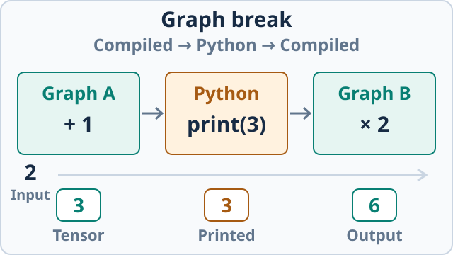
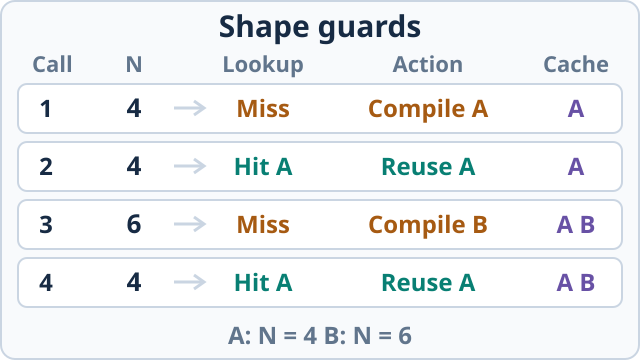

# torch.compile 與 TorchInductor

`torch.compile` 是 PyTorch 的模型編譯入口，同時保留即時執行的 Python 程式風格。它用 TorchDynamo 擷取前向程式，用 AOTAutograd 事先擷取反向傳播，然後把圖交給後端。預設後端是 TorchInductor，它為多種加速器產生程式碼；在 NVIDIA、AMD 與 Intel GPU 上，則使用 OpenAI Triton 核心程式。

!!! info "屬於編譯器與核心程式"
    本方法頁屬於[編譯器與核心程式](index.zh-TW.md)。它詳細說明 PyTorch 的編譯器堆疊；上層頁面則比較它與其他系統。

## 問題

PyTorch 的即時執行模式容易除錯，但它一次只執行一個運算，因此每個中間結果都要先寫入慢速記憶體，下一個運算才能讀取。編譯器可以融合運算，但必須擷取可能含有分支、呼叫外部程式碼並改變形狀的 Python 程式。問題在於：如何可靠地擷取程式，而不要求使用者改寫。

## 核心想法

追蹤執行模型的 Python 框架，把張量運算記錄為圖，然後編譯這張圖。遇到無法擷取的程式碼時，圖會在該處切開，其餘部分改回 Python 執行。擷取工作由 TorchDynamo 負責。官方文件寫道，它「使用 CPython 的一項功能，稱為 Frame Evaluation API，以安全地擷取 PyTorch 圖」。

ASPLOS 2024 關於 PyTorch 2 的論文說明了 `torch.compile` 所用的圖擷取與編譯堆疊的設計。

## 流程

1. 使用者在模型或函式上呼叫 `torch.compile`。
2. TorchDynamo 從 Python 位元組碼擷取前向圖。
3. AOTAutograd 事先擷取反向傳播，使編譯器能同時最佳化兩個方向。
4. 後端編譯這些圖。預設為 TorchInductor，它產生程式碼，並為 GPU 核心程式呼叫 Triton。
5. 可以選擇其他後端。官方文件列出了這項選擇的各種選項。

擷取失敗時，圖會被切成數段。官方文件另有一份關於圖中斷（graph break）的指南，模型執行比預期慢時可以參考。


### 圖中斷：執行 Python 後接續編譯

圖中斷（graph break）是圖擷取的邊界，不一定代表整個編譯函式失敗。在 `fullgraph=False` 下，Dynamo 可以編譯已擷取的區域，在圖外執行 Python 運算，再繼續擷取下一個區域。[^dynamo-concepts] 刻意停用編譯的記錄函式能明確呈現這個邊界。[^dynamo-disable]

```python
import torch

@torch.compiler.disable
def report(y):
    print(y.item())

@torch.compile(fullgraph=False)
def f(x):
    y = x + 1
    report(y)
    return y * 2

f(torch.tensor(2))  # 印出 3；回傳 tensor(6)
```



*原創教學動畫，CC BY-SA 4.0。* 移動圓點表示兩個成功擷取區域之間的執行順序，三個結果分別在對應階段完成後顯示。印出數值是副作用，不是對數運算，也不會產生新的張量。數值為示意，並非實際執行追蹤或效能量測。MkDocs 提供可用鍵盤操作的 **播放／暫停（Play/Pause）** 控制；偏好減少動態效果時預設顯示靜態圖。[GitHub 靜態預覽](../../../assets/concept-animations/dynamo-graph-break-resume-still.svg)。

兩個已編譯區域可以分別最佳化，但在此例中，一般的運算融合無法跨越 Python 邊界，且副作用仍可被觀察。某些圖中斷無法接續擷取，而會退回即時執行；`fullgraph=True` 要求單一可擷取的圖，遇到圖中斷便會報錯。可使用 `TORCH_LOGS="graph_breaks"` 檢查中斷位置。

### 形狀 Guard：重用與重新編譯

Guard 是已編譯程式碼仍然有效所必須滿足的執行期條件。形狀只是其中一項；資料型別、裝置、stride 與 Python 數值也可能影響判斷。如果既有編譯版本都不符合各自的 Guard，Dynamo 可能重新追蹤並編譯另一版本，但仍受快取上限限制。[^dynamo-concepts][^dynamo-recompile]

考慮新的一維函式 `g(x) = x + 1`，使用 `torch.compile(g, dynamic=False)` 編譯。在其他 Guard 相關屬性固定、沒有快取淘汰或編譯失敗的假設下，依序輸入長度 4、4、6、4。



*原創教學動畫，CC BY-SA 4.0。* 移動圓點代表快取查找；顯示的各列記錄查找結果與呼叫後的快取。首次未命中是因快取為空，第三次則是既有形狀 Guard 不符。A 與 B 代表示意的受 Guard 保護的編譯版本，而非 GPU 核心程式。每列的播放時間並非編譯開銷的實測值。MkDocs 提供可用鍵盤操作的 **播放／暫停（Play/Pause）** 控制；偏好減少動態效果時預設顯示靜態圖。[GitHub 靜態預覽](../../../assets/concept-animations/dynamo-shape-guard-cache-still.svg)。

| 呼叫 | 長度 | 快取查找 | 動作 | 呼叫後的編譯版本 |
|---|---:|---|---|---|
| 1 | 4 | 空 | 編譯 A | A |
| 2 | 4 | A 符合 | 重用 A | A |
| 3 | 6 | A 不符合 | 編譯 B | A、B |
| 4 | 4 | A 符合 | 重用 A | A、B |

總共編譯兩個不同版本（其中一次是函式的重新編譯），而非四次。Guard 未命中與圖中斷不同：前者表示目前呼叫無法使用既有的特化版本，後者則是程式區域的擷取邊界。預設的 `dynamic=None` 可能在重新編譯時將變動的維度泛化；`dynamic=True` 則一開始就嘗試更多動態形狀，但兩者都不保證所有後續呼叫只使用同一張圖。可使用 `TORCH_LOGS="recompiles"` 檢查不符的 Guard。

[^dynamo-concepts]: PyTorch，[Dynamo Core Concepts](https://docs.pytorch.org/docs/2.15/user_guide/torch_compiler/compile/programming_model.dynamo_core_concepts.html)。
[^dynamo-disable]: PyTorch，[Disabling and Suppressing Errors](https://docs.pytorch.org/docs/main/user_guide/torch_compiler/compile/programming_model.compiler_disable.html)。
[^dynamo-recompile]: PyTorch，[Dealing with Recompilations](https://docs.pytorch.org/docs/2.15/user_guide/torch_compiler/compile/programming_model.recompilation.html)。

## 結果

官方文件描述了各組件與預設後端，但沒有報告基準測試結果，因此本頁不提供加速倍數。ASPLOS 2024 論文報告了它自己的評估，應以該論文為準。若需要自己模型的數字，應實際測量並記錄 PyTorch 版本，因為結果會隨版本改變。

## 限制

- **圖中斷。** 無法被擷取的程式碼會切斷圖。許多中斷會降低效益，而找出它們需要花費力氣。
- **編譯時間與重新編譯。** 第一次呼叫需要時間編譯，輸入形狀改變時可能觸發新的編譯。
- **依賴後端。** 速度取決於 TorchInductor 與目標 GPU 所用的 Triton 版本。
- **除錯。** 錯誤可能來自編譯器堆疊而非模型本身，比即時執行模式的錯誤更難追蹤。

## 相關連結

- TorchInductor 為 GPU 產生核心程式所用的語言是 [Triton](triton.zh-TW.md)。
- JAX 使用者所依賴的編譯器是 [XLA](xla.zh-TW.md)，它也能作為 PyTorch 的後端。
- 編譯器試圖重現的融合注意力核心程式，在[推論最佳化](../../inference-optimization/index.zh-TW.md)中討論。

## 未解問題

- 真實模型多常退回即時執行？每次中斷的成本為何？
- 在最新的注意力變體上，通用編譯器能否追上手寫核心程式？

## 參考文獻

### 開創性論文

- Ansel, J. et al. (2024). *PyTorch 2: Faster Machine Learning Through Dynamic Python Bytecode Transformation and Graph Compilation*. ASPLOS 2024. https://doi.org/10.1145/3620665.3640366 — 描述 `torch.compile` 所建立於其上的圖擷取與編譯設計。
- Chen, T. et al. (2018). *TVM: An Automated End-to-End Optimizing Compiler for Deep Learning*. arXiv:1802.04799. https://arxiv.org/abs/1802.04799 — 為多種後端最佳化圖與運算的編譯器，是 TorchInductor 的另一種設計。
- Dao, T. et al. (2022). *FlashAttention: Fast and Memory-Efficient Exact Attention with IO-Awareness*. arXiv:2205.14135. https://arxiv.org/abs/2205.14135 — 核心層級的論點：減少記憶體搬移可加速注意力，而編譯器試圖重現這點。

### 文件與說明

- PyTorch. *torch.compiler: Compiling PyTorch models*. https://docs.pytorch.org/docs/2.14/user_guide/torch_compiler/torch.compiler.html — TorchDynamo、AOTAutograd、TorchInductor 與預設後端的官方說明。
- OpenXLA. *XLA: Optimized compiler for machine learning*. https://openxla.org/xla — JAX 與 TensorFlow 所用編譯器的官方說明，供比較之用。
- Triton contributors. *Triton documentation*. https://triton-lang.org/main/index.html — TorchInductor 用於 GPU 程式碼的核心程式語言之官方文件。
- PyTorch. *Dynamo Core Concepts*. https://docs.pytorch.org/docs/2.15/user_guide/torch_compiler/compile/programming_model.dynamo_core_concepts.html — 說明圖中斷、執行期 Guard 與動態形狀。
- PyTorch. *Disabling and Suppressing Errors*. https://docs.pytorch.org/docs/main/user_guide/torch_compiler/compile/programming_model.compiler_disable.html — 說明如何排除特定函式的擷取並在其後接續。
- PyTorch. *Dealing with Recompilations*. https://docs.pytorch.org/docs/2.15/user_guide/torch_compiler/compile/programming_model.recompilation.html — 說明形狀特化與快取上限。
