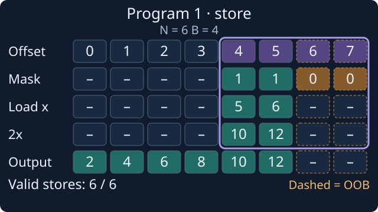

# Triton

Triton is a language and compiler for writing GPU kernels in Python. The official documentation says it aims to provide a "Python-based programming environment for productively writing custom DNN compute kernels," capable of "running at maximal throughput on modern GPU hardware." It sits between a fully automatic compiler and hand-written device code: the programmer chooses the tiling, and the compiler handles the low-level details.

!!! info "Part of Compilers and Kernels"
    This method page belongs to [Compilers and Kernels](index.md). It explains the kernel language in detail; the parent page compares it with the compiler systems.

## Problem

Some operations, such as attention, are fast only when they are fused and tiled to fit in on-chip memory. Writing those kernels in CUDA takes expert time for each chip and each variant. Automatic compilers do not always find the best tiling, so a faster kernel often needs someone to write it. The problem is to make that kind of kernel practical to write without giving up most of the hardware speed.

## Core idea

The programmer writes a block of a computation in Python, and the compiler maps it onto the chip's threads and memory. The program is organised around tiles: blocks of data are loaded from slow memory, computed on, and written back. Because the programmer controls the tile size and the order of loads, the kernel can keep intermediate values on chip. This is the memory argument behind fused attention, as set out in the [FlashAttention](https://arxiv.org/abs/2205.14135) paper.

The 2019 MAPL paper by Tillet, Kung and Cox introduces the intermediate language and compiler behind this design.

## Procedure

1. The engineer writes a kernel as a Python function that operates on blocks of data.
2. The programmer picks block sizes and the loads and stores for each block.
3. The Triton compiler lowers the function and generates GPU code for the target device.
4. The kernel is called from Python, in the same way as a library function.

Triton is also used as a backend. TorchInductor generates Triton code for NVIDIA, AMD and Intel GPUs, as described on the [torch.compile page](torch-compile.md).

### Worked example: masking a partial tile

A vector of length $N=6$ is divided into logical blocks of size $B=4$. Launch $\lceil N/B\rceil=2$ programs. Program $p$ uses offsets $pB+[0,1,2,3]$ and sets its memory-access mask to `offsets < N`. The same mask protects both the load and the store, as in the official vector-addition tutorial.[^tail-mask]



*Original animated teaching diagram, CC BY-SA 4.0.* The outline identifies the current program; dashed cells at offsets 6 and 7 are out of bounds, not allocated padding. The sequence shows one possible illustrative order, not the GPU scheduler. On MkDocs, use the keyboard-accessible **Play/Pause** control; reduced-motion preferences initially show the still. [Static preview for GitHub](../../../assets/concept-animations/triton-tail-mask-still.svg).

For input $[1,2,3,4,5,6]$ and pointwise operation $y=2x$:

| Program | Offsets | Mask | Valid outputs |
|---|---|---|---|
| 0 | 0, 1, 2, 3 | 1, 1, 1, 1 | 2, 4, 6, 8 |
| 1 | 4, 5, 6, 7 | 1, 1, 0, 0 | 10, 12 |

The core of this illustrative kernel is:

```python
offsets = tl.program_id(0) * BLOCK_SIZE + tl.arange(0, BLOCK_SIZE)
mask = offsets < n_elements
x = tl.load(x_ptr + offsets, mask=mask, other=0)
tl.store(y_ptr + offsets, 2 * x, mask=mask)
```

Masked loads return the specified fallback value here, without reading invalid memory. Masked stores do not write. Dashes in the compute row omit inactive lane values: the mask does not imply that all arithmetic instructions for those lanes disappear. The two independent programs need not run in the depicted order. Six valid element loads and six stores are logical counts, not GPU memory-transaction measurements.

[^tail-mask]: Triton contributors, [Vector Addition](https://triton-lang.org/main/getting-started/tutorials/01-vector-add.html), demonstrates the program ID, offset calculation and matching load/store masks.

## Results

The official documentation describes the language and its goals, and it does not report benchmark results. This page gives no speed-up figures. Kernels written in Triton should be measured on the target GPU, with the Triton version recorded.

## Limitations

- **Programmer effort.** A faster kernel still needs knowledge of tiling and memory. The language lowers the effort compared with CUDA, but does not remove it.
- **Target coverage.** The set of supported hardware and features depends on the Triton version and the backend.
- **Tuning.** The best block sizes differ across chips and input shapes, so kernels need autotuning or careful selection.
- **Scope.** Triton targets tiled computations. Operations that do not tile well still need other approaches.

## Connections

- The compiler that generates Triton code for PyTorch is [torch.compile and TorchInductor](torch-compile.md).
- The compiler for linear algebra, which fuses operations automatically, is [XLA](xla.md).
- The reason fused kernels matter for attention is set out in the [FlashAttention](https://arxiv.org/abs/2205.14135) paper and in [Inference Optimization](../../inference-optimization/index.md).

## Open questions

- Will hand-written kernels in a higher-level language keep their advantage as compilers improve?
- How should kernels be shared across chips with different memory hierarchies?

## References

### Seminal papers

- Tillet, P., Kung, H. T. & Cox, D. (2019). *Triton: an intermediate language and compiler for tiled neural network computations*. MAPL 2019. https://doi.org/10.1145/3315508.3329973 — Introduces the intermediate language and compiler for tiled neural network kernels, the basis of Triton.
- Dao, T. et al. (2022). *FlashAttention: Fast and Memory-Efficient Exact Attention with IO-Awareness*. arXiv:2205.14135. https://arxiv.org/abs/2205.14135 — A fused, tiled attention kernel that shows the speed gain Triton-style kernels aim for.
- Chen, T. et al. (2018). *TVM: An Automated End-to-End Optimizing Compiler for Deep Learning*. arXiv:1802.04799. https://arxiv.org/abs/1802.04799 — The automatic alternative, which searches for schedules rather than asking the programmer to write them.

### Articles and documentation

- Triton contributors. *Triton documentation*. https://triton-lang.org/main/index.html — Official documentation of the language, its Python-based environment and its goals.
- PyTorch. *torch.compiler: Compiling PyTorch models*. https://docs.pytorch.org/docs/2.14/user_guide/torch_compiler/torch.compiler.html — Official description of how TorchInductor uses Triton for GPU kernels.
- OpenXLA. *XLA: Optimized compiler for machine learning*. https://openxla.org/xla — Official description of the compiler path that competes with hand-written kernels.

- Triton contributors. *Vector Addition*. https://triton-lang.org/main/getting-started/tutorials/01-vector-add.html — Official tutorial on program IDs, offsets and masking partial blocks.
