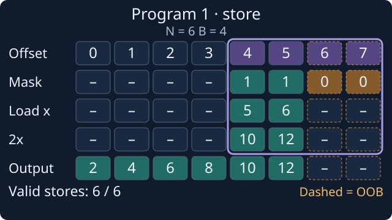

# Triton

Triton 是以 Python 撰寫 GPU 核心程式的語言與編譯器。官方文件表示，它的目標是提供「以 Python 為基礎的程式環境，用於高效撰寫自訂 DNN 計算核心程式」，並能在「現代 GPU 硬體上以最大吞吐量執行」。它位於全自動編譯器與手寫裝置程式碼之間：程式設計師選擇分塊方式，而編譯器處理底層細節。

!!! info "屬於編譯器與核心程式"
    本方法頁屬於[編譯器與核心程式](index.zh-TW.md)。它詳細說明這個核心程式語言；上層頁面則比較它與各編譯器系統。

## 問題

有些運算（例如注意力）只有在融合並分塊、以便放進晶片上記憶體時才快。以 CUDA 為每種晶片、每種變體撰寫這類核心程式，需要專家投入大量時間。自動編譯器不一定找得到最佳分塊，因此更快的核心程式通常需要人工撰寫。問題在於：如何讓這類核心程式容易撰寫，又不損失大部分硬體速度。

## 核心想法

程式設計師以 Python 撰寫計算的一個區塊，編譯器再把它對應到晶片的執行緒與記憶體。程式以分塊（tile）組織：每個資料區塊從慢速記憶體載入、進行計算、再寫回。由於程式設計師控制分塊大小與載入順序，核心程式便能把中間值保留在晶片上。這正是融合注意力背後的記憶體論點，見 [FlashAttention](https://arxiv.org/abs/2205.14135) 論文的說明。

Tillet、Kung 與 Cox 於 2019 年 MAPL 的論文介紹了這套設計背後的中間語言與編譯器。

## 流程

1. 工程師把核心程式寫成對資料區塊運作的 Python 函式。
2. 程式設計師選定區塊大小，以及每個區塊的載入與寫回。
3. Triton 編譯器對該函式降階，並為目標裝置產生 GPU 程式碼。
4. 核心程式從 Python 呼叫，與呼叫函式庫函式的方式相同。

Triton 也被當作後端使用。TorchInductor 會為 NVIDIA、AMD 與 Intel GPU 產生 Triton 程式碼，見 [torch.compile 頁面](torch-compile.zh-TW.md)。

### 數值示例：尾端不完整分塊的遮罩

將長度 $N=6$ 的向量切成大小 $B=4$ 的邏輯區塊，共啟動 $\lceil N/B\rceil=2$ 個 program。第 $p$ 個 program 使用偏移量 $pB+[0,1,2,3]$，並以 `offsets < N` 作為記憶體存取遮罩。與官方向量加法教學相同，讀取與寫回皆使用同一遮罩。[^tail-mask]



*原創教學動畫，CC BY-SA 4.0。* 外框標示目前的 program；已計算的遮罩保留於圖中作為歷史紀錄，並不代表暫存器仍保有其值；偏移量 6 與 7 的虛線格代表超出邊界的位置，而非實際配置的填充元素。動畫是其中一種示意順序，並非 GPU 排程器的實際時序。在 MkDocs 可使用支援鍵盤操作的 **播放／暫停** 控制；偏好減少動態效果時預設顯示靜態圖。[GitHub 靜態預覽](../../../assets/concept-animations/triton-tail-mask-still.svg)。

以輸入 $[1,2,3,4,5,6]$ 與逐元素運算 $y=2x$ 為例：

| Program | 偏移量 | 遮罩 | 有效輸出 |
|---|---|---|---|
| 0 | 0, 1, 2, 3 | 1, 1, 1, 1 | 2, 4, 6, 8 |
| 1 | 4, 5, 6, 7 | 1, 1, 0, 0 | 10, 12 |

示意核心程式的主要運算如下：

```python
offsets = tl.program_id(0) * BLOCK_SIZE + tl.arange(0, BLOCK_SIZE)
mask = offsets < n_elements
x = tl.load(x_ptr + offsets, mask=mask, other=0)
tl.store(y_ptr + offsets, 2 * x, mask=mask)
```

遮罩為假的讀取會取得此處指定的替代值，不會讀取無效記憶體；遮罩為假的寫回不會寫入。運算列以破折號省略非有效 lane 的數值：遮罩並不代表這些 lane 的所有算術指令都會消失。兩個獨立 program 不一定依圖示順序執行。六次有效元素讀取與六次寫回是邏輯計數，並非 GPU 記憶體交易的實測值。

`other` 的選擇也取決於後續算術。若對有效值 $[-5,-2]$ 執行最大值歸約，將另外兩個無效 lane 填入零會錯誤得到 0，而非 −2。浮點最大值歸約的中性填充值為負無窮大；對非空且有效值有限的 softmax 列，這些填充位置經指數運算後貢獻為零。官方 [Fused Softmax](https://triton-lang.org/main/getting-started/tutorials/02-fused-softmax.html) 教學採用此模式。[^tail-reduction] 僅遮罩最終寫回無法修正已受到污染的歸約結果。

[^tail-reduction]: Triton contributors，*Fused Softmax*，示範以負無窮大作為遮罩讀取替代值、計算列最大值與指數，並以遮罩寫回。

[^tail-mask]: Triton contributors，[Vector Addition](https://triton-lang.org/main/getting-started/tutorials/01-vector-add.html)，示範 program ID、偏移量計算與相同的讀寫遮罩。

## 結果

官方文件描述的是語言與其目標，並未報告基準測試結果，因此本頁不提供加速倍數。以 Triton 撰寫的核心程式，應在目標 GPU 上測量，並記錄 Triton 版本。

## 限制

- **程式設計師的工作量。** 更快的核心程式仍需要分塊與記憶體的知識。與 CUDA 相比，這門語言降低了工作量，但沒有消除它。
- **目標涵蓋範圍。** 支援的硬體與功能取決於 Triton 版本與後端。
- **調校。** 最佳區塊大小隨晶片與輸入形狀而異，因此核心程式需要自動調校或審慎選擇。
- **適用範圍。** Triton 針對可分塊的計算。不易分塊的運算仍需其他方法。

## 相關連結

- 為 PyTorch 產生 Triton 程式碼的編譯器是 [torch.compile 與 TorchInductor](torch-compile.zh-TW.md)。
- 自動融合運算的線性代數編譯器是 [XLA](xla.zh-TW.md)。
- 融合核心程式對注意力為何重要，見 [FlashAttention](https://arxiv.org/abs/2205.14135) 論文及[推論最佳化](../../inference-optimization/index.zh-TW.md)。

## 未解問題

- 在更高階語言中撰寫的手寫核心程式，會在編譯器進步後保有優勢嗎？
- 如何在記憶體層級不同的晶片之間共用核心程式？

## 參考文獻

### 開創性論文

- Tillet, P., Kung, H. T. & Cox, D. (2019). *Triton: an intermediate language and compiler for tiled neural network computations*. MAPL 2019. https://doi.org/10.1145/3315508.3329973 — 介紹分塊神經網路核心程式的中間語言與編譯器，是 Triton 的基礎。
- Dao, T. et al. (2022). *FlashAttention: Fast and Memory-Efficient Exact Attention with IO-Awareness*. arXiv:2205.14135. https://arxiv.org/abs/2205.14135 — 融合且分塊的注意力核心程式，展示 Triton 式核心程式所追求的速度提升。
- Chen, T. et al. (2018). *TVM: An Automated End-to-End Optimizing Compiler for Deep Learning*. arXiv:1802.04799. https://arxiv.org/abs/1802.04799 — 自動的替代方案，它搜尋排程，而不是要求程式設計師自行撰寫。

### 文件與說明

- Triton contributors. *Triton documentation*. https://triton-lang.org/main/index.html — 語言、其以 Python 為基礎的環境與設計目標的官方文件。
- PyTorch. *torch.compiler: Compiling PyTorch models*. https://docs.pytorch.org/docs/2.14/user_guide/torch_compiler/torch.compiler.html — TorchInductor 如何為 GPU 核心程式使用 Triton 的官方說明。
- OpenXLA. *XLA: Optimized compiler for machine learning*. https://openxla.org/xla — 與手寫核心程式競爭的編譯器路徑之官方說明。

- Triton contributors. *Vector Addition*. https://triton-lang.org/main/getting-started/tutorials/01-vector-add.html — 示範 program ID、偏移量及不完整區塊遮罩的官方教學。
- Triton contributors. *Fused Softmax*. https://triton-lang.org/main/getting-started/tutorials/02-fused-softmax.html — 示範融合核心中考量歸約運算的填充值與輸出遮罩。
