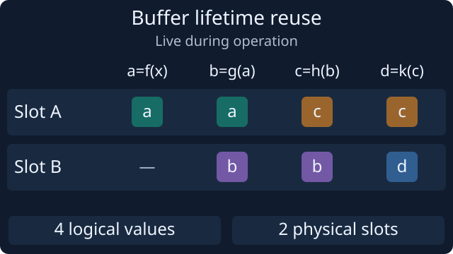
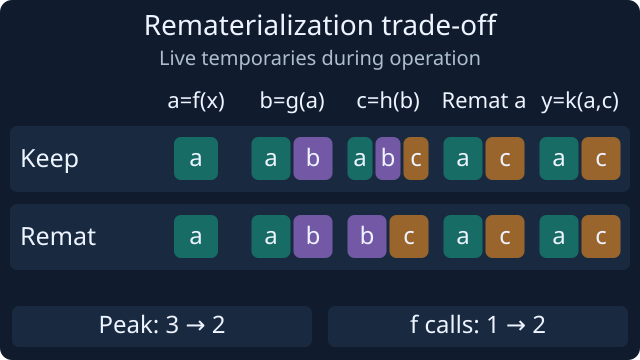

# XLA

XLA (Accelerated Linear Algebra) is an open-source compiler for machine learning. It takes a model's graph, optimises it, and generates code for a specific device. The official project describes it as usable from PyTorch, TensorFlow and JAX, and as built collaboratively by hardware and software companies including Alibaba, Amazon Web Services, AMD, Apple, Arm, Google, Intel, Meta and NVIDIA.

!!! info "Part of Compilers and Kernels"
    This method page belongs to [Compilers and Kernels](index.md). It explains XLA in detail; the parent page compares it with the other systems.

## Problem

A framework produces a graph of tensor operations. Run one operation at a time, and each intermediate result returns to slow memory before the next operation reads it. Hand-optimising every model for every chip does not scale. XLA addresses both by compiling the whole graph for the device, so that the compiler chooses the fusions.

## Core idea

Capture the program as a graph, lower it to a linear-algebra intermediate representation, optimise that representation with a series of passes, and emit code for the target backend. The official page says XLA "leverages the power of MLIR" to bring its capabilities into a single compiler toolchain. The backend is pluggable, so the same front end can serve GPUs, CPUs and ML accelerators.

## Procedure

1. The framework, for example JAX, traces the model and hands a graph to XLA.
2. XLA lowers the graph to its intermediate representation, called HLO in XLA's documentation.
3. A sequence of optimisation passes runs over the representation. The official page describes these as production-tested, and mentions automated partitioning for model parallelism.
4. The backend generates device code, and the compiled program runs on the chip.

The official page links to a walkthrough of the journey from HLO to an executable, which is the place to look for the detail of these steps.

### Buffer assignment: reuse after the last consumer

After scheduling, logical values with disjoint live ranges can share a physical buffer slice; XLA's buffer assignment uses lifetime and alias information to avoid overwriting live values.[^xla-buffers] Consider four equal-sized arrays in the fixed sequence $a=f(x), b=g(a), c=h(b), d=k(c)$. Assume pure operations, no in-place aliasing, external input $x$, and that each operation's input and output must coexist.

*Original animated teaching diagram, CC BY-SA 4.0.* The orange outline tracks the active operation; earlier columns remain as history. On MkDocs use the keyboard-accessible **Play/Pause** control; reduced-motion preferences initially show the still. [Static preview for GitHub](../../../assets/concept-animations/xla-buffer-lifetime-reuse-still.svg) · [Full animation](../../../assets/concept-animations/xla-buffer-lifetime-reuse-motion.svg).

| Operation | Live values in slot A | Live values in slot B |
|---|---|---|
| a = f(x) | a | — |
| b = g(a) | a | b |
| c = h(b) | c | b |
| d = k(c) | c | d |

The last use of $a$ is in the second operation; its slot becomes available for $c$ in the third. Likewise $d$ reuses the slot of $b$ after the third operation. The table includes the produced output $d$ but excludes the external input $x$. Four distinct logical values require only two equal-sized physical slots in this schedule. This is a schematic allocation, not an XLA dump or a measurement of allocated GPU memory.

Each column represents coexistence **during** an operation, not values retained after it finishes. For unequal array sizes $A,B,C,D$ (bytes), the illustrated fixed two-slot assignment needs capacity $\max(A,C)+\max(B,D)$, ignoring alignment and allocator overhead. Two slots do not imply that the peak byte count is exactly half of four separate slots; their capacities must accommodate the largest value assigned to each slot.

### Rematerialization: shorten a live range by recomputing

XLA also has a rematerialization pass, which trades recomputation for lower memory pressure.[^xla-remat] Change the example so $y=k(a,c)$ needs $a$ again after $b=g(a)$ and $c=h(b)$. Keeping $a$ alive across the third operation requires three simultaneously live internal arrays. Alternatively, drop $a$ after computing $b$, then recompute $a=f(x)$ after producing $c$.

*Original animated teaching diagram, CC BY-SA 4.0.* Each coloured block is one live internal array; the fourth column is idle in Keep and recomputes a only in Remat. Use **Play/Pause** on MkDocs; reduced motion initially shows the still. [Static preview for GitHub](../../../assets/concept-animations/xla-rematerialization-liveness-still.svg) · [Full animation](../../../assets/concept-animations/xla-rematerialization-liveness-motion.svg).

| Stage | Keep | Remat |
|---|---|---|
| Compute a | a | a |
| Compute b | a, b | a, b |
| Compute c | a, b, c | b, c |
| Keep idle / recompute a | a, c | a, c |
| Compute y | a, c | a, c |

For equal-sized temporaries of $M$ bytes, the peak internal storage drops from $3M$ to $2M$ while the number of calls to $f$ rises from one to two. Both schedules exclude the externally held input $x$, final output $y$ and operator workspace; input and output temporaries coexist during each operation. Recomputing is valid here because $f$ is pure and $x$ remains available unchanged. This is a fixed illustrative schedule, not a claim about which schedule XLA will select or its measured memory consumption. Actual decisions depend on the graph, buffer sizes, aliasing, execution schedule and cost model.

For unequal temporary sizes $A,B,C>0$, the Keep peak is $A+B+C$; the Remat peak is $\max(A+B,B+C,A+C)$. The difference is $\min(A,B,C)$, not necessarily $A$. For example, with sizes 10, 4 and 1 MiB, the peak drops from 15 to 14 MiB, even though recomputing $a$ removes a 10 MiB value from the third operation. The peak shifts to the second operation. This follows from the same fixed live sets in the animation; other schedules, alignment, workspaces or retained operands can change the result.

## Results

The official page describes the system and does not report benchmark results, so this page gives no speed-up figures. The claims it makes concern coverage: XLA is integrated with PyTorch, JAX and TensorFlow, and it targets GPUs, CPUs and ML accelerators.

## Limitations

- **Compile time.** Ahead-of-time compilation adds latency on the first call, and graphs that change shape often recompile.
- **Less control than hand kernels.** A compiler chooses fusions by its own rules. An engineer who needs a specific tiling may still need a hand-written kernel, as in [Triton](triton.md).
- **Backend quality varies.** A new backend reaches full speed only when its passes and kernels are mature.
- **Portability of results.** Speed depends on compiler versions and the backend, so measurements do not transfer cleanly between stacks.

## Connections

- The alternative for PyTorch users is [torch.compile and TorchInductor](torch-compile.md), which can use Triton kernels.
- Fusion at the chip level is discussed on the [hardware co-design](../../hardware/co-design/index.md) page.
- JAX, the framework that most often uses XLA, is listed in [Frameworks & Tools](../index.md).

## Open questions

- How far can an automatic compiler match a hand-written attention kernel on a new chip?
- How should compilers handle dynamic shapes, which are common in serving and cause repeated compilation?

## References

### Seminal papers

- Lattner, C. et al. (2020). *MLIR: A Compiler Infrastructure for the End of Moore's Law*. arXiv:2002.11054. https://arxiv.org/abs/2002.11054 — Describes MLIR, the shared compiler infrastructure on which XLA's official page says it is built.
- Chen, T. et al. (2018). *TVM: An Automated End-to-End Optimizing Compiler for Deep Learning*. arXiv:1802.04799. https://arxiv.org/abs/1802.04799 — A contemporary compiler that also optimises graphs and operators for many back-ends, for comparison with XLA's design.
- Dao, T. et al. (2022). *FlashAttention: Fast and Memory-Efficient Exact Attention with IO-Awareness*. arXiv:2205.14135. https://arxiv.org/abs/2205.14135 — Shows the memory-traffic argument for fused kernels, which a compiler tries to reproduce automatically.

### Articles and documentation

- OpenXLA. *XLA: Optimized compiler for machine learning*. https://openxla.org/xla — Official description of XLA, the frameworks it supports, its backends and its optimisation passes.
- PyTorch. *torch.compiler: Compiling PyTorch models*. https://docs.pytorch.org/docs/2.14/user_guide/torch_compiler/torch.compiler.html — Official PyTorch documentation of torch.compile and its backend options, for comparison with XLA's approach.
- Triton contributors. *Triton documentation*. https://triton-lang.org/main/index.html — Official documentation of the hand-written kernel language that complements compilers such as XLA.

- OpenXLA. *From HLO to Thunks*. https://openxla.org/xla/hlo_to_thunks — Explains buffer assignment, live ranges and backend lowering.
- OpenXLA. *HLO Passes*. https://openxla.org/xla/hlo_passes — Explains rematerialization and other HLO optimizations.

[^xla-buffers]: OpenXLA, *From HLO to Thunks*, https://openxla.org/xla/hlo_to_thunks — Covers GPU scheduling and buffer assignment using value lifetimes.
[^xla-remat]: OpenXLA, *HLO Passes*, https://openxla.org/xla/hlo_passes — Explains how selective recomputation reduces peak HLO memory use.
