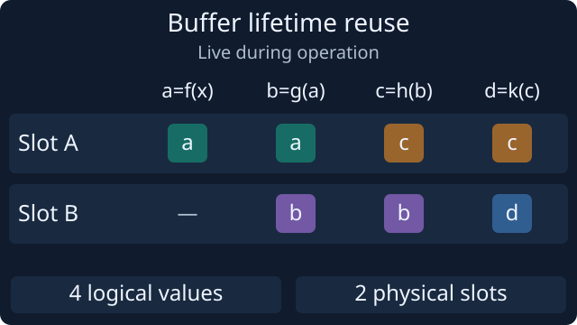
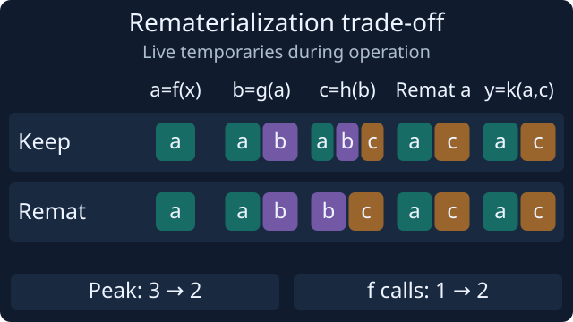

# XLA

XLA（Accelerated Linear Algebra，加速線性代數）是一個開源的機器學習編譯器。它接收模型的圖，加以最佳化，並為特定裝置產生程式碼。官方專案說明它可從 PyTorch、TensorFlow 與 JAX 使用，並由包括 Alibaba、Amazon Web Services、AMD、Apple、Arm、Google、Intel、Meta 與 NVIDIA 在內的硬體與軟體公司共同建立。

!!! info "屬於編譯器與核心程式"
    本方法頁屬於[編譯器與核心程式](index.zh-TW.md)。它詳細說明 XLA；上層頁面則比較它與其他系統。

## 問題

框架會產生一張張量運算的圖。若一次執行一個運算，每個中間結果都要先回到慢速記憶體，下一個運算才能讀取。為每個晶片手動最佳化每個模型無法擴展。XLA 同時處理這兩點：它為裝置編譯整張圖，因此由編譯器決定如何融合。

## 核心想法

把程式擷取為圖，降階到線性代數的中間表示，以一系列遍歷（pass）最佳化該表示，然後為目標後端產生程式碼。官方頁面表示，XLA「運用 MLIR 的能力」，把這些功能整合進單一編譯器工具鏈。後端可以替換，因此同一個前端可以服務 GPU、CPU 與機器學習加速器。

## 流程

1. 框架（例如 JAX）追蹤模型，並把圖交給 XLA。
2. XLA 把圖降階到其中間表示，XLA 文件稱之為 HLO。
3. 一系列最佳化遍歷在該表示上執行。官方頁面描述這些遍歷經過生產環境驗證，並提到模型平行化的自動分割。
4. 後端產生裝置程式碼，編譯後的程式在晶片上執行。

官方頁面連結到一份從 HLO 到可執行檔的流程說明，要了解這些步驟的細節，可以參考該說明。

### 緩衝區配置：最後一次使用後重用

完成排程後，存活區間不重疊的邏輯值可以共用實體緩衝區切片；XLA 的緩衝區配置會利用存活區間與別名資訊，避免覆寫仍需使用的值。[^xla-buffers] 考慮四個大小相同的陣列，固定運算順序為 $a=f(x), b=g(a), c=h(b), d=k(c)$。假設運算沒有副作用、不進行原地別名重用，輸入 $x$ 由外部持有，且運算期間輸入與輸出必須同時存在。

*原創教學動畫，CC BY-SA 4.0。* 橘框標示目前運算，先前欄位保留為歷史紀錄。在 MkDocs 使用支援鍵盤的 **播放／暫停** 控制；偏好減少動態效果時，初始顯示靜態圖。 [GitHub 靜態預覽](../../../assets/concept-animations/xla-buffer-lifetime-reuse-still.svg) · [完整動畫](../../../assets/concept-animations/xla-buffer-lifetime-reuse-motion.svg)。

| 運算 | 緩衝區 A 的存活值 | 緩衝區 B 的存活值 |
|---|---|---|
| a = f(x) | a | — |
| b = g(a) | a | b |
| c = h(b) | c | b |
| d = k(c) | c | d |

$a$ 最後一次使用發生於第二個運算，因此第三個運算可讓 $c$ 重用其空間。同理，第三個運算結束後，$d$ 可以重用 $b$ 的空間。表格包含輸出 $d$，但不包含外部輸入 $x$。在此排程中，四個不同的邏輯值只需要兩個等大的實體緩衝區。這是配置示意，並非 XLA 實際輸出紀錄或 GPU 記憶體實測值。

每欄表示運算**期間**同時存在的值，不是運算結束後仍保留的值。若各陣列大小不同，以 $A,B,C,D$（bytes）表示，圖中的固定雙緩衝區配置需要 $\max(A,C)+\max(B,D)$ 的容量，暫不考慮對齊與配置器額外成本。兩個緩衝區不代表所需位元組數恰為四個獨立緩衝區的一半，因為每個緩衝區必須容納分配給它的最大值。

最小化緩衝區數量不等於最小化其保留容量總和。例如令 $A=D=10$ MiB、$B=C=1$ MiB，圖中的雙緩衝區配置需要保留 20 MiB，即使同時存活值的大小峰值只有 11 MiB。另一種三緩衝區配置讓 $a$ 與 $d$ 共用一個 10 MiB 緩衝區，並為 $b$、$c$ 各配置一個 1 MiB 緩衝區，僅需保留 12 MiB。同時存活的值仍各自占用不同緩衝區。此反例假設固定的整值緩衝區，不考慮對齊成本或子配置，並非預測 XLA 實際配置器的行為。

### 重新計算（Rematerialization）：以額外運算縮短存活區間

XLA 也提供重新計算的最佳化遍歷，以額外運算換取較低的記憶體壓力。[^xla-remat] 修改前例，令 $y=k(a,c)$ 在 $b=g(a)$ 與 $c=h(b)$ 完成後再次需要 $a$。若一直保留 $a$，第三個運算期間就需要三個同時存活的內部陣列。另一種方式是在計算 $b$ 後釋放 $a$，產生 $c$ 後再計算 $a=f(x)$。

*原創教學動畫，CC BY-SA 4.0。* 每個色塊是一個存活的內部陣列；第四欄中 Keep 閒置，只有 Remat 重新計算 a。在 MkDocs 使用 **播放／暫停**，偏好減少動態效果時初始顯示靜態圖。 [GitHub 靜態預覽](../../../assets/concept-animations/xla-rematerialization-liveness-still.svg) · [完整動畫](../../../assets/concept-animations/xla-rematerialization-liveness-motion.svg)。

| 階段 | 保留 | 重新計算 |
|---|---|---|
| 計算 a | a | a |
| 計算 b | a、b | a、b |
| 計算 c | a、b、c | b、c |
| 閒置／重新計算 a | a、c | a、c |
| 計算 y | a、c | a、c |

若每個暫存陣列占 $M$ bytes，內部暫存空間峰值由 $3M$ 降至 $2M$，而 $f$ 的呼叫次數由一次增至兩次。兩種排程皆不計外部持有的輸入 $x$、最終輸出 $y$ 及運算工作空間；運算期間輸入與輸出的暫存值同時存在。因為 $f$ 無副作用且 $x$ 保持不變並可存取，此例可以重新計算。這是固定的示意排程，並非 XLA 實際選擇的排程或記憶體實測值。真實決策取決於運算圖、緩衝區大小、別名、執行排程及成本模型。

若暫存陣列大小不同，以 $A,B,C>0$ 表示，保留排程的峰值為 $A+B+C$，重新計算排程的峰值為 $\max(A+B,B+C,A+C)$。差值為 $\min(A,B,C)$，不一定是 $A$。例如三者大小分別為 10、4、1 MiB，峰值由 15 降至 14 MiB，即使重新計算讓第三個運算不必保留 10 MiB 的 $a$，整體峰值仍會轉移至第二個運算。這是由動畫相同的固定存活集合推導而得；其他排程、對齊、工作空間或額外保留的運算元都可能改變結果。

## 結果

官方頁面描述的是系統本身，並未報告基準測試結果，因此本頁不提供加速倍數。它所作的主張著重於涵蓋範圍：XLA 已與 PyTorch、JAX 及 TensorFlow 整合，並支援 GPU、CPU 與機器學習加速器。

## 限制

- **編譯時間。** 事先編譯會在第一次呼叫時增加延遲，而形狀經常改變的圖會反覆重新編譯。
- **控制力低於手寫核心程式。** 編譯器依自己的規則選擇融合。需要特定分塊的工程師，仍可能需要手寫核心程式，如 [Triton](triton.zh-TW.md) 所示。
- **後端品質不一。** 新後端只有在其遍歷與核心程式成熟後才能達到全速。
- **結果的可攜性。** 速度取決於編譯器版本與後端，因此測量結果無法乾淨地跨堆疊轉移。

## 相關連結

- PyTorch 使用者的替代方案是 [torch.compile 與 TorchInductor](torch-compile.zh-TW.md)，它可以使用 Triton 核心程式。
- 晶片層級的融合討論，見[硬體協同設計](../../hardware/co-design/index.zh-TW.md)頁。
- 最常使用 XLA 的框架 JAX，列於[框架與工具](../index.zh-TW.md)。

## 未解問題

- 自動編譯器在新晶片上，能多接近手寫的注意力核心程式？
- 編譯器應如何處理動態形狀？它在服務中很常見，並會造成反覆編譯。

## 參考文獻

### 開創性論文

- Lattner, C. et al. (2020). *MLIR: A Compiler Infrastructure for the End of Moore's Law*. arXiv:2002.11054. https://arxiv.org/abs/2002.11054 — 描述 MLIR，即 XLA 官方頁面所說其所建立於其上的共用編譯器基礎架構。
- Chen, T. et al. (2018). *TVM: An Automated End-to-End Optimizing Compiler for Deep Learning*. arXiv:1802.04799. https://arxiv.org/abs/1802.04799 — 同樣為多種後端最佳化圖與運算的同期編譯器，可與 XLA 的設計比較。
- Dao, T. et al. (2022). *FlashAttention: Fast and Memory-Efficient Exact Attention with IO-Awareness*. arXiv:2205.14135. https://arxiv.org/abs/2205.14135 — 說明融合核心程式的記憶體搬移論點，編譯器試圖自動重現它。

### 文件與說明

- OpenXLA. *XLA: Optimized compiler for machine learning*. https://openxla.org/xla — XLA 的官方說明，包括其支援的框架、後端與最佳化遍歷。
- PyTorch. *torch.compiler: Compiling PyTorch models*. https://docs.pytorch.org/docs/2.14/user_guide/torch_compiler/torch.compiler.html — torch.compile 及其後端選項的官方 PyTorch 文件，可與 XLA 的做法比較。
- Triton contributors. *Triton documentation*. https://triton-lang.org/main/index.html — 與 XLA 等編譯器互補的手寫核心程式語言之官方文件。

- OpenXLA. *From HLO to Thunks*. https://openxla.org/xla/hlo_to_thunks — 說明緩衝區配置、存活區間與後端降階。
- OpenXLA. *HLO Passes*. https://openxla.org/xla/hlo_passes — 說明重新計算及其他 HLO 最佳化遍歷。

[^xla-buffers]: OpenXLA, *From HLO to Thunks*, https://openxla.org/xla/hlo_to_thunks.
[^xla-remat]: OpenXLA, *HLO Passes*, https://openxla.org/xla/hlo_passes.
