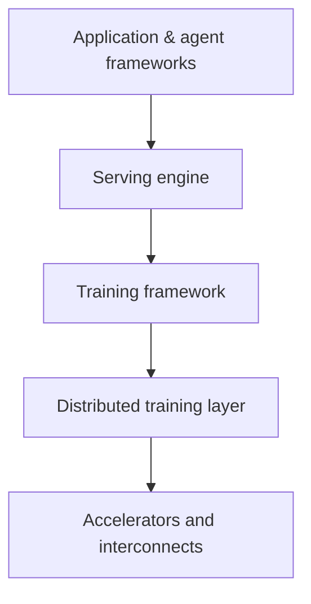

---
related:
- engineering/training
- engineering/mlops
tags:
- engineering
- frameworks
aliases:
- 框架與工具
---

# Frameworks & Tools

A modern ML project uses tools at several layers: a framework to define and train models, a distributed-training layer when one device is not enough, a serving engine for inference, and application frameworks on top. Most choices are reversible within a layer and hard to reverse across layers, so the decision that matters most is how the layers fit together.

## Deep learning frameworks

| Framework | Strengths | Notes |
|---|---|---|
| [PyTorch](https://pytorch.org/) | Dominant in research and increasingly production; eager execution; huge ecosystem; `torch.compile` | Linux Foundation governance |
| [JAX](https://docs.jax.dev/) | Functional transforms (`grad`, `jit`, `vmap`, `pmap`), XLA compilation, excellent on TPUs | Flax, Optax, Equinox |
| [TensorFlow / Keras](https://www.tensorflow.org/) | Mature production tooling (TF Serving, TFLite) | Keras 3 runs on JAX, TF or PyTorch |
| [MLX](https://github.com/ml-explore/mlx) | Apple silicon | On-device experimentation |
| [scikit-learn](https://scikit-learn.org/) | Classical ML | The default for tabular baselines |
| XGBoost, LightGBM, CatBoost | Gradient boosting | Tabular data |

## The Hugging Face ecosystem

- **Hub**: hundreds of thousands of models and datasets
- **transformers**, **diffusers**, **datasets**, **tokenizers**, **accelerate**, **peft**, **trl** (RLHF/DPO), **evaluate**, **smolagents**, **LeRobot**
- `safetensors` as a safe weight format

## Training at scale

| Tool | Purpose |
|---|---|
| PyTorch FSDP, DeepSpeed (ZeRO) | Shard parameters, gradients and optimiser states |
| Megatron-LM / Megatron-Core | Tensor and pipeline parallelism for very large models |
| torchtitan, NeMo | Reference LLM training stacks |
| Ray | Distributed compute and hyperparameter tuning |
| Weights & Biases, MLflow, TensorBoard | Experiment tracking |
| Axolotl, Unsloth, LLaMA-Factory, torchtune | Fine-tuning recipes |

## Inference and serving

| Tool | Notes |
|---|---|
| [vLLM](https://github.com/vllm-project/vllm) | PagedAttention, continuous batching; widely used open serving engine |
| SGLang | Fast serving with structured generation and prefix caching |
| TensorRT-LLM, Triton Inference Server | NVIDIA-optimised |
| llama.cpp / GGUF, Ollama, LM Studio | Local inference on CPUs, Macs, consumer GPUs |
| ONNX Runtime, OpenVINO, Core ML, LiteRT (TFLite), ExecuTorch | Edge and cross-platform deployment |

## LLM application and agent frameworks

- **Orchestration**: LangChain/LangGraph, LlamaIndex, Haystack, DSPy (programmatic prompt optimisation)
- **Agents**: OpenAI Agents SDK, Claude Agent SDK, AutoGen, CrewAI, smolagents
- **Protocols**: Model Context Protocol (MCP) for tools and data; A2A for agent-to-agent communication
- **Structured output**: JSON schema / function calling, Outlines, Instructor
- **Vector databases**: FAISS, pgvector, Qdrant, Weaviate, Milvus, Chroma, LanceDB (see [RAG](../rag/index.md))
- **Observability and evals**: Langfuse, Arize Phoenix, Braintrust, promptfoo, Inspect (UK AISI)

## Domain libraries

- Vision: timm, Ultralytics, Detectron2, MMDetection, OpenCV, Kornia
- Audio: torchaudio, SpeechBrain, ESPnet, NeMo
- Graphs: PyTorch Geometric, DGL
- RL: Gymnasium, Stable-Baselines3, CleanRL, RLlib, TorchRL
- Probabilistic: PyMC, NumPyro, Stan
- Science: DeepChem, RDKit, e3nn, MONAI
- Neuroscience: MNE, Nilearn, Brian2, snnTorch, NEST

## Choosing

- Learning and research → PyTorch (+ Hugging Face)
- TPU-scale or functional style → JAX
- Tabular → scikit-learn + gradient boosting
- Local LLMs → Ollama / llama.cpp; production serving → vLLM or SGLang

## Selection criteria

Tool lists go out of date quickly, so the criteria below are more durable than any single recommendation.

| Criterion | Questions to ask |
|---|---|
| Hardware fit | Does the framework support your accelerators and interconnects at the scale you need? |
| Production path | Is there a tested route from training to serving, with versioned artifacts and rollback? |
| Ecosystem | Are the pretrained models, datasets and integrations you need already maintained? |
| Lock-in | How hard is it to move models or data to another framework? Is the weight format open (for example safetensors)? |
| Maintenance and licence | Is the project actively maintained, and does its licence allow your use? |
| Team skill | Does the team already know the language and style, and how long would the learning curve take? |

## Connections

- Sharding and pipeline strategies behind the training layer are covered in [Distributed Training](../distributed-training/index.md), including [ZeRO](../distributed-training/zero.md) and [PyTorch FSDP](../distributed-training/fsdp.md).
- Serving engines build on the techniques in [Inference Optimization](../inference-optimization/index.md), such as [PagedAttention and vLLM](../inference-optimization/paged-attention.md).
- Deployment practices that sit around these tools are in [MLOps & Deployment](../mlops/index.md).

## Open questions

- How should teams compare frameworks when hardware, model architecture and serving needs change within a year?
- Which interoperability formats, such as safetensors and ONNX, will hold up as models move between training and on-device runtimes?

## References

### Seminal papers

- Paszke, A. et al. (2019). *PyTorch: An Imperative Style, High-Performance Deep Learning Library*. arXiv:1912.01703. https://arxiv.org/abs/1912.01703 — Describes PyTorch's eager, define-by-run design and how it combines flexibility with performance.
- Abadi, M. et al. (2016). *TensorFlow: Large-Scale Machine Learning on Heterogeneous Distributed Systems*. arXiv:1603.04467. https://arxiv.org/abs/1603.04467 — Describes TensorFlow's dataflow graph and its support for heterogeneous devices and distributed execution.
- Pedregosa, F. et al. (2012). *Scikit-learn: Machine Learning in Python*. arXiv:1201.0490. https://arxiv.org/abs/1201.0490 — Presents the scikit-learn library, a consistent API for classical machine-learning algorithms.

### Related work

- Wolf, T. et al. (2019). *HuggingFace's Transformers: State-of-the-art Natural Language Processing*. arXiv:1910.03771. https://arxiv.org/abs/1910.03771 — Describes the Transformers library and its shared model and tokenizer interface.
- Moritz, P. et al. (2017). *Ray: A Distributed Framework for Emerging AI Applications*. arXiv:1712.05889. https://arxiv.org/abs/1712.05889 — A distributed execution framework for training, serving and reinforcement learning workloads.
- Khattab, O. et al. (2023). *DSPy: Compiling Declarative Language Model Calls into Self-Improving Pipelines*. arXiv:2310.03714. https://arxiv.org/abs/2310.03714 — Describes a framework that compiles declarative language-model pipelines and optimises their prompts.
