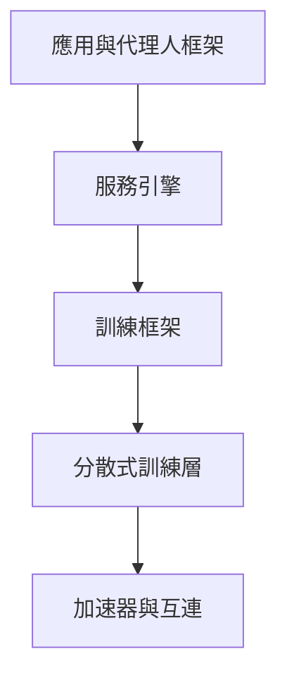

# 框架與工具

一個現代的 ML 專案會在幾個層次使用工具：用框架定義並訓練模型，當單一裝置不夠用時使用分散式訓練層，推論時使用服務引擎，最上層則是應用程式與代理人框架。多數選擇在同一層內還能更換，但跨層的決定很難逆轉，因此最重要的是各層如何搭配。

## 深度學習框架

| 框架 | 優點 | 說明 |
|---|---|---|
| [PyTorch](https://pytorch.org/) | 在研究領域居主導地位，且在正式環境中日益普及；即時執行（eager execution）；生態系龐大；`torch.compile` | 由 Linux Foundation 治理 |
| [JAX](https://docs.jax.dev/) | 函數式轉換（`grad`、`jit`、`vmap`、`pmap`）、XLA 編譯，在 TPU 上表現極佳 | 相關套件：Flax、Optax、Equinox |
| [TensorFlow／Keras](https://www.tensorflow.org/) | 成熟的正式環境工具（TF Serving、TFLite） | Keras 3 可在 JAX、TF 或 PyTorch 上執行 |
| [MLX](https://github.com/ml-explore/mlx) | 適用於 Apple 晶片 | 裝置端實驗 |
| [scikit-learn](https://scikit-learn.org/) | 傳統機器學習 | 表格資料基準方法的預設選擇 |
| XGBoost、LightGBM、CatBoost | 梯度提升 | 表格資料 |

## 編譯器與核心程式

編譯器把模型的計算圖轉為晶片上的程式碼，而核心程式則是一個融合運算的程式碼。[XLA](compilers-and-kernels/xla.zh-TW.md)、[torch.compile 與 TorchInductor](compilers-and-kernels/torch-compile.zh-TW.md) 以及 [Triton](compilers-and-kernels/triton.zh-TW.md) 是主要的系統，並在[編譯器與核心程式](compilers-and-kernels/index.zh-TW.md)頁面中比較。

## Hugging Face 生態系

- **Hub**：數十萬個模型與資料集
- **transformers**、**diffusers**、**datasets**、**tokenizers**、**accelerate**、**peft**、**trl**（RLHF／DPO）、**evaluate**、**smolagents**、**LeRobot**
- 以 `safetensors` 作為安全的權重格式

## 大規模訓練

| 工具 | 用途 |
|---|---|
| PyTorch FSDP、DeepSpeed（ZeRO） | 分片參數、梯度與優化器狀態 |
| Megatron-LM／Megatron-Core | 超大模型的張量與管線平行 |
| torchtitan、NeMo | LLM 訓練的參考技術堆疊 |
| Ray | 分散式運算與超參數調校 |
| Weights & Biases、MLflow、TensorBoard | 實驗追蹤 |
| Axolotl、Unsloth、LLaMA-Factory、torchtune | 微調配方 |

## 推論與服務化

| 工具 | 說明 |
|---|---|
| [vLLM](https://github.com/vllm-project/vllm) | PagedAttention、連續批次處理；廣泛使用的開源服務引擎 |
| SGLang | 快速服務，支援結構化生成與前綴快取 |
| TensorRT-LLM、Triton Inference Server | 針對 NVIDIA 最佳化 |
| llama.cpp／GGUF、Ollama、LM Studio | 在 CPU、Mac 與消費級 GPU 上進行本地推論 |
| ONNX Runtime、OpenVINO、Core ML、LiteRT（TFLite）、ExecuTorch | 邊緣與跨平台部署 |

## LLM 應用與代理人框架

- **編排**：LangChain／LangGraph、LlamaIndex、Haystack、DSPy（程式化的提示最佳化）
- **代理人**：OpenAI Agents SDK、Claude Agent SDK、AutoGen、CrewAI、smolagents
- **協定**：用於工具與資料的 Model Context Protocol（MCP）；用於代理人之間通訊的 A2A
- **結構化輸出**：JSON schema／函式呼叫、Outlines、Instructor
- **向量資料庫**：FAISS、pgvector、Qdrant、Weaviate、Milvus、Chroma、LanceDB（見 [RAG](../rag/index.md)）
- **可觀測性與評估**：Langfuse、Arize Phoenix、Braintrust、promptfoo、Inspect（英國 AISI）

## 領域函式庫

- 視覺：timm、Ultralytics、Detectron2、MMDetection、OpenCV、Kornia
- 音訊：torchaudio、SpeechBrain、ESPnet、NeMo
- 圖：PyTorch Geometric、DGL
- 強化學習：Gymnasium、Stable-Baselines3、CleanRL、RLlib、TorchRL
- 機率：PyMC、NumPyro、Stan
- 科學：DeepChem、RDKit、e3nn、MONAI
- 神經科學：MNE、Nilearn、Brian2、snnTorch、NEST

## 如何選擇

- 學習與研究 → PyTorch（加上 Hugging Face）
- TPU 規模或偏好函數式風格 → JAX
- 表格資料 → scikit-learn 加梯度提升
- 本地 LLM → Ollama／llama.cpp；正式環境服務 → vLLM 或 SGLang

## 選擇標準

工具清單很快就會過時，因此下面的標準比任何單一推薦都更持久。

| 標準 | 應該問的問題 |
|---|---|
| 硬體適配 | 框架是否支援你的加速器與互連，且達到所需的規模？ |
| 正式環境路徑 | 從訓練到服務是否有經過測試的路線，包含有版本的產物與回滾？ |
| 生態系 | 你需要的預訓練模型、資料集與整合是否已有人維護？ |
| 鎖定程度 | 把模型或資料搬到另一個框架有多困難？權重格式是否開放（例如 safetensors）？ |
| 維護與授權 | 專案是否仍在積極維護，其授權是否允許你的用途？ |
| 團隊技能 | 團隊是否已熟悉語言與風格，學習曲線有多長？ |

## 相關連結

- 訓練層背後的分片與管線策略見[分散式訓練](../distributed-training/index.zh-TW.md)，包括 [ZeRO](../distributed-training/zero.zh-TW.md) 與 [PyTorch FSDP](../distributed-training/fsdp.zh-TW.md)。
- 服務引擎建立在[推論最佳化](../inference-optimization/index.zh-TW.md)的技術上，例如 [PagedAttention 與 vLLM](../inference-optimization/paged-attention.zh-TW.md)。
- 圍繞這些工具的部署做法見 [MLOps 與部署](../mlops/index.zh-TW.md)。

## 開放問題

- 當硬體、模型架構與服務需求在一年內改變時，團隊應如何比較框架？
- 當模型在訓練與裝置端執行環境之間移動時，safetensors 與 ONNX 等互通格式能否持續可靠？

## 參考文獻

### 重要論文

- Paszke, A. et al. (2019). *PyTorch: An Imperative Style, High-Performance Deep Learning Library*. arXiv:1912.01703. https://arxiv.org/abs/1912.01703 — 描述 PyTorch 即時執行、邊執行邊定義圖的設計，以及它如何兼顧彈性與效能。
- Abadi, M. et al. (2016). *TensorFlow: Large-Scale Machine Learning on Heterogeneous Distributed Systems*. arXiv:1603.04467. https://arxiv.org/abs/1603.04467 — 描述 TensorFlow 的資料流圖，以及它對異質裝置與分散式執行的支援。
- Pedregosa, F. et al. (2012). *Scikit-learn: Machine Learning in Python*. arXiv:1201.0490. https://arxiv.org/abs/1201.0490 — 介紹 scikit-learn 函式庫，為經典機器學習演算法提供一致的 API。

### 相關工作

- Wolf, T. et al. (2019). *HuggingFace's Transformers: State-of-the-art Natural Language Processing*. arXiv:1910.03771. https://arxiv.org/abs/1910.03771 — 描述 Transformers 函式庫，以及其共用的模型與 tokenizer 介面。
- Moritz, P. et al. (2017). *Ray: A Distributed Framework for Emerging AI Applications*. arXiv:1712.05889. https://arxiv.org/abs/1712.05889 — 用於訓練、服務與強化學習工作負載的分散式執行框架。
- Khattab, O. et al. (2023). *DSPy: Compiling Declarative Language Model Calls into Self-Improving Pipelines*. arXiv:2310.03714. https://arxiv.org/abs/2310.03714 — 描述一個編譯宣告式語言模型流程並最佳化其提示的框架。
