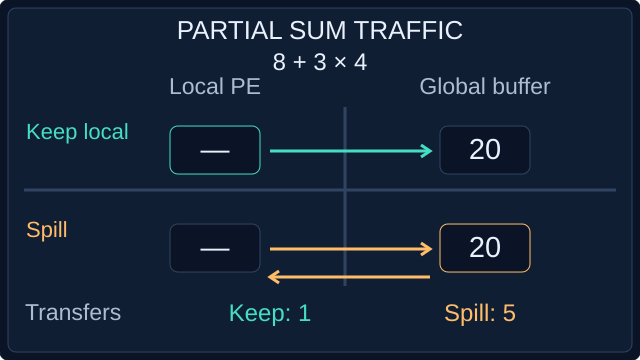
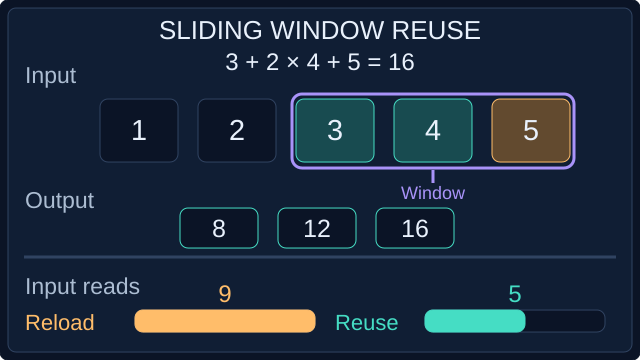

---
related:
  - engineering/hardware/co-design
  - engineering/hardware/memory-hierarchy
  - theory/model-compression/quantisation
tags:
  - hardware
  - accelerators
  - energy efficiency
last_reviewed: 2026-11-01
aliases:
  - Efficient Processing of Deep Neural Networks
  - Sze tutorial
  - 深度神經網路的高效處理
---

# Efficient Processing of Deep Neural Networks (Sze et al., 2017)

Sze, Chen, Yang and Emer (2017) give a tutorial and survey on how to process deep neural networks efficiently in hardware. Their main claim is that the cost of a network on an accelerator is set less by the arithmetic than by how often data is moved, and that the design of the dataflow decides how much movement there is (Sze et al., 2017).

## Overview

Deep networks deliver high accuracy at a high computational cost. The tutorial asks how to improve energy efficiency and throughput without sacrificing accuracy or increasing hardware cost. It covers the architecture of processing elements, the memory hierarchy they use, and the dataflows that schedule computation across them (Sze et al., 2017).

The paper is organised as a tutorial first and a survey second. It explains the operations a convolutional layer requires, then compares the design choices that accelerators make, and finally discusses how algorithmic compression, such as pruning and quantisation, interacts with hardware (Sze et al., 2017).

## Key concepts

- **Processing element (PE)**: a small unit that performs multiply-accumulate operations, usually with a local register file for storage.
- **Memory hierarchy**: the layers of storage between a PE and off-chip DRAM. Each layer trades capacity for speed and energy per access.
- **Data reuse**: using a value fetched from memory for several operations, so that it need not be fetched again.
- **Dataflow**: the order in which a PE array computes outputs and which operands stay local while others stream in.

## Energy and data movement

The tutorial's central quantitative point is that moving data costs far more energy than computing with it. The paper states that DRAM accesses require up to several orders of magnitude higher energy than computation, and that fetching from a register file or a neighbouring PE costs one or two orders of magnitude less than DRAM (Sze et al., 2017, Section V-B, Figure 22). Each multiply-accumulate in a convolution needs three reads (weight, input activation and partial sum) and one write (the updated partial sum) (Figure 21).

Because of this gap, the important question is how often each value is read from far away. A design that reuses data locally spends its energy budget on computation. A design that streams data from DRAM spends it on movement.

## Dataflows

The paper compares four dataflows for convolutional layers (Section V-B, Figure 25):

- **Weight stationary (WS)**: keeps weights in the register file and maximises their reuse.
- **Output stationary (OS)**: keeps the partial sums for one output in the local register file until they are complete.
- **No local reuse (NLR)**: allocates no local storage to each PE and gives the area to the global buffer instead.
- **Row stationary (RS)**: maximises reuse and accumulation in the register file for all three data types.

In the paper's comparison on AlexNet convolutional layers at batch size 16, row stationary has the lowest total energy consumption. The paper reports that it uses 1.4 to 2.5 times less energy than the other dataflows, and it notes that WS and OS are best for their own data types while NLR has the lowest DRAM energy but high global-buffer energy (Section V-B.4, Figure 33).

### Animated example: partial-sum traffic

*Original educational animation, CC BY-SA 4.0. The website offers Play/Pause with keyboard controls; GitHub readers can open the [static preview](../../../assets/concept-animations/dnn-output-stationary-traffic-still.svg) and [full animation](../../../assets/concept-animations/dnn-output-stationary-traffic-motion.svg).*

For one output, let the three input-weight products be $1\times2$, $2\times3$ and $3\times4$. Both schedules perform the same three MACs, in the same order. The top lane retains the partial sum in a PE until the final result is written; the bottom lane writes the sum to a global buffer after every MAC and reads it back before the next MAC. The arrows summarize transfers during each step (read before compute, write after compute), not simultaneous or cycle-accurate traffic. A dash means the value is not retained at that boundary.

| Completed MACs | Partial sum | Keep local: transfers | Spill: transfers |
| --- | --- | --- | --- |
| 0 | 0 | 0 | 0 |
| 1 | 2 | 0 | 1 |
| 2 | 8 | 0 | 3 |
| 3 | 20 | 1 | 5 |

These counts include the final output write in both cases and exclude weight and activation movement. They are illustrative element transfers between the PE and global buffer, not DRAM accesses, measured energy, or a general comparison of complete dataflows.

For a reduction of $K\geq 1$ MACs with a zero-initialized accumulator and no intermediate eviction, keeping the sum local needs one final write. Spilling after every MAC needs $K$ writes and $K-1$ reads, or $2K-1$ transfers. This comparison assumes both schedules write the completed output to the same global buffer; it is not a total-memory-traffic model.

### Animated example: overlapping convolution windows

*Original educational animation, CC BY-SA 4.0. The website offers Play/Pause with keyboard controls; GitHub readers can open the [static preview](../../../assets/concept-animations/dnn-sliding-window-reuse-still.svg) and [full animation](../../../assets/concept-animations/dnn-sliding-window-reuse-motion.svg).*

For valid stride-one cross-correlation with input $[1,2,3,4,5]$ and kernel $[1,2,1]$, the three output values are 8, 12 and 16. The first window loads three values; each subsequent window retains two and loads one. Orange cells marked New are newly loaded; teal cells marked Keep are retained from the previous window. The purple outline identifies the current operands, and the coefficients directly below them show which kernel weight multiplies each input. Reusing an activation does not mean reusing its product: input 3, for example, is multiplied by 1, then 2, then 1 as the window advances.

| Window | Output | Reload all: input reads | Retain overlap: input reads |
| --- | --- | --- | --- |
| 1 | 8 | 3 | 3 |
| 2 | 12 | 6 | 4 |
| 3 | 16 | 9 | 5 |

Both schedules perform nine MACs. This idealized local-window example excludes weight reads and output writes, and illustrates only activation reuse, not the full row-stationary mapping or a measured energy/speed improvement. It complements the partial-sum example: different loop orders and local storage capacities determine which operand can be reused. See the dataflow discussion in Sze et al. (2017).

## Eyeriss

The paper uses Eyeriss, a row-stationary accelerator, as its worked example. The design consists of a 14 by 12 array of processing elements and a 108 KB global buffer. It adds ReLU and feature-map compression units and uses replication and folding to keep the array busy (Section V-B.4, Figure 31). The energy advantage quoted above comes from a simulated 256-PE architecture, not from the fabricated chip (Sze et al., 2017).

## Connections

- [Hardware co-design](../co-design/index.md) takes this idea further by changing the model and the hardware together.
- [Memory hierarchy](../memory-hierarchy/index.md) explains why data movement dominates, and [AI and the memory wall](../memory-hierarchy/ai-and-memory-wall.md) argues that it increasingly limits large models.
- [Quantisation](../../../theory/model-compression/quantisation/index.md) reduces the number of bits moved, which compounds with dataflow choices.

## Applications

The paper's concerns apply to any accelerator that runs convolutional or dense layers, from data-centre chips to embedded vision processors. The dataflow analysis is most directly relevant to designers choosing a PE array layout.

## Open questions

- How to choose a dataflow automatically for layers whose shapes differ from those in the paper's benchmark.
- How the energy trade-offs change as memory technologies and precisions change.

## References

### Seminal papers

- Sze, V., Chen, Y.-H., Yang, T.-J. & Emer, J. S. (2017). *Efficient Processing of Deep Neural Networks: A Tutorial and Survey*. arXiv. https://arxiv.org/abs/1703.09039 — A tutorial and survey of DNN accelerator design, with the energy and dataflow analysis discussed on this page.
- Chen, Y.-H., Krishna, T., Emer, J. S. & Sze, V. (2017). *Eyeriss: An Energy-Efficient Reconfigurable Accelerator for Deep Convolutional Neural Networks*. IEEE Journal of Solid-State Circuits, 52(1), 127–138. https://doi.org/10.1109/JSSC.2016.2616357 — The row-stationary accelerator used as the paper's worked example.
- Horowitz, M. (2014). *1.1 Computing's energy problem (and what we can do about it)*. ISSCC, pp. 10–14. https://doi.org/10.1109/ISSCC.2014.6757323 — An early account of how much more energy memory accesses cost than arithmetic.
- Han, S., Pool, J., Tran, J. & Dally, W. J. (2015). *Learning both Weights and Connections for Efficient Neural Networks*. arXiv. https://arxiv.org/abs/1506.02626 — Pruning that reduces the work and storage a hardware design must handle.
- Jacob, B., Kligys, S., Chen, B. et al. (2017). *Quantization and Training of Neural Networks for Efficient Integer-Arithmetic-Only Inference*. arXiv. https://arxiv.org/abs/1712.05877 — Integer-only inference, which lets accelerators use cheaper arithmetic.
