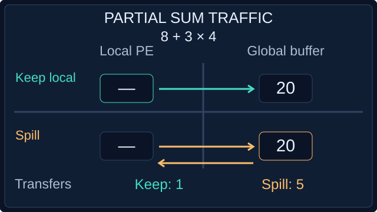
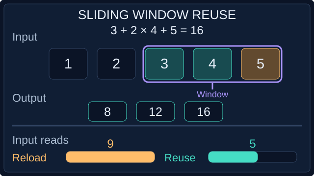

---
related:
  - engineering/hardware/co-design
  - engineering/hardware/memory-hierarchy
  - theory/model-compression/quantisation
tags:
  - hardware
  - accelerators
  - energy efficiency
last_reviewed: 2026-11-01
translation_reviewed: 2026-11-01
aliases:
  - Efficient Processing of Deep Neural Networks
  - Sze tutorial
  - 深度神經網路的高效處理
---

# 深度神經網路的高效處理（Sze et al., 2017）

Sze、Chen、Yang 與 Emer（2017）綜述了如何在硬體上高效處理深度神經網路，兼具教學與綜述的性質。他們的主要論點是：網路在加速器上的成本，取決於資料搬移的次數，而非算術運算本身；而資料流的設計決定了搬移的多寡（Sze et al., 2017）。

## 概觀

深度網路能提供很高的準確率，但運算成本也很高。這份教學探討如何在不犧牲準確率、也不增加硬體成本的前提下，提升能源效率與吞吐量。內容涵蓋處理單元的架構、它們使用的記憶體階層，以及在它們之間排程運算的資料流（Sze et al., 2017）。

論文先以教學的方式說明卷積層所需的運算，接著比較加速器的設計選擇，最後討論剪枝與量化等演算法壓縮如何與硬體互動（Sze et al., 2017）。

## 關鍵概念

- **處理單元（PE）**：執行乘加運算的小型單元，通常有本地的暫存器檔案。
- **記憶體階層**：處理單元與晶片外 DRAM 之間的多層儲存。每一層在容量、速度與每次存取的能耗之間各有取捨。
- **資料重用**：把從記憶體取來的一個值用於多次運算，使它不必再次被取用。
- **資料流（dataflow）**：PE 陣列計算輸出的順序，以及哪些運算元留在本地、哪些串流進來。

## 能量與資料搬移

這份教學最核心的量化觀點是：搬移資料的能耗遠高於運算本身。論文指出，DRAM 存取的能耗可能高出運算數個數量級，而從暫存器檔案或相鄰 PE 取值，能耗比 DRAM 低一到兩個數量級（Sze et al., 2017，第 V-B 節，圖 22）。卷積中的每一次乘加需要三次讀取（權重、輸入活化值與部分和）與一次寫入（更新後的部分和）（圖 21）。

由於這個落差，關鍵問題在於每個值從遠處讀取的頻率。若設計在本地重用資料，能耗主要花在運算上；若設計不斷從 DRAM 串流資料，能耗則主要花在搬移上。

## 資料流

論文比較了卷積層的四種資料流（第 V-B 節，圖 25）：

- **權重固定（WS）**：把權重保留在暫存器檔案中，最大化權重的重用。
- **輸出固定（OS）**：把同一個輸出的部分和保留在本地暫存器檔案中，直到完成。
- **無本地重用（NLR）**：不為每個 PE 分配本地儲存，而把面積改給全域緩衝區。
- **列固定（RS）**：在暫存器層級最大化三種資料的重用與累加。

在論文以批次大小 16 對 AlexNet 卷積層進行的比較中，列固定的總能耗最低。論文報告，它的能耗比其他資料流低 1.4 到 2.5 倍，並指出 WS 與 OS 分別對其所屬的資料類型最有利，而 NLR 的 DRAM 能耗最低，但全域緩衝區的能耗很高（第 V-B.4 節，圖 33）。

### 動畫示例：部分和搬移

*原創教學動畫，CC BY-SA 4.0。網站提供播放／暫停及鍵盤操作；GitHub 可查看 [靜態預覽](../../../assets/concept-animations/dnn-output-stationary-traffic-still.svg) 與 [完整動畫](../../../assets/concept-animations/dnn-output-stationary-traffic-motion.svg).*

以單一輸出為例，三個輸入與權重的乘積分別為 $1\times2$、$2\times3$ 與 $3\times4$。兩種排程以相同順序完成三次乘加。上列將部分和保留在處理單元（PE）內，直到寫出最終結果；下列則在每次乘加後將部分和寫回全域緩衝區，並在下一次乘加前重新讀取。箭頭摘要各步驟的搬移（先讀取、再運算、最後寫回），不代表同時發生或週期精確的傳輸。破折號代表該階段結束時未在該處保留數值。

| 已完成乘加 | 部分和 | 本地保留：搬移次數 | 寫回：搬移次數 |
| --- | --- | --- | --- |
| 0 | 0 | 0 | 0 |
| 1 | 2 | 0 | 1 |
| 2 | 8 | 0 | 3 |
| 3 | 20 | 1 | 5 |

兩種計數皆包含最終輸出寫入，但不包含權重與激活值的搬移。這些數值是 PE 與全域緩衝區間的示意元素搬移次數，不是 DRAM 存取、實測能耗或完整資料流的通用比較。

對於包含 $K\geq 1$ 次乘加的歸約運算，假設累加器初始為零且中途不被逐出，本地保留只需一次最終寫入；每次乘加後寫回則需 $K$ 次寫入及 $K-1$ 次讀取，合計 $2K-1$ 次搬移。兩種排程均假設將完成的輸出寫入同一全域緩衝區，這並非總記憶體流量模型。

### 動畫示例：重疊卷積視窗

*原創教學動畫，CC BY-SA 4.0。網站提供播放／暫停及鍵盤操作；GitHub 可查看 [靜態預覽](../../../assets/concept-animations/dnn-sliding-window-reuse-still.svg) 與 [完整動畫](../../../assets/concept-animations/dnn-sliding-window-reuse-motion.svg).*

以輸入 $[1,2,3,4,5]$ 與卷積核 $[1,2,1]$ 進行步幅為一、無填補的互相關運算，三個輸出分別為 8、12、16。第一個視窗讀入三個值，後續每個視窗保留兩個值並讀入一個新值。橘色 New 標示新讀入的輸入，藍綠色 Keep 標示從前一個視窗保留的輸入。紫色外框標示目前運算元，下方對齊的係數顯示各輸入所乘的卷積核權重。重用激活值不等於重用乘積：例如輸入 3 隨視窗移動，依序乘上 1、2、1。

| 視窗 | 輸出 | 全部重讀：輸入讀取 | 保留重疊：輸入讀取 |
| --- | --- | --- | --- |
| 1 | 8 | 3 | 3 |
| 2 | 12 | 6 | 4 |
| 3 | 16 | 9 | 5 |

兩種排程皆執行九次乘加。此理想化的本地視窗示例不包含權重讀取及輸出寫入，只示範激活值重用，並非完整的列固定映射，也不是實測能耗或加速結果。它與部分和範例互補：迴圈順序及本地儲存容量決定了可以重用的運算元。詳見 Sze et al.（2017）的資料流討論。

## Eyeriss

論文以 Eyeriss 為實例說明，它是一個列固定加速器。設計包含 14 乘 12 的處理單元陣列與 108 KB 的全域緩衝區，並加上 ReLU 與特徵圖壓縮單元，透過複製與摺疊來維持陣列的使用率（第 V-B.4 節，圖 31）。前面引用的能耗優勢來自一個模擬的 256 個 PE 架構，而非實際製造的晶片（Sze et al., 2017）。

## 相關連結

- [硬體協同設計](../co-design/index.md) 進一步同時改變模型與硬體。
- [記憶體階層](../memory-hierarchy/index.md) 說明為何資料搬移佔主導，而 [AI 與記憶體牆](../memory-hierarchy/ai-and-memory-wall.md) 論證它對大型模型的限制日益加重。
- [量化](../../../theory/model-compression/quantisation/index.md) 減少搬移的位元數，這與資料流的選擇相互加成。

## 應用

論文的關切適用於任何執行卷積層或全連接層的加速器，從資料中心晶片到嵌入式視覺處理器都包括在內。資料流分析對於選擇 PE 陣列配置的設計者最直接相關。

## 未解問題

- 如何為形狀與論文基準不同的層，自動選擇資料流。
- 當記憶體技術與精度改變時，能耗的取捨會如何變化。

## 參考文獻

### 開創性論文

- Sze, V., Chen, Y.-H., Yang, T.-J. & Emer, J. S. (2017). *Efficient Processing of Deep Neural Networks: A Tutorial and Survey*. arXiv. https://arxiv.org/abs/1703.09039 — 關於深度神經網路加速器設計的教學與綜述，本頁討論的能耗與資料流分析即出自此文。
- Chen, Y.-H., Krishna, T., Emer, J. S. & Sze, V. (2017). *Eyeriss: An Energy-Efficient Reconfigurable Accelerator for Deep Convolutional Neural Networks*. IEEE Journal of Solid-State Circuits, 52(1), 127–138. https://doi.org/10.1109/JSSC.2016.2616357 — 論文用來說明的列固定加速器。
- Horowitz, M. (2014). *1.1 Computing's energy problem (and what we can do about it)*. ISSCC, pp. 10–14. https://doi.org/10.1109/ISSCC.2014.6757323 — 早期說明記憶體存取能耗遠高於算術運算的文獻。
- Han, S., Pool, J., Tran, J. & Dally, W. J. (2015). *Learning both Weights and Connections for Efficient Neural Networks*. arXiv. https://arxiv.org/abs/1506.02626 — 剪枝減少硬體設計必須處理的運算與儲存。
- Jacob, B., Kligys, S., Chen, B. et al. (2017). *Quantization and Training of Neural Networks for Efficient Integer-Arithmetic-Only Inference*. arXiv. https://arxiv.org/abs/1712.05877 — 純整數推論，讓加速器能使用成本較低的運算。
