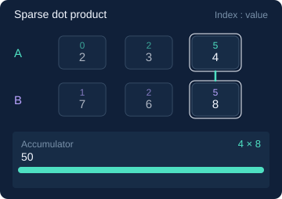

# Eyeriss v2

Eyeriss v2 is a research accelerator for emerging neural networks on mobile devices, designed by Chen et al. It keeps the reuse of data that makes spatial accelerators efficient, adds a flexible on-chip network, and processes compressed, sparse weights and activations directly. The abstract reports that on sparse MobileNet at batch size one it reaches 12.6 times the throughput and 2.5 times the energy efficiency of the original Eyeriss. It is an [AI accelerator](../index.md) built for compact and sparse models rather than dense matrix work.

## Problem

Compact models such as MobileNet are small and often sparse, so a chip built for dense matrix multiplication spends work on zeros, and its data movement does not match the varying reuse of different layers. The target setting is mobile inference at batch size one, where one input is processed at a time.

## Core idea

Organise the processing elements in a hierarchical mesh network, so that the on-chip routing adapts to the different reuse patterns and bandwidth needs of weights, activations and partial sums. Store and process compressed sparse data directly, so that zero values are skipped instead of multiplied.

## Equation or algorithm

The chip computes the convolutions of a layer with a dataflow chosen to reuse each operand as much as possible. For sparse data, the processing elements receive only the non-zero values together with their indices, so zero products can be avoided; actual execution cost also includes index handling and data movement. The mesh routes these values to the elements that need them.

### Animated explanation: matching compressed sparse operands

*Original educational animation, CC BY-SA 4.0.* [GitHub-readable still](../../../../assets/concept-animations/sparse-index-intersection-still.svg) · [Full SVG animation](../../../../assets/concept-animations/sparse-index-intersection-motion.svg). The website offers keyboard-accessible Play/Pause; Pause restores the representative still, and reduced-motion preference defaults to the still.

A schematic sparse dot product makes the index-handling cost visible. Let two length-six vectors have nonzero entries $A=\{0:2,2:3,5:4\}$ and $B=\{1:7,2:6,5:8\}$. Each row stores its nonzero indices in sorted order, above the associated values. Compare the current indices (white outlines): if unequal, advance only the smaller one (orange link); if equal, multiply and add to the accumulator (teal link), then advance both. The four comparisons are $(0,1),(2,1),(2,2),(5,5)$. Only indices 2 and 5 contribute, so the accumulator moves from 0 to 18 to 50. A dense loop would attempt six products; this particular merge evaluates two nonzero products but also needs index comparisons and metadata. This is an abstract example of avoiding zero products, not a cycle-accurate reconstruction of Eyeriss v2's compressed-sparse-column processing element (Chen et al., 2018). The counts and values are illustrative, not measured throughput or energy.

## Key methods

Two landmark designs show the trade-off between a fixed dense dataflow and a flexible one.

- [Eyeriss v2 (Chen et al., 2018)](index.md): described on this page. A flexible mesh network that processes compressed sparse models directly, aimed at mobile devices.
- [First-generation TPU (Jouppi et al., 2017)](../tpu/index.md): a fixed systolic dataflow for dense matrix products, with 8-bit integer arithmetic and inference only.

## Results

The abstract reports that, on sparse MobileNet at batch size one in a 65 nm CMOS process, Eyeriss v2 achieves a throughput of 1470.6 inferences per second and 2560.3 inferences per joule. Compared with the original Eyeriss running MobileNet, it is reported as 12.6 times faster and 2.5 times more energy efficient. The paper's conclusion states these as throughput and energy-efficiency improvements.

## Limitations

The design is a research chip evaluated on a specific process and network family, so its results do not transfer directly to other process nodes or models. A flexible mesh network generally needs more area and control logic than a fixed systolic array. That is a design trade-off in general terms, not a figure from the paper.

## Open questions

- **Sparsity support.** Whether the benefit of skipping zeros holds for less sparse or differently structured models is open.
- **Related designs.** The [TPU](../tpu/index.md) uses a fixed systolic dataflow for dense matrix work, which is the contrasting design.
- **Compression.** Sparsity in the models comes from compression methods such as [pruning](../../../../theory/model-compression/pruning/index.md), so the hardware benefit depends on those methods.

## Connections

The mobile-device setting connects this design to on-device models, discussed under [AI hardware](../../index.md) and in the [model compression](../../../../theory/model-compression/index.md) pages on the edge.

## References

### Seminal papers

- Chen, Y.-H., et al. (2018). *Eyeriss v2: A Flexible Accelerator for Emerging Deep Neural Networks on Mobile Devices*. arXiv:1807.07928. https://arxiv.org/abs/1807.07928 — Reports 12.6 times the throughput and 2.5 times the energy efficiency of the original Eyeriss on sparse MobileNet.
- Jouppi, N. P., et al. (2017). *In-Datacenter Performance Analysis of a Tensor Processing Unit*. arXiv:1704.04760. https://arxiv.org/abs/1704.04760 — The fixed-dataflow contrast, with a systolic array for dense inference.

### Surveys and textbooks

- Sze, V., Chen, Y.-H., Yang, T.-J., Emer, J. S. (2017). *Efficient Processing of Deep Neural Networks: A Tutorial and Survey*. arXiv:1703.09039. https://arxiv.org/abs/1703.09039 — Surveys the dataflow and sparsity techniques that this design builds on.

### Articles and documentation

- Gholami, A., et al. (2024). *AI and Memory Wall*. arXiv:2403.14123. https://arxiv.org/abs/2403.14123 — Argues that memory bandwidth, not compute, limits serving large models on server hardware, the pressure that data-reuse designs such as this one respond to.
- Dao, T., et al. (2022). *FlashAttention: Fast and Memory-Efficient Exact Attention with IO-Awareness*. arXiv:2205.14135. https://arxiv.org/abs/2205.14135 — A software-side example of reducing memory traffic.
