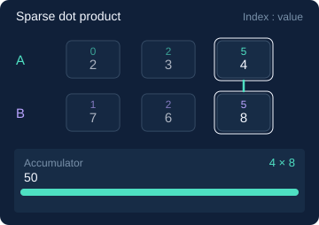

# Eyeriss v2

Eyeriss v2 是 Chen 等人為行動裝置上的新興神經網路設計的研究型加速器。它保留了讓空間式加速器有效率的資料重用，加入可彈性配置的晶片內網路，並直接處理壓縮後的稀疏權重與激活值。摘要報告，在批次大小為一的稀疏 MobileNet 上，它的吞吐量是原始 Eyeriss 的 12.6 倍，能源效率是其 2.5 倍。它是為緊湊且稀疏的模型而設計的 [AI 加速器](../index.zh-TW.md)，而非用於稠密矩陣工作。

## 問題

MobileNet 這類緊湊模型體積小，且常是稀疏的。為稠密矩陣乘法設計的晶片會把工作花在零值上，而且它的資料搬移無法配合各層不同的重用模式。本設計的目標情境是行動推論，批次大小為一，即一次只處理一個輸入。

## 核心想法

把處理單元組織成階層式網狀網路，讓晶片內的路由能適應權重、激活值與部分和各自不同的重用模式與頻寬需求。直接儲存並處理壓縮的稀疏資料，因此跳過零值而不是把它們相乘。

## 公式或演算法

晶片以盡量重用每個運算元的資料流，計算某層的卷積。對稀疏資料而言，處理單元只接收非零值及其索引，因此可避免零值乘法；但實際執行成本也包含索引處理與資料搬移。網狀網路把這些數值路由到需要它們的單元。

### 動態解說：壓縮稀疏運算元的索引配對

*原創教學動畫，CC BY-SA 4.0。* [GitHub 靜態預覽](../../../../assets/concept-animations/sparse-index-intersection-still.svg) · [完整 SVG 動畫](../../../../assets/concept-animations/sparse-index-intersection-motion.svg)。網站提供鍵盤可操作的播放／暫停；暫停時回到代表性靜態圖，系統偏好減少動態效果時預設使用靜態圖。

以下稀疏內積示意可看出索引處理的成本。假設兩個長度為六的向量，其非零項為 $A=\{0:2,2:3,5:4\}$ 與 $B=\{1:7,2:6,5:8\}$。每列依序儲存非零項索引，下方為對應數值。比較目前索引（白框）：若不同，僅推進較小索引（橘色連線）；若相同，將乘積加到累加器（藍綠色連線），再同時推進兩者。四次比較依序為 $(0,1),(2,1),(2,2),(5,5)$。只有索引 2 與 5 有貢獻，故累加器從 0 變成 18 再變成 50。稠密迴圈會嘗試六次乘法；這個合併演算法只計算兩個非零乘積，但仍有索引比較與中繼資料的成本。這是避免零值乘法的抽象示意，不是 Eyeriss v2 壓縮稀疏欄（compressed sparse column）處理單元的週期精確重現（Chen 等人，2018）。數值與次數皆為示意，不是實測吞吐量或能耗。

## 關鍵方法

兩個具代表性的設計，展示了固定稠密資料流與彈性設計之間的取捨。

- [Eyeriss v2（Chen 等人，2018）](index.zh-TW.md)：在本頁說明。以彈性的網狀網路直接處理壓縮的稀疏模型，目標是行動裝置。
- [第一代 TPU（Jouppi 等人，2017）](../tpu/index.zh-TW.md)：為稠密矩陣乘積採用固定的脈動資料流，使用 8 位元整數運算，且只做推論。

## 結果

摘要報告，在批次大小為一、65 奈米 CMOS 製程的稀疏 MobileNet 上，Eyeriss v2 每秒可完成 1470.6 次推論，每焦耳可完成 2560.3 次推論。相較於原始 Eyeriss 執行同一網路，它被報告為快 12.6 倍、能源效率高 2.5 倍。論文結論將其表述為吞吐量與能源效率的提升。

## 限制

此設計是研究晶片，只在特定製程與網路家族上評估，因此結果不能直接套用到其他製程節點或模型。彈性的網狀網路，通常比固定的脈動陣列需要更多面積與控制邏輯。這是一般性的設計取捨，並非論文中的數字。

## 開放問題

- **稀疏支援。** 跳過零值的效益，對稀疏程度較低或結構不同的模型是否仍然成立，尚待確認。
- **相關設計。** [TPU](../tpu/index.zh-TW.md)為稠密矩陣工作使用固定的脈動資料流，是相對的設計。
- **壓縮。** 模型中的稀疏性來自[剪枝](../../../../theory/model-compression/pruning/index.zh-TW.md)等壓縮方法，因此硬體效益取決於這些方法。

## 相關連結

行動裝置的情境把這個設計與裝置端模型連在一起，相關討論見 [AI 硬體](../../index.zh-TW.md)，以及[模型壓縮](../../../../theory/model-compression/index.zh-TW.md)中關於邊緣的頁面。

## 參考文獻

### 開創性論文

- Chen, Y.-H., 等人 (2018). *Eyeriss v2: A Flexible Accelerator for Emerging Deep Neural Networks on Mobile Devices*. arXiv:1807.07928. https://arxiv.org/abs/1807.07928 — 在稀疏 MobileNet 上，相較原始 Eyeriss 報告 12.6 倍吞吐量與 2.5 倍能源效率。
- Jouppi, N. P., 等人 (2017). *In-Datacenter Performance Analysis of a Tensor Processing Unit*. arXiv:1704.04760. https://arxiv.org/abs/1704.04760 — 以脈動陣列做稠密推論的固定資料流對照。

### 綜述與教科書

- Sze, V., Chen, Y.-H., Yang, T.-J., Emer, J. S. (2017). *Efficient Processing of Deep Neural Networks: A Tutorial and Survey*. arXiv:1703.09039. https://arxiv.org/abs/1703.09039 — 綜述本設計所依據的資料流與稀疏技術。

### 文章與文件

- Gholami, A., 等人 (2024). *AI and Memory Wall*. arXiv:2403.14123. https://arxiv.org/abs/2403.14123 — 主張在伺服器硬體上服務大型模型時，記憶體頻寬而非運算是限制，正是本設計這類重用資料的做法所回應的壓力。
- Dao, T., 等人 (2022). *FlashAttention: Fast and Memory-Efficient Exact Attention with IO-Awareness*. arXiv:2205.14135. https://arxiv.org/abs/2205.14135 — 軟體端減少記憶體流量的例子。
