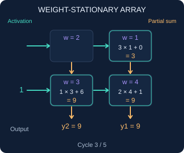

# 張量處理單元

張量處理單元（TPU）是 Google 為神經網路推論設計的特殊應用晶片，核心是一個由乘加單元組成的大型脈動陣列。Jouppi 等人描述第一代 TPU，並報告它執行神經網路推論時，速度約為當時 CPU 與 GPU 的 15 至 30 倍，每瓦效能約高出 30 至 80 倍。它是 [AI 加速器](../index.zh-TW.md)的一種，設計原則是為稠密矩陣乘法採用固定資料流。

## 問題

資料中心規模的神經網路推論，主要是少數運算元類型的矩陣乘法。通用處理器把大部分能量花在指令擷取、控制與記憶體搬移上，而非算術運算，因此每次推論的成本主要由這些額外開銷決定。

## 核心想法

以一個大型矩陣單元為核心設計晶片，讓資料流過由乘加單元組成的網格。每個權重只載入一次，並在許多輸入之間重複使用；每個激活值則從一個單元傳到下一個單元，因此大多數數值只從記憶體讀取一次。控制邏輯很小，晶片在每個週期執行相同的運算。

## 公式或演算法

核心運算是矩陣乘積 \(Y = XW\)。在大小為 \(n \times n\) 的脈動陣列中，每個單元把其儲存的權重乘上進入的激活值，並把結果加到傳給鄰居的部分和上。第一代晶片包含一個 256 × 256 的乘加單元陣列，可對帶號或無號整數執行 8 位元乘加運算，這是論文架構一節的描述。因此，大小為 \(m \times k\) 乘以 \(k \times n\) 的層能讓陣列保持忙碌，而記憶體流量很少。這個晶片以數值精度換取吞吐量。

### 動畫解說：權重固定的波前

*原創教學動畫，CC BY-SA 4.0。* [GitHub 靜態預覽](../../../../assets/concept-animations/tpu-systolic-wavefront-still.svg) · [完整 SVG 動畫](../../../../assets/concept-animations/tpu-systolic-wavefront-motion.svg)。網站提供可用鍵盤操作的播放／暫停；暫停會回到代表性靜態圖，減少動態效果偏好預設顯示靜態圖。

使用示意的 $2\times2$ 權重區塊，兩列分別為 $(2,1)$、$(3,4)$，輸入為 $x_1=(1,2)$ 與 $x_2=(3,1)$。各單元保留紫色權重；藍綠色箭頭表示激活值向右傳遞，橘色箭頭表示部分和向下傳遞，亮框單元執行當下顯示的乘加。第二列比第一列晚一個週期接收輸入，每往右一欄再延遲一個週期。以從零起算的列 $r$、欄 $j$ 與輸入索引 $m$ 表示，單元於週期 $t=m+r+j$ 運作（圖中週期從一開始）。底列在第 2–4 週期依序輸出 $x_1W=(8,9)$ 與 $x_2W=(9,7)$ 的各分量；第 5 週期僅保留完整輸出供閱讀，不代表額外運算週期。此理想化排程假設權重已載入且無停滯，用於說明權重固定原理（Jouppi 等人，2017），而非週期精確的 TPU 模擬或使用率實測。

## 關鍵方法

兩個具代表性的設計，展示了固定稠密資料流與較有彈性的設計之間的取捨。

- **第一代 TPU（Jouppi 等人，2017）：** 在本頁說明。它採用針對稠密矩陣乘積的固定脈動資料流，使用 8 位元整數運算，且只做推論。
- [Eyeriss v2（Chen 等人，2018）](../eyeriss-v2/index.zh-TW.md)：以彈性的晶片內網路處理壓縮與稀疏模型，目標是行動裝置。

## 結果

摘要報告，TPU 的速度約為當時 GPU 與 CPU 的 15 至 30 倍，每瓦 TOPS 約高出 30 至 80 倍。比較對象是 Intel Haswell CPU 與 Nvidia K80 GPU，且使用當時的工作負載，因此數字只適用於那些工作負載。作者也指出，若 TPU 採用當時 GPU 的 GDDR5 記憶體，其實際達成的 TOPS 大約會增為三倍。

## 限制

固定的資料流適合稠密矩陣工作，不規則或稀疏的運算則較難對應到它上面。論文只涵蓋第一代晶片，這是一個只做推論的晶片，因此其結果不描述之後的世代。這類比較取決於所用的工作負載與軟體堆疊。

## 開放問題

- **稀疏工作負載。** 脈動設計能否在不損失效率的情況下利用稀疏性，是開放的設計問題。[Eyeriss v2](../eyeriss-v2/index.zh-TW.md)以不同的方式處理它。
- **記憶體頻寬。** 論文自己的假設性比較顯示，限制晶片的是記憶體，而非矩陣單元。Gholami 等人在下方引用的記憶體牆分析中，針對大型模型的服務提出相同的觀點。
- **相關設計。** GPU 內的矩陣單元，也就是張量核心，扮演類似的角色，但控制結構較有彈性。

## 相關連結

TPU 的運算叢集透過晶片間網路連接，[AI 硬體](../../index.zh-TW.md)概觀中的擴展討論依賴於此。它的稠密矩陣設計，也是[Transformer](../../../../theory/models/transformer/index.zh-TW.md)層特別適合它的原因。

## 參考文獻

### 開創性論文

- Jouppi, N. P., 等人 (2017). *In-Datacenter Performance Analysis of a Tensor Processing Unit*. arXiv:1704.04760. https://arxiv.org/abs/1704.04760 — 描述第一代 TPU，並報告其速度與每瓦 TOPS 分別約為當時 CPU 與 GPU 的 15 至 30 倍與 30 至 80 倍。
- Chen, Y.-H., 等人 (2018). *Eyeriss v2: A Flexible Accelerator for Emerging Deep Neural Networks on Mobile Devices*. arXiv:1807.07928. https://arxiv.org/abs/1807.07928 — 以彈性的晶片內網路利用稀疏性的對照設計，並以精簡模型評估。
- Dao, T., 等人 (2022). *FlashAttention: Fast and Memory-Efficient Exact Attention with IO-Awareness*. DOI:10.48550/arXiv.2205.14135. https://doi.org/10.48550/arXiv.2205.14135 — 展示減少記憶體層級之間的資料搬移，如何加速加速器上的精確注意力。

### 綜述與教科書

- Sze, V., Chen, Y.-H., Yang, T.-J., Emer, J. S. (2017). *Efficient Processing of Deep Neural Networks: A Tutorial and Survey*. arXiv:1703.09039. https://arxiv.org/abs/1703.09039 — 綜述使稠密矩陣工作變得高效的架構與資料流。

### 文章與文件

- Gholami, A., 等人 (2024). *AI and Memory Wall*. arXiv:2403.14123. https://arxiv.org/abs/2403.14123 — 主張在伺服器硬體上服務大型 Transformer 時，記憶體頻寬而非運算，正成為主要限制。
