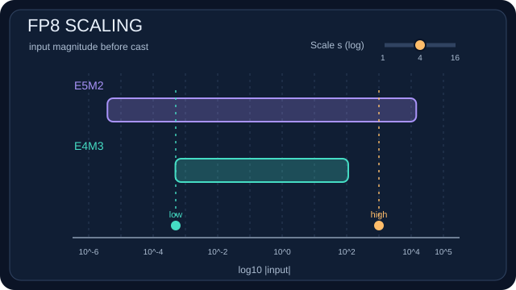
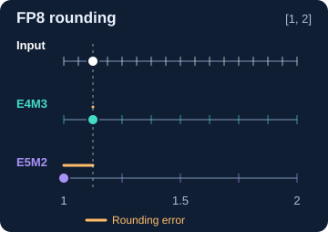
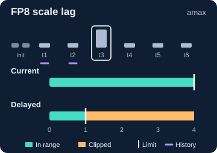

# 深度學習的 FP8 格式

FP8 是一種用於深度學習的 8 位元浮點格式。Micikevicius 等人（2022）提出它的兩種編碼，E4M3 與 E5M2，並報告以它們進行訓練與推論，其結果實質上與 16 位元訓練相當，且不需更改超參數。它是[混合精度訓練](mixed-precision.zh-TW.md)之後的下一步；混合精度把數值從 32 位元降到 16 位元。現在每個數值的位元組數又減半，在[協同設計總覽](index.zh-TW.md)中，它是訓練端最積極的數值格式槓桿。

## 問題

以 16 位元儲存與搬移數值，已使搬移的流量減為 32 位元的一半。8 位元格式再把流量減半，這在記憶體頻寬限制速度時特別重要，正如[記憶體階層](../memory-hierarchy/index.zh-TW.md)頁面所描述。但只有 8 個位元，格式必須在範圍（由指數決定）與精度（由尾數決定）之間分配位元，而沒有一種切分方式適合所有張量。因此論文定義了兩種切分不同的編碼。

## 關鍵概念

- **E4M3：** 4 個指數位元與 3 個尾數位元。它的精度較高，範圍較小。論文透過不表示無窮大，並讓 NaN 只使用單一位元型態，來擴展它的動態範圍。它的最大正規數為 448。
- **E5M2：** 5 個指數位元與 2 個尾數位元。它的範圍較大，精度較低，並遵循 IEEE 754 對特殊值的慣例。它的最大正規數為 57,344。
- **縮放因子：** 在轉換為 FP8 之前乘在張量上的數字，使張量的最大量值接近該格式的最大值。仍然溢位的數值會飽和到該最大值。

## 關鍵方法

### 以 E4M3 與 E5M2 進行 FP8 訓練（Micikevicius 等人，2022）

- **問題：** 8 位元格式必須在範圍與精度之間分配位元，而且溢位比 16 位元常見得多。
- **核心想法：** 權重與激活值使用 E4M3，梯度使用 E5M2，每個張量各有一個縮放因子。矩陣乘法與卷積的輸入捨入為 FP8，運算仍以 16 位元或更高精度進行。
- **公式：** 每個張量以 \(x_{\text{FP8}} = \mathrm{cast}(s \cdot x)\) 轉換，其中 \(s\) 的選擇使張量的最大量值接近格式上限：E4M3 為 448，E5M2 為 57,344。
- **結果：** 多數模型的 FP8 訓練結果，在多次執行的變異範圍內與 16 位元相當。1750 億參數的模型以訓練進行到 75% 時比較，困惑度為 6.68，bfloat16 基準為 6.65。
- **限制：** 實驗以軟體模擬 FP8，論文把縮放啟發式方法留給實作決定。16 位元的補救方法，即溢位時跳過更新，並不適合 FP8。

## 運作方式

論文以模擬的方式進行 FP8 訓練：把每次矩陣乘法與卷積的輸入捨入為 FP8。運算以 16 位元或 bfloat16 進行，輸出則保留在較高精度。在此設定下，論文建議權重與激活值使用 E4M3，而範圍較寬的激活梯度使用 E5M2。

縮放在軟體中完成。每個張量在轉換前乘上一個縮放因子，有些網路需要為每個張量分別設定因子。論文也指出，16 位元混合精度訓練中遇到溢位時跳過權重更新的做法，不適合用於 FP8，因為在這個寬度下溢位要常見得多。

### 動態解說：縮放如何移動 FP8 的可表示區間

*原創教學動畫，CC BY-SA 4.0。GitHub 顯示[靜態 SVG](../../../assets/concept-animations/fp8-scale-range-still.svg)；網站提供播放／暫停與鍵盤水平捲動。* [完整 SVG 動畫](../../../assets/concept-animations/fp8-scale-range-motion.svg)。

色帶界定經過 $s\lvert x\rvert$ 縮放後，**正量值**中可表示的非零有限數之上下界，再換算回原始輸入單位。假設支援次正規數（subnormal），E4M3 的區間為 $[2^{-9}/s,448/s]$，E5M2 為 $[2^{-16}/s,57344/s]$。當**人工設定**的 $s$ 由 1 連續升至 16 再返回時，兩個區間沿對數軸向左移；縮放滑桿亦採對數刻度，中點為 $s=4$。實心色帶僅是範圍包絡，不表示其中每個實數皆可精確表示。兩個固定示意輸入是 $\lvert x_{\mathrm{low}}\rvert=5\times10^{-4}$ 與 $\lvert x_{\mathrm{high}}\rvert=10^3$。增加 $s$ 能讓較小的輸入落入 E4M3 非零範圍，但更多大值也會超出其有限上限。E5M2 色帶較寬僅比較**動態範圍**，並未表示量化格點、捨入誤差或模型準確率；實際下溢及溢位行為亦取決於轉換規則。

### 動態解說：兩種 FP8 格點的捨入差異

*原創教學動畫，CC BY-SA 4.0。* [GitHub 靜態圖](../../../assets/concept-animations/fp8-rounding-grid-still.svg) · [完整 SVG 動畫](../../../assets/concept-animations/fp8-rounding-grid-motion.svg)。網站可播放／暫停；暫停會回到代表性靜態圖，而非凍結當前影格。

這個例子只考慮單一正規指數區間，縮放係數為 1，並明確採用最接近值捨入、平手取偶數（round-to-nearest, ties-to-even）。依照有效數位的配置，E4M3 在 $[1,2]$ 的間距為 $2^{-3}=1/8$，E5M2 則為 $2^{-2}=1/4$。[^fp8-grid] 輸入樣本為 $x=1+i/16$，$i=0,\ldots,16$。輸出標記跳至對應格點；橘線長度代表 $|Q(x)-x|$。當 $x=1.125$ 時，E4M3 能精確保留該值，E5M2 則將中點捨入至 1；當 $x=1.0625$ 時，兩者皆捨入至 1。在這個取樣指數區間內，兩種格式的最大絕對捨入誤差分別為 $1/16$ 與 $1/8$。這些是數學示意值，不是硬體或模型實測；不同指數區間、次正規數與其他轉換規則會有不同結果。

[^fp8-grid]: Micikevicius 等人（2022），第 3 節，[FP8 Formats for Deep Learning](https://arxiv.org/abs/2209.05433)。格點範例與捨入規則為本圖的示意設定。

### 動態解說：即時縮放與延遲縮放

*原創教學動畫，CC BY-SA 4.0。* [GitHub 靜態圖](../../../assets/concept-animations/fp8-delayed-amax-still.svg) · [完整 SVG 動畫](../../../assets/concept-animations/fp8-delayed-amax-motion.svg)。播放／暫停與減少動態效果的回退顯示沿用網站共用播放器。

實務上的縮放策略可使用當前張量的最大量值，或以先前記錄的最大量值估計縮放係數。[^fp8-delayed] 在此人工例子中，令 $a_t=\max|x_t|$ 依序為 $(1,1,4,1,1,1)$，並令 $H_t=\max(a_{t-2},a_{t-1})$，初始兩筆歷史值均為 1。對格式最大值 $F$，理想化即時縮放係數為 $F/a_t$，延遲縮放則為 $F/H_t$。因此，換算回原始輸入單位的量值上限（白線）分別是 $a_t$ 與 $H_t$。第 3 步的延遲上限為 1，但觀察到的最大量值為 4；若採飽和轉換，量值大於 1 的元素會被截斷至上限。第 4、5 步的延遲上限仍為 4，當前量值僅需要上限的四分之一；第 6 步突增值移出歷史視窗。橘色長度表示超過上限的量值區間，不代表被截斷的元素比例。此例假設最大量值為正、縮放運算精確、無安全餘裕，且歷史只保留兩筆以利教學；並非效能測試、模型準確率結論或特定函式庫更新時序的精確重現。

[^fp8-delayed]: NVIDIA，[FP8 Delayed Scaling](https://docs.nvidia.com/deeplearning/transformer-engine/features/low_precision_training/fp8_delayed_scaling/fp8_delayed_scaling.html)。說明依據歷史量值選擇縮放係數，以及量化與張量讀取的取捨。

## 結果

論文報告，在多種影像與語言任務上，FP8 訓練的結果實質上與 16 位元訓練相當，且超參數不變。涵蓋的模型包括卷積網路、循環網路與 Transformer，其中語言模型最大達 1750 億參數。

對於 1750 億參數的模型，FP8 訓練達到的困惑度為 6.68，而 bfloat16 基準為 6.65。這個比較取自訓練進行到 75% 時，因為基準尚未完成。論文報告，MobileNet v2 是唯一結果超出多次執行變異範圍的視覺模型。

論文也把 FP8 用於訓練後量化，對象是那些無法良好量化為 8 位元整數的語言模型。把一個 13 億參數 GPT 模型的殘差連接，以單一指數偏移量化後，困惑度升至 12.59，而基準為 10.19。改用逐張量校準後降至 10.44。

## 限制

- **是模擬，而非原生。** 訓練實驗以軟體模擬 FP8，並未使用真正的 FP8 硬體，因此速度上的主張需要另外測量。
- **縮放不在論文範圍內。** 論文把縮放因子的啟發式方法與捨入模式留給實作決定。
- **張量範圍。** 主要實驗只量化了矩陣乘法與卷積的輸入，把更多張量改為 FP8 留作未來工作。對於影像模型，第一個卷積層與最後一個全連接層也被量化。
- **對格式選擇敏感。** 有些網路需要逐張量縮放，而不是共用的指數偏移，因此單一配方無法涵蓋所有模型。

## 開放問題

- **哪些張量能使用 FP8。** 論文沒有回答，訓練中其餘部分（例如最佳化器狀態與歸約運算）能在不損失品質的情況下改用 FP8 的比例有多少。
- **視覺模型的差距。** MobileNet v2 的結果究竟是真實效應還是雜訊，論文中尚未確定。
- **硬體支援。** FP8 能提供多少加速取決於晶片，因此[加速器](../accelerators/index.zh-TW.md)的比較十分重要。

## 相關連結

FP8 延伸了[混合精度訓練](mixed-precision.zh-TW.md)的想法，後者在單精度保留主權重，並對損失進行縮放。它所節省的位元組，正是[記憶體階層與頻寬](../memory-hierarchy/index.zh-TW.md)所描述的流量；低位元格式在推論端的應用，則見[量化](../../../theory/model-compression/quantisation/index.zh-TW.md)。

## 參考文獻

### 開創性論文

- Micikevicius, P., 等人 (2022). *FP8 Formats for Deep Learning*. arXiv:2209.05433. https://arxiv.org/abs/2209.05433 — 定義 E4M3 與 E5M2 編碼，並報告在多達 1750 億參數的模型上，FP8 訓練實質上與 16 位元結果相當。
- Micikevicius, P., 等人 (2017). *Mixed Precision Training*. arXiv:1710.03740. https://arxiv.org/abs/1710.03740 — 提出以主權重與損失縮放進行 16 位元訓練，FP8 訓練即建立於此之上。

### 綜述與教科書

- Sze, V., Chen, Y.-H., Yang, T.-J., Emer, J. S. (2017). *Efficient Processing of Deep Neural Networks: A Tutorial and Survey*. arXiv:1703.09039. https://arxiv.org/abs/1703.09039 — 綜述 DNN 硬體的能量效率與吞吐量，並涵蓋硬體與演算法的共同設計。

### 文章與文件

- NVIDIA. *FP8 Delayed Scaling*. https://docs.nvidia.com/deeplearning/transformer-engine/features/low_precision_training/fp8_delayed_scaling/fp8_delayed_scaling.html — 說明依據歷史量值選擇縮放係數、張量讀取及截斷。

- Krishnamoorthi, R. (2018). *Quantizing deep convolutional networks for efficient inference: A whitepaper*. arXiv:1806.08342. https://arxiv.org/abs/1806.08342 — 顯示推論端的整數對應做法：逐通道的 8 位元量化能讓許多 CNN 維持在浮點數 2% 以內的準確度。
- Gholami, A., 等人 (2024). *AI and Memory Wall*. arXiv:2403.14123. https://arxiv.org/abs/2403.14123 — 主張記憶體而非運算已成為 AI 應用（尤其是服務）的主要瓶頸，而低位元格式正是為了緩解這項壓力。
