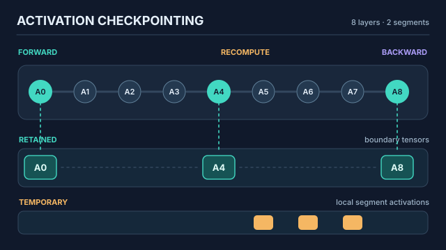
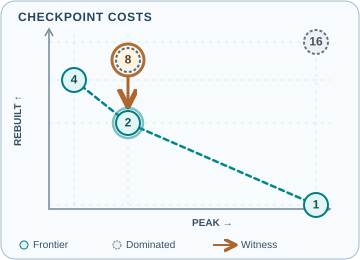
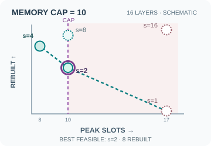

# Gradient Checkpointing

Gradient checkpointing trades computation for memory during training. The forward pass keeps only some intermediate activations, and the backward pass recomputes the rest when they are needed. Chen et al. (2016) show that for a chain of n layers, the memory for stored feature maps can fall to about O(√n), at the cost of roughly one extra forward pass per mini-batch. It sits in the [co-design overview](index.md) next to [mixed-precision training](mixed-precision.md), as a lever that trades one resource for another.

## Problem

Backpropagation needs the activations from the forward pass, so training stores them until the backward pass uses them. For deep networks this storage grows with depth, and it often limits the batch size or model that fits on a device well before compute runs out. Chen et al. report that, before their change, a 1,000-layer residual network trained on ImageNet needed about 48 GB.

## Key concepts

- **Checkpoint:** an activation kept in memory after the forward pass.
- **Segment:** the layers between two checkpoints. Their internal activations are discarded.
- **Recomputation:** rerunning a segment's forward pass during the backward pass, starting from its stored checkpoint, to rebuild the activations needed for that segment's gradients.

## Key methods

### Sublinear-memory checkpointing (Chen et al., 2016)

- **Problem:** backpropagation stores the activations of every layer, so memory grows with depth.
- **Core idea:** store activations only at about √n segment boundaries, and recompute each segment's forward pass during the backward pass.
- **Equations:** for n layers, the stored activations need O(√n) memory, at about one extra forward pass per mini-batch. A recursive variant reaches O(log n) memory at an extra O(n log n) forward computation.
- **Results:** for a 1,000-layer residual network on ImageNet, memory falls from 48 GB to 7 GB at about 30% extra running time.
- **Limitations:** the bound counts stored feature maps, so parameters and optimiser state lie outside it. The extra forward pass slows training, and the computation graph must be split into segments.

## How it works

The paper's √n scheme works as follows:

1. Split the n layers into about √n segments.
2. In the forward pass, store only the outputs at the segment boundaries, and discard every other activation.
3. In the backward pass, go from the last segment to the first. For each segment, rerun its forward pass from the stored boundary, compute its gradients, and then free its activations.

The stored feature maps then take about √n boundary tensors, plus the activations of the largest segment while it is being recomputed. That gives O(√n) memory, at the cost of about one extra forward pass per mini-batch.
The paper also describes a recursive version, in which each segment is handled by the same strategy. Memory then grows as O(log n), but the extra forward computation rises to O(n log n), which is far more expensive than the √n scheme.

### Activation storage and recomputation: animated walkthrough

*Original continuous teaching animation, CC BY-SA 4.0.* The illustrative eight-layer chain keeps boundary tensors **A0, A4 and A8** (cyan). After the forward sweep, each segment's discarded internal activations (amber) are reconstructed from its preceding checkpoint, starting with **A5–A7** and then **A1–A3** during the reverse traversal. The amber cursor recomputes each segment forward before the violet cursor performs its backward traversal; temporary internal activations are released after that segment finishes. The violet cursor represents **backward processing**, not an optimisation step. Three persistent boundary tensors out of nine are shown **only as a schematic storage example**, not as peak device memory: temporary recomputation buffers, gradients, parameters and optimiser states also occupy memory. On MkDocs, the existing Play/Pause button supports keyboard operation and reduced-motion preferences; the image can scroll horizontally on narrow displays. [View the complete SVG animation](../../../assets/concept-animations/checkpoint-recompute-motion.svg) · [GitHub-readable still](../../../assets/concept-animations/checkpoint-recompute-still.svg).

### Choosing checkpoint intervals: the memory trade-off

*Original computational SVG animation and GitHub-safe comparison, CC BY-SA 4.0.* For a **constructed chain of 16 equal-size layers**, let the segment length $s$ divide 16. Keep boundary activations $A_0,A_s,\ldots,A_{16}$ until backward processing needs them, and rebuild at most $s-1$ discarded internal activations for one segment. In this deliberately simplified retention model, the maximum simultaneous *activation slots* is

$$
M(s)=\left(\frac{16}{s}+1\right)+(s-1)=\frac{16}{s}+s.
$$

At $s=1,2,4,8,16$, the persistent checkpoint counts are **17, 9, 5, 3, 2**, the temporary internal counts are **0, 1, 3, 7, 15**, and the peak totals are **17, 10, 8, 10, 17**. Thus $s=4$ minimizes this *five-choice example*, illustrating the square-root balance described by Chen et al. (2016), already listed in References. It is **not a GPU peak-memory measurement**: it excludes gradients, parameters, optimiser state, unequal activation sizes, allocator effects, and the compute-time cost of replaying segments. The optimum can change for a nonuniform graph.

The animated **TOTAL REBUILT** readout makes the separate recomputation cost visible. If each segment reconstructs its $s-1$ internal activations once during the backward sweep, the cumulative number of recreated internal activation tensors across the 16-layer chain is

$$
B(s)=\frac{16}{s}(s-1)=16-\frac{16}{s}.
$$

For $s=1,2,4,8,16$, this gives **0, 8, 12, 14, 15** rebuilt tensors in total. The **REBUILD** bar instead counts the *maximum simultaneously live temporary slots in one segment* (**0, 1, 3, 7, 15**). Neither number is a measured FLOP count or runtime: real recomputation can execute additional layer operations and incur framework-specific overhead. This is an illustrative storage-versus-recreation comparison, not a benchmark.

The animation changes the checkpoint boundaries, the stored/rebuilt slot counts, and the active point on the cost curve together. **An amber bracket highlights only the last segment currently being replayed**: at $s=4$, it spans four layers, while the REBUILD count of three refers to the internal activations temporarily needed for that one segment. At $s=1$ every layer boundary is retained, so the bracket disappears: no internal activations are replayed. An amber cursor now sweeps from left to right along the bracket during each nontrivial segment size, indicating forward recomputation **inside one segment**, not a simultaneous replay of all segments or a backward-gradient cursor. The bracket, growing trace and cursor are spatial/temporal explanations, not additional activation allocations. The orange trace fills only the active segment as the forward replay cursor advances, resetting for each segment-length choice; it does not represent the total number of tensors rebuilt across all segments. **Small amber dots now appear at internal boundaries only after the replay cursor passes them**: there are three temporary reconstructed boundaries at $s=4$, fifteen at $s=16$, and none at $s=1$. These are **recreated temporary activations**, not newly retained checkpoints; the teal dots remain the persistent boundaries. **The live KEEP and REBUILD counters, together with the new PEAK SLOTS addition equation, expose the decomposition at each step**: at $s=4$, five persistent boundaries plus three temporary internal activations yield eight peak slots. These counters refer to activation tensors, not bytes or measured GPU memory. On MkDocs, **Previous/Next Step** selects the five segment sizes, the seek slider reveals intermediate forward replay, and **Play/Pause**, **Restart** (return directly to the first spacing choice), and 0.5×/1×/2× speed control the sequence. Switching to another browser tab automatically pauses the animation so intermediate replay states are not silently skipped; returning does not resume it automatically. The controls stay outside the horizontally scrollable figure on narrow screens. A bilingual synchronized readout beneath the controls distinguishes the **peak temporary slots in one segment** from **TOTAL REBUILT across all segments** and tracks reconstructed activations within the highlighted final segment; these are **illustrative tensor counts, not measured GPU memory or FLOPs**. Seeking or using Previous/Next Step also announces the selected state to assistive technology. The timeline slider itself exposes the current illustrative spacing and peak/rebuild counts as its accessible value rather than an arbitrary 0–1000 position. Reduced-motion users see the $s=4$ state, while the GitHub fallback compares **all five** choices without JavaScript. Switching the system's reduced-motion preference while this page is open changes between the still fallback and interactive timeline without requiring a reload. Focus the figure region to scroll with the keyboard. [GitHub static comparison](../../../assets/concept-animations/checkpoint-spacing-still.svg) · [Animated SVG](../../../assets/concept-animations/checkpoint-spacing-motion.svg).

**Compare two checkpoint choices (MkDocs).** Use **Pin A** to freeze the current spacing as a baseline, then seek or step to another spacing, **B**. The A/B comparison reports both **PEAK** (simultaneous illustrative activation slots) and **TOTAL REBUILT** (all reconstructed internal boundaries), plus signed **B − A** differences. For example, from s=1 to s=4, peak slots decrease **17 → 8** while total reconstructed boundaries increase **0 → 12**; this is a *memory-versus-recomputation trade-off*, not measured GPU usage or wall-clock time. **Swap A/B** exchanges the pinned baseline and the current timeline state, so the signed **B − A** deltas reverse (s=4 versus s=1 changes ΔPEAK from −9 to +9 and ΔTOTAL REBUILT from +12 to −12). **Replace A** updates the baseline, and **Clear A** removes the comparison. Buttons work with keyboard focus and Enter; the comparison is hidden in reduced-motion mode, where the GitHub-readable still gives all five choices. The paired A/B bar gauges now animate the two trade-off quantities on **fixed, shared domains** (PEAK 0–17 illustrative slots, TOTAL REBUILT 0–15), so visual bar lengths remain comparable before and after swapping; the adjacent numbers are the exact values, not GPU measurements.

**Interpret the A/B verdict.** The synchronized comparison now distinguishes a memory–recomputation **trade-off** from **equal aggregate costs** and **dominance on both illustrated costs**. For example, `s=8` (PEAK 10, TOTAL REBUILT 14) is dominated by `s=4` (PEAK 8, TOTAL REBUILT 12) in this equal-activation, two-metric toy model. It does **not** establish an optimal real-world checkpoint schedule; tensor lifetimes, recomputation FLOPs and runtime overhead are excluded.

**Pareto dominance in the toy cost plane.** One choice dominates another when it is no worse on both PEAK and TOTAL REBUILT, and strictly better on at least one. Thus `s=2` dominates `s=8`: both peak at 10 slots, but the reconstructed totals are 8 versus 14. Equal peak memory is not a trade-off when replay strictly worsens. Among the **five sampled spacings**, `s=1,2,4` form the **Pareto frontier**: none is dominated by another sampled setting, whereas `s=8,16` are dominated. The live interpretation announces this five-choice classification as the timeline advances; `s=4` minimizes PEAK alone, not both costs simultaneously. This criterion covers illustrative counts, not measured GPU memory, time or optimal placement.

**Count the forward work as well as memory.** This synthetic 16-layer chain executes the original 16 forward layers once, then re-executes the \(B(s)=16-16/s\) internal layers during checkpoint replay. Its resulting **forward-layer evaluations** (initial pass + replay) are **16, 24, 28, 30, 31** for \(s=1,2,4,8,16\). The live readout and A/B difference now track this third, derived count. It excludes backward operations and says nothing about FLOPs, time or the cost of unequal layers; it is not a measured compute benchmark. More evaluations explain *why* the plotted memory optimum alone is insufficient for a hardware decision.

**Try a guided A/B comparison (MkDocs).** The native keyboard-accessible **Try a worked comparison…** menu loads two reproducible states and pauses playback: **s=1 → s=4** demonstrates reduced activation storage at the cost of additional reconstructions, while **s=8 → s=4** demonstrates dominance within this *two-metric synthetic model*. Two additional presets expose a less obvious distinction: **s=2 → s=8** has equal peak storage (**10 → 10 slots**) but raises total rebuilt activations (**8 → 14**), and **s=1 → s=16** likewise has equal peak storage (**17 → 17**) while raising reconstructed activations (**0 → 15**). Under these deliberately limited two costs, equal memory does not imply equal recomputation; the smaller-replay choice dominates, although the model says nothing about measured latency. A is pinned and B is shown on the timeline; you can still **Swap A/B**, replace the pin or seek to another B. Menu selections never run an optimizer or measure hardware. **Sweep A→B** scans the fixed illustrative choices from the pinned A to the selected B in about three seconds at 1×, showing every intermediate SVG state and synchronized comparison before stopping at B. The scan works in both directions, respects playback speed, and can be interrupted with Pause, seeking or reduced-motion mode. It is a parameter-space visual scan, **not** an actual forward/backward pass or timing benchmark.

**Interactive Pareto map (MkDocs).** Below the same controlled 16-layer SVG, a two-cost plane plots the **five sampled checkpoint spacings**, with **PEAK** activation slots on the horizontal axis and **TOTAL REBUILT** activations on the vertical axis (both increase along their arrows). The solid, connected choices **s=1, 2, 4** form the nondominated frontier; **s=8, 16** are dashed because another sampled choice uses no more of either cost and strictly less of at least one. Each numbered point is a native keyboard-operable button: selecting it pauses playback and seeks the existing SVG to that spacing, updating the peak/replay counts and any pinned A/B comparison. A ring marks the current spacing and an amber halo marks pinned A, in addition to the accessible numerical state; the connecting line is **not** a continuous optimization trajectory between sampled configurations. The diagram does not estimate GPU latency, actual memory bytes or performance beyond these five artificial configurations. Its SVG/GitHub fallback remains the reviewed five-choice static comparison.

**Dominance witness (MkDocs).** When the selected point is dominated (s=8 or s=16), a short **amber arrow** points toward the sampled s=2 configuration that dominates it. At s=8, both configurations have PEAK 10 while s=2 rebuilds only 8 rather than 14 activations. At s=16, moving to s=2 reduces both PEAK (17 → 10) and TOTAL REBUILT (15 → 8). At s=1, 2, or 4, no dominance arrow is drawn: none of these three is dominated *within the five-choice set*. This is one explicit witness, not a unique optimal setting, a continuous optimisation trajectory, or a GPU measurement. Its numeric justification is also exposed in the bilingual timeline readout.

**Pinned A/B cost-plane link (MkDocs).** After **Pin A** or **Compare Previous**, a violet dotted *curved connector* joins the pinned configuration A to the currently selected B in the same two-cost plane. It follows Step, Seek, Swap A/B and guided comparisons; it disappears when A and B coincide or **Clear A** is used. The curve is deliberately bent away from the straight amber *dominance-witness arrow* so both remain visible when the two examples overlap. It is a visual association between **two sampled configurations**, **not** an optimisation path, interpolation of GPU costs or evidence that one point dominates the other. The separate signed B−A numerical comparison remains authoritative; the GitHub still above shows the fixed dominance witness, not a user-specific pinned baseline.

*Original GitHub fallback snapshot for both overlays, CC BY-SA 4.0.* Here **s=2 is pinned A** (amber halo) and **s=8 is current B** (dark ring). The straight amber arrow is a *dominance witness*, while the curved violet dotted link simply joins A and B. The live MkDocs controls move both indicators independently; the original five-choice computation SVG remains the primary process animation. All costs are synthetic.

**Constrained memory budget (MkDocs).** The same five-point Pareto map now has a native **Memory cap (slots)** slider, ranging from 8 to 17 illustrative peak slots. A **violet vertical cutoff** tracks the cap; hatched, faded points exceed it, while a separate violet ring identifies the **feasible sampled choice with the fewest total reconstructed activations**. The current time-axis state and pinned A remain independent of this budget. At caps **8–9**, only `s=4` is feasible (peak 8, rebuilt 12); at **10–16**, `s=2` minimizes rebuilding among feasible choices (peak 10, rebuilt 8); at **17**, `s=1` becomes feasible and minimizes rebuilding (peak 17, rebuilt 0). The dominated `s=8` point is feasible at a cap of 10 but is not the least-replay option. The accessible slider and bilingual summary report the chosen constraint and optimum, so the deduction is not color-dependent. This is a **discrete constrained choice over five synthetic points**, not a continuous solver, hardware memory budget in bytes, measured FLOPs or a GPU recommendation. The original motion timeline continues to explain reconstruction; the added slider only changes the budget overlay.

*Original script-free GitHub fallback for the constrained Pareto comparison, CC BY-SA 4.0.* This frozen snapshot has **cap=10**: `s=2,4,8` meet the peak-slot limit; `s=2` reconstructs the least (8 activations). The violet line is the budget cutoff, and the outlined `s=2` is the sampled feasible minimum. MkDocs allows keyboard-adjusting the cap without creating a second animation clock. Values are schematic, not device measurements.

**Key-transition navigation (MkDocs):** Five native, keyboard-focusable state buttons jump directly to `s=1, 2, 4, 8, 16`. The current synthetic spacing is highlighted without relying only on colour, and every jump pauses any A→B sweep while synchronizing the SVG, numerical interpretation and pinned comparison. The buttons navigate reviewed sample configurations; they do not estimate an optimal real-world GPU checkpoint schedule.

**Keyboard timeline navigation (MkDocs).** Focus the time slider and press **Left/Right** to visit the preceding/next checkpoint-spacing choice (`s=1, 2, 4, 8, 16`) rather than advancing an unreadable 1/1000 of a timeline; **Shift+Left/Right** keeps native fine-grained seeking, and **Home/End** seeks to the beginning/end. Keyboard state jumps pause animation or A→B Sweep, retain any pinned A baseline, and update the numerical and accessible slider readouts. Mouse/touch dragging remains continuous. During continuous scrubbing, the SVG, numerical interpretation and accessible slider state update immediately; the polite status region announces the chosen result only when the user finishes seeking, avoiding repetitive screen-reader announcements.

**Viewport-aware playback (MkDocs).** When both the horizontally scrollable figure and its separate controls leave the visible viewport, the animation pauses automatically; scrolling back does **not** restart it. On a phone, either the visible figure **or** the visible controls keeps playback available. Press **Play** to resume. An offscreen/hidden-tab Play or A→B Scan request will not silently restart motion: scroll the figure or controls into view, then start the action. This guard checks current geometry rather than trusting a possibly delayed viewport-observer notification. A pinned A/B comparison remains intact, and this is a display-performance safeguard rather than a change to the synthetic computation.

**SVG load-failure fallback (MkDocs).** If the animated SVG cannot be loaded or resolves to a non-SVG document, unusable timeline controls are hidden and the reviewed still SVG remains visible with the same localized alternative text. Use **Animation unavailable · Retry** to request a fresh same-origin SVG without reloading the chapter; a successful retry preserves the synthetic seek time and A/B comparison. If a load or retry remains unanswered for 15 seconds, the still remains visible and Retry becomes available again. A subsequent successful request retains the selected synthetic state. The still image is a schematic teaching example, not a model measurement.

**Compare with the immediately preceding state (MkDocs).** After selecting any noninitial spacing, press **Compare previous** to pin the prior segment size as **A** while keeping the selected size as **B**. For example, at `s=8`, this directly compares `s=4 → s=8`: schematic peak slots change **8 → 10** and total rebuilt activations change **12 → 14**. The same **Swap A/B**, signed deltas and two fixed-scale visual gauges remain available. The button is disabled at `s=1`, which has no prior sampled choice. These are synthetic slot counts, not benchmarked GPU memory or runtime.

## Results

The abstract reports that, for a 1,000-layer residual network on ImageNet, memory falls from about 48 GB to 7 GB, with roughly 30% more running time. The body reports that its ResNet experiments used batch size 32, 224 × 224 inputs, MXNet on a single Titan X GPU, and counted each conv-bn-relu block as one layer. The abstract also reports a significant memory reduction when training complex recurrent networks.

## Limitations

- **Runtime cost.** The measured running time rose by about 30%. The backward pass costs about twice the forward pass, so recomputing the forward pass adds a large share of the work.
- **Framework support.** The computation graph must be split into segments, so frameworks without that support need custom training loops.
- **Scope of the saving.** The √n bound counts stored feature maps. Parameters and optimiser state lie outside it.

## Open questions

- **Choosing segments automatically.** Where the boundaries go depends on per-layer memory costs. How well a good choice holds for irregular graphs is not settled by this paper, whose abstract describes experiments on ImageNet residual networks and complex recurrent networks.
- **Combining with other memory savers.** How recomputation combines with lower-precision storage and with offloading to host memory is outside this paper, and it is where most practical training systems now operate.

## Connections

Checkpointing and [mixed-precision training](mixed-precision.md) are complementary. Mixed precision shrinks each stored value, while checkpointing stores fewer values and recomputes the rest. The trade is useful when memory capacity, not compute, limits training. Whether a given recomputation pays off depends on the balance described in [memory hierarchy and bandwidth](../memory-hierarchy/index.md) and [the roofline model](../memory-hierarchy/roofline.md).

## References

### Seminal papers

- Chen, T., Xu, B., Zhang, C. & Guestrin, C. (2016). *Training Deep Nets with Sublinear Memory Cost*. arXiv:1604.06174. https://arxiv.org/abs/1604.06174 — Stores only segment-boundary activations and recomputes the rest during the backward pass, reducing memory to O(√n) at about one extra forward pass.
- Micikevicius, P., et al. (2017). *Mixed Precision Training*. arXiv:1710.03740. https://arxiv.org/abs/1710.03740 — Shrinks each stored value to 16 bits, a memory lever that complements storing fewer values.

### Surveys and textbooks

- Sze, V., Chen, Y.-H., Yang, T.-J., Emer, J. S. (2017). *Efficient Processing of Deep Neural Networks: A Tutorial and Survey*. arXiv:1703.09039. https://arxiv.org/abs/1703.09039 — Surveys the energy and throughput of DNN hardware, the efficiency concerns behind the trade-off this page describes.

### Articles and documentation

- Ivanov, A., et al. (2020). *Data Movement Is All You Need: A Case Study on Optimizing Transformers*. arXiv:2007.00072. https://arxiv.org/abs/2007.00072 — Argues that data movement is the key bottleneck when training transformers, which is the cost checkpointing trades against.
- Gholami, A., et al. (2024). *AI and Memory Wall*. arXiv:2403.14123. https://arxiv.org/abs/2403.14123 — Argues that memory, rather than compute, has become the primary bottleneck for AI applications, particularly serving, the same pressure that makes recomputation attractive.
