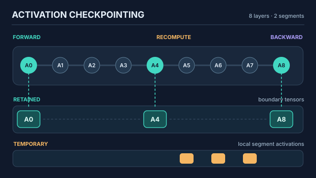
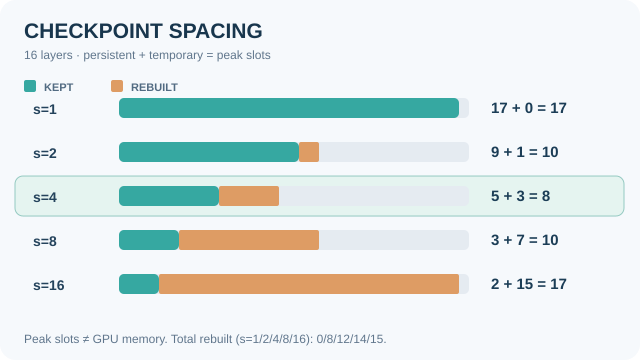
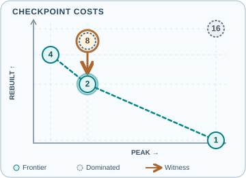

# 梯度檢查點

梯度檢查點是訓練時以計算換取記憶體的做法。前向傳播只保留部分中間激活值，反向傳播需要時再重新計算其餘的部分。Chen 等人（2016）顯示，對一條 n 層的鏈，儲存特徵圖所需的記憶體可降到約 O(√n)，代價是每個小批次多約一次前向傳播。它與[混合精度訓練](mixed-precision.zh-TW.md)並列於[協同設計總覽](index.zh-TW.md)，兩者都是用一種資源換取另一種資源的槓桿。

## 問題

反向傳播需要前向傳播產生的激活值，因此訓練時會把它們儲存起來，直到反向傳播使用為止。對深層網路而言，這份儲存量隨深度成長，常在運算耗盡之前，就先限制了能放進裝置的批次大小或模型大小。Chen 等人報告，在改進之前，一個在 ImageNet 上訓練的 1,000 層殘差網路需要約 48 GB。

## 關鍵概念

- **檢查點：** 前向傳播後保留在記憶體中的激活值。
- **區段：** 兩個檢查點之間的各層。區段內部的激活值會被丟棄。
- **重新計算：** 在反向傳播時，從儲存的檢查點出發，重新執行某區段的前向傳播，以重建該區段梯度所需的激活值。

## 關鍵方法

### 次線性記憶體的檢查點（Chen 等人，2016）

- **問題：** 反向傳播需要儲存每一層的激活值，因此記憶體隨深度成長。
- **核心想法：** 只在約 √n 個區段邊界儲存激活值，並在反向傳播時重新計算每個區段的前向傳播。
- **公式：** 對 n 層網路，儲存的激活值需要 O(√n) 記憶體，代價約為每個小批次多一次前向傳播。遞迴版本可達 O(log n) 記憶體，但額外的前向運算為 O(n log n)。
- **結果：** 對 ImageNet 上的 1,000 層殘差網路，記憶體從 48 GB 降到 7 GB，執行時間約增加 30%。
- **限制：** 此界限只計算儲存的特徵圖，因此參數與最佳化器狀態不在其內。額外的前向傳播會拖慢訓練，且計算圖必須能切分為區段。

## 運作方式

論文的 √n 方案如下：

1. 把 n 層分成約 √n 個區段。
2. 前向傳播時，只儲存區段邊界的輸出，丟棄其他所有激活值。
3. 反向傳播時，從最後一個區段走到第一個。對每個區段，從儲存的邊界重新執行其前向傳播，計算其梯度，然後釋放其激活值。

如此一來，儲存的特徵圖只需約 √n 個邊界張量，加上重新計算時最大區段的激活值，記憶體為 O(√n)，代價是每個小批次多約一次前向傳播。

論文也描述了一種遞迴版本，每個區段再以同樣的策略處理。此時記憶體隨深度以 O(log n) 成長，但額外的前向運算增至 O(n log n)，比 √n 方案昂貴得多。

### 激活值保留與重算：教學動畫

*原創連續教學動畫，CC BY-SA 4.0。* 此人工設定的八層鏈僅長期保留 **A0、A4、A8** 三個邊界張量（青綠色）。前向掃描完成後，反向傳播從最後一段開始，先由檢查點重新計算 **A5–A7**，再處理 **A1–A3**（琥珀色）；琥珀色游標先完成該段前向重算，紫色游標才反向遍歷；該段完成後釋放暫存激活值。紫色游標表示**反向處理順序**，不是最佳化器更新。圖中的「九個激活值只保留三個邊界」僅示範**長期保存的張量數量**，**並非 GPU 峰值記憶體的實測值**，也未計入重算暫存、梯度、參數或最佳化器狀態。MkDocs 沿用鍵盤可操作的播放／暫停與減少動態效果回退；窄螢幕可水平捲動。[完整 SVG 動畫](../../../assets/concept-animations/checkpoint-recompute-motion.svg) · [GitHub 靜態預覽](../../../assets/concept-animations/checkpoint-recompute-still.svg)。

### 如何選擇檢查點間距：記憶體取捨

*原創運算型 SVG 動畫與 GitHub 靜態比較，CC BY-SA 4.0。* 考慮一條 **16 層、各層激活值大小相同的人工網路鏈**，區段長度 $s$ 為 16 的因數。邊界 $A_0,A_s,\ldots,A_{16}$ 保留至反向傳播需要時，重算某一區段時最多額外保留 $s-1$ 個內部激活值。在這個**簡化的保留策略**下，同時存活的峰值激活值槽數為

$$
M(s)=\left(\frac{16}{s}+1\right)+(s-1)=\frac{16}{s}+s.
$$

當 $s=1,2,4,8,16$ 時，長期保留的檢查點依序為 **17、9、5、3、2** 個，區段重算的暫存為 **0、1、3、7、15** 個，峰值合計為 **17、10、8、10、17** 個。因而 $s=4$ 是這**五個選項**的最低值，呈現 Chen 等人（2016；見既有參考文獻）所討論的平方根平衡。這**不是 GPU 峰值記憶體的實測值**：圖中沒有計入梯度、參數、最佳化器狀態、不同大小的激活值、配置器成本及重算的運算時間；在非均勻計算圖上，最佳區段長度可能不同。

動畫另外以 **TOTAL REBUILT** 顯示跨區段的**累積重建量**，刻意與單一區段中同時存在的 REBUILD 暫存峰值分開。假設反向傳播對每個區段各重建一次 $s-1$ 個內部激活值，16 層人工鏈的累積重建張量數就是

$$
B(s)=\frac{16}{s}(s-1)=16-\frac{16}{s}.
$$

$s=1,2,4,8,16$ 時，依序為 **0、8、12、14、15** 個；但 REBUILD 長條表示**單一區段同時存活的暫存峰值**，依序為 **0、1、3、7、15** 個。兩者均為簡化張量數量，**不是額外前向 FLOPs、實際耗時或 GPU 記憶體實測**；實務上還可能重新執行其他運算及產生框架額外開銷。

動畫同步更新區段邊界、保留／重算槽數以及成本曲線上的選取點。**橘色括號只標示目前正在重建的最後一個區段**：當 $s=4$，它跨越四層，而 REBUILD 的三個暫存槽位僅對應該區段內部的激活值。當 $s=1$，所有層邊界都已保留，沒有內部激活值需要重建，因此括號會消失。橘色小游標會在非零重算需求的區段內由左向右移動，示意**單一區段內的前向重算順序**，而非所有區段同時重算，也不是反向傳播的梯度游標。括號、逐漸延伸的橘色軌跡與游標只是空間及時間的示意，不代表額外配置激活值。橘色軌跡僅隨目前區段的前向重算逐漸填滿，切換區段長度時重新開始；它不是所有區段累積重建張量數的計數器。**新增的橘色小點會在游標經過各個未保留的內部邊界後依序出現**：$s=4$ 的末段會出現 3 點，$s=16$ 會出現 15 點，$s=1$ 不會出現。小點代表該區段暫時重建的激活值，**不是新的長期檢查點**；青綠色小點才是保留的邊界。**KEEP 與 REBUILD 右側的動態數字，搭配新增的 PEAK SLOTS 加法算式**，顯示每個區段長度的精確分解，例如 $s=4$ 時，五個保留的邊界激活值加上三個重算暫存，合計八個峰值槽位；這些數字是激活值張量的數量，不是位元組或 GPU 實測記憶體。MkDocs 現可透過**上一步／下一步**選擇五種區段長度，以時間軸滑桿檢視區段內的前向重算中間狀態，並使用**播放／暫停**、**重新開始**（直接回到第一種間距）與 0.5×／1×／2× 速度控制。切換到其他瀏覽器分頁時會自動暫停，避免跳過中間重算步驟；返回後不會自動續播。手機上的控制列放在水平捲動的圖形區域外，方便操作；圖形區域可聚焦後使用方向鍵捲動。控制列下方的**同步文字解讀**會區分**單一區段的峰值重算暫存槽位**與**所有區段的總重建數量**，並顯示最後一個高亮區段目前重建的小點數；這是**教學示意的張量計數，不是 GPU 記憶體或 FLOPs 實測**。逐步或拖曳操作也會讓輔助科技收到選取狀態的文字提示。時間軸滑桿的無障礙數值會直接提供目前的示意間距、峰值槽位與總重建數量，而不是缺乏數學意義的 0–1000 位置。偏好減少動態效果者看到 $s=4$ 的靜態狀態，GitHub 回退圖則直接比較**全部五種**選擇。 頁面開啟期間若調整系統的減少動態效果偏好，會直接在靜態回退圖與互動時間軸之間切換，不需要重新載入。[GitHub 靜態比較](../../../assets/concept-animations/checkpoint-spacing-still.svg) · [完整 SVG 動畫](../../../assets/concept-animations/checkpoint-spacing-motion.svg)。

**比較兩種檢查點間距（MkDocs）**：按下 **釘選 A** 固定目前的間距，接著使用時間軸或逐步按鈕選擇 **B**。A/B 比較會同時呈現 **PEAK**（同時存在的示意激活值槽位）與 **TOTAL REBUILT**（所有區段累積重建的內部邊界），並計算帶正負號的 **B − A** 差異。例如從 s=1 改為 s=4，峰值槽位由 **17 降到 8**，但總重建數由 **0 增至 12**，這是**記憶體與重算量的取捨**，不是 GPU 記憶體或執行時間實測。按 **交換 A／B** 會互換基準與目前時間軸狀態，使 **B − A** 的差值符號反轉（s=4 與 s=1 對調後，峰值變化從 −9 轉為 +9、總重建量從 +12 轉為 −12）。可使用 **更新 A** 重新設定基準，或 **清除 A** 收起比較；按鈕可用鍵盤聚焦後按 Enter。減少動態效果模式不顯示操作式比較，但 GitHub 靜態回退圖保留五種設定。 A／B 雙色比較長條會依**固定且共用的刻度**同步更新（峰值 0–17 個示意槽位、總重算量 0–15 個），因此交換 A／B 後仍可直接對照長度；精確數字以旁邊的文字為準，並非 GPU 實測。

**A/B 比較的定性判讀**：同步比較會區分記憶體／重算量的**取捨**、**兩項總體成本相同**，以及某一選項在兩項示意成本上**皆不劣於另一選項**。例如在等大小激活值、只比較兩項指標的簡化模型中，`s=8`（峰值 10、總重算 14）被 `s=4`（峰值 8、總重算 12）支配。這**不代表**實際訓練的最佳檢查點間距；張量存活時間、重算 FLOPs 與執行開銷並未納入。

**雙成本模型中的 Pareto 支配。** 若一方案在峰值槽位（PEAK）與全區段總重建量（TOTAL REBUILT）上均不劣於另一方案，且**至少一項嚴格更好**，就構成 Pareto 支配。例如 `s=2` 與 `s=8` 的峰值同為 10 槽，但重建總數是 8 與 14，因此前者支配後者，並非取捨。對這**五種取樣間距**，`s=1、2、4` 構成 **Pareto 前緣**，彼此不被其餘取樣方案支配；`s=8、16` 則會被其他方案支配。動態讀數會隨間距標示此分類；`s=4` 僅使峰值槽位最小，並沒有同時最小化兩項成本。此判準只涵蓋人工槽位與重建計數，不能等同實測 GPU 記憶體、延遲或最佳切分。

**同時追蹤前向計算工作量。** 在這條 16 層人工鏈中，先執行原始的 16 層前向計算，再於檢查點重算期間額外執行 \(B(s)=16-16/s\) 次區段內層計算。因此當 \(s=1、2、4、8、16\) 時，**前向層計算總次數**（初次加重算）依序為 **16、24、28、30、31**。互動讀數與 A/B 差值會同步呈現這個衍生計數；它未計入反向運算，也不能換算為實際 FLOPs、耗時或不同成本的層。這不是 GPU 實測，只用來說明峰值記憶體最低不等於運算成本最低。

**引導式 A/B 比較（MkDocs）**：可使用支援原生鍵盤操作的「**選擇示範比較…**」選單直接載入兩組可重現的人工狀態並暫停播放。**s=1 → s=4** 顯示減少激活值保存量與增加重算量之間的取捨；**s=8 → s=4** 則顯示在此**雙指標人工模型**中，後者同時降低兩項成本。另有兩組容易忽略的比較：**s=2 → s=8** 的示意峰值同為 **10 槽**，但全區段重建量由 **8 → 14**；**s=1 → s=16** 的峰值同為 **17 槽**，重建量卻從 **0 → 15**。因此在這個僅考慮兩項成本的簡化模型裡，**峰值記憶體相同不代表重算成本相同**，重算較少的方案在雙指標上支配另一方案；這不是實際延遲的量測。選取後 A 會釘選為基準，B 顯示於時間軸；仍可**交換 A／B**、更新基準或自行拖曳 B。這些選單只載入教學數值，不會執行最佳化器或量測硬體。 新增的 **掃描 A→B** 可從釘選的 A 沿時間軸逐步移至目前的 B，在 1× 速度下約三秒結束並停留於 B，讓中間示意狀態與即時比較同步顯示；可往返掃描、調整速度，或透過暫停、拖曳時間軸與減少動態效果模式中斷。這只是**固定數值配置的介面掃描**，不是實際執行前向／反向運算，也不是效能實測。

**互動式 Pareto 成本地圖（MkDocs）：** 在原本受控的 16 層 SVG 動畫下方，新增以 **PEAK**（橫軸峰值激活值槽數）及 **TOTAL REBUILT**（縱軸累積重建數）為座標的五種取樣間距地圖；兩軸沿箭頭方向都是成本增加。實心、以虛線相連的 `s=1、2、4` 為**非支配前緣**，`s=8、16` 則以虛線圓框表示被其他取樣方案支配。每個圓點都是原生鍵盤可操作的按鈕：選取時會暫停播放，並把原本 SVG 時間軸切換到對應間距，同步更新峰值、重建量及釘選的 A/B 比較。目前選取點有外框，釘選 A 則有琥珀色外圈，數值也會提供給輔助科技；連線**不是**在不同配置間實際執行的連續最佳化路徑。此地圖僅涵蓋五組人工數值，不是 GPU 延遲、位元組記憶體或效能實測。GitHub 仍以原本五種配置的靜態 SVG 作為回退預覽。

**支配關係的動態見證（MkDocs）：** 當選取被支配的 `s=8` 或 `s=16` 時，成本地圖會出現一條**琥珀色箭頭**，指向可支配它的取樣方案 `s=2`。在 `s=8`，兩者的峰值都為 10 槽，但 `s=2` 的總重建量只有 8，而非 14；在 `s=16`，切換到 `s=2` 同時降低峰值（17 → 10）與總重建量（15 → 8）。`s=1、2、4` 在**這五種選項**中皆未被支配，因此不會出現箭頭。箭頭只是**一個**可驗算的支配例證，不是唯一最佳方案、連續最佳化路徑或 GPU 實測；雙語時間軸讀數也會提供相同的數值理由。

**A/B 雙成本連結（MkDocs）：** 使用 **釘選 A** 或 **比較前一步** 後，成本地圖會以紫色點線弧線連接釘選的 A 與目前選取的 B，並隨單步、時間軸、交換 A/B 及引導式比較同步變化；兩個設定相同或執行 **清除 A** 時即隱藏。弧線刻意與琥珀色的**支配關係箭頭**錯開，避免兩者重疊而難以辨識。此線只表示**兩個取樣設定之間的介面連結**，不是最佳化路徑、GPU 成本的連續內插，也**不表示 A 或 B 一定支配對方**。具方向性的 B−A 差值仍由雙語文字與數值比較提供；GitHub 回退圖只固定呈現支配見證，不會假裝能儲存讀者的釘選狀態。

*原創互動式 Pareto 見證箭頭的 GitHub 靜態回退圖，CC BY-SA 4.0。MkDocs 網站上的箭頭會隨被支配的設定更新；前文的五種設定計算流程 SVG 仍是主要動態教學內容。*

**關鍵狀態導覽（MkDocs）：** 新增五個可透過鍵盤操作的狀態按鈕，可直接切換至 `s=1、2、4、8、16`，以邊框、底線和字重標示目前示意間距，而非僅依靠顏色。跳轉時會中止 A→B 掃描，並同步 SVG、數值解讀及釘選比較；這些按鈕只切換已核對的人工配置，不代表真實 GPU 的最佳檢查點策略。

**時間軸鍵盤導覽（MkDocs）**：聚焦時間軸滑桿後，按 **←／→** 可直接切換上一個／下一個檢查點間距（`s=1、2、4、8、16`），不必逐格按壓僅有 1/1000 時長的細小位移；**Shift+←／→** 保留原生細部拖曳，**Home／End** 跳到起點／終點。按鍵跳轉會暫停播放或 A→B 掃描，不會清除釘選的 A，並同步更新數值及無障礙滑桿資訊；滑鼠與觸控仍可連續拖曳。連續拖曳期間，SVG、示意數值與滑桿無障礙資訊會即時更新；僅在完成調整時透過狀態播報一次目前結果，避免反覆干擾螢幕閱讀器。

**可視範圍暫停（MkDocs）**：當水平捲動圖形與下方控制列**都離開**可視範圍時，動畫會自動暫停；捲動回來不會自動續播，需再按**播放**。手機上只要圖形或控制列任一仍可見，便不會因另一區域移出畫面而誤暫停。已釘選的 A/B 比較仍保留；這只是播放管理，不代表示意運算有新的狀態。

**SVG 載入失敗回退（MkDocs）**：若動態 SVG 無法載入，或伺服器回傳的不是 SVG 文件，網站會隱藏無法操作的時間軸，顯示已審核的靜態 SVG 及繁體中文替代文字。暫時性問題可按「**動畫無法載入 · 重試**」重新向相同來源請求 SVG；成功後保留時間位置與 A/B 比較，若載入或重試超過 15 秒仍未收到回應，仍保留靜態圖並重新提供重試按鈕；成功後可恢復原本選取的示意狀態。靜態圖仍是教學示意，非模型實測。

**比較前一個狀態（MkDocs）**：選取非初始的檢查點間距後，可按 **比較前一步**，直接把時間軸上的前一種間距釘選為 **A**，並保留目前設定為 **B**。例如在 `s=8` 時，立即比較 `s=4 → s=8`：示意峰值槽位由 **8 → 10**、全區段重建量由 **12 → 14**。原有 **交換 A／B**、有號差值與共用刻度的雙色長條均可繼續操作。初始 `s=1` 沒有前一個示意選項，按鈕會停用。這些都是人工槽位計數，不是 GPU 記憶體或執行時間實測。

## 結果

摘要報告，對一個在 ImageNet 上訓練的 1,000 層殘差網路，記憶體從約 48 GB 降到 7 GB，執行時間約增加 30%。正文報告其殘差網路實驗的設定為：批次大小 32、輸入 224 × 224、以 MXNet 在單張 Titan X GPU 上執行，並把每個 conv-bn-relu 區塊視為一層。摘要也報告，在訓練複雜的循環網路時，記憶體用量有顯著的減少。

## 限制

- **執行時間成本。** 實測執行時間增加約 30%。反向傳播的成本約為前向傳播的兩倍，因此重新執行前向傳播會佔去相當大的工作量。
- **框架支援。** 計算圖必須能切分為區段，因此不支援此功能的框架需要自訂訓練迴圈。
- **節省的範圍。** √n 的界限計算的是儲存的特徵圖，參數與最佳化器狀態不在其內。

## 開放問題

- **自動選擇區段。** 邊界的位置取決於各層的記憶體成本。對於不規則的計算圖，好的選擇能否成立，這篇論文並未解決；摘要所描述的實驗對象是 ImageNet 上的殘差網路與複雜的循環網路。
- **與其他記憶體節省方法結合。** 重新計算如何與低精度儲存、以及把資料卸載到主機記憶體結合，超出了這篇論文的範圍，而這正是現今許多實際訓練系統運作的地方。

## 相關連結

檢查點與[混合精度訓練](mixed-precision.zh-TW.md)互補。混合精度縮小每個儲存的數值，檢查點則儲存較少的數值並重新計算其餘部分。只有當記憶體容量而非運算限制了訓練時，這種取捨才有價值。某次重新計算是否划算，取決於[記憶體階層與頻寬](../memory-hierarchy/index.zh-TW.md)所描述的平衡，以及[屋頂線模型](../memory-hierarchy/roofline.zh-TW.md)。

## 參考文獻

### 開創性論文

- Chen, T., Xu, B., Zhang, C. 與 Guestrin, C. (2016). *Training Deep Nets with Sublinear Memory Cost*. arXiv:1604.06174. https://arxiv.org/abs/1604.06174 — 只儲存區段邊界的激活值，並在反向傳播時重新計算其餘部分，以約一次額外前向傳播，把記憶體降到 O(√n)。
- Micikevicius, P., 等人 (2017). *Mixed Precision Training*. arXiv:1710.03740. https://arxiv.org/abs/1710.03740 — 把每個儲存的數值縮小為 16 位元，是與「儲存較少數值」互補的記憶體槓桿。

### 綜述與教科書

- Sze, V., Chen, Y.-H., Yang, T.-J., Emer, J. S. (2017). *Efficient Processing of Deep Neural Networks: A Tutorial and Survey*. arXiv:1703.09039. https://arxiv.org/abs/1703.09039 — 綜述 DNN 硬體的能量與吞吐量效率，也就是本頁取捨背後的效率考量。

### 文章與文件

- Ivanov, A., 等人 (2020). *Data Movement Is All You Need: A Case Study on Optimizing Transformers*. arXiv:2007.00072. https://arxiv.org/abs/2007.00072 — 主張在訓練 Transformer 時，資料搬移是關鍵瓶頸，而檢查點正是以此為代價進行交換。
- Gholami, A., 等人 (2024). *AI and Memory Wall*. arXiv:2403.14123. https://arxiv.org/abs/2403.14123 — 主張記憶體而非運算已成為 AI 應用（尤其是服務）的主要瓶頸，這也正是重新計算具有吸引力的原因。
