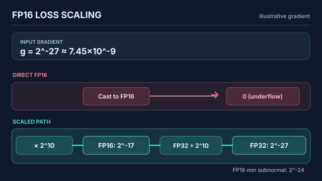

# Mixed-Precision Training

Mixed-precision training stores most values and runs most arithmetic in 16-bit floating point, while keeping a single-precision copy of the weights and scaling the loss so that small gradients survive. Micikevicius et al. (2017) report that this reduces the memory used by deep learning models by nearly two times, across several architectures. It is a training technique, and it sits in the [co-design overview](index.md) as the number-format lever for training.

## Problem

Training a network keeps the weights, the activations and the gradients in memory, and each of them is usually stored as a 32-bit float. Memory limits the size of model and batch that fits on a chip, and the bandwidth needed to move 32-bit values limits speed. Storing values in 16 bits halves the bytes moved for each one, but 16-bit values have a smaller range and precision, and training can lose accuracy or become unstable with them.

## Key concepts

- **Half precision:** a 16-bit floating-point format for activations and gradients, with less range and precision than 32-bit.
- **Master weights:** a single-precision copy of the weights, which accumulates the gradient updates after each optimiser step, so small updates are not lost to rounding.
- **Loss scaling:** multiplying the loss by a constant before the backward pass, so that small gradients do not underflow in half precision, and dividing the gradients by the same constant before the weight update.

## Key methods

### Mixed-precision training (Micikevicius et al., 2017)

- **Problem:** 32-bit storage doubles the memory and bandwidth a training step needs, but 16-bit values lose the range and precision that small gradients rely on.
- **Core idea:** keep an FP32 master copy of the weights, run the forward and backward passes in FP16, and scale the loss by a constant before the backward pass.
- **Equations:** the optimiser receives \(g = \tfrac{1}{S}\nabla_\theta(S \cdot L)\) and updates the FP32 master weights, \(\theta \leftarrow \theta - \eta\, g\). The scale \(S\) cancels, so the update matches full-precision training when no value overflows or underflows.
- **Results:** the paper reports nearly a 2× reduction in memory across convolutional, recurrent and generative adversarial networks.
- **Limitations:** the master weights and the optimiser state stay at full precision, so the saving is less than half. The scale must be tuned to avoid overflow.

The 8-bit extension is [FP8](fp8.md). The results and limits are discussed below.

## How it works

Each training step follows these stages:

1. Copy the single-precision master weights into a half-precision copy.
2. Run the forward pass and the backward pass in half precision, with the loss scaled.
3. Undo the loss scaling on the gradients.
4. Apply the update to the single-precision master weights.

The arithmetic and the stored activations run at the lower width, which is where the memory and bandwidth saving comes from. The master weights and the update remain at full width, which keeps small changes from being rounded away.

### Why loss scaling matters: continuous FP16 example

*Original continuous teaching animation, CC BY-SA 4.0.* This **analytical** example uses a gradient $g=2^{-27}\approx7.45\times10^{-9}$, below IEEE binary16's smallest positive subnormal value $2^{-24}$. With round-to-nearest-even, a direct FP16 cast rounds it to **zero** (it is below half the smallest positive subnormal); applying loss scale $S=2^{10}=1024$ **before backpropagation** yields the representable scaled gradient $Sg=2^{-17}$. Converting to FP32 and unscaling gives $g=(Sg)/S=2^{-27}$ for the FP32 optimiser/master-weight update. These values are **not model measurements**. In a real system the scale must also avoid **overflow**, and exact recovery is not guaranteed for arbitrary gradients because of rounding and possible subnormal flushing. The figure isolates a single gradient; it does not imply that all operations in mixed-precision training are FP16. MkDocs provides the existing keyboard-accessible Play/Pause and reduced-motion fallback; on narrow screens, scroll horizontally. [View the SVG animation](../../../assets/concept-animations/fp16-loss-scaling-motion.svg) · [GitHub-readable still](../../../assets/concept-animations/fp16-loss-scaling-still.svg).

### Loss-scale range: rescuing a small gradient can overflow a large one

*Original stepwise SVG teaching animation and three-case GitHub fallback, CC BY-SA 4.0.* Consider **two illustrative gradients**, $g_{\mathrm{low}}=2^{-27}$ and $g_{\mathrm{high}}=2^5$, scaled by the same power-of-two $S$ *before* their FP16 representation. Under IEEE binary16 with subnormals and round-to-nearest-even, the minimum positive subnormal is $2^{-24}$ and the largest finite value is **65504**. At $S=1$, the small value rounds to zero; at $S=2^{10}=1024$, the scaled pair is $2^{-17}$ and $2^{15}$, both representable; at $S=2^{12}=4096$, the large value becomes $2^{17}$ and overflows. For these **specific** powers-of-two inputs and scales, **$8\le S\le1024$** is the simultaneous nonzero-finite range, with $S$ restricted to powers of two.

At $S=4$, the tiny value is $2^{-25}$, exactly halfway to the smallest positive subnormal, so round-to-nearest-even still returns zero. At **$S=8$**, it becomes the representable $2^{-24}$; at **$S=2048$**, the large value becomes $2^{16}=65536>65504$ and overflows. The animation visits **integer powers of two only**, and the footer synchronises the exact current $S$ with LOW ZERO, BOTH FINITE or HIGH INF. The moving markers show the exponents of $|Sg|$ on one shared axis. **A purple dashed link translates with both pre-rounding values, always spanning 32 binary exponents.** Multiplying both values by the same scale leaves their ratio unchanged:

$
\begin{aligned}
\frac{|Sg_{\mathrm{high}}|}{|Sg_{\mathrm{low}}|}
  &= \frac{|g_{\mathrm{high}}|}{|g_{\mathrm{low}}|},\\
\log_2\frac{|g_{\mathrm{high}}|}{|g_{\mathrm{low}}|}
  &= 32.
\end{aligned}
$

A common $S$ shifts both positions equally; it cannot compress the gradient dynamic range. This is why one safe scale must satisfy the lower and upper FP16 limits at once. The left orange band ends at the marked $2^{-25}$ **round-to-zero midpoint**, not at the smallest representable subnormal $2^{-24}$. At the midpoint ties-to-even still gives zero, but values just above it can round *up* to a nonzero subnormal. The plotted circles track **pre-rounding** $|Sg|$; the status footer reports **rounded binary16 outcomes**. The right orange band marks the first overflowing *sampled power of two*, $2^{16}$, rather than a general real-valued overflow threshold. This is **synthetic numerical arithmetic, not measured training performance** or a universal safe loss-scale interval. Actual training distributions vary, some devices flush subnormals to zero, and many operations accumulate in FP32. Loss scaling must be undone before the optimiser update, as explained above. The MkDocs player offers Play/Pause; the GitHub [static comparison](../../../assets/concept-animations/fp16-scaling-window-still.svg) gives the three exact outcomes, and the [SVG motion](../../../assets/concept-animations/fp16-scaling-window-motion.svg) shows the boundary crossings. Reduced-motion mode displays the static comparison.

## Results

Micikevicius et al. (2017) report that using this approach reduces the memory consumption of deep learning models by nearly two times. They recommend keeping a single-precision copy of the weights that accumulates the gradients after each optimiser step, and scaling the loss to handle the loss of information in half-precision gradients. They tested convolutional, recurrent and generative adversarial networks.

Micikevicius et al. (2022) extend the idea to [8-bit floating-point formats](fp8.md), E4M3 and E5M2. They report that on models up to 175 billion parameters, training with these formats effectively matches the result quality of 16-bit training, with the hyperparameters left unchanged. That result is for training; the lower-precision inference methods covered in [quantisation](../../../theory/model-compression/quantisation/index.md) are a separate line of work.

## Limitations

The saving is less than a full halving of all memory, because the master weights stay in single precision and the optimiser state is not reduced by this method. Half-precision gradients can lose information, which is why loss scaling is needed, and the scale must be chosen so that values neither underflow nor overflow. The paper's experiments cover the architectures listed above, so results on other models need their own checks.

## Open questions

- **How far below 16 bits training can go.** The FP8 results show that 8-bit formats can match 16-bit quality on large models, but which operations and which stages of training tolerate the lower precision is still being worked out.
- **Hardware support.** Whether a chip runs half-precision and 8-bit arithmetic at the speed its memory saving suggests depends on the hardware, which is why the [accelerators](../accelerators/index.md) comparison matters.

## Connections

Mixed precision is one of the three levers in the [co-design overview](index.md). The memory it saves is the cost that [memory hierarchy and bandwidth](../memory-hierarchy/index.md) describes, and the same idea of fewer bits per value appears in the inference side of [quantisation](../../../theory/model-compression/quantisation/index.md). [FlashAttention](../../../theory/models/transformer/attention-variants/flash-attention/index.md) is a kernel that works within the same memory constraints.

## References

### Seminal papers

- Micikevicius, P., et al. (2017). *Mixed Precision Training*. arXiv:1710.03740. https://arxiv.org/abs/1710.03740 — Shows that 16-bit training reduces memory use by nearly two times across architectures, with master weights and loss scaling.
- Micikevicius, P., et al. (2022). *FP8 Formats for Deep Learning*. arXiv:2209.05433. https://arxiv.org/abs/2209.05433 — Proposes two 8-bit floating-point encodings that match 16-bit training quality on models up to 175 billion parameters.

### Surveys and textbooks

- Sze, V., Chen, Y.-H., Yang, T.-J., Emer, J. S. (2017). *Efficient Processing of Deep Neural Networks: A Tutorial and Survey*. arXiv:1703.09039. https://arxiv.org/abs/1703.09039 — Surveys the energy and throughput trade-offs of DNN hardware, including hardware–algorithm co-design.

### Articles and documentation

- Krishnamoorthi, R. (2018). *Quantizing deep convolutional networks for efficient inference: A whitepaper*. arXiv:1806.08342. https://arxiv.org/abs/1806.08342 — Shows the inference-side counterpart: per-channel 8-bit quantisation keeps many CNNs within 2% of floating-point accuracy.
- Gholami, A., et al. (2024). *AI and Memory Wall*. arXiv:2403.14123. https://arxiv.org/abs/2403.14123 — Argues that memory, rather than compute, has become the primary bottleneck for AI applications, particularly serving, which is the pressure this method relieves.
