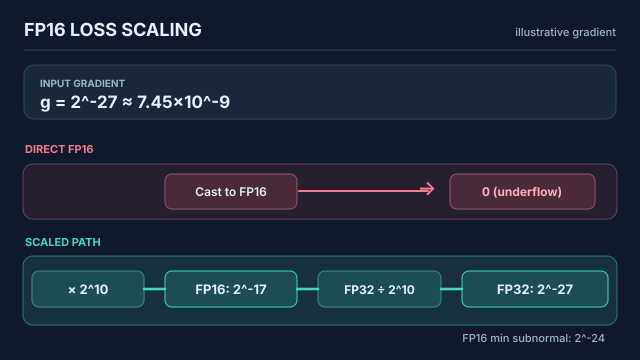
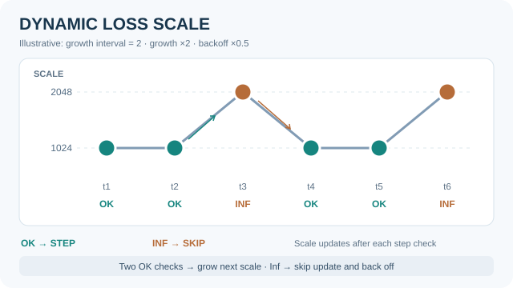
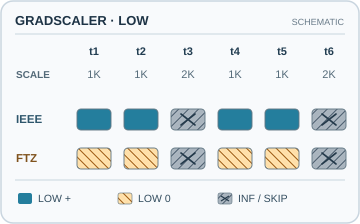
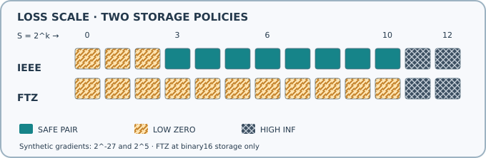

# 混合精度訓練

混合精度訓練把大部分數值以 16 位元浮點數儲存，並以它執行大部分運算，同時保留一份單精度的權重副本，並對損失進行縮放，使微小的梯度不會消失。Micikevicius 等人（2017）顯示，這種做法在多種架構上可把深度學習模型的記憶體用量減少近 2 倍。它是一種訓練技術，在[協同設計總覽](index.zh-TW.md)中作為訓練端的數值格式槓桿。

## 問題

訓練網路時，權重、激活值與梯度都要佔用記憶體，而每一項通常以 32 位元浮點數儲存。記憶體限制了晶片上能容納的模型與批次大小，而搬移 32 位元數值所需的頻寬，則限制了速度。以 16 位元儲存，每個數值搬移的位元組數減半，但 16 位元的範圍與精度較小，使用它訓練可能損失準確度或變得不穩定。

## 關鍵概念

- **半精度：** 用於激活值與梯度的 16 位元浮點格式，範圍與精度都小於 32 位元。
- **主權重：** 一份單精度的權重副本，在每次最佳化器步驟後累積梯度更新，使微小的更新不會因捨入而消失。
- **損失縮放：** 在反向傳播前把損失乘上一個常數，使微小的梯度在半精度中不會下溢；更新權重前再把梯度除以同一個常數。

## 關鍵方法

### 混合精度訓練（Micikevicius 等人，2017）

- **問題：** 32 位元儲存使一個訓練步驟所需的記憶體與頻寬加倍，但 16 位元數值會失去小梯度所依賴的範圍與精度。
- **核心想法：** 保留一份 FP32 的主權重，前向與反向傳播以 FP16 進行，並在反向傳播前把損失乘上一個常數。
- **公式：** 最佳化器收到 \(g = \tfrac{1}{S}\nabla_\theta(S \cdot L)\)，並更新 FP32 的主權重 \(\theta \leftarrow \theta - \eta\, g\)。縮放因子 \(S\) 會相互抵消，因此在沒有數值溢位或下溢時，更新與全精度訓練一致。
- **結果：** 論文報告，在卷積網路、循環網路與生成對抗網路上，記憶體用量減少近 2 倍。
- **限制：** 主權重與最佳化器狀態仍保持全精度，因此節省不到一半。縮放倍數必須調整，以避免溢位。

8 位元的延伸是 [FP8](fp8.zh-TW.md)。結果與限制見下文。

## 運作方式

每個訓練步驟依序進行以下階段：

1. 把單精度的主權重複製成半精度副本。
2. 以半精度執行前向與反向傳播，並對損失進行縮放。
3. 還原梯度的損失縮放。
4. 把更新套用到單精度的主權重上。

運算與儲存的激活值都以較低的寬度執行，這正是記憶體與頻寬節省的來源。主權重與更新仍以完整寬度進行，因此微小的變化不會被捨入掉。

### 損失縮放如何避免 FP16 下溢：連續動畫

*原創連續教學動畫，CC BY-SA 4.0。* 人工設定的梯度為 $g=2^{-27}\approx7.45\times10^{-9}$，小於 IEEE binary16 的最小正次正規（subnormal）數值 $2^{-24}$，採最接近且同距取偶數捨入（round-to-nearest-even）時，因其小於最小正次正規數的一半，直接轉成 FP16 會捨入為 **0**。若先在反向傳播前把 loss 乘上 $S=2^{10}=1024$，縮放後梯度 $Sg=2^{-17}$ 就能以 FP16 表示；轉回 FP32 再除以 $S$，可得到供 FP32 主權重更新的 $g=2^{-27}$。此為**可驗算的教學示意數值，不是模型實測**。實際訓練仍須避免縮放溢位，且任意梯度不保證都能精確還原，因為仍可能發生捨入或非正規數沖零（flush-to-zero）。圖中只示範單一梯度，並不表示混合精度訓練中的所有運算皆用 FP16。MkDocs 沿用鍵盤可操作的播放／暫停與減少動態效果回退，手機可水平捲動。[完整 SVG 動畫](../../../assets/concept-animations/fp16-loss-scaling-motion.svg) · [GitHub 靜態預覽](../../../assets/concept-animations/fp16-loss-scaling-still.svg)。

### 損失縮放的有效區間：救回微小梯度，也可能使大梯度溢位

*原創逐級 SVG 教學動畫與 GitHub 三情境回退圖，CC BY-SA 4.0。* 設兩個**人工梯度** $g_{\mathrm{low}}=2^{-27}$、$g_{\mathrm{high}}=2^5$，在以 FP16 表示**之前**，先乘上相同的二次方縮放係數 $S$。對支援次正規數、採最接近且同距取偶數捨入的 IEEE binary16，最小正次正規數是 $2^{-24}$，最大有限數是 **65504**。當 $S=1$，小梯度會捨入為零；當 $S=2^{10}=1024$，兩者為 $2^{-17}$ 與 $2^{15}$，都可表示；當 $S=2^{12}=4096$，大梯度變成 $2^{17}$，造成上溢。對這**兩個特定數值與二次方縮放設定**，兩者都保持非零且有限的範圍為 **$8\le S\le1024$**，此處的 $S$ 只取 2 的整數次方。

邊界情況也很重要：$S=4$ 時，小梯度為 $2^{-25}$，恰好位於零與最小正次正規數的中點，因此在同距取偶數捨入下仍為 **0**；當 **$S=8$** 才到達可表示的 $2^{-24}$。另一方面，當 **$S=2048$**，大梯度為 $2^{16}=65536>65504$，首次上溢。動畫只逐級切換到 **2 的整數次方縮放係數**，下方讀數同步顯示目前 $S$，以及 LOW ZERO、BOTH FINITE 或 HIGH INF 的結果。兩個移動圓點共用 $|Sg|$ 指數軸。**紫色虛線連接兩個捨入前的數值，並隨縮放等距平移，兩者始終相差 32 個二進位指數。** 圖中的「Δ log₂ = 32」標記也隨線段移動，強調共同縮放只平移兩者的位置，無法縮小其對數差距。 兩個數值同乘縮放係數後，其比值不變：

$
\begin{aligned}
\frac{|Sg_{\mathrm{high}}|}{|Sg_{\mathrm{low}}|}
  &= \frac{|g_{\mathrm{high}}|}{|g_{\mathrm{low}}|},\\
\log_2\frac{|g_{\mathrm{high}}|}{|g_{\mathrm{low}}|}
  &= 32.
\end{aligned}
$

共同的 $S$ 不會縮小兩種梯度間的動態範圍；因此安全的縮放係數須同時滿足 FP16 的上下數值邊界。回到色帶判讀：左側橘紅區現在以虛線標出精確的 $2^{-25}$ **捨入為零中點**，而不是錯把最小正次正規數 $2^{-24}$ 當成捨入界線；恰好位於中點仍捨入為零，略高於中點則可能捨入成非零的次正規數。圓點位置表示**捨入前**的 $|Sg|$，下方狀態則表示**經 binary16 捨入後**的結果。新增的 **LOW／HIGH** 行內標記會獨立顯示每筆梯度的捨入結果：LOW 在 $S=1$–$4$ 顯示 `0`，從 $S=8$ 起顯示 `OK`；HIGH 到 $S=1024$ 仍是 `OK`，但在 $S=2048$–$4096$ 變為 `INF`。`OK` 只代表**非零且有限**，並不保證數值準確性或訓練品質。藉此把捨入前的座標和實際 binary16 的有限性結果分開理解。右側橘紅區代表本例所採用的 2 的整數次方中，第一個溢位的 $2^{16}$，不是所有實數輸入的精確溢位門檻。這些都是**可驗算的人工數值，不是模型實測**，也不是通用的安全縮放區間。實際梯度分布會變動，部分硬體會將次正規數沖零，許多運算也會在 FP32 累加。更新最佳化器前仍須將梯度除回原本的縮放係數，如前節所述。MkDocs 現可使用**上一步／下一步**檢視上升與下降掃描中的關鍵下溢、有限值及溢位邊界，以時間軸滑桿尋找中間的二次方縮放係數，並使用**播放／暫停**、**重新開始**（第一個縮放狀態）與 0.5×／1×／2× 速度控制；切換瀏覽器分頁時自動暫停，返回後不會自動續播；手機上的控制列不會隨圖形水平捲動。**同步文字解讀**會顯示當前的二次方縮放係數、兩筆梯度的捨入結果，以及示意最佳化器步驟是否符合更新條件或應跳過；另明確區分**靜默下溢為零（仍為有限值）與 Inf／NaN 導致跳過更新**。逐步與拖曳操作也會向輔助科技播報選取狀態。鍵盤可操作的時間軸會以無障礙數值表示當前的示意損失縮放係數與梯度捨入結果，而不只是 0–1000 的滑桿位置；GradScaler 時間軸也會提供目前迭代與下次縮放係數。GitHub 的[三情境靜態比較](../../../assets/concept-animations/fp16-scaling-window-still.svg)與[完整 SVG 動畫](../../../assets/concept-animations/fp16-scaling-window-motion.svg)可分別查看結果與跨界過程，減少動態效果模式呈現靜態版本。 頁面開啟期間切換系統的減少動態效果偏好，兩個教學時間軸會直接切換為可操作動畫或靜態回退圖，不需要重新載入。

**非有限值檢查與資訊遺失並不相同。** 動畫新增 **STEP ELIGIBLE**（可進行步驟）和 **SKIP (INF)**（跳過）讀數，對應一個僅檢查 Inf／NaN 的動態損失縮放器。假設最佳化器只有圖中這兩筆人工梯度：$S=1,2,4$ 時，小梯度雖已下溢成 0、失去資訊，但 **0 仍是有限值，不會單因這件事觸發跳過更新**；$S=8$ 至 $1024$ 時兩者有限，同樣符合執行條件；$S=2048$ 或 $4096$ 時，大梯度成為 Inf，縮放器便會略過該次權重更新。**ELIGIBLE 只是這兩個示意數值下的條件判斷**，不是宣稱實際更新已執行或訓練數值準確；真實模型可能還有其他非有限梯度，也可能涉及梯度累積與框架行為。[^amp-step-gate]

[^amp-step-gate]: PyTorch，[*Automatic Mixed Precision examples*](https://docs.pytorch.org/docs/stable/notes/amp_examples.html)，說明 `GradScaler.step` 還原縮放後檢查 Inf／NaN，若出現非有限梯度就跳過最佳化器更新。

### 動態損失縮放：跨訓練迭代的回饋控制

*原創 SVG 回饋教學動畫，附 GitHub 可閱讀的靜態回退圖，CC BY-SA 4.0。* 承接上節的兩筆固定人工梯度，這裡示範的是**跨六次迭代的動態控制**，而不只是測試不同縮放係數。設定 `growth_interval=2`、`growth_factor=2`、`backoff_factor=0.5`，初始縮放係數為 1024；發生溢位後，連續通過有限值檢查的計數重新歸零。假設被檢查的梯度只有前述 $2^{-27}$ 與 $2^5$：縮放為 1024 時兩者皆有限；縮放為 2048 時大梯度溢位。因此，連續兩次檢查通過會讓**下一次迭代**使用兩倍係數；偵測到 Inf 則會**跳過當次最佳化器更新**，並讓**下一次迭代**將係數減半。[^dynamic-gradscaler]

| 迭代 | 當次使用 S | 有限值檢查 | 最佳化器步驟 | 下次 S |
| --- | ---: | --- | --- | ---: |
| 1 | 1024 | OK | 符合執行條件 | 1024 |
| 2 | 1024 | OK | 符合執行條件 | 2048 |
| 3 | 2048 | Inf | 跳過 | 1024 |
| 4 | 1024 | OK | 符合執行條件 | 1024 |
| 5 | 1024 | OK | 符合執行條件 | 2048 |
| 6 | 2048 | Inf | 跳過 | 1024 |

圖中明確區分三種狀態：曲線是**當次使用的縮放係數**，`NEXT S` 列是在有限值檢查**之後決定的下一次係數**，而動態底列則呈現**連續通過有限值檢查的次數**。在 t2，計數達 2/2，觸發下一次增加到 2048；t3 偵測到 Inf 後跳過當次更新、把計數歸零，並將下一次係數回退為 1024。最後的 `NEXT S=1024` 指的是圖中尚未畫出的第七次迭代。`2/2` 表示**觸發成長當下的進度**，隨後計數會歸零。各時間點下方的 **STREAK** 雙圓點列也提供 GitHub 可直接閱讀的歷程：t1／t4 填滿一點、t2／t5 填滿兩點（達到成長門檻）、t3／t6 顯示叉號（溢位後重設）。這只是有限值連續檢查計數，**不代表最佳化器的進度或 loss 改善**；所有數值都是教學示意而非模型實測。

曲線呈現的是**當次實際使用的縮放係數**，不是檢查後才得到的新係數，因此最後一次回退會反映在圖中未畫出的第七次迭代。PyTorch 文件中的**預設** `growth_interval` 為 **2000**，不是 2；此處為了在六個時間點呈現控制迴路，刻意縮短間隔並設定重複溢位情境。這不是實際執行的訓練或 GPU 梯度量測，也不能因通過有限值檢查便推論 loss 必然下降。MkDocs 現可用**上一步／下一步**依序查看六次有限值檢查，以時間軸滑桿選擇任意中間時刻，並透過**播放／暫停**、**重新開始**（直接回到 t1）與 0.5×／1×／2× 速度控制完整的 12 秒迴圈。切換分頁時自動暫停，不會在背景悄悄跳過有限值檢查。手機的圖形區域仍可聚焦後以方向鍵水平捲動，操作控制列獨立放在外側；控制列下方的**同步文字解讀**也會指出當次迭代、當次與下一次縮放係數、依這兩筆人工梯度判定的**符合更新條件或跳過**，以及有限值檢查後的放大或重設決策。讀數均根據固定人工示例推導，並非模型實測。減少動態效果模式與 GitHub 預覽都保留標示完整的靜態曲線。[完整 SVG 動畫](../../../assets/concept-animations/gradscaler-feedback-motion.svg) · [GitHub 靜態回退圖](../../../assets/concept-animations/gradscaler-feedback-still.svg)。

[^dynamic-gradscaler]: PyTorch，[*Automatic Mixed Precision package — torch.amp*](https://docs.pytorch.org/docs/stable/amp.html)，說明縮放係數增加與回退參數及預設間隔；[*Automatic Mixed Precision examples*](https://docs.pytorch.org/docs/stable/notes/amp_examples.html) 說明偵測 Inf／NaN 時跳過最佳化器步驟。

**連續通過計數的時間點。** 在 `growth_interval=2` 的人工示例，t2、t5 顯示的 2/2 是觸發放大的**決策當下**計數；決定提高下一次縮放係數後，連續成功計數便歸零，並非下一迭代仍從 2/2 開始。互動讀數現在進一步區分**決策後**計數：t1–t6 每次判定結束後依序為 `1、0、0、1、0、0`；A/B 比較同時保留圖中**決策當下**的 `1、2、0、1、2、0`，避免把達到 2/2 的成長判定誤認為下一次仍累積兩次成功。PyTorch 的實際預設值已於上文引用。

**符合更新條件不等於已完成權重更新。** 這六次人工迭代中，依兩筆示意梯度的非有限值檢查，累計**符合更新條件**的次數依序為 **1、2、2、3、4、4**。t3、t6 含 Inf，因此計數停留在前一次；這個**累計次數**與成長或溢位時會歸零的**連續成功計數**不同。互動讀數與 A/B 差值會同步顯示「累計符合更新條件」。這只是條件判斷的衍生計數，**不表示已實際執行四次權重更新**，也不是訓練紀錄或實測學習曲線。

**有限值回饋無法修復 FTZ 的靜默資訊流失。** 將前述**在 binary16 梯度儲存邊界沖零**的反事實假設套用到六次 GradScaler 人工迭代，並保持原來的非有限值檢查規則。圖中的 $S=1024$ 與 $S=2048$ 分別使小梯度變成 $2^{-17}$、$2^{-16}$；在保留次正規數的理想 IEEE binary16 中兩者皆**非零**，但在此 FTZ 假設下皆變成 **0**。大梯度在 $S=1024$ 仍為有限值、在 $S=2048$ 則為 Inf，因此兩種假設下的有限／非有限判斷，以及維持、放大、縮小的**決策序列不變**。然而，t1–t6 中「**符合更新條件且小梯度仍非零**」的累計次數，在保留次正規數時為 **1、2、2、3、4、4**，在假設 FTZ 時則始終為 **0**。MkDocs 的同步讀數、無障礙時間軸與 A/B 比較均呈現這項差異。只依賴 Inf／NaN 的成長控制器無法自行偵測此類靜默損失。這只是針對**兩筆指定梯度**的數學反事實比較，不是裝置模擬、完整訓練運算或所有 GPU 皆啟用 FTZ 的證據。

**追蹤梯度資訊保留（MkDocs）。** GradScaler 下方的六欄 **IEEE／FTZ** 色帶會隨 t1–t6 移動。藍色代表人工迭代符合非有限值檢查的更新條件，且理想 IEEE 次正規數路徑保留非零小梯度；橘色斜紋代表同一次迭代雖符合條件，但小梯度在**假設的 FTZ 梯度儲存邊界**靜默歸零。灰色斜線表示兩條路徑均因 Inf 而跳過；淡色代表尚未走到的迭代，外框表示目前位置。透過逐步或時間軸可觀察相同的有限值決策如何保留不同資訊。色帶純屬**數學示意、非 GPU 實測**；雙語即時解讀與支援鍵盤的滑桿描述也會提供相同計數。

**逐次選取與比較資訊保留（MkDocs）。** IEEE／FTZ 色帶上方的 `t1–t6` 現為**原生按鈕**；點選或聚焦後按 Enter／空白鍵，即可暫停並跳轉至**同一個** GradScaler SVG 時間軸，同步更新繁體中文數值解讀。深色外框代表目前 **B**；按下「**釘選 A**」後，兩列在基準位置都會顯示紫色短底線，即使 A、B 相同仍可辨識。交換 A／B、比較前一步與清除 A 都會同步更新標記。圖例使用顏色、斜紋與外框區分**小梯度保留、歸零、Inf 跳過**及兩個選取位置，不要求只憑顏色判讀。六次迭代是**人工推導，非最佳化器執行紀錄或 GPU 實測**；偏好減少動態效果時保留原有 GradScaler 靜態圖。

*原創且可於 GitHub 閱讀的 IEEE／FTZ 保留狀態快照，CC BY-SA 4.0。* SCALE 列以 **1K** 表示 1024、**2K** 表示 2048；斜紋區分**符合更新條件**與**保有梯度資訊**。靜態圖不保留讀者的 A/B 基準，也不是 GPU 實測值。

**比較兩種精度狀態（MkDocs）**：兩個動畫各自有獨立的 **釘選 A** 基準。先選取某個 Loss Scale 或 GradScaler 迭代並釘選，再移動時間軸觀察 **B**。FP16 比較會對照兩筆梯度**經捨入後**的狀態（包含靜默下溢為零）、最佳化器步驟是否**符合執行條件**及**帶正負號的縮放指數差**；例如 S=1 與 S=2048 的比較會從「小梯度資訊已歸零但仍為有限值」變成「大梯度出現非有限值」，對應**符合更新條件 → 跳過**。GradScaler 比較則列出當次／下次縮放係數、**決策當下的連續通過計數**、**帶正負號的下次係數差**與各次人工迭代的有限值檢查結果。例如 t1 與 t5 都符合更新條件，但因連續通過檢查的累積歷史不同，**下次縮放係數**分別是 **1024** 與 **2048**；此為不同迭代歷史的比較，不是因果處置效果。按 **交換 A／B** 會互換釘選基準與目前時間軸狀態，並反轉比較方向（例如符合更新條件 → 跳過，對調後為跳過 → 符合更新條件），不會更改人工示例的數值。可按 **更新 A** 更換基準或 **清除 A** 收起比較。此功能只比較**人工示意數值**，不是實際執行的最佳化器更新或訓練結果；支援滑鼠及鍵盤操作，減少動態效果模式與 GitHub 預覽仍有獨立的靜態解讀。 雙色 A／B 長條另將 FP16 的**縮放指數、小梯度是否保留非零、大梯度是否保持有限值**，以及 GradScaler 的**決策當下連續通過次數、下次縮放係數**視覺化。每個指標的 A/B 使用相同固定刻度；長條僅輔助閱讀人工示意數值，不是實際梯度或最佳化器結果。

**定性狀態的判讀**：FP16 A/B 另外明確指出這兩筆人工梯度的捨入狀態為**小梯度歸零**、**兩筆皆為有限非零**或**大梯度溢位**。這些結果只對圖中的兩筆梯度成立，**不保證整個模型的 Loss Scale 都安全**。GradScaler A/B 則將下一次縮放動作標成**維持**、**放大**或**縮小**，區分歷次有限值檢查造成的控制器狀態與單次更新資格；兩者都不是實際最佳化器的量測結果。

**次正規數並非正規數精度。** 對人工小梯度 $g_{\mathrm{low}}=2^{-27}$，$S=8$ 時縮放後為 $2^{-24}$，即 binary16 最小正次正規數；$S=1024$ 時雖達 $2^{-17}$，仍低於最小正規數 $2^{-14}$，**依然是次正規數**。在圖中 $S=1$ 至 $4096$ 的範圍，小梯度只要非零就仍為次正規數；大梯度從 $S=2048$ 起溢位。互動讀數明確區分**歸零**與**次正規數**，不把所有有限值視為精度同等安全。另以「**兩筆均非零有限：是**」標示本例的 $S=8、16、\ldots、1024$（只取 2 的整數次方），表示**這兩筆人工縮放後梯度同時非零且有限**。這比「符合更新條件」更嚴格：$S=1、2、4$ 雖讓小梯度歸零，仍可能通過非有限值檢查。A/B 比較會分別呈現兩種判斷，兩者都不能保證真實模型的數值準確性。部分硬體或運算路徑會將次正規數沖零，因此符合更新條件也不保證梯度資訊完整。這些都是人工二次方示意，不是實測。

**補上還原縮放階段（MkDocs）。** 為銜接「binary16 縮放後捨入」與「可能執行的最佳化器步驟」，互動讀數及 A/B 比較新增 **FP32 還原小梯度**。在這個刻意使用精確 2 的整數次方的人工例子，先將 $S\,2^{-27}$ 捨入至理想 binary16，再轉為 FP32 並除以 $S$：$S=1、2、4$ 得到 **0**；當 $S=8、16、\ldots、4096$ 且次正規數未被沖零時，會精確還原成 **$2^{-27}$**。但在 $S=2048、4096$，大梯度已成 Inf，**即使小梯度可還原，這次示意更新仍會跳過**。實際梯度未必是精確的 2 的整數次方，運算中也可能產生額外誤差或次正規數沖零；本例不能證明整個模型數值無損或訓練精度。

**IEEE／FTZ 雙軌對照（MkDocs）。** 原有 FP16 時間軸現在會同步控制兩列、13 個縮放指數的結果，上升與下降掃描皆適用。當 $S=2^k$ 時，理想 IEEE 路徑在 $k=3$–$10$ 同時保留兩筆非零有限梯度（藍綠色），在 $k=0$–$2$ 使小梯度歸零（琥珀色斜紋），在 $k=11$–$12$ 使大梯度上溢（深色交叉紋）。在明確限定為 **binary16 梯度儲存邊界沖零的 FTZ 反事實假設**下，只要大梯度尚未上溢，小梯度始終為零；最大兩個縮放係數則同樣發生大梯度上溢。外框跟隨目前指數，沿用原本 SVG 的播放／暫停、單步、速度及鍵盤操作。這是**人工數值推導，不是 GPU 實測**。

MkDocs 圖內的精簡圖例標出：斜紋 **LOW 0**（小梯度歸零）、實心 **PAIR nonzero**（兩筆梯度皆非零且有限）、交叉紋 **HIGH Inf**（大梯度溢位），以及 **Selected**（目前選取狀態的外框）。這些都是人工數值對的分類，並非硬體量測值。

**釘選縮放指數標記（MkDocs）：** 使用 **釘選 A** 或引導式 A/B 比較後，IEEE 與假設 FTZ 兩列都會在基準 A 的指數位置出現**紫色短底線**；深色外框仍跟隨目前的 B，即使 A、B 相同也能同時看到兩個標記。**交換 A／B** 會對調角色，**清除 A** 則移除紫色底線，不改變任一量化路徑。它只標示兩個人工縮放設定的對照關係，不是新的數值區間或硬體實測；下方 GitHub 靜態預覽不會儲存網站中的 A/B 狀態。

*原創互動對照的 GitHub 可閱讀回退圖；CC BY-SA 4.0。數值僅為示意。*

**次正規數沖零時的反事實比較（FTZ）。** SVG 與原本的「兩筆均非零有限」使用**保留次正規數的理想 IEEE binary16**。MkDocs 同步讀數現在另外提供**將次正規數沖零（flush-to-zero, FTZ）的假設結果**，不能把它誤讀為同一條硬體路徑的實測值。對本例的 $g_{\mathrm{low}}=2^{-27}$，圖中 $S=1、2、4、\ldots、4096$ 的縮放結果不是捨入為零，就是低於 binary16 最小正規數 $2^{-14}$ 的次正規數；即使 $S=4096$ 也只有 $2^{-15}$。若這些儲存邊界上的次正規梯度被沖零，整段動畫都是 **FTZ 小梯度 = 0、兩筆非零有限 = 否**，與理想 IEEE 在 $S=8$–$1024$ 的非零有限區間形成對照。小梯度至少要到 $S=8192$ 才成為正規數，但大梯度 $S\,2^5$ 早已溢位，所以**沒有同時保留這兩筆梯度的 FTZ 縮放係數**。A/B 比較會標出兩種假設的判斷在哪些縮放狀態不同。這是**binary16 量化輸出的反事實假設**，不代表所有 GPU 或混合精度運算都沖零；實際 FP32 累加與個別運算路徑可能不同。圖中數值均為人工示意，原有單一路徑 SVG 靜態圖只顯示理想 IEEE；上方新增的雙列 GitHub 回退圖則同時呈現兩種數值假設。

**引導式數值邊界比較（MkDocs）**：兩個動畫各有支援鍵盤操作的「**選擇示範比較…**」選單，選取後會暫停播放，釘選 A 並將 B 載入目前時間軸。FP16 動畫的 **S=4 → 8** 穿越小梯度由捨入為零轉成非零的邊界；**S=1024 → 2048** 穿越大梯度上溢的邊界，兩者是不同的數值問題。新增的 **S=2048 → 1024** 與 **S=8 → 4** 則沿著*下降*路徑檢查邊界：前者讓大梯度恢復有限值並重新符合更新條件，後者讓小梯度再度歸零，但不會因此觸發非有限值跳過；反向掃描並未創造另一套數值閾值。GradScaler 動畫的 **t1 → t5** 對照同樣通過有限值檢查、但受歷史計數影響而不同的下次縮放係數；**t2 → t3** 則顯示連續成功後的放大及溢位回退。新增的 **t1 → t2** 對照連續兩次有限值檢查如何達到人工設定的 2/2 放大門檻；**t3 → t4** 則示範溢位後恢復有限值只會重新符合更新資格，下次係數仍先維持不變，因為連續成功計數已重設。依然可**交換 A／B**、拖曳時間軸或手動釘選。所有輸入與輸出均為人工示意，不是實際訓練紀錄。 **掃描 A→B** 會沿原有示意時間軸顯示兩端之間的 FP16 縮放狀態或 GradScaler 人工迭代，而不只是瞬間跳至端點；1× 時約三秒，抵達 B 後自動停止，交換比較方向後也能反向掃描。仍可調整速度、暫停、拖曳時間軸或切換減少動態效果模式。掃描只重播**預先指定的畫面狀態**，並未重新執行訓練、量測損失縮放歷程，也不能作為因果效果證據。

**關鍵狀態導覽（MkDocs）：** FP16 動畫新增四個可透過鍵盤操作的邊界按鈕：縮放上升時小梯度恢復與大梯度溢位，以及縮放下降時大梯度恢復與小梯度再次歸零。GradScaler 動畫則提供 `t1–t6` 六次「維持／放大／縮小」決策的按鈕。點選後會暫停播放並跳到精確的人工示意狀態，不代表新增最佳化器執行紀錄或所有梯度通用的安全縮放係數。 FP16 的選取狀態現在會涵蓋對應的**整個離散縮放區段**，而非只在事件時間點附近短暫亮起；**上一步／下一步**亦可抵達下降方向的 `S=1024`（大梯度恢復有限值）與 `S=4`（小梯度重新歸零）兩個邊界。不在這四個特定事件的區段不會誤標為目前選取的邊界。

**時間軸鍵盤導覽（MkDocs）**：將焦點移至任一時間軸滑桿，按 **←／→** 可逐一切換**真正的離散示意狀態**：FP16 沿上升或下降路徑每次移動一個二的次方縮放區段；GradScaler 則逐次查看 `t1–t6` 檢查。**Shift+←／→** 保留原生細部位移，**Home／End** 跳到起點／終點。按鍵操作會暫停播放或 A→B 掃描、保留已釘選的 A，並更新數值與 `aria-valuetext`；滑鼠及觸控仍可連續拖曳。連續拖曳期間，SVG、示意數值與滑桿無障礙資訊會即時更新；僅在完成調整時透過狀態播報一次目前結果，避免反覆干擾螢幕閱讀器。FP16 結尾重複初始縮放值的樣本並非另一個具有非零持續時間的影格。

**可視範圍暫停（MkDocs）**：FP16 與 GradScaler 各自判斷圖形與控制列是否**同時**離開可視範圍；手機上即使圖形已移出，只要控制列仍可見就不會誤暫停。兩者都離開時自動暫停，捲回後需按**播放**才繼續。如果圖形與控制列都位在畫面外，或分頁處於背景，直接觸發**播放**或 **A→B 掃描**也不會在看不到的地方開始動作；需先將其中一者捲回可視範圍。啟動前會檢查當下幾何位置，避免只依賴可能延後觸發的觀察事件。已釘選的 A/B 基準仍保留。此功能避免不可見動畫持續耗用資源，**不是** FP16 或 GradScaler 的數值決策。

**SVG 載入失敗回退（MkDocs）**：若任一動態圖無法載入，或收到非 SVG 文件，網站會隱藏該圖無法操作的時間軸，保留已審核的靜態 SVG 與繁體中文替代文字。若錯誤只是暫時性，可按「**動畫無法載入 · 重試**」重新請求相同來源 SVG；成功後恢復時間位置與 A/B 比較，再次失敗或請求超過 15 秒未完成時，仍保留靜態圖並可重新重試。靜態圖不代表梯度實測或實際訓練紀錄。

**比較相鄰數值狀態（MkDocs）**：按 **比較前一步**，可將時間軸上的前一個取樣縮放係數或迭代釘選為 **A**，並以目前選取的狀態作為 **B**；在起點沒有前一狀態時按鈕會停用。FP16 上升至 **S=8** 時，可直接對照先前的 **S=4**（小梯度由歸零變非零）；下降至 **S=1024** 時則對照前一個 **S=2048**（大梯度由 Inf 恢復為有限值）。比較遵循**時間方向**，不會混淆上升與下降時的邊界。GradScaler 在 **t3** 可直接比較 **t2**，檢視放大後因溢位回退的決策。釘選狀態、有號差值、交換方向及雙色長條仍可操作；所有數值均為教學示意，不是實際訓練量測。

## 結果

Micikevicius 等人（2017）報告，採用此方法可把深度學習模型的記憶體用量減少近 2 倍。他們建議保留一份單精度的權重副本，在每次最佳化器步驟後累積梯度，並對損失進行縮放，以處理半精度梯度的資訊損失。他們測試的架構包括卷積網路、循環網路與生成對抗網路。

Micikevicius 等人（2022）把這個想法延伸到[8 位元浮點格式](fp8.zh-TW.md)，E4M3 與 E5M2。他們報告，在參數多達 1750 億的模型上，以這些格式訓練，其結果品質與 16 位元訓練實質相當，且超參數保持不變。這是訓練的結果；[量化](../../../theory/model-compression/quantisation/index.zh-TW.md)中所涵蓋的低精度推論方法，則是另一條研究路線。

## 限制

節省的記憶體不到全部記憶體的一半，因為主權重仍保持單精度，而這個方法也沒有減少最佳化器的狀態。半精度梯度可能損失資訊，這正是需要損失縮放的原因，而縮放倍數必須選擇得使數值既不下溢也不上溢。論文的實驗只涵蓋上述架構，因此在其他模型上的結果需要另行檢驗。

## 開放問題

- **訓練能降到多低的位元。** FP8 的結果顯示，8 位元格式在大型模型上能與 16 位元的品質相當，但哪些運算與訓練的哪些階段能容忍較低的精度，仍在研究中。
- **硬體支援。** 晶片能否以記憶體節省所暗示的速度執行半精度與 8 位元運算，取決於硬體，因此[加速器](../accelerators/index.zh-TW.md)的比較十分重要。

## 相關連結

混合精度是[協同設計總覽](index.zh-TW.md)中三個槓桿之一。它所節省的記憶體，正是[記憶體階層與頻寬](../memory-hierarchy/index.zh-TW.md)所描述的成本；而「每個數值使用較少位元」的想法，也出現在[量化](../../../theory/model-compression/quantisation/index.zh-TW.md)的推論端。[FlashAttention](../../../theory/models/transformer/attention-variants/flash-attention/index.zh-TW.md) 是在同樣記憶體限制下運作的核心。

## 參考文獻

### 開創性論文

- Micikevicius, P., 等人 (2017). *Mixed Precision Training*. arXiv:1710.03740. https://arxiv.org/abs/1710.03740 — 顯示 16 位元訓練在多種架構上可把記憶體用量減少近 2 倍，並需搭配主權重與損失縮放。
- Micikevicius, P., 等人 (2022). *FP8 Formats for Deep Learning*. arXiv:2209.05433. https://arxiv.org/abs/2209.05433 — 提出兩種 8 位元浮點編碼，在多達 1750 億參數的模型上達到與 16 位元訓練相當的品質。

### 綜述與教科書

- Sze, V., Chen, Y.-H., Yang, T.-J., Emer, J. S. (2017). *Efficient Processing of Deep Neural Networks: A Tutorial and Survey*. arXiv:1703.09039. https://arxiv.org/abs/1703.09039 — 綜述 DNN 硬體的能量效率與吞吐量，並涵蓋硬體與演算法的共同設計。

### 文章與文件

- PyTorch. *Automatic Mixed Precision examples*. https://docs.pytorch.org/docs/stable/notes/amp_examples.html — 說明 GradScaler 在還原縮放後的 Inf／NaN 檢查及跳過更新的行為，作為本圖人工示例的判斷規則。

- Krishnamoorthi, R. (2018). *Quantizing deep convolutional networks for efficient inference: A whitepaper*. arXiv:1806.08342. https://arxiv.org/abs/1806.08342 — 推論端的對應做法：逐通道的 8 位元量化能讓許多 CNN 維持在浮點數 2% 以內的準確度。
- Gholami, A., 等人 (2024). *AI and Memory Wall*. arXiv:2403.14123. https://arxiv.org/abs/2403.14123 — 主張記憶體而非運算已成為 AI 應用（尤其是服務）的主要瓶頸，這正是此方法所紓解的壓力。
