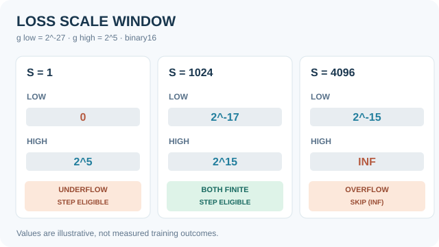

# 混合精度訓練

混合精度訓練把大部分數值以 16 位元浮點數儲存，並以它執行大部分運算，同時保留一份單精度的權重副本，並對損失進行縮放，使微小的梯度不會消失。Micikevicius 等人（2017）顯示，這種做法在多種架構上可把深度學習模型的記憶體用量減少近 2 倍。它是一種訓練技術，在[協同設計總覽](index.zh-TW.md)中作為訓練端的數值格式槓桿。

## 問題

訓練網路時，權重、激活值與梯度都要佔用記憶體，而每一項通常以 32 位元浮點數儲存。記憶體限制了晶片上能容納的模型與批次大小，而搬移 32 位元數值所需的頻寬，則限制了速度。以 16 位元儲存，每個數值搬移的位元組數減半，但 16 位元的範圍與精度較小，使用它訓練可能損失準確度或變得不穩定。

## 關鍵概念

- **半精度：** 用於激活值與梯度的 16 位元浮點格式，範圍與精度都小於 32 位元。
- **主權重：** 一份單精度的權重副本，在每次最佳化器步驟後累積梯度更新，使微小的更新不會因捨入而消失。
- **損失縮放：** 在反向傳播前把損失乘上一個常數，使微小的梯度在半精度中不會下溢；更新權重前再把梯度除以同一個常數。

## 關鍵方法

### 混合精度訓練（Micikevicius 等人，2017）

- **問題：** 32 位元儲存使一個訓練步驟所需的記憶體與頻寬加倍，但 16 位元數值會失去小梯度所依賴的範圍與精度。
- **核心想法：** 保留一份 FP32 的主權重，前向與反向傳播以 FP16 進行，並在反向傳播前把損失乘上一個常數。
- **公式：** 最佳化器收到 \(g = \tfrac{1}{S}\nabla_\theta(S \cdot L)\)，並更新 FP32 的主權重 \(\theta \leftarrow \theta - \eta\, g\)。縮放因子 \(S\) 會相互抵消，因此在沒有數值溢位或下溢時，更新與全精度訓練一致。
- **結果：** 論文報告，在卷積網路、循環網路與生成對抗網路上，記憶體用量減少近 2 倍。
- **限制：** 主權重與最佳化器狀態仍保持全精度，因此節省不到一半。縮放倍數必須調整，以避免溢位。

8 位元的延伸是 [FP8](fp8.zh-TW.md)。結果與限制見下文。

## 運作方式

每個訓練步驟依序進行以下階段：

1. 把單精度的主權重複製成半精度副本。
2. 以半精度執行前向與反向傳播，並對損失進行縮放。
3. 還原梯度的損失縮放。
4. 把更新套用到單精度的主權重上。

運算與儲存的激活值都以較低的寬度執行，這正是記憶體與頻寬節省的來源。主權重與更新仍以完整寬度進行，因此微小的變化不會被捨入掉。

### 損失縮放如何避免 FP16 下溢：連續動畫

*原創連續教學動畫，CC BY-SA 4.0。* 人工設定的梯度為 $g=2^{-27}\approx7.45\times10^{-9}$，小於 IEEE binary16 的最小正次正規（subnormal）數值 $2^{-24}$，採最接近且同距取偶數捨入（round-to-nearest-even）時，因其小於最小正次正規數的一半，直接轉成 FP16 會捨入為 **0**。若先在反向傳播前把 loss 乘上 $S=2^{10}=1024$，縮放後梯度 $Sg=2^{-17}$ 就能以 FP16 表示；轉回 FP32 再除以 $S$，可得到供 FP32 主權重更新的 $g=2^{-27}$。此為**可驗算的教學示意數值，不是模型實測**。實際訓練仍須避免縮放溢位，且任意梯度不保證都能精確還原，因為仍可能發生捨入或非正規數沖零（flush-to-zero）。圖中只示範單一梯度，並不表示混合精度訓練中的所有運算皆用 FP16。MkDocs 沿用鍵盤可操作的播放／暫停與減少動態效果回退，手機可水平捲動。[完整 SVG 動畫](../../../assets/concept-animations/fp16-loss-scaling-motion.svg) · [GitHub 靜態預覽](../../../assets/concept-animations/fp16-loss-scaling-still.svg)。

### 損失縮放的有效區間：救回微小梯度，也可能使大梯度溢位

*原創逐級 SVG 教學動畫與 GitHub 三情境回退圖，CC BY-SA 4.0。* 設兩個**人工梯度** $g_{\mathrm{low}}=2^{-27}$、$g_{\mathrm{high}}=2^5$，在以 FP16 表示**之前**，先乘上相同的二次方縮放係數 $S$。對支援次正規數、採最接近且同距取偶數捨入的 IEEE binary16，最小正次正規數是 $2^{-24}$，最大有限數是 **65504**。當 $S=1$，小梯度會捨入為零；當 $S=2^{10}=1024$，兩者為 $2^{-17}$ 與 $2^{15}$，都可表示；當 $S=2^{12}=4096$，大梯度變成 $2^{17}$，造成上溢。對這**兩個特定數值與二次方縮放設定**，兩者都保持非零且有限的範圍為 **$8\le S\le1024$**，此處的 $S$ 只取 2 的整數次方。

邊界情況也很重要：$S=4$ 時，小梯度為 $2^{-25}$，恰好位於零與最小正次正規數的中點，因此在同距取偶數捨入下仍為 **0**；當 **$S=8$** 才到達可表示的 $2^{-24}$。另一方面，當 **$S=2048$**，大梯度為 $2^{16}=65536>65504$，首次上溢。動畫只逐級切換到 **2 的整數次方縮放係數**，下方讀數同步顯示目前 $S$，以及 LOW ZERO、BOTH FINITE 或 HIGH INF 的結果。兩個移動圓點共用 $|Sg|$ 指數軸。**紫色虛線連接兩個捨入前的數值，並隨縮放等距平移，兩者始終相差 32 個二進位指數。** 兩個數值同乘縮放係數後，其比值不變：

$
\begin{aligned}
\frac{|Sg_{\mathrm{high}}|}{|Sg_{\mathrm{low}}|}
  &= \frac{|g_{\mathrm{high}}|}{|g_{\mathrm{low}}|},\\
\log_2\frac{|g_{\mathrm{high}}|}{|g_{\mathrm{low}}|}
  &= 32.
\end{aligned}
$

共同的 $S$ 不會縮小兩種梯度間的動態範圍；因此安全的縮放係數須同時滿足 FP16 的上下數值邊界。回到色帶判讀：左側橘紅區現在以虛線標出精確的 $2^{-25}$ **捨入為零中點**，而不是錯把最小正次正規數 $2^{-24}$ 當成捨入界線；恰好位於中點仍捨入為零，略高於中點則可能捨入成非零的次正規數。圓點位置表示**捨入前**的 $|Sg|$，下方狀態則表示**經 binary16 捨入後**的結果。右側橘紅區代表本例所採用的 2 的整數次方中，第一個溢位的 $2^{16}$，不是所有實數輸入的精確溢位門檻。這些都是**可驗算的人工數值，不是模型實測**，也不是通用的安全縮放區間。實際梯度分布會變動，部分硬體會將次正規數沖零，許多運算也會在 FP32 累加。更新最佳化器前仍須將梯度除回原本的縮放係數，如前節所述。MkDocs 可播放／暫停；GitHub 的[三情境靜態比較](../../../assets/concept-animations/fp16-scaling-window-still.svg)與[完整 SVG 動畫](../../../assets/concept-animations/fp16-scaling-window-motion.svg)可分別查看結果與連續跨界過程，減少動態效果模式會呈現靜態版本。

## 結果

Micikevicius 等人（2017）報告，採用此方法可把深度學習模型的記憶體用量減少近 2 倍。他們建議保留一份單精度的權重副本，在每次最佳化器步驟後累積梯度，並對損失進行縮放，以處理半精度梯度的資訊損失。他們測試的架構包括卷積網路、循環網路與生成對抗網路。

Micikevicius 等人（2022）把這個想法延伸到[8 位元浮點格式](fp8.zh-TW.md)，E4M3 與 E5M2。他們報告，在參數多達 1750 億的模型上，以這些格式訓練，其結果品質與 16 位元訓練實質相當，且超參數保持不變。這是訓練的結果；[量化](../../../theory/model-compression/quantisation/index.zh-TW.md)中所涵蓋的低精度推論方法，則是另一條研究路線。

## 限制

節省的記憶體不到全部記憶體的一半，因為主權重仍保持單精度，而這個方法也沒有減少最佳化器的狀態。半精度梯度可能損失資訊，這正是需要損失縮放的原因，而縮放倍數必須選擇得使數值既不下溢也不上溢。論文的實驗只涵蓋上述架構，因此在其他模型上的結果需要另行檢驗。

## 開放問題

- **訓練能降到多低的位元。** FP8 的結果顯示，8 位元格式在大型模型上能與 16 位元的品質相當，但哪些運算與訓練的哪些階段能容忍較低的精度，仍在研究中。
- **硬體支援。** 晶片能否以記憶體節省所暗示的速度執行半精度與 8 位元運算，取決於硬體，因此[加速器](../accelerators/index.zh-TW.md)的比較十分重要。

## 相關連結

混合精度是[協同設計總覽](index.zh-TW.md)中三個槓桿之一。它所節省的記憶體，正是[記憶體階層與頻寬](../memory-hierarchy/index.zh-TW.md)所描述的成本；而「每個數值使用較少位元」的想法，也出現在[量化](../../../theory/model-compression/quantisation/index.zh-TW.md)的推論端。[FlashAttention](../../../theory/models/transformer/attention-variants/flash-attention/index.zh-TW.md) 是在同樣記憶體限制下運作的核心。

## 參考文獻

### 開創性論文

- Micikevicius, P., 等人 (2017). *Mixed Precision Training*. arXiv:1710.03740. https://arxiv.org/abs/1710.03740 — 顯示 16 位元訓練在多種架構上可把記憶體用量減少近 2 倍，並需搭配主權重與損失縮放。
- Micikevicius, P., 等人 (2022). *FP8 Formats for Deep Learning*. arXiv:2209.05433. https://arxiv.org/abs/2209.05433 — 提出兩種 8 位元浮點編碼，在多達 1750 億參數的模型上達到與 16 位元訓練相當的品質。

### 綜述與教科書

- Sze, V., Chen, Y.-H., Yang, T.-J., Emer, J. S. (2017). *Efficient Processing of Deep Neural Networks: A Tutorial and Survey*. arXiv:1703.09039. https://arxiv.org/abs/1703.09039 — 綜述 DNN 硬體的能量效率與吞吐量，並涵蓋硬體與演算法的共同設計。

### 文章與文件

- Krishnamoorthi, R. (2018). *Quantizing deep convolutional networks for efficient inference: A whitepaper*. arXiv:1806.08342. https://arxiv.org/abs/1806.08342 — 推論端的對應做法：逐通道的 8 位元量化能讓許多 CNN 維持在浮點數 2% 以內的準確度。
- Gholami, A., 等人 (2024). *AI and Memory Wall*. arXiv:2403.14123. https://arxiv.org/abs/2403.14123 — 主張記憶體而非運算已成為 AI 應用（尤其是服務）的主要瓶頸，這正是此方法所紓解的壓力。
