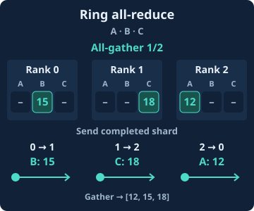
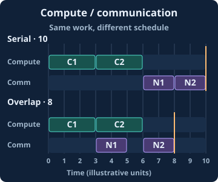

# 互連與擴展

當模型無法放進單一加速器時，單一晶片的速度就不如晶片之間的連線重要。訓練與服務會把權重、激活值與梯度分散到許多裝置上，而連線的頻寬與延遲，決定有多少工作能平行進行。互連也形成一個與記憶體類似的階層：封裝或伺服器內部是非常快的連線，機架與叢集之間則較慢。本頁是 [AI 硬體](../index.zh-TW.md)章節的子章節。它涵蓋各層連線、使用這些連線的集體通訊操作，以及平行化策略如何決定哪些資料跨越各層連線。

## 問題

當矩陣乘法被切分到多顆晶片上時，它所需的部分資料位於其他晶片，可能是部分和、激活值或梯度。搬移這些資料的時間，可能超過實際計算的時間。因此平行的配置必須讓大量流量留在最快的連線上，並讓其餘的通訊與計算重疊。

## 核心想法

連線分成數個層級，每一層決定了哪種平行化能在其上有效率地執行：

| 層級 | 例子 | 典型範圍 |
|---|---|---|
| 伺服器或機架規模的網域內 | GPU 系統中的 NVLink 與 NVSwitch | 一組彼此之間頻寬非常高的 GPU |
| 機櫃或切片內 | TPU 系統中的晶片間互連（ICI），排列成三維環面（3D torus） | 一個 TPU 切片或 pod |
| 伺服器之間 | InfiniBand，或搭配 RDMA 的乙太網路（RoCE） | 一個叢集，每顆晶片的頻寬較低 |

平行工作通常這樣切分：最頻繁的通訊留在最快的層級。張量平行在每一層內都要交換資料，因此需要最快的連線；資料平行每個步驟只交換一次梯度，因此可以容忍較慢的連線。

集體通訊操作描述了常見的通訊模式。全歸約（all-reduce）把各晶片的值加總，並讓每顆晶片都拿到結果。全收集（all-gather）把分片收集到每顆晶片上，歸約分散（reduce-scatter）則加總後讓每顆晶片只留下一個分片。全互換（all-to-all）把不同的資料片段送到每一顆其他晶片，這是混合專家模型把 token 路由到專家時的模式。

## 公式或演算法

環狀全歸約（ring all-reduce）把晶片排成一個環。它以歸約分散接著全收集的方式執行，每個步驟中每顆晶片都傳送與接收一部分資料。在這個演算法的標準成本模型中，每顆晶片的頻寬成本為

\[
T \approx \frac{2(N-1)}{N} \cdot \frac{S}{B}
\]

其中 \(N\) 是晶片數，\(S\) 是每顆晶片上的資料量，\(B\) 是連線的頻寬。Patarasuk 與 Yuan（2009）研究叢集上的頻寬最佳全歸約演算法，本頁的環狀成本模型取自這一脈絡。由於本環境無法讀取該論文全文，上方的算式尚未逐行對照原文。係數 \(2(N-1)/N\) 隨 \(N\) 增加而趨近於二，因此叢集擴大時，每顆晶片的流量幾乎不變。這裡忽略了延遲，而延遲對小訊息很重要。若通訊與計算完全重疊，步驟時間是兩者中較大的那一個，而不是兩者相加。

不同的平行化策略傳送的內容不同。資料平行每個步驟對梯度做一次全歸約。張量平行在每一層內對激活值做全歸約，頻率高，需要快速連線。流水線平行只在相鄰的階段之間傳送激活值，資料量少得多。如 ZeRO 與 FSDP 的分片資料平行，則在使用前做參數的全收集，在使用後做梯度的歸約分散。

### 動畫解說：環狀歸約與結果複製

*原創教學動畫，CC BY-SA 4.0。* [GitHub 靜態預覽](../../../assets/concept-animations/interconnect-ring-reduction-still.svg) · [完整 SVG 動畫](../../../assets/concept-animations/interconnect-ring-reduction-motion.svg)。

Rank 0 起始為 (1, 2, 3)，rank 1 為 (4, 5, 6)，rank 2 為 (7, 8, 9)。每一同步輪次，各 rank 將一個分片傳給下一個鄰居（0 → 1 → 2 → 0）。前兩輪歸約分散中，接收端將收到的部分和加到本地對應分片；圖中隱藏已送出、不再參與後續運算的部分和，並非表示實際釋放緩衝區。最後 rank 0 持有 B=15、rank 1 持有 C=18、rank 2 持有 A=12。後兩輪全收集只複製已完成歸約的分片，不再相加，最終每個 rank 都得到 (12, 15, 18)。移動圓點代表傳輸中的封包，卡片則顯示每輪開始前仍有效的資料狀態。

若原始向量大小為 $S$，且三個分片等大，每個 rank 共傳送四個分片，即 $4S/3$ 位元組，接收量亦相同。這是上述頻寬成本式在三個 rank 情況下的單方向流量，而非網路介面吞吐量實測值。四個輪次還會產生啟動延遲。

### 動畫解說：通訊與計算重疊

*原創教學動畫，CC BY-SA 4.0。* [GitHub 靜態預覽](../../../assets/concept-animations/interconnect-bucket-overlap-still.svg) · [完整 SVG 動畫](../../../assets/concept-animations/interconnect-bucket-overlap-motion.svg)。

假設 C1、C2 各需三個時間單位，在計算串流中執行；N1、N2 各需兩個時間單位，在獨立的通訊串流中執行。每個 N 桶須等對應的 C 桶完成。串行排程先完成兩個計算桶，再依序通訊，共需 10 單位。重疊排程中，N1 在時間 3、C1 完成後立即開始，與 C2 重疊至時間 5；N2 必須等 C2 在時間 6 完成後才開始，因此整步在時間 8 結束。橘色游標以相同速率掃過兩種排程；較亮的區塊表示正在執行，較暗的區塊則依游標位置區分尚未執行或已完成。最後一段通訊仍暴露在關鍵路徑上，無法透過這個排程隱藏。

上述皆為示意數值，並非硬體實測。此例假設計算與通訊資源獨立，且無資源競爭或額外啟動成本，實際重疊程度可能更低。兩項動畫均沿用網站可使用鍵盤操作的播放／暫停控制；暫停會回到代表性靜態圖，偏好減少動態效果時預設顯示靜態圖。

## 結果

Jouppi 等人（2023）描述 TPU v4 的 pod，它以光學電路交換器重新配置互連拓撲。他們報告，交換器與其光學元件佔系統成本不到 5%、佔系統功耗不到 3%。在相近規模的系統上，TPU v4 比 Nvidia A100 快 1.2 至 1.7 倍，功耗低 1.3 至 1.9 倍。

Shoeybi 等人（2019）把每一層切分到多顆 GPU 上，在 512 顆 GPU 上訓練 83 億參數的 Transformer，擴展效率為 76%。Rajbhandari 等人（2019）顯示，ZeRO 在資料平行與模型平行訓練中消除了記憶體冗餘，同時保持通訊量低。Narayanan 等人（2021）結合張量、流水線與資料平行，在 3072 顆 GPU 上訓練一兆參數的模型。他們指出，若直接套用這些方法，由於跨節點通訊代價高昂，成本會變得很大。

## 限制

不同世代與廠商的頻寬數字不同，而且常以每個方向、每條連線或每顆晶片來表示，因此無法直接比較。拓撲也很重要：環面、交換式網路與樹狀結構，即使名義頻寬相同，集體通訊的成本也不同。上面的頻寬模型忽略了延遲與競爭。實際的擴展效率還取決於重疊程度、負載平衡，以及在大規模下更頻繁出現的故障。

## 開放問題

- **快速網域能擴大到多大。** 何時應把緊密耦合的群組拆到較慢的連線上，取決於工作負載。像 TPU v4 那樣的光學交換，是讓大型網域變得便宜的一種答案。
- **專家路由。** [混合專家](../../../theory/models/mixture-of-experts/index.zh-TW.md)模型路由所產生的全互換流量，與全歸約是不同的模式，而且可能比全歸約更難與計算重疊。
- **較小的訊息。** 較低精度的梯度與激活值可以減少流量，見[量化](../../../theory/model-compression/quantisation/index.zh-TW.md)。
- **相關：** [記憶體階層](../memory-hierarchy/index.zh-TW.md)在晶片內部遵循相同的邏輯，各層記憶體之間的頻寬決定速度。

## 相關連結

本主題的訓練端說明見[分散式訓練](../../distributed-training/index.zh-TW.md)，包括 [ZeRO](../../distributed-training/zero.zh-TW.md)、[Megatron 張量平行](../../distributed-training/megatron-tensor-parallelism.zh-TW.md)、[FSDP](../../distributed-training/fsdp.zh-TW.md) 與 [GPipe](../../distributed-training/gpipe.zh-TW.md)。[TPU](../accelerators/tpu/index.zh-TW.md) 的 pod 設計，則是這裡所討論拓撲的硬體對應。

## 參考文獻

### 開創性論文

- Jouppi, N. P., 等人 (2023). *TPU v4: An Optically Reconfigurable Supercomputer for Machine Learning with Hardware Support for Embeddings*. arXiv:2304.01433. https://arxiv.org/abs/2304.01433 — 說明以光學電路交換重新配置 TPU v4 的網路，並報告其與 A100 相比的速度與功耗。
- Shoeybi, M., 等人 (2019). *Megatron-LM: Training Multi-Billion Parameter Language Models Using Model Parallelism*. arXiv:1909.08053. https://arxiv.org/abs/1909.08053 — 顯示層內模型平行可在 512 顆 GPU 上訓練 83 億參數的 Transformer，擴展效率為 76%。
- Rajbhandari, S., 等人 (2019). *ZeRO: Memory Optimizations Toward Training Trillion Parameter Models*. arXiv:1910.02054. https://arxiv.org/abs/1910.02054 — 在資料平行與模型平行訓練中消除記憶體冗餘，同時保持通訊量低。
- Narayanan, D., 等人 (2021). *Efficient Large-Scale Language Model Training on GPU Clusters Using Megatron-LM*. arXiv:2104.04473. https://arxiv.org/abs/2104.04473 — 結合張量、流水線與資料平行來訓練一兆參數的模型，並討論跨節點傳輸的成本。
- Patarasuk, P. 與 Yuan, X. (2009). Bandwidth optimal all-reduce algorithms for clusters of workstations. *Journal of Parallel and Distributed Computing*, 69, 117–124. https://doi.org/10.1016/j.jpdc.2008.09.002 — 研究叢集上頻寬最佳的全歸約演算法，是本頁環狀成本模型的來源。本版未閱讀全文。
- Sergeev, A. 與 Del Balso, M. (2018). *Horovod: fast and easy distributed deep learning in TensorFlow*. arXiv:1802.05799. https://arxiv.org/abs/1802.05799 — 以環狀歸約讓資料平行訓練中 GPU 之間的通訊更有效率。
