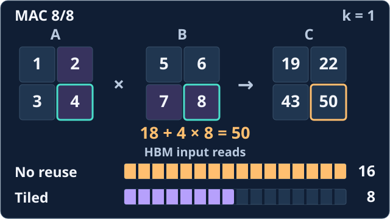

# 記憶體階層與頻寬

在 AI 加速器上，速度通常受限於資料送達運算單元的速度，而非算術單元本身的速度。記憶體組織成一個階層：靠近運算單元的是小而快的儲存，遠離的則是大而慢的儲存。運算的算術強度，以及以它為基礎的[屋頂線模型](roofline.zh-TW.md)，可以說明一個工作負載受記憶體還是受運算限制。LLM 的解碼是受記憶體限制的典型例子。本頁是 [AI 硬體](../index.zh-TW.md)章節的子章節，與 [AI 加速器](../accelerators/index.zh-TW.md)的比較並列。

## 問題

現代加速器每秒能執行的乘加運算遠多於它能載入運算元的次數。每個從遠處讀取的運算元都要花費時間與能量，因此實際達到的吞吐量，往往由記憶體流量決定，而非晶片標示的峰值 FLOP 數。

## 核心想法

讓資料靠近使用它的地方，並在被換出之前盡可能重複使用。階層中的每一層都以容量換取速度：

| 層級 | 位置 | 容量 | 速度 |
|---|---|---|---|
| 暫存器 | 每個處理單元內部 | 非常小 | 最快 |
| 晶片上的 SRAM | 晶片上的快取、共享記憶體與暫存區 | 小 | 非常快 |
| 晶片外的高頻寬記憶體（HBM）或 DRAM | 與晶片並排的封裝 | 大 | 比晶片上的 SRAM 慢得多 |
| 主機記憶體與儲存 | 跨越主機或網路連線 | 非常大 | 慢得多 |

[AI 與記憶體牆](ai-and-memory-wall.md) 主張，記憶體頻寬對大型模型的限制已超過運算（Gholami et al., 2024）。

哪些工作留在快的層級，由軟體決定。把矩陣乘法切成分塊，讓每個分塊在 SRAM 中被重複使用，就是典型的做法。

### 動態解說：矩陣乘法分塊

*原創教學動畫，CC BY-SA 4.0。GitHub 顯示[靜態 SVG](../../../assets/concept-animations/memory-tiled-input-reuse-still.svg)；網站提供播放／暫停（暫停時顯示代表性靜態畫面）。* [完整 SVG 動畫](../../../assets/concept-animations/memory-tiled-input-reuse-motion.svg)。

在這個**人工設定、非設備實測**的示例中，$C=AB$，其中 $A=[[1,2],[3,4]]$、$B=[[5,6],[7,8]]$。兩種排程都將四個輸出累加器初始化為零，依 $k$、$i$、$j$ 的順序執行相同的八次乘加（若一次乘加算兩次浮點運算，共 16 FLOPs）。藍綠框標示當前運算元，橘框標示更新的輸出。紫色格子是保留在本地的輸入分塊：每個 $k$ 只讀取一次 $A_{:,k}$ 的兩個元素與 $B_{k,:}$ 的兩個元素，再重複用於外積更新的四個乘積。

刻意不重用輸入的對照排程，每次乘加都從 HBM 讀取兩個輸入，共 16 次；分塊排程每個 $k$ 讀取四個元素，共 8 次，計數器在該 $k$ 的第一次乘加時便計入分塊載入。兩種排程都將輸出累加器保留在本地，最後各寫出四個輸出一次。計數器不含這些相同的輸出寫入與其他流量，結果矩陣均為 $[[19,22],[43,50]]$。本地儲存須能容納分塊與部分和；真實快取行為、較大矩陣及排程開銷都會改變流量與吞吐量，不能據此宣稱兩倍加速（Sze 等人，2017）。

不播放動畫也可透過下表追蹤關鍵轉換點：

| 已完成乘加次數 | 本地分塊 | 不重用（讀取次數） | 分塊（讀取次數） |
|---:|---|---:|---:|
| 0 | 無 | 0 | 0 |
| 1 | 第一欄／列 | 2 | 4 |
| 4 | 第一欄／列 | 8 | 4 |
| 5 | 第二欄／列 | 10 | 8 |
| 8 | 第二欄／列 | 16 | 8 |

每個分塊的第一次乘加須負擔四次輸入讀取，接下來三次則重用這些元素。若輸入與最終輸出每個元素均以兩位元組儲存，示例中的 HBM 總流量（含四次輸出寫入）在不重用及分塊排程下分別為 40 與 24 位元組，對應運算強度為 0.4 與約 0.667 FLOP/byte。累加器可以使用更寬的本地數值格式，其內部流量不計入此例。這正是[屋頂線模型](roofline.zh-TW.md)流量分母的具體示例，而非頻寬或延遲的實測結果。

## 公式或演算法

一個核心的算術強度，是浮點運算數除以它與晶片外記憶體之間搬移的位元組數：

\[
I = \frac{\text{FLOPs}}{\text{搬移的位元組數}}
\]

[屋頂線模型](roofline.zh-TW.md)（Williams 等人，2009）以峰值運算能力 \(P_{\text{peak}}\) 與記憶體頻寬 \(B\) 限制可達到的效能 \(P\)：

\[
P = \min\left(P_{\text{peak}},\; B \cdot I\right)
\]

兩項在轉折點 \(I^* = P_{\text{peak}} / B\) 相交。\(I < I^*\) 的核心受記憶體限制，\(I > I^*\) 的核心受運算限制。

解碼說明了這對 LLM 為何重要。對一個以每參數兩位元組儲存、具有 \(N\) 個參數的稠密模型，為一條序列生成一個 token 約需 \(2N\) 次 FLOPs，並讀取約 \(2N\) 位元組的權重，因此 \(I \approx 1\)。這遠低於具有大型運算單元的任何加速器的轉折點，所以這一步受限於權重的讀取速度。若在同一批次中服務 \(b\) 條序列，每個權重只讀取一次便供所有序列共用，強度會提高到約 \(b\)。KV 快取還會帶來額外的讀取，且隨上下文長度增加，因此長上下文會把解碼進一步推向記憶體的上限。

## 結果

Ivanov 等人主張，資料搬移而非算術運算，是訓練 Transformer 時的關鍵瓶頸；他們的資料搬移最佳化，在一個 BERT 編碼器層上比所測試的框架快 1.30 倍。Gholami 等人主張，AI 服務的主要瓶頸是記憶體頻寬，而非運算。Dao 等人顯示，重新安排注意力計算，使其較少讀寫高頻寬記憶體，可以加速注意力，且得到的結果完全相同，見 [FlashAttention](../../../theory/models/transformer/attention-variants/flash-attention/index.zh-TW.md) 頁面。Pope 等人建立推論效率的解析模型，並以它為 TPU v4 切片選擇合適的分割策略。

## 限制

屋頂線模型是一種簡化的描述。它忽略了延遲、運算與記憶體存取之間的重疊、快取命中率，以及晶片之間的通訊。算術強度同時取決於演算法與實作：融合的核心，其強度可能遠高於逐一執行相同運算。實務上很少能達到峰值頻寬或峰值 FLOPs，因此實測數字低於任一上限。

## 開放問題

- **記憶體牆。** Gholami 等人主張，記憶體頻寬的成長慢於運算，因此兩者的差距會逐漸擴大。新的記憶體技術能否彌合這個差距，仍是開放問題。
- **模型端的解法。** 以更少的位元儲存權重，可以減少每個 token 讀取的位元組數，從而提高強度，見[量化](../../../theory/model-compression/quantisation/index.zh-TW.md)。
- **軟體端的解法。** [PagedAttention](../../inference-optimization/paged-attention.zh-TW.md)管理 KV 快取的記憶體，減少浪費；[投機解碼](../../inference-optimization/speculative-decoding.zh-TW.md)則把每次權重讀取分攤到數個 token 上。
- **相關：** [KV 快取](../../../theory/models/transformer/kv-cache/index.zh-TW.md)說明了讀取量為何隨上下文長度增加。

## 相關連結

晶片外的記憶體，是單一晶片與系統其餘部分之間的邊界。晶片與主機之間的資料搬移，則是另一個更慢的層級，擴展的討論依賴於它。[TPU](../accelerators/tpu/index.zh-TW.md)與 [AI 加速器](../accelerators/index.zh-TW.md)的概述，說明了不同設計如何安排它們的記憶體。

## 參考文獻

### 開創性論文

- Ivanov, A., 等人 (2020). *Data Movement Is All You Need: A Case Study on Optimizing Transformers*. arXiv:2007.00072. https://arxiv.org/abs/2007.00072 — 主張限制 Transformer 訓練的關鍵是資料搬移，並報告一個在 BERT 編碼器層上達到 1.30 倍加速的資料搬移最佳化。
- Dao, T., 等人 (2022). *FlashAttention: Fast and Memory-Efficient Exact Attention with IO-Awareness*. arXiv:2205.14135. https://arxiv.org/abs/2205.14135 — 以較少的高頻寬記憶體讀寫計算精確注意力，因此速度更快。
- Williams, S., Waterman, A. 與 Patterson, D. (2009). *Roofline: An Insightful Visual Performance Model for Multicore Architectures*. Communications of the ACM 52(4). https://doi.org/10.1145/1498765.1498785 — 提出屋頂線模型，以峰值運算能力與記憶體頻寬限制可達到的效能。

### 綜述與教科書

- Sze, V., Chen, Y.-H., Yang, T.-J., Emer, J. S. (2017). *Efficient Processing of Deep Neural Networks: A Tutorial and Survey*. arXiv:1703.09039. https://arxiv.org/abs/1703.09039 — 綜述資料流如何利用本地儲存，以降低資料搬移的能量成本。

### 文章與文件

- Gholami, A., 等人 (2024). *AI and Memory Wall*. arXiv:2403.14123. https://arxiv.org/abs/2403.14123 — 主張 AI 服務的主要瓶頸是記憶體頻寬，而非運算。
- Pope, R., 等人 (2022). *Efficiently Scaling Transformer Inference*. arXiv:2211.05102. https://arxiv.org/abs/2211.05102 — 建立推論效率的解析模型，並用以為 TPU v4 切片選擇分割策略。
