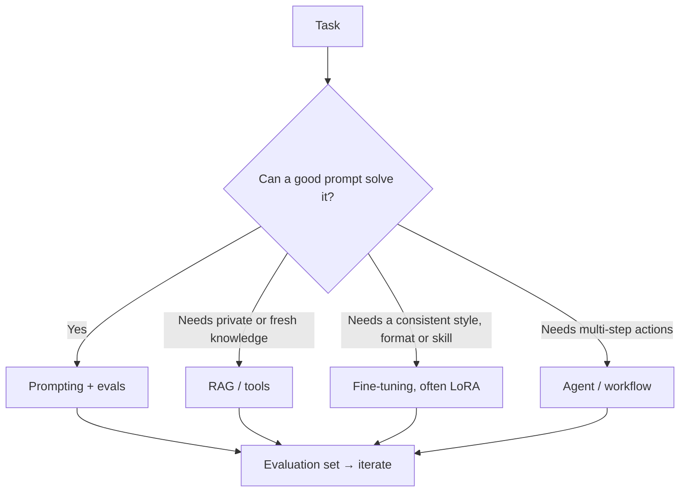

# Engineering

How AI systems are actually built, adapted, evaluated and run.

| Page | Focus |
|---|---|
| [Frameworks & Tools](frameworks/index.md) | PyTorch, JAX, Hugging Face, inference engines, agent frameworks |
| [Data](data/index.md) | Collection, labelling, cleaning, synthetic data, governance |
| [Training & Fine-tuning](training/index.md) | Pre-training at scale, SFT, LoRA/QLoRA, preference optimisation, distillation |
| [Prompt Engineering](prompting/index.md) | Writing effective prompts, structured output, context engineering |
| [Retrieval-Augmented Generation](rag/index.md) | Grounding LLMs in your documents |
| [Distributed Training](distributed-training/index.md) | Data, tensor, pipeline and sharded parallelism; ZeRO and FSDP |
| [Vector Databases](vector-databases/index.md) | Embeddings, approximate nearest-neighbour search, HNSW, FAISS, dense retrieval |
| [LLM Application Security](llm-security/index.md) | Prompt injection, data leakage, excessive agency, defensive design |
| [Agent Engineering](agents/index.md) | Tool calling and MCP, sandboxing, multi-agent orchestration, agent evaluation, observability |
| [Synthetic Data](synthetic-data/index.md) | Generating training data with models, filtering, and model collapse |
| [Evaluation & Benchmarks](evaluation/index.md) | Benchmarks, LLM-as-judge, contamination, human evaluation |
| [Inference Optimization](inference-optimization/index.md) | Batching, paged KV caches, speculative decoding, attention variants |
| [MLOps & Deployment](mlops/index.md) | Serving, monitoring, quantisation, cost, LLMOps |
| [AI Coding Assistants](coding-assistants/index.md) | Completion, chat and agents for programming; productivity and security evidence |
| [AI Hardware](hardware/index.md) | GPUs, TPUs, NPUs, memory bandwidth, interconnects, neuromorphic chips |
| [On-device and Edge AI](on-device-edge/index.md) | Compression, quantisation, distillation, NPUs, TinyML |

## Choosing an approach for an LLM application

Start simple: a strong model with a clear prompt and an evaluation set. Add retrieval for knowledge, fine-tuning for behaviour, and agents only when steps cannot be fixed in advance.
