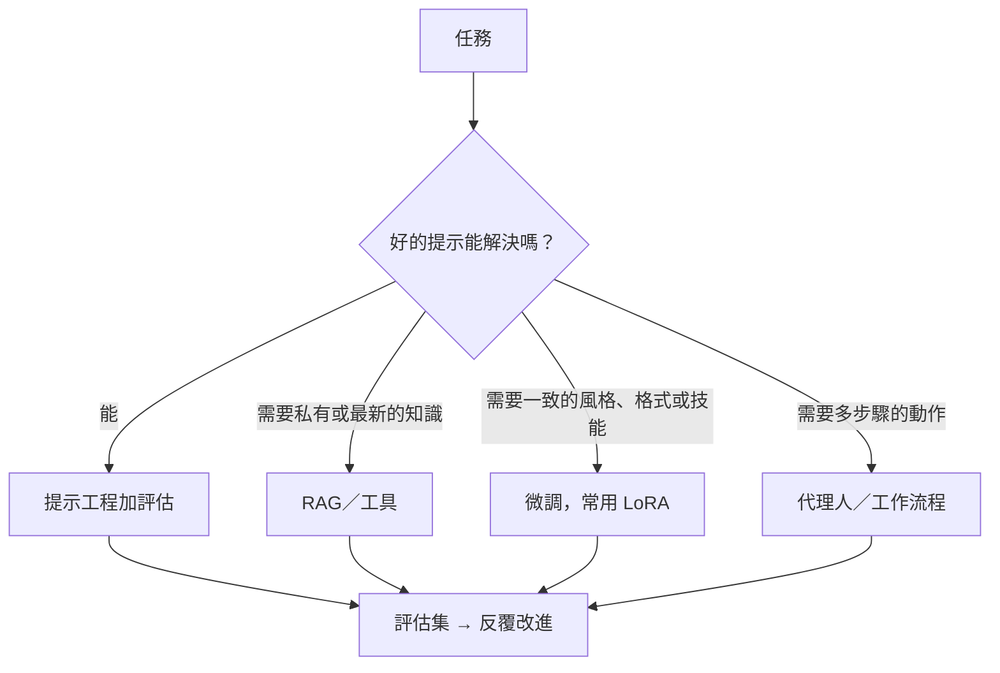

# 工程

AI 系統實際上是如何被建構、調整、評估與運行的。

| 頁面 | 重點 |
|---|---|
| [框架與工具](frameworks/index.md) | PyTorch、JAX、Hugging Face、推論引擎、代理人框架 |
| [資料](data/index.md) | 蒐集、標註、清理、合成資料、資料治理 |
| [訓練與微調](training/index.md) | 大規模預訓練、SFT、LoRA／QLoRA、偏好最佳化、蒸餾 |
| [提示工程](prompting/index.md) | 撰寫有效的提示、結構化輸出、脈絡工程 |
| [檢索增強生成（RAG）](rag/index.md) | 讓 LLM 以你的文件為依據 |
| [分散式訓練](distributed-training/index.md) | 資料、張量、管線與分片平行；ZeRO 與 FSDP |
| [向量資料庫](vector-databases/index.md) | 嵌入、近似最近鄰搜尋、HNSW、FAISS、密集檢索 |
| [LLM 應用安全](llm-security/index.md) | 提示注入、資料外洩、過度代理、防禦式設計 |
| [合成資料](synthetic-data/index.md) | 以模型生成訓練資料、過濾，以及模型崩潰 |
| [評估與基準](evaluation/index.md) | 基準測試、LLM 作為評審、資料污染、人工評估 |
| [推論最佳化](inference-optimization/index.md) | 批次處理、分頁式 KV 快取、推測式解碼、注意力變體 |
| [MLOps 與部署](mlops/index.md) | 服務化、監控、量化、成本、LLMOps |
| [AI 程式助手](coding-assistants/index.md) | 程式設計的補全、對話與代理人；生產力與安全性的證據 |
| [代理人工程](agents/index.md) | 實務上建構 LLM 代理人：迴圈、工具、記憶、沙箱、編排與評估 |
| [AI 硬體](hardware/index.md) | GPU、TPU、NPU、記憶體頻寬、互連、神經形態晶片 |
| [裝置端與邊緣 AI](on-device-edge/index.md) | 壓縮、量化、蒸餾、NPU、TinyML |

## 為 LLM 應用選擇方法

從簡單開始：用強大的模型搭配清楚的提示與評估集。需要知識時再加入檢索，需要改變行為時再微調，只有在步驟無法事先固定時才使用代理人。
