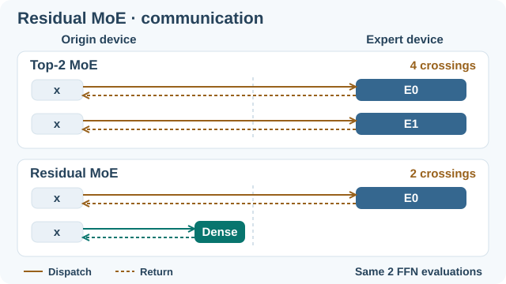

# DeepSpeed-MoE

!!! info "Part of Serving Mixture-of-Experts Models"
    This method page belongs to [Serving Mixture-of-Experts Models](moe-serving.md). It explains DeepSpeed-MoE in detail; the parent page compares it with the other methods.

DeepSpeed-MoE is a set of model compression techniques and an inference system for mixture-of-experts models, from the DeepSpeed project. It reduces the size of an MoE model, and it runs the model with an inference system designed for the MoE layers, which the authors report as faster and cheaper than existing MoE inference solutions and than quality-equivalent dense models.

## Problem

MoE models have many more parameters than dense models of similar quality, so they are expensive to store and to serve. Existing inference solutions were built for dense models, and they handle the routing and the expert computation poorly. The problem is to make MoE inference cheap enough to be worth the larger parameter count, both in memory and in latency and cost.

## Core idea

DeepSpeed-MoE combines two parts. The first is a set of compression techniques that reduce the MoE model's size while keeping its quality. The second is an inference system that handles the expert layers efficiently, including the routing and the communication between devices. Together they aim to make the sparse model cheap enough to compete with a dense model that has similar quality.

## Procedure

1. Train or obtain a sparse MoE model.
2. Apply the compression techniques to reduce the model's size.
3. Deploy the compressed model on the inference system, which places the experts and handles their routing.
4. Serve requests, with the system grouping tokens by expert and combining the outputs.
5. Compare latency and cost against the dense and MoE baselines on the target hardware.

### Worked example: residual MoE and communication

DeepSpeed-MoE's Pyramid Residual MoE (PR-MoE) combines a depth-dependent expert count with a residual branch: one routed expert and a shared dense feed-forward network (FFN), rather than two routed experts.[^residual-traffic] The two design choices are distinct. The animation isolates the latter choice for a token originating on a device without either of the selected remote experts.

*Original instructional animation, CC BY-SA 4.0.* Solid arrows show dispatch and dashed arrows show return. The two copies of x denote the same token, not two independent requests. Both returned branch outputs are combined at the origin (combination weights are omitted). On MkDocs use **Play/Pause** (Enter or Space); reduced-motion preferences show the still. On narrow screens the figure may be scrolled horizontally. [GitHub-readable static preview](../../assets/concept-animations/deepspeed-residual-traffic-still.svg).

| Logical work per token | Top-2 MoE | Residual MoE |
|---|---:|---:|
| FFN evaluations | 2 | 2 |
| Remote activation sends | 2 | 1 |
| Remote output returns | 2 | 1 |
| Total cross-device payloads | 4 | 2 |

If each payload contains $h$ elements of $b$ bytes each, the two cases carry $4hb$ and $2hb$ logical bytes, respectively. This comparison assumes the dense branch is replicated locally, both original routed experts are remote, equal activation sizes and no other traffic. A selected expert may instead be local, and tensor parallelism, padding, collective algorithms and synchronization can change physical traffic. Two FFN evaluations do not imply equal FLOPs or model quality. The toy comparison is not a measured speedup or a guarantee of halving network bytes.

[^residual-traffic]: Rajbhandari et al., [DeepSpeed-MoE](https://arxiv.org/abs/2201.05596), Section 4.1; the logical payload example is original.

## Results

The abstract reports three claims. The compression techniques reduce MoE model size by up to 3.7 times. The inference system provides 7.3 times better latency and cost compared with existing MoE inference solutions. Against quality-equivalent dense models, the system is up to 4.5 times faster and 9 times cheaper for inference. These comparisons depend on the baselines and the hardware in the paper, so the figures should be read with that setup.

## Limitations

- **Compression trade-off.** The size reduction depends on the compression, which can affect the quality of the model.
- **System dependence.** The latency and cost gains come from the inference system as well as the model, so they are tied to that system.
- **Baseline choice.** The dense comparison is against models of similar quality, which depends on how quality was measured.

## Connections

- The alternative for serving a large MoE model on limited memory is [expert offloading](expert-offloading.md).
- The compiler-level sharding method for the same kind of layers is [GShard](gshard.md).
- The architecture and routing are covered in the [mixture-of-experts theory pages](../../theory/models/mixture-of-experts/index.md).

## Open questions

- How much of the cost gain survives when the compression is applied more aggressively?
- Can the inference system adapt its expert placement to the traffic it actually receives?

## References

### Seminal papers

- Rajbhandari, S. et al. (2022). *DeepSpeed-MoE: Advancing Mixture-of-Experts Inference and Training to Power Next-Generation AI Scale*. arXiv:2201.05596. https://arxiv.org/abs/2201.05596 — The primary paper: MoE compression and an MoE inference system, with latency, cost and size results.
- Lepikhin, D. et al. (2020). *GShard: Scaling Giant Models with Conditional Computation and Automatic Sharding*. arXiv:2006.16668. https://arxiv.org/abs/2006.16668 — Compiler-level sharding of MoE layers, for comparison.
- Eliseev, A. & Mazur, D. (2023). *Fast Inference of Mixture-of-Experts Language Models with Offloading*. arXiv:2312.17238. https://arxiv.org/abs/2312.17238 — An alternative serving approach that keeps inactive experts off the device.
- Fedus, W., Zoph, B. & Shazeer, N. (2022). *Switch Transformers: Scaling to Trillion Parameter Models with Simple and Efficient Sparsity*. Journal of Machine Learning Research 23(120):1–39. arXiv:2101.03961. https://arxiv.org/abs/2101.03961 — The top-1 routing that simplifies MoE inference.
- Kwon, W. et al. (2023). *Efficient Memory Management for Large Language Model Serving with PagedAttention*. SOSP 2023. arXiv:2309.06180. https://arxiv.org/abs/2309.06180 — The serving memory layout for the attention part of the model.
