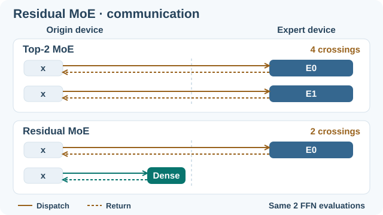

# DeepSpeed-MoE

!!! info "屬於混合專家模型的服務"
    本方法頁隸屬於[混合專家模型的服務](moe-serving.zh-TW.md)。它詳細說明 DeepSpeed-MoE；上層頁面則比較它與其他方法。

DeepSpeed-MoE 是 DeepSpeed 專案中，用於混合專家模型的一組模型壓縮技術與推論系統。它縮小 MoE 模型的大小，並以為 MoE 層設計的推論系統執行模型。作者報告，相較於現有的 MoE 推論方案，以及品質相當的稠密模型，它更快也更便宜。

## 問題

MoE 模型的參數數量遠多於品質相近的稠密模型，因此儲存與服務的成本都很高。現有的推論方案是為稠密模型設計的，處理路由與專家運算的效率不佳。問題在於：如何讓 MoE 推論便宜到值得付出更多參數的代價，無論是在記憶體、延遲或成本上。

## 核心想法

DeepSpeed-MoE 結合兩個部分。第一是一組壓縮技術，在維持品質的同時縮小 MoE 模型。第二是一個推論系統，有效處理專家層，包括路由與裝置之間的通訊。兩者結合的目標，是讓這種稀疏模型便宜到能與品質相近的稠密模型競爭。

## 程序

1. 訓練或取得一個稀疏的 MoE 模型。
2. 套用壓縮技術，縮小模型大小。
3. 把壓縮後的模型部署到推論系統上，由系統放置專家並處理路由。
4. 服務請求，系統依專家為 token 分組，並合併輸出。
5. 在目標硬體上，與稠密與 MoE 基準比較延遲與成本。

### 算例：殘差 MoE 與通訊

DeepSpeed-MoE 的金字塔殘差 MoE（PR-MoE）結合兩種設計：依深度配置不同的專家數量，以及殘差分支，以一個路由專家與共享稠密前饋網路（FFN）取代兩個路由專家。[^residual-traffic] 兩種設計並不相同。動畫隔離後者，假設 token 起始裝置並未持有所選的兩個遠端專家。

*原創教學動畫，CC BY-SA 4.0。* 實線箭頭表示派送，虛線箭頭表示回傳。兩個 x 是同一個 token 的兩份輸入，不是兩筆獨立請求。兩個分支的輸出在起始裝置合併（省略合併權重）。在 MkDocs 使用 **播放／暫停**（Enter 或 Space）；減少動態效果偏好會顯示靜態圖。窄螢幕可水平捲動。[GitHub 可讀靜態預覽](../../assets/concept-animations/deepspeed-residual-traffic-still.svg)。

| 每個 token 的邏輯工作 | Top-2 MoE | 殘差 MoE |
|---|---:|---:|
| FFN 運算次數 | 2 | 2 |
| 遠端 activation 派送 | 2 | 1 |
| 遠端輸出回傳 | 2 | 1 |
| 跨裝置負載總數 | 4 | 2 |

若每份負載包含 $h$ 個元素、每元素 $b$ 位元組，兩種情況的邏輯資料量分別為 $4hb$ 與 $2hb$ 位元組。此比較假設稠密分支在本地複製、原本所選的兩個路由專家皆為遠端、activation 大小相同，且無其他通訊。所選專家也可能位於本地；張量平行、填充、集合通訊演算法及同步都可能改變實際流量。兩次 FFN 運算不代表 FLOPs 或模型品質相等。算例並非實測加速比，也不保證網路資料量減半。

[^residual-traffic]: Rajbhandari 等人，[DeepSpeed-MoE](https://arxiv.org/abs/2201.05596)，第 4.1 節；邏輯負載算例為原創。

## 結果

摘要提出三項主張。壓縮技術可把 MoE 模型大小縮小最多 3.7 倍。推論系統相較於現有 MoE 推論方案，延遲與成本改善 7.3 倍。相較於品質相當的稠密模型，此系統的推論速度最多快 4.5 倍，成本最多低 9 倍。這些比較取決於論文中的基準與硬體，因此讀數字時應連同這些設定一起考慮。

## 限制

- **壓縮的取捨。** 大小縮減取決於壓縮方法，而壓縮可能影響模型品質。
- **依賴系統。** 延遲與成本的增益同時來自模型與推論系統，因此與該系統綁定。
- **基準的選擇。** 與稠密模型的比較，是以品質相近為前提，而這取決於品質的衡量方式。

## 關聯

- 在記憶體有限的情況下服務大型 MoE 模型的替代做法，是[專家卸載](expert-offloading.zh-TW.md)。
- 同類層在編譯器層級的分片方法，是 [GShard](gshard.zh-TW.md)。
- 架構與路由見[混合專家理論頁面](../../theory/models/mixture-of-experts/index.zh-TW.md)。

## 開放問題

- 當壓縮更積極時，成本的增益還能保留多少？
- 推論系統能否依實際收到的流量，調整專家的放置？

## 參考文獻

### 重要論文

- Rajbhandari, S. et al. (2022). *DeepSpeed-MoE: Advancing Mixture-of-Experts Inference and Training to Power Next-Generation AI Scale*. arXiv:2201.05596. https://arxiv.org/abs/2201.05596 — 主要論文：MoE 壓縮與 MoE 推論系統，附有延遲、成本與大小的結果。
- Lepikhin, D. et al. (2020). *GShard: Scaling Giant Models with Conditional Computation and Automatic Sharding*. arXiv:2006.16668. https://arxiv.org/abs/2006.16668 — 編譯器層級的 MoE 層分片，供比較。
- Eliseev, A. & Mazur, D. (2023). *Fast Inference of Mixture-of-Experts Language Models with Offloading*. arXiv:2312.17238. https://arxiv.org/abs/2312.17238 — 讓不活躍的專家離開裝置的另一種服務做法。
- Fedus, W., Zoph, B. & Shazeer, N. (2022). *Switch Transformers: Scaling to Trillion Parameter Models with Simple and Efficient Sparsity*. Journal of Machine Learning Research 23(120):1–39. arXiv:2101.03961. https://arxiv.org/abs/2101.03961 — Top-1 路由，簡化了 MoE 推論。
- Kwon, W. et al. (2023). *Efficient Memory Management for Large Language Model Serving with PagedAttention*. SOSP 2023. arXiv:2309.06180. https://arxiv.org/abs/2309.06180 — 模型注意力部分的服務記憶體佈局。
