# Disaggregated Prefill and Decode

!!! info "Part of Inference Optimization"
    This page sits under [Inference Optimization](index.md). It explains why the two phases of inference are split across machines; each named system has its own page.

Serving a language model runs two phases with different hardware needs. Prefill processes the whole prompt in one parallel pass and is limited by compute. Decoding produces one token at a time and is limited by memory bandwidth. Disaggregated serving runs the two phases on separate GPUs or machines, so that each pool can be sized and scheduled for its own bottleneck, and so that a long prefill does not stall the decoding of other requests.

## Overview

On a shared GPU, a large prefill can take many milliseconds, during which the decoding requests in the same batch wait. Batching the two phases together helps throughput but ties the latency of decoding to the length of the prompts being prefilled. Separating them removes this interference, at the cost of moving the KV cache from the prefill machine to the decoding machine. Whether the move is worth it depends on the cache size, the interconnect and the service-level objective.

## Key concepts

- **Prefill and decode interference.** A prefill request in the same batch as decoding requests delays every decoding step it shares.
- **Goodput.** The rate of requests that finish within their latency objectives, as opposed to raw throughput, which counts all requests.
- **KV transfer.** Moving the KV cache of a prompt from the prefill machine to the decoding machine after prefill.
- **Phase-specific provisioning.** Choosing different hardware or different numbers of machines for each phase, based on its bottleneck.

## How it works

A request is routed to a prefill pool, which computes the prompt's KV cache. The cache is then transferred to a decoding pool, which generates the output tokens. A scheduler decides which pool and which machine receive each request, and it balances the two pools so that neither waits for the other.

*Original animated teaching diagram, CC BY-SA 4.0.* The four highlighted phases trace **one request** from prefill to decode. In a serving system, prefill and decoding for *different* requests may run concurrently in separate pools; the sequential highlights are not a GPU schedule, a latency measurement, or evidence that transfer is free. On MkDocs, use the keyboard-accessible **Play/Pause** control; reduced-motion preferences initially show the static image. [Static KV-handoff overview for GitHub](../../assets/concept-animations/disaggregated-handoff-still.svg). This schematic follows the phase separation described in the DistServe and Splitwise papers already listed in References.

The transfer is the step that the design must make cheap. Systems that use it reduce the cost by sending cache blocks over fast interconnects, and by overlapping the transfer with computation.

## Key methods

Each named system has its own page, which gives the problem, the core idea, the reported results and the limitations. The table compares them.

| Method | Problem it addresses | Core idea | Main trade-off | Page |
|---|---|---|---|---|
| DistServe | Prefill interferes with decoding, so latency objectives are missed | Assign each phase to its own GPUs, and place them to meet the SLO | Needs a placement search for each model and cluster | [DistServe](distserve.md) |
| Splitwise | Prompt and token phases use hardware differently, so one machine type is a poor fit | Split the phases onto separate machines, provisioned per phase | Moving state between machines needs a fast link | [Splitwise](splitwise.md) |
| Mooncake | Overloaded serving must use cache across many requests | A KV-cache-centric architecture that separates prefill and decoding clusters | Depends on a distributed cache store and its placement | [Mooncake](mooncake.md) |

Chunked prefill, which splits a long prompt into pieces and mixes them into decoding batches, is an alternative that keeps the phases on one machine. It is not given a separate page here, and its trade-offs are noted in the method pages that discuss the same problem.

## Results

The reported gains depend on the system, the workload and the baseline. DistServe reports that it can serve 7.4 times more requests, or meet a 12.6 times tighter SLO, than the state-of-the-art systems it compares against. Splitwise reports 1.4 times higher throughput at 20 percent lower cost, or 2.35 times more throughput at the same cost and power. Mooncake reports up to a 525 percent throughput increase in certain simulated scenarios, and a 75 percent increase in requests handled under real workloads. These numbers come from different setups, so they are not directly comparable.

## Trade-offs

- **Transfer cost.** The KV cache of a long prompt can be large, so the transfer adds latency and needs bandwidth. Short prompts may not benefit.
- **Pool balance.** The ratio of prefill to decoding machines depends on the workload, and it shifts when the prompt mix changes.
- **Utilisation.** Two pools can leave capacity idle when one is over-provisioned for a peak that the other does not share.
- **Complexity.** Failures, retries and cache placement all cross machine boundaries, which a single-machine server does not face.

## Connections

- The batching that each pool uses internally is [Orca](orca.md)-style iteration-level scheduling.
- The memory layout that makes moving cache blocks practical is [PagedAttention and vLLM](paged-attention.md).
- The cache itself, and its compression, are covered on [KV cache compression and eviction](kv-cache-compression.md) and in the [Transformer KV cache](../../theory/models/transformer/kv-cache/index.md) page.
- Hardware choices for each phase depend on [AI Hardware](../hardware/index.md).

## Open questions

- How should a scheduler set the prefill-to-decoding ratio when the prompt length changes within minutes?
- When the transfer link is slow, is it better to recompute the prefill on the decoding machine than to move the cache?

## References

### Seminal papers

- Zhong, Y. et al. (2024). *DistServe: Disaggregating Prefill and Decoding for Goodput-optimized Large Language Model Serving*. arXiv:2401.09670. https://arxiv.org/abs/2401.09670 — Assigns prefill and decoding to different GPUs to remove interference, and reports goodput and SLO gains.
- Patel, P. et al. (2023). *Splitwise: Efficient generative LLM inference using phase splitting*. arXiv:2311.18677. https://arxiv.org/abs/2311.18677 — Splits the prompt and token phases onto separate machines, provisioned for each phase, with throughput and cost results.
- Qin, R. et al. (2024). *Mooncake: A KVCache-centric Disaggregated Architecture for LLM Serving*. arXiv:2407.00079. https://arxiv.org/abs/2407.00079 — A serving architecture built around the KV cache, which separates prefill and decoding clusters under overload.
- Yu, G.-I. et al. (2022). *Orca: A Distributed Serving System for Transformer-Based Generative Models*. OSDI 2022. https://www.usenix.org/conference/osdi22/presentation/yu — Iteration-level scheduling, which each pool in a disaggregated system uses internally.
- Kwon, W. et al. (2023). *Efficient Memory Management for Large Language Model Serving with PagedAttention*. SOSP 2023. arXiv:2309.06180. https://arxiv.org/abs/2309.06180 — The paged cache layout in which transferred blocks are stored and reused.
