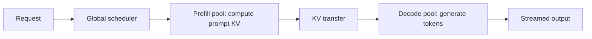

# Disaggregated Prefill and Decode

Disaggregated prefill and decode is a serving design that runs the two phases of LLM inference on separate pools of GPUs. The prefill pool processes the prompt and builds its [KV cache](../../theory/models/transformer/kv-cache/index.md); that cache is then moved to a decode pool, which generates the output. Separating the phases removes the interference that occurs when long prompts and token-by-token generation share one GPU, and it lets each pool be sized and configured for its own latency target.

## Overview

Serving a request has two phases, described in [Inference Optimization](index.md). Prefill reads the whole prompt in one parallel pass and produces the first token. Decoding then produces the rest one at a time, reading the weights and the request's cache at each step.

Most engines colocate the two phases on the same GPUs. [Continuous batching](orca.md) keeps that shared batch full, but a large prefill that joins it slows every decoding step, and users see a stall between tokens. Disaggregation avoids the conflict by giving each phase its own machines. Research systems proposed this in 2023 and 2024, and Mooncake reports use in a production service.

## Key concepts

- **Prefill instance**: a worker that processes prompts and writes their KV cache.
- **Decode instance**: a worker that receives the cache and generates output tokens.
- **Time to first token (TTFT)** and **time per output token (TPOT)**: the delay before the first token, mainly set by prefill, and the average gap between later tokens, mainly set by decoding.
- **Service-level objective (SLO)**: the latency targets a service promises, usually bounds on TTFT and TPOT.
- **Goodput**: the rate of requests that finish while meeting their SLO. DistServe uses it as its main metric in place of raw throughput.
- **KV transfer**: moving one request's cache from the prefill instance to the decode instance over a network or interconnect.

## How it works

For one request, the path runs through a router and two pools:

The scheduler sends the request to a prefill instance. Before the transfer starts, the decode instance must reserve memory for the incoming cache. When the prefill finishes, the cache moves over the network, and the decode instance takes over until the output ends.

The reason the phases can be split so cleanly is that their bottlenecks differ. In prefill, one read of the weights serves every prompt token, so arithmetic intensity is high and compute limits speed (the roofline model in the references explains this trade-off). In decoding, each step reads the weights and the cache of each sequence to produce one token per sequence, so memory bandwidth limits speed. A pool can therefore be given the parallelism and GPU count that suit its phase, and the ratio of prefill to decode GPUs can follow the load.

**KV transfer cost.** The cache moved per request follows the formula $2 \cdot L \cdot H_{kv} \cdot d_h \cdot T \cdot b$ from [KV cache compression](kv-cache-compression.md), with $T$ the prompt length. As a back-of-the-envelope example, assume 32 layers, 32 key-value heads of dimension 128, and 16-bit values. Each token then needs $2 \cdot 32 \cdot 32 \cdot 128 \cdot 2$ bytes, which is 512 KiB. A 2048-token prompt produces 1 GiB of cache. Over a link carrying 25 GB/s, that takes about 40 ms, which is a visible share of a TTFT target measured in hundreds of milliseconds. Grouped-query attention, quantised caches and fast interconnects all reduce this cost, and a design can overlap the transfer with prefill compute, for example by sending each layer's cache as soon as it is ready. The figures here are illustrative, not measurements.

## Key methods

The main variants differ in what they optimise and what they change beside the split itself. The last row is a colocated alternative that avoids moving the cache. Results are each paper's own abstract figures, on different models and hardware, so they are not directly comparable.

| Variant | What separates it | Reported result (from its abstract) |
|---|---|---|
| Splitwise | Characterises the two phases, then splits them across machines, with the decode machines chosen for lower power and cost | 1.4 times the throughput at 20% lower cost than current designs |
| DistServe | Chooses resources and parallelism for each phase separately, against a goodput target, and places the phases by cluster bandwidth | Up to 7.4 times more requests, or 12.6 times tighter SLO, than state-of-the-art systems |
| TetriInfer | Splits prompts into fixed-size chunks, disaggregates the phases and schedules with predicted resource use | 97% lower average TTFT and 47% lower average job completion time, with 38% fewer resources |
| Mooncake | A KV-cache-centric architecture for a production service, with a cache pool across CPU memory and SSD and early rejection under overload | Up to 525% higher throughput in some simulated scenarios; 75% more requests served in the real workload |
| Sarathi-Serve (colocated) | Chunked prefill adds prompt chunks to decode batches without pausing decoding, so no cache moves | 2.6 times the serving capacity of vLLM for Mistral-7B on one A100, under tail-latency limits |

Splitwise treats the split as a hardware and cost decision, DistServe as a planning problem set by the SLO, and TetriInfer and Mooncake add scheduling and caching around it. Sarathi-Serve shows that much of the interference can be removed without any transfer.

## Connections

The cache itself is explained in [Transformer KV cache](../../theory/models/transformer/kv-cache/index.md). Each instance manages its memory as in [PagedAttention and vLLM](paged-attention.md), and [KV cache compression](kv-cache-compression.md) reduces the bytes moved between instances.

The split extends the scheduling idea of [Orca](orca.md) from one pool to two. Whether a transfer pays off depends on the interconnect and on memory bandwidth, which is covered in [AI Hardware](../hardware/index.md). Running two pools that must stay balanced, with monitoring and autoscaling, is an operations problem treated in [MLOps & Deployment](../mlops/index.md).

The brain comparison is weak: specialised modules passing work to each other is a loose analogy at best, so this page does not rely on it.

## Applications

- **Chat services with long prompts**: first-token latency and steady output speed are both visible to users. Mooncake describes this setting for the Kimi service.
- **Long-document tasks**: long inputs with short answers make prefill dominate, so a prefill pool can be scaled independently of the decode pool, as DistServe and Splitwise both do when sizing phases separately.
- **Mixed workloads**: TetriInfer targets mixed downstream workloads, where requests differ widely in prompt and output length, and where one long prompt can otherwise delay many decoding steps.

## Open questions

- **Transfer as context grows**: the cache grows linearly with prompt length, so transferring, recomputing or compressing it depends on the workload and link.
- **Pool sizing**: the right ratio of prefill to decode GPUs changes with prompt and output lengths. Scaling two pools is harder than scaling one.
- **Failures and reuse**: if a decode instance fails mid-generation, its cache may have to be rebuilt. A shared cache pool, as in Mooncake, adds reuse but also new failure modes.
- **Split or colocate**: chunked prefill narrows the gap, and the winner depends on hardware, network and latency targets.

## References

### Seminal papers

- Zhong, Y. et al. (2024). *DistServe: Disaggregating Prefill and Decoding for Goodput-optimized Large Language Model Serving*. OSDI 2024. https://arxiv.org/abs/2401.09670 — Puts the two phases on different GPUs, with resources and parallelism planned for each.
- Patel, P. et al. (2024). *Splitwise: Efficient generative LLM inference using phase splitting*. ISCA 2024. https://arxiv.org/abs/2311.18677 — Characterises prompt computation and token generation, then splits them across machines.
- Hu, C. et al. (2024). *Inference without Interference: Disaggregate LLM Inference for Mixed Downstream Workloads*. arXiv preprint. https://arxiv.org/abs/2401.11181 — Combines chunked prompts, separate prefill and decode instances, and a two-level scheduler for mixed workloads.
- Agrawal, A. et al. (2024). *Taming Throughput-Latency Tradeoff in LLM Inference with Sarathi-Serve*. OSDI 2024. https://arxiv.org/abs/2403.02310 — Uses chunked prefill and stall-free batching on one GPU, as an alternative to moving the cache between machines.
- Qin, R. et al. (2024). *Mooncake: A KVCache-centric Disaggregated Architecture for LLM Serving*. arXiv preprint. https://arxiv.org/abs/2407.00079 — Describes a production platform that separates prefill and decode clusters and pools cache across CPU memory and SSD.
- Kwon, W. et al. (2023). *Efficient Memory Management for Large Language Model Serving with PagedAttention*. SOSP 2023. https://arxiv.org/abs/2309.06180 — Introduces paged KV-cache memory management in vLLM, which each instance in a split system still needs.

### Surveys and textbooks

- Zhou, Z. et al. (2024). *A Survey on Efficient Inference for Large Language Models*. arXiv preprint. https://arxiv.org/abs/2404.14294 — Survey that places serving-level, system-wide optimisations in a taxonomy of efficient LLM inference.

### Articles and documentation

- Williams, S., Waterman, A. & Patterson, D. (2009). *Roofline: An Insightful Visual Performance Model for Multicore Architectures*. Communications of the ACM. https://doi.org/10.1145/1498765.1498785 — Defines the roofline model, which explains why prefill is compute-bound and decoding is memory-bound.
