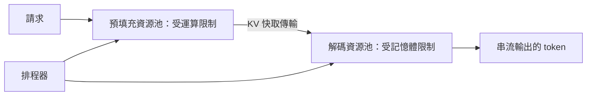

# 預填充與解碼分離

!!! info "屬於推論最佳化"
    本頁隸屬於[推論最佳化](index.zh-TW.md)。它說明為什麼推論的兩個階段要分散到不同機器上；每個具名系統各有自己的頁面。

服務語言模型時，會執行兩個對硬體需求不同的階段。預填充（prefill）以一次平行的前向計算處理整個提示，受限於運算能力。解碼（decode）則一次產生一個 token，受限於記憶體頻寬。分離式服務讓這兩個階段在不同的 GPU 或機器上執行，使每個資源池都能依照自己的瓶頸來配置與排程，也使一個很長的預填充不會拖慢其他請求的解碼。

## 概述

在共用的 GPU 上，一個大型預填充可能要花很多毫秒，同一批次中正在解碼的請求只能等待。把兩個階段放在同一批次裡有助於吞吐量，但會讓解碼的延遲綁在被預填充的提示長度上。把它們分開可以消除這種干擾，代價是必須把 KV 快取從預填充機器搬到解碼機器。這樣做是否值得，取決於快取大小、互連速度與服務的延遲目標。

## 關鍵概念

- **預填充與解碼的干擾。** 與解碼請求放在同一批次的預填充，會延遲它所共用的每一個解碼步驟。
- **有效吞吐（goodput）。** 在延遲目標內完成的請求速率，不同於計算所有請求的原始吞吐量。
- **KV 傳輸。** 預填充結束後，把提示的 KV 快取從預填充機器搬到解碼機器。
- **依階段配置資源。** 依各階段的瓶頸，為它選擇不同的硬體或不同數量的機器。

## 運作方式

請求會先送到預填充資源池，由它計算提示的 KV 快取。接著快取傳輸到解碼資源池，由它產生輸出 token。排程器決定每個請求送到哪個資源池與哪台機器，並平衡兩個資源池，使任何一方都不必等待另一方。

設計上必須讓傳輸變得便宜。採用此設計的系統會透過快速互連傳送快取區塊，並讓傳輸與運算重疊，以降低成本。

## 關鍵方法

每個具名系統各有自己的頁面，說明問題、核心想法、報告的結果與限制。下表比較它們。

| 方法 | 處理的問題 | 核心想法 | 主要取捨 | 頁面 |
|---|---|---|---|---|
| DistServe | 預填充干擾解碼，導致延遲目標未達成 | 把每個階段指派給自己的 GPU，並依 SLO 安排位置 | 每個模型與叢集都需要搜尋配置 | [DistServe](distserve.zh-TW.md) |
| Splitwise | 提示階段與 token 階段對硬體的使用不同，單一機器類型並不合適 | 把兩個階段分到不同機器上，依階段分別配置 | 機器之間搬移狀態需要快速連線 | [Splitwise](splitwise.zh-TW.md) |
| Mooncake | 過載的服務必須跨多個請求重用快取 | 以 KV 快取為中心的架構，把預填充與解碼叢集分開 | 依賴分散式快取儲存與其放置策略 | [Mooncake](mooncake.zh-TW.md) |

分塊預填充（chunked prefill）是把長提示切成小段，並混入解碼批次中的替代做法，它讓兩個階段仍在同一台機器上執行。本頁未另設獨立頁面，其取捨會在討論相同問題的方法頁中提到。

## 結果

報告的增益取決於系統、工作負載與比較基準。DistServe 報告，相較於它所比較的最先進系統，它能服務 7.4 倍的請求，或達成 12.6 倍更嚴格的 SLO。Splitwise 報告在相同成本下達到 1.4 倍的吞吐量，成本低 20%；或在相同成本與功耗下達到 2.35 倍的吞吐量。Mooncake 報告在某些模擬情境中吞吐量最多提升 525%，在真實工作負載下能處理的請求多 75%。這些數字來自不同的設定，因此不能直接比較。

## 取捨

- **傳輸成本。** 長提示的 KV 快取可能很大，因此傳輸會增加延遲並佔用頻寬。短提示可能受益較少。
- **資源池的平衡。** 預填充與解碼機器的比例取決於工作負載，並會隨提示組成改變而變動。
- **使用率。** 若一個資源池為另一方不共用的尖峰而過度配置，兩個資源池都可能留下閒置的容量。
- **複雜度。** 故障、重試與快取放置都會跨越機器邊界，這是單機伺服器不會遇到的問題。

## 關聯

- 每個資源池內部採用的批次處理，是 [Orca](orca.zh-TW.md) 式的迭代層級排程。
- 讓搬移快取區塊可行的記憶體佈局，是 [PagedAttention 與 vLLM](paged-attention.zh-TW.md)。
- 快取本身及其壓縮，見 [KV 快取壓縮與淘汰](kv-cache-compression.zh-TW.md)與 [Transformer KV 快取](../../theory/models/transformer/kv-cache/index.zh-TW.md)頁面。
- 每個階段的硬體選擇，取決於 [AI 硬體](../hardware/index.zh-TW.md)。

## 開放問題

- 當提示長度在幾分鐘內改變時，排程器應如何設定預填充與解碼機器的比例？
- 當傳輸連線很慢時，在解碼機器上重新計算預填充，是否比搬移快取更好？

## 參考文獻

### 重要論文

- Zhong, Y. et al. (2024). *DistServe: Disaggregating Prefill and Decoding for Goodput-optimized Large Language Model Serving*. arXiv:2401.09670. https://arxiv.org/abs/2401.09670 — 把預填充與解碼指派給不同的 GPU 以消除干擾，並報告有效吞吐與 SLO 的增益。
- Patel, P. et al. (2023). *Splitwise: Efficient generative LLM inference using phase splitting*. arXiv:2311.18677. https://arxiv.org/abs/2311.18677 — 把提示階段與 token 階段分到不同機器上，依階段配置，並報告吞吐與成本結果。
- Qin, R. et al. (2024). *Mooncake: A KVCache-centric Disaggregated Architecture for LLM Serving*. arXiv:2407.00079. https://arxiv.org/abs/2407.00079 — 以 KV 快取為核心的服務架構，在過載下把預填充與解碼叢集分開。
- Yu, G.-I. et al. (2022). *Orca: A Distributed Serving System for Transformer-Based Generative Models*. OSDI 2022. https://www.usenix.org/conference/osdi22/presentation/yu — 迭代層級排程，每個資源池內部都採用它。
- Kwon, W. et al. (2023). *Efficient Memory Management for Large Language Model Serving with PagedAttention*. SOSP 2023. arXiv:2309.06180. https://arxiv.org/abs/2309.06180 — 分頁式快取佈局，傳輸過來的快取在其中儲存。
