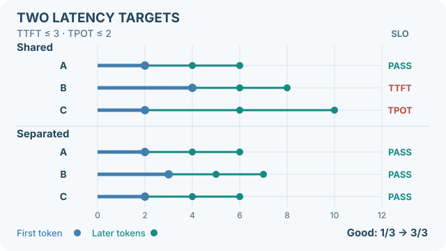

# DistServe

!!! info "Part of Disaggregated Prefill and Decode"
    This method page belongs to [Disaggregated Prefill and Decode](disaggregated-serving.md). It explains DistServe in detail; the parent page compares it with the other systems.

DistServe is a serving system that assigns the prefill and decoding phases of LLM inference to different GPUs. The authors argue that running both phases on the same GPU makes them interfere with each other, and that separating them lets the system meet latency objectives that a shared deployment misses. The paper reports goodput gains, meaning the rate of requests that finish within their latency targets.

## Problem

A serving system is judged by how many requests meet their latency objectives, not only by total tokens per second. On a shared GPU, a long prefill delays the decoding of requests in the same batch, which raises the time between tokens. Tuning the batch size to protect latency lowers throughput, so the operator must trade one for the other. The problem is to serve more requests within the objectives without that trade-off.

## Core idea

DistServe removes the interference by placing prefill and decoding on different GPUs. Each phase then has its own batch, and each pool can be sized and parallelised for its own bottleneck. The system chooses the placement and the parallelism of each phase by searching for the configuration that maximises goodput under the target latencies, and it takes the cluster bandwidth into account. The KV cache is moved from the prefill GPU to the decoding GPU after the prompt is processed.

## Procedure

1. Profile the model on the target hardware, to estimate prefill and decoding latency at different batch sizes and parallel degrees.
2. Search for a placement that gives each phase its GPUs and parallelism, under the latency objectives.
3. Route each request to a prefill GPU, which computes its KV cache.
4. Transfer the cache to a decoding GPU, which generates the output tokens in its own batches.
5. Monitor the latency of both phases and adjust the placement when the workload changes.

### Animated example: two latency targets, one goodput count

  

    
  

*Original teaching animation (CC BY-SA 4.0).* [GitHub-readable static preview](../../assets/concept-animations/distserve-joint-slo-still.svg). On MkDocs use Play/Pause; reduced-motion preferences show the still. On narrow screens swipe horizontally or focus the region and use Left/Right arrow keys.

All three requests arrive at time zero and emit three output tokens each. The time axis is in arbitrary teaching units; blue marks the first token and teal marks later tokens. TTFT is the first arrival time, and TPOT is the mean interval after that token (last minus first, divided by two). Set TTFT at most 3 and TPOT at most 2. The cursor advances in time and each completed request receives its joint SLO verdict.

In the shared trace, A emits at (2, 4, 6) and passes; B emits at (4, 6, 8) and fails TTFT; C emits at (2, 6, 10) and fails TPOT. In the separated trace the arrivals are (2, 4, 6), (3, 5, 7), (2, 4, 6), so all pass. Over the same 12-unit window both configurations complete three requests, but only one versus three meets both targets. The joint attainment fractions are 1/3 and 3/3; the corresponding compliant completion rates are 1/12 and 3/12 requests per time unit. These invented traces illustrate the metric rather than simulate resource scheduling or reproduce a DistServe measurement. They do not establish per-GPU goodput or the maximum sustainable arrival rate: DistServe additionally compares resource allocation and SLO attainment at offered loads.[^joint-slo]

[^joint-slo]: Zhong et al. (2024), *DistServe*, section 2 and abstract; linked in References.

## Results

The paper reports that DistServe can serve 7.4 times more requests, or meet a 12.6 times tighter SLO, compared with the state-of-the-art systems it evaluates, and that over 90 percent of requests stay within their latency limits. These results are goodput results, which count only requests that meet their objectives, so they should not be read as raw throughput gains. The comparison depends on the systems evaluated and the workloads chosen.

## Limitations

- **Placement search.** The best placement depends on the model, the hardware and the workload, and the search must be repeated when any of them changes.
- **Transfer cost.** The KV cache must move between GPUs after each prefill, which adds latency and needs bandwidth on the interconnect.
- **Workload shifts.** A fixed split between pools can become unbalanced when the prompt length distribution changes.
- **Goodput is a chosen metric.** Gains are reported against a latency target, so a different target can change the ranking.

## Connections

- The alternative that keeps both phases on one machine by splitting long prompts into chunks is discussed on the [parent page](disaggregated-serving.md).
- The other systems that split phases across machines are [Splitwise](splitwise.md) and [Mooncake](mooncake.md).
- The batching inside each pool follows the iteration-level idea in [Orca](orca.md).

## Open questions

- Can the placement search run online, so that it adapts to bursts without a long profiling step?
- How should the system decide when a transfer is cheaper than recomputing the prefill on the decoding GPU?

## References

### Seminal papers

- Zhong, Y. et al. (2024). *DistServe: Disaggregating Prefill and Decoding for Goodput-optimized Large Language Model Serving*. arXiv:2401.09670. https://arxiv.org/abs/2401.09670 — The primary paper: separation of the phases, goodput-based placement, and the SLO results.
- Patel, P. et al. (2023). *Splitwise: Efficient generative LLM inference using phase splitting*. arXiv:2311.18677. https://arxiv.org/abs/2311.18677 — An independent design that splits the phases onto separate machines, for comparison.
- Qin, R. et al. (2024). *Mooncake: A KVCache-centric Disaggregated Architecture for LLM Serving*. arXiv:2407.00079. https://arxiv.org/abs/2407.00079 — A cache-centred version of the same separation, under overload.
- Yu, G.-I. et al. (2022). *Orca: A Distributed Serving System for Transformer-Based Generative Models*. OSDI 2022. https://www.usenix.org/conference/osdi22/presentation/yu — The iteration-level scheduling used inside each pool.
- Kwon, W. et al. (2023). *Efficient Memory Management for Large Language Model Serving with PagedAttention*. SOSP 2023. arXiv:2309.06180. https://arxiv.org/abs/2309.06180 — The paged cache layout that the transferred cache is stored in.
