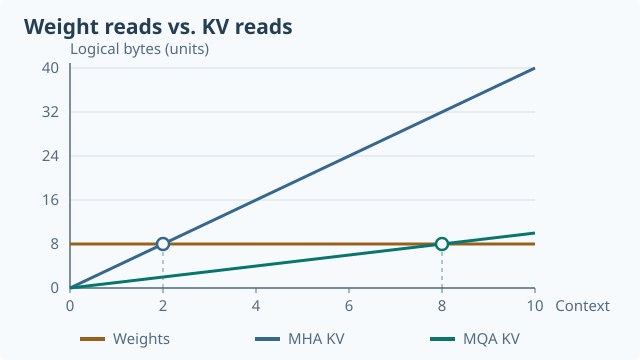

---
related:
  - engineering/inference-optimization
  - engineering/hardware
  - theory/models/transformer
tags:
  - inference
  - transformers
  - latency
  - KV cache
  - partitioning
aliases:
  - Efficiently Scaling Transformer Inference
  - Pope et al. 2022
  - 高效擴展 Transformer 推論
last_reviewed: 2026-11-01
---

# Efficiently Scaling Transformer Inference

Pope et al. (2022) give an analytical model of how a large Transformer should be split across many accelerator chips during generation, and they test partitioning layouts for latency-sensitive use. The paper's main point is that the best layout depends on the batch size and the phase of inference, and that multi-query attention and a careful KV-cache layout change the cost of long contexts. The family of techniques is on the [Inference Optimisation](index.md) page.

## Overview

Generating text with a large Transformer has two costs. The weights and the key-value (KV) cache must be read from memory on every step, and the model must be split across chips, which adds communication. The paper studies these costs for dense models of 500 billion parameters or more, served on TPU v4 slices, with the PaLM family as the case study.

## Problem

The authors state that generation is costly and slow. The parameters and the KV cache create a large memory footprint, and decoding produces one token at a time, which limits parallelism. Attention cost also grows with the input length. For a 500-billion-parameter-scale model with multi-head attention, batch size 512 and context length 2048, the paper estimates a KV cache of about 3 TB, roughly three times the size of the parameters.

## Analytical model

The paper estimates three times per layer.

- **Memory time:** the time to move the weights and the KV cache from high-bandwidth memory to the compute cores. Weight loading dominates at small batch sizes, and KV-cache loading dominates at large batch sizes and long contexts.
- **Compute time:** an \(N\)-parameter decoder needs about \(2N\) matrix-multiplication FLOPs per token, so compute time is that count divided by peak FLOPS. Attention FLOPs are excluded in the main estimate.
- **Communication time:** for a 1D weight-stationary layout, \(T_\text{comm} = 2BLE / \text{bandwidth}\), which does not shrink as chips are added. For a 2D weight-stationary layout, \(T_\text{comm} = 8BLE / (\sqrt{n_\text{chips}} \cdot \text{bandwidth})\), assuming \(d_\text{ff} = 4\,d_\text{model}\). The 2D layout therefore wins once \(\sqrt{n_\text{chips}} > d_\text{ff}/d_\text{model}\), which is more than 16 chips for that ratio.

Here \(B\) is the batch size, \(L\) the sequence length and \(E\) the model dimension.

### Worked example: when cache reads overtake weight reads

[GitHub static preview](../../assets/concept-animations/decode-weight-kv-crossover-still.svg) · On MkDocs use the keyboard-accessible **Play/Pause** control (Enter or Space); reduced-motion preferences initially show the still.

The memory term in the analytical model motivates a controlled comparison. Suppose a fixed batch of $B$ equal-length sequences uses $G$ KV heads of dimension $d$, and each stored element occupies $b$ bytes. In an idealised read-once model, each decode iteration reads $2BSGdb$ bytes of cached keys and values at context length $S$, plus $W$ bytes of weights. It neglects KV writes, repeated loads, cache residency, communication, compute and other traffic.

The crossover at which KV reads equal weight reads is $S_* = W/(2BGdb)$. The graph fixes $W=8$ arbitrary byte units and compares four KV heads with one, setting the per-context-unit KV read costs to 4 and 1 respectively. Thus MHA crosses at $S=2$ and MQA at $S=8$. At context 4, MHA reads 16 KV units while MQA reads 4; weights still cost 8 in both cases. The moving cursor sweeps context, not wall-clock time. The horizontal origin is a mathematical extrapolation; the animated sweep starts at context 1.

The comparison holds non-KV weight traffic constant to isolate the cache effect; real MHA and MQA weight sizes can differ. Even with the fourfold change in crossover, neither latency nor achievable context capacity is guaranteed to improve fourfold: those depend on the full system and workload. These quantities are schematic, not PaLM measurements. See [Pope et al. (2022)](https://arxiv.org/abs/2211.05102) for the broader partitioning model and [Shazeer (2019)](https://arxiv.org/abs/1911.02150) for shared KV heads.

*Original instructional diagram, CC BY-SA 4.0.*

## Partitioning and results

- **1D and 2D weight-stationary layouts** keep the weights fixed on chips and move activations. The 2D layout is used for decoding.
- **Weight-gathered layouts** move the weights instead. They suit large token batches, so prefill switches between the two families depending on the number of tokens.
- **Multi-query attention** shares one key and value head across all query heads, which reduces the KV cache by the number of heads. The optimised layout shards the batch dimension across chips, so each chip loads a smaller part of the cache.
- **Parallel attention and feed-forward blocks** use one layer norm and fuse the matrix multiplications. This removes one of the two all-reduces per layer, and the paper reports 14% higher per-step latency for the serial formulation.

The paper reports low-latency generation of 29 ms per token for PaLM 540B with int8 weights on 64 chips, and 76% model FLOPS utilisation for large-batch prefill with weight-gathered layouts. Table 1 reports a maximum context of 10,700 tokens at batch 512 with the optimised multi-query layout, against 330 tokens for multi-head attention.

## Limitations

- The authors state that FLOP count and communication volume can fundamentally limit dense Transformer inference.
- Decoding reaches much lower utilisation than prefill.
- Activation quantisation is not implemented in the paper. The authors expect it could reduce compute for large batches and communication for weight-stationary layouts.
- The comparison with FasterTransformer uses different hardware, so the paper normalises by utilisation rather than by raw speed.

## Connections

- The KV-cache argument is the basis of [multi-query attention](multi-query-attention.md) and [grouped-query attention](grouped-query-attention.md).
- Memory management for the same cache is the subject of [PagedAttention](paged-attention.md).
- Hardware constraints behind the bandwidth terms are covered in the [hardware](../hardware/index.md) chapter.

## Open issues

- Mixture-of-experts and adaptive computation are suggested to reduce FLOPs per token. How much of the gain survives at the latencies the paper targets?
- How should communication be compressed without hurting accuracy?
- Decode utilisation is low, so what layout would lift it without increasing memory traffic?

## References

### Seminal papers

- Pope, R., Douglas, S., Chowdhery, A., Devlin, J., Bradbury, J., Levskaya, A., Heek, J., Xi, K. et al. (2022). Efficiently Scaling Transformer Inference. [arXiv:2211.05102](https://arxiv.org/abs/2211.05102) — The analytical model, the partitioning layouts and the PaLM results discussed on this page.
- Shazeer, N. (2019). Fast Transformer Decoding: One Write-Head is All You Need. [arXiv:1911.02150](https://arxiv.org/abs/1911.02150) — Introduces multi-query attention, which the paper uses to shrink the KV cache.
- Vaswani, A. et al. (2017). Attention Is All You Need. [arXiv:1706.03762](https://arxiv.org/abs/1706.03762) — The Transformer architecture whose inference cost the paper analyses.
- Chowdhery, A. et al. (2022). PaLM: Scaling Language Modeling with Pathways. [arXiv:2204.02311](https://arxiv.org/abs/2204.02311) — The PaLM model family used as the case study.
- Shoeybi, M. et al. (2019). Megatron-LM: Training Multi-Billion Parameter Language Models Using Model Parallelism. [arXiv:1909.08053](https://arxiv.org/abs/1909.08053) — Tensor-parallel layouts for large Transformers, the GPU baseline the paper compares against.

### Surveys and textbooks

(none checked for this page)

### Lectures and videos

(none checked for this page)

### Articles and documentation

- Kwon, W. et al. (2023). Efficient Memory Management for Large Language Model Serving with PagedAttention. [arXiv:2309.06180](https://arxiv.org/abs/2309.06180) — Memory management for the KV cache in a serving system, a complementary approach to the layouts here.
