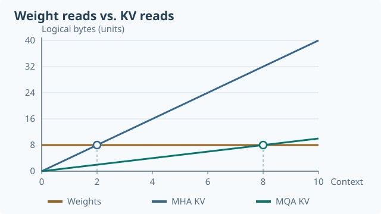

---
related:
  - engineering/inference-optimization
  - engineering/hardware
  - theory/models/transformer
tags:
  - inference
  - transformers
  - latency
  - KV cache
  - partitioning
aliases:
  - Efficiently Scaling Transformer Inference
  - Pope et al. 2022
  - 高效擴展 Transformer 推論
translation_reviewed: 2026-11-01
---

# 高效擴展 Transformer 推論

Pope 等人（2022）提出一個分析模型，說明在生成過程中，大型 Transformer 應如何切分到許多加速器晶片上，並測試了適用於延遲敏感情境的切分配置。論文的主要觀點是：最佳配置取決於批次大小與推論階段，而多查詢注意力與審慎設計的 KV 快取配置，會改變長上下文的成本。這類技術的家族見[推論最佳化](index.md)頁面。

## 概述

以大型 Transformer 生成文字有兩種成本。每一步都必須從記憶體讀取權重與 KV 快取，而模型切分到多個晶片上又會增加通訊。論文研究的是參數量至少 5,000 億的稠密模型，部署於 TPU v4 切片上，並以 PaLM 系列作為案例。

## 問題

作者指出，生成的成本高且速度慢。參數與 KV 快取造成很大的記憶體佔用，而解碼每次只產生一個 token，限制了平行度。注意力的成本也隨輸入長度增長。以參數規模 5,000 億以上、多頭注意力、批次大小 512、上下文長度 2048 的模型為例，論文估計 KV 快取約為 3 TB，大約是參數大小的三倍。

## 分析模型

論文在每一層估計三種時間。

- **記憶體時間：** 把權重與 KV 快取從高頻寬記憶體搬到運算核心的時間。小批次時權重載入占主導，大批次與長上下文時 KV 快取載入占主導。
- **計算時間：** 一個 \(N\) 參數的解碼器每個 token 需要約 \(2N\) 次矩陣乘法 FLOP，因此計算時間是該數字除以峰值 FLOPS。主要估計中不計入注意力的 FLOP。
- **通訊時間：** 對 1D 權重固定配置，\(T_\text{comm} = 2BLE / \text{頻寬}\)，且不會因晶片增加而縮短。對 2D 權重固定配置，\(T_\text{comm} = 8BLE / (\sqrt{n_\text{chips}} \cdot \text{頻寬})\)，假設 \(d_\text{ff} = 4\,d_\text{model}\)。因此當 \(\sqrt{n_\text{chips}} > d_\text{ff}/d_\text{model}\) 時 2D 配置較佳，以該比例而言即超過 16 個晶片。

其中 \(B\) 為批次大小，\(L\) 為序列長度，\(E\) 為模型維度。

### 算例：KV 快取讀取何時超過權重讀取

[GitHub 靜態預覽](../../assets/concept-animations/decode-weight-kv-crossover-still.svg) · 在 MkDocs 網站使用可鍵盤操作的播放／暫停控制（Enter 或空白鍵）；減少動態效果偏好預設顯示靜態圖。

分析模型的記憶體項可用一個受控比較說明。假設固定批次包含 $B$ 個等長序列，使用 $G$ 個維度為 $d$ 的 KV 頭，每個儲存元素占 $b$ 位元組。在理想化的單次讀取模型中，上下文長度為 $S$ 時，每次解碼迭代讀取 $2BSGdb$ 位元組的 KV 快取，另讀取 $W$ 位元組的權重。此模型忽略 KV 寫入、重複載入、快取駐留、通訊、運算及其他流量。

KV 快取讀取量等於權重讀取量的交會點為 $S_* = W/(2BGdb)$。圖中固定 $W=8$ 個任意位元組單位，比較四個 KV 頭與一個 KV 頭，每個上下文長度單位的 KV 讀取成本分別設定為 4 與 1。因此 MHA 在 $S=2$ 交會，MQA 在 $S=8$ 交會。當上下文長度為 4，MHA 讀取 16 個 KV 單位，MQA 讀取 4 個單位，兩者權重讀取仍為 8 個單位。移動游標掃描的是上下文長度，而非實際時間。橫軸原點是數學外推，動畫從上下文長度 1 開始。

受控比較固定非 KV 的權重讀取量，以隔離快取效應；實際 MHA 與 MQA 的權重大小可能不同。即使交會點變為四倍，也不保證延遲或可支援上下文容量有四倍改善，仍取決於完整系統與工作負載。以上為示意數值，並非 PaLM 實測結果。更完整的切分模型見 [Pope 等人（2022）](https://arxiv.org/abs/2211.05102)，共用 KV 頭見 [Shazeer（2019）](https://arxiv.org/abs/1911.02150)。

*原創教學動畫，CC BY-SA 4.0。*

## 切分與結果

- **1D 與 2D 權重固定配置** 讓權重固定在晶片上，改為移動啟動值。解碼階段使用 2D 配置。
- **權重聚集配置** 反過來移動權重，適合大量 token 的批次，因此預填階段會依 token 數量在兩類配置之間切換。
- **多查詢注意力** 讓所有查詢頭共享一組鍵與值頭，使 KV 快取縮小為頭數分之一。最佳化的配置把批次維度切分到各晶片，讓每顆晶片載入的快取更少。
- **並行的注意力與前饋區塊** 使用一個層正規化並融合矩陣乘法，因此每層少一次全規約。論文報告串列式寫法的每步延遲高出 14%。

論文報告，PaLM 540B 在 64 顆晶片上以 int8 權重可達每 token 29 毫秒的低延遲生成；大批次預填以權重聚集配置達到 76% 的模型 FLOPS 利用率。表 1 顯示，在批次 512 下，最佳化多查詢配置的最大上下文為 10,700 個 token，而多頭注意力僅為 330 個。

## 限制

- 作者指出，FLOP 數量與通訊量可能從根本上限制稠密 Transformer 的推論。
- 解碼的利用率遠低於預填。
- 論文未實作啟動值量化。作者認為它在大批次時可減少計算，在權重固定配置下可減少通訊。
- 與 FasterTransformer 的比較使用不同硬體，因此論文以利用率而非原始速度來正規化。

## 關聯

- KV 快取的論證是[多查詢注意力](multi-query-attention.md)與[分組查詢注意力](grouped-query-attention.md)的基礎。
- 同一快取的記憶體管理見 [PagedAttention](paged-attention.md)。
- 頻寬項背後的硬體限制，見[硬體](../hardware/index.md)章節。

## 未解問題

- 論文建議以混合專家與自適應計算減少每個 token 的 FLOP，但在論文所設定的延遲目標下，能保留多少增益？
- 如何壓縮晶片間的通訊而不損害準確率？
- 解碼利用率偏低，什麼配置能在不增加記憶體流量的情況下提升它？

## 參考文獻

### 奠基論文

- Pope, R., Douglas, S., Chowdhery, A., Devlin, J., Bradbury, J., Levskaya, A., Heek, J., Xi, K. 等人（2022）。Efficiently Scaling Transformer Inference. [arXiv:2211.05102](https://arxiv.org/abs/2211.05102) — 本頁討論的分析模型、切分配置與 PaLM 結果。
- Shazeer, N.（2019）。Fast Transformer Decoding: One Write-Head is All You Need. [arXiv:1911.02150](https://arxiv.org/abs/1911.02150) — 提出多查詢注意力，論文用它來縮小 KV 快取。
- Vaswani, A. 等人（2017）。Attention Is All You Need. [arXiv:1706.03762](https://arxiv.org/abs/1706.03762) — 論文分析其推論成本的 Transformer 架構。
- Chowdhery, A. 等人（2022）。PaLM: Scaling Language Modeling with Pathways. [arXiv:2204.02311](https://arxiv.org/abs/2204.02311) — 論文作為案例使用的 PaLM 模型家族。
- Shoeybi, M. 等人（2019）。Megatron-LM: Training Multi-Billion Parameter Language Models Using Model Parallelism. [arXiv:1909.08053](https://arxiv.org/abs/1909.08053) — 大型 Transformer 的張量平行配置，也是論文比較的 GPU 基準。

### 綜述與教科書

（本頁未核對）

### 講座與影片

（本頁未核對）

### 文章與文件

- Kwon, W. 等人（2023）。Efficient Memory Management for Large Language Model Serving with PagedAttention. [arXiv:2309.06180](https://arxiv.org/abs/2309.06180) — 服務系統中 KV 快取的記憶體管理，是本頁切分配置的互補做法。
