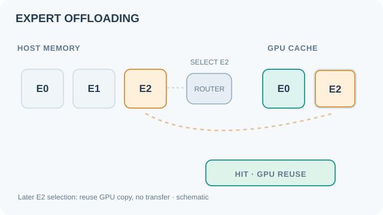
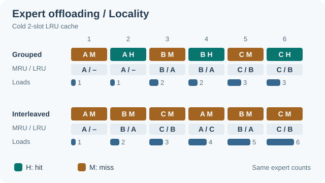

# Expert Offloading

!!! info "Part of Serving Mixture-of-Experts Models"
    This method page belongs to [Serving Mixture-of-Experts Models](moe-serving.md). It explains expert offloading in detail; the parent page compares it with the other methods.

Expert offloading serves an MoE model on a device that cannot hold all of its experts. The inactive experts are kept in host memory or on disk, and the ones the router needs are loaded onto the device when they are required. Eliseev and Mazur build on parameter offloading algorithms and propose a strategy that speeds up the offloading, and they report running Mixtral-8x7B with mixed quantisation on desktop hardware.

## Problem

An MoE model with eight large experts per layer can be too large for the memory of one GPU, even though each token uses only two of the experts. Keeping every expert resident wastes memory on experts that are not used for the current token. Offloading everything to the host makes every expert fetch slow. The problem is to keep the experts a model actually uses close to the compute, and to load the others without stalling generation.

## Core idea

The method keeps the non-expert parts of the model and a cache of experts on the device, and it stores the remaining experts in host memory. When the router selects an expert that is not resident, the expert is transferred to the device. The authors build on parameter offloading algorithms and propose a strategy that accelerates offloading. The abstract does not describe that strategy in detail, so this page does not either. The model is run with mixed quantisation, which reduces the size of the data that must be stored and moved.

## Procedure

1. Quantise the expert weights with a mixed bit-width scheme, to reduce their size.
2. Store the experts in host memory, and keep the shared layers and a cache of experts on the device.
3. For each layer, let the router choose the experts for the current token.
4. If a selected expert is missing and the cache is full, make room according to the cache policy before loading it.
5. Transfer the missing expert to the available slot, then use the resident expert to continue generation.

The animation first frees the GPU slot, then transfers E2. LOADED means the first request can execute; HIT appears only when a later request selects E2 again. The host copy of E1 remains available. Looping resets the illustration; durations and eviction choices are not measurements.

*Original instructional animation, CC BY-SA 4.0.* This is a **two-slot schematic cache**, not a measured inference trace or a claim about the original paper's cache policy. Initially the GPU holds E0 and E1 while the router selects E2; E2 must be loaded from host memory and E1's GPU copy is evicted. The following selection of E2 is a **cache hit** and needs no repeated transfer. The dashed path and moving dot depict a conceptual transfer, not a GPU hardware trace. The specific victim, timing, and expert choices are illustrative. On MkDocs use **Play/Pause** (Enter or Space); reduced-motion preferences show the still, and the image can be scrolled horizontally by keyboard on narrow screens. [GitHub-readable post-load state](../../assets/concept-animations/expert-cache-miss-still.svg).

### Worked example: routing locality and repeated loads

[GitHub static preview](../../assets/concept-animations/expert-lru-locality-still.svg) · Use the keyboard-accessible **Play/Pause** on MkDocs; reduced motion displays the complete still.

Consider a single layer, one selected expert per access, equal-size expert weights and a cold two-slot least-recently-used (LRU) cache. Compare A,A,B,B,C,C with A,B,C,A,B,C. Both traces select each expert twice. On a hit, move that expert to the most-recently-used (MRU) position; on a miss, load its weights and, if full, evict the least-recently-used entry. The animation shows the cache after each access and the cumulative load count.

| Trace | Hits | Misses | Host-to-device loads |
|---|---:|---:|---:|
| Grouped | 3 | 3 | 3 |
| Interleaved | 0 | 6 | 6 |

For expert size W bytes, the logical weight transfer is 3W versus 6W bytes. Equal expert counts therefore do not determine cache hit rate or traffic; temporal locality matters. The example is a generic LRU calculation, not an assertion that Eliseev and Mazur (2023) use precisely this policy or that a real system is twice as fast. It excludes prefetching, overlap, shared weights, other layers and transfer overhead. All traces and counts are synthetic.

*Original instructional animation, CC BY-SA 4.0.*

## Results

The abstract reports that the strategy allows Mixtral-8x7B to run with mixed quantisation on desktop hardware and on free-tier Google Colab instances. The abstract does not give specific speed figures, so this page reports none. A reader who needs them should measure the method on the target hardware, with its cache size and quantisation.

## Limitations

- **Loading latency.** A token whose router selects an expert that is not resident must wait for its transfer, which adds latency.
- **Cache hit rate.** The benefit depends on how often the router selects experts that are already cached, which varies with the prompt and the model.
- **Quantisation effects.** Quantising the experts to fit the memory can reduce output quality, so quality must be checked after quantisation.
- **Batch behaviour.** Serving many requests at once spreads the router's choices across more experts, which reduces the cache hit rate.

## Connections

- The alternative that keeps all experts on several devices and shards them is [GShard](gshard.md).
- The alternative that compresses the model and uses a dedicated inference system is [DeepSpeed-MoE](deepspeed-moe.md).
- Quantisation of weights for smaller devices is covered on the [on-device and edge AI](../on-device-edge/index.md) page.
- The architecture of Mixtral is covered in the [mixture-of-experts theory pages](../../theory/models/mixture-of-experts/mixtral.md).

## Open questions

- Can the cache policy use the router's probabilities to predict which experts to load before they are selected?
- How much does the cache hit rate fall as the batch size grows, and when does offloading stop being worth it?

## References

### Seminal papers

- Eliseev, A. & Mazur, D. (2023). *Fast Inference of Mixture-of-Experts Language Models with Offloading*. arXiv:2312.17238. https://arxiv.org/abs/2312.17238 — The primary paper: an offloading strategy for MoE inference, which runs Mixtral-8x7B with mixed quantisation on desktop hardware.
- Shazeer, N. et al. (2017). *Outrageously Large Neural Networks: The Sparsely-Gated Mixture-of-Experts Layer*. arXiv:1701.06538. https://arxiv.org/abs/1701.06538 — The sparsely gated layer whose unused experts offloading keeps off the device.
- Rajbhandari, S. et al. (2022). *DeepSpeed-MoE: Advancing Mixture-of-Experts Inference and Training to Power Next-Generation AI Scale*. arXiv:2201.05596. https://arxiv.org/abs/2201.05596 — A compression-plus-system alternative for serving MoE models.
- Lepikhin, D. et al. (2020). *GShard: Scaling Giant Models with Conditional Computation and Automatic Sharding*. arXiv:2006.16668. https://arxiv.org/abs/2006.16668 — The sharding alternative that keeps experts on many devices.
- Fedus, W., Zoph, B. & Shazeer, N. (2022). *Switch Transformers: Scaling to Trillion Parameter Models with Simple and Efficient Sparsity*. Journal of Machine Learning Research 23(120):1–39. arXiv:2101.03961. https://arxiv.org/abs/2101.03961 — Top-1 routing, which limits how many experts each token needs.
