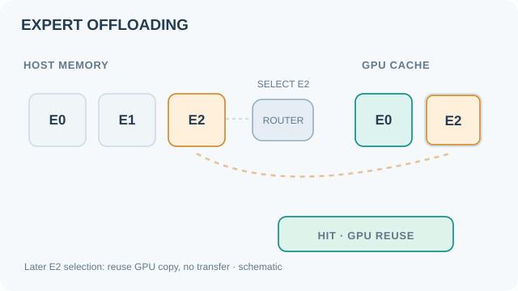
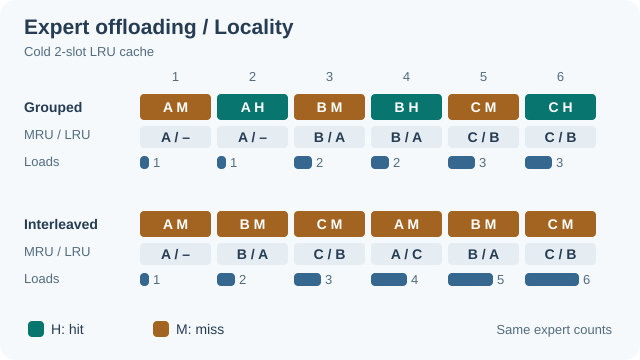

# 專家卸載

!!! info "屬於混合專家模型的服務"
    本方法頁隸屬於[混合專家模型的服務](moe-serving.zh-TW.md)。它詳細說明專家卸載；上層頁面則比較它與其他方法。

專家卸載讓 MoE 模型能在無法保存所有專家的裝置上服務。不活躍的專家保存在主機記憶體或磁碟中，路由器需要時才把它們載入裝置。Eliseev 與 Mazur 以參數卸載演算法為基礎，提出一種加速卸載的策略，並報告能在桌上型硬體與免費的 Google Colab 執行個體上以混合量化執行 Mixtral-8x7B。

## 問題

每層有八個大型專家的 MoE 模型，可能大到一張 GPU 的記憶體放不下，即使每個 token 只用到其中兩個專家。把每個專家都保留在裝置上，會浪費記憶體在目前 token 不使用的專家上。把所有專家都卸載到主機，則每次取用專家都很慢。問題在於：如何讓模型實際使用的專家靠近運算，同時載入其餘的專家，又不讓生成停頓。

## 核心想法

此方法在裝置上保留模型的非專家部分，以及一份專家快取；其餘專家則存放在主機記憶體中。當路由器選到不在裝置上的專家時，該專家會被傳到裝置。論文採用各 MoE 層容量相同的 LRU 快取及推測式載入：將下一層路由器套用至較早的隱藏狀態，預測應在運算期間先載入哪些專家。預測錯誤時仍須載入實際選中的專家，不會改變路由器的最終選擇。[^expert-method]模型以混合量化執行，可減少必須儲存與搬移的資料大小。

## 程序

1. 以混合位元寬度的方案量化專家權重，以縮小其大小。
2. 把專家保存在主機記憶體中，並在裝置上保留共享層與一份專家快取。
3. 對每一層，由路由器為目前的 token 選擇專家。
4. 若選中的專家不在裝置上且快取已滿，先依快取策略騰出空間。
5. 將缺少的專家傳輸至可用位置，待它常駐後再繼續生成。

動畫先騰出 GPU 位置，再傳輸 E2；LOADED 表示首次請求已可執行，直到另一個請求再次選中 E2 才顯示 HIT。主機上的 E1 副本仍保留；重播只重設示意狀態，時間與淘汰對象並非實測。

*原創教學動畫，CC BY-SA 4.0。* 圖中是**只有兩個位置的示意快取**，並非推論效能實測，也不代表原始論文特定的替換策略。起初 GPU 存有 E0 與 E1，但路由器選中 E2，因此必須從主機記憶體載入 E2，並移除 GPU 上的 E1 副本。下一次再選中 E2 時便會**快取命中**，不必重新傳輸。虛線與移動圓點只示意傳輸，並非實際硬體追蹤；淘汰對象、時間與專家選擇均為人工設定。MkDocs 可使用**播放／暫停**（Enter 或 Space），偏好減少動態效果時顯示靜態圖；窄螢幕可聚焦圖像區域並以鍵盤水平捲動。[GitHub 可閱讀的載入後狀態](../../assets/concept-animations/expert-cache-miss-still.svg)。

### 算例：路由的時間區域性與重複載入

[GitHub 靜態回退預覽](../../assets/concept-animations/expert-lru-locality-still.svg) · MkDocs 網站支援鍵盤操作的**播放／暫停**；偏好減少動態效果時顯示完整靜態圖。

考慮單一層、每次存取只選一個專家、專家權重大小相同，以及初始為空的兩格最近最少使用（LRU）快取。比較 A,A,B,B,C,C 與 A,B,C,A,B,C；兩者皆選取每個專家兩次。命中時將專家移至最近使用（MRU）位置；未命中時載入權重，若已滿則淘汰最近最少使用的項目。動畫顯示每次存取後的快取及累積載入次數。

| 路由順序 | 命中 | 未命中 | 主機至裝置載入 |
|---|---:|---:|---:|
| 群聚 | 3 | 3 | 3 |
| 交錯 | 0 | 6 | 6 |

若每個專家大小為 W 位元組，邏輯權重傳輸量分別為 3W 與 6W 位元組。因此，即使每個專家的選取次數相同，快取命中率及流量仍取決於時間區域性。此為一般 LRU 算例，符合 Eliseev 與 Mazur（2023）第 3.1 節的 LRU 原理，但不是其多專家存取追蹤、實作或速度的重現。未計入預先載入、運算與通訊重疊、共享權重、其他層及傳輸額外成本。路由序列與數值皆為人工示意。

*原創教學動畫，CC BY-SA 4.0。*

#### 重用距離與快取容量

重用距離（reuse distance）是同一專家前後兩次存取之間，曾存取的其他相異專家數；首次存取的距離視為無限大。初始為空、容量為 k 的全相聯 LRU 快取，只有在重用距離嚴格小於 k 時才會命中。群聚序列的三次重複存取距離為 0、0、0；交錯序列則為 2、2、2。

| 專家槽位數 | 群聚載入次數 | 交錯載入次數 |
|---:|---:|---:|
| 1 | 3 | 6 |
| 2（動畫） | 3 | 6 |
| 3 | 3 | 3 |

容量由一格增加至兩格，對兩個序列都沒有改善；增加至三格則可消除交錯序列中所有非首次存取的未命中。等大小專家的每次主機至裝置載入需 W 位元組。此計數不包括主機未保留副本時的反向傳輸（論文第 3.3 節也討論專家交換），推測式載入亦可能在沒有需求未命中時產生傳輸。這些人工序列不能預測實測延遲。

## 結果

摘要報告，此策略可讓 Mixtral-8x7B 以混合量化在桌上型硬體與免費的 Google Colab 執行個體上執行。摘要未給出具體的速度數字，因此本頁不報告速度。需要這些數字的讀者，應在目標硬體上，以所用的快取大小與量化方式進行量測。

## 限制

- **載入延遲。** 當路由器選到不在裝置上的專家時，該 token 必須等待傳輸完成，因此增加了延遲。
- **快取命中率。** 增益取決於路由器選到已快取專家的頻率，而這會因提示與模型而異。
- **量化的影響。** 為了放進記憶體而量化專家，可能降低輸出品質，因此量化後必須檢查品質。
- **批次的行為。** 同時服務許多請求，會把路由器的選擇分散到更多專家上，降低快取命中率。

## 關聯

- 在所有裝置上保留專家並加以分片的替代做法，是 [GShard](gshard.zh-TW.md)。
- 壓縮模型並使用專用推論系統的替代做法，是 [DeepSpeed-MoE](deepspeed-moe.zh-TW.md)。
- 為較小裝置量化權重的說明，見[裝置端與邊緣 AI](../on-device-edge/index.zh-TW.md)頁面。
- Mixtral 的架構見[混合專家理論頁面](../../theory/models/mixture-of-experts/mixtral.zh-TW.md)。

## 開放問題

- 快取策略能否利用路由器的機率，在專家被選中之前預先載入？
- 隨著批次變大，快取命中率會下降多少？到什麼時候卸載就不再值得？

[^expert-method]: Eliseev 與 Mazur（2023），第 3.1–3.3 節，[論文](https://arxiv.org/abs/2312.17238)。

## 參考文獻

### 重要論文

- Eliseev, A. & Mazur, D. (2023). *Fast Inference of Mixture-of-Experts Language Models with Offloading*. arXiv:2312.17238. https://arxiv.org/abs/2312.17238 — 主要論文：用於 MoE 推論的卸載策略，能在桌上型硬體上以混合量化執行 Mixtral-8x7B。
- Shazeer, N. et al. (2017). *Outrageously Large Neural Networks: The Sparsely-Gated Mixture-of-Experts Layer*. arXiv:1701.06538. https://arxiv.org/abs/1701.06538 — 稀疏閘控層，卸載方法讓其中未使用的專家離開裝置。
- Rajbhandari, S. et al. (2022). *DeepSpeed-MoE: Advancing Mixture-of-Experts Inference and Training to Power Next-Generation AI Scale*. arXiv:2201.05596. https://arxiv.org/abs/2201.05596 — 壓縮加系統的替代服務方法。
- Lepikhin, D. et al. (2020). *GShard: Scaling Giant Models with Conditional Computation and Automatic Sharding*. arXiv:2006.16668. https://arxiv.org/abs/2006.16668 — 把專家保留在多台裝置上的分片替代做法。
- Fedus, W., Zoph, B. & Shazeer, N. (2022). *Switch Transformers: Scaling to Trillion Parameter Models with Simple and Efficient Sparsity*. Journal of Machine Learning Research 23(120):1–39. arXiv:2101.03961. https://arxiv.org/abs/2101.03961 — Top-1 路由，限制了每個 token 需要的專家數。
