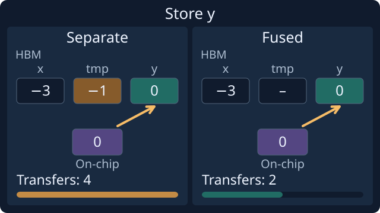
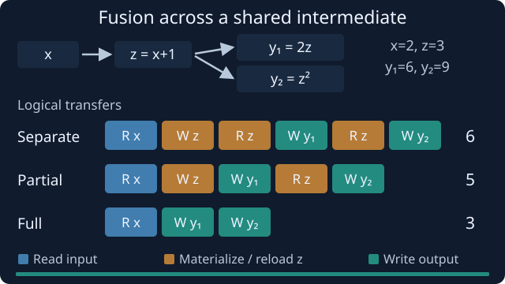

# 融合核心與感知輸入輸出的注意力

融合核心（fused kernel）在一次掃描資料的過程中完成多個運算，使中間結果留在快速的晶片上記憶體中，而不必寫回較慢的記憶體再讀取。對大型語言模型而言，許多運算受限於記憶體流量而非算術速度，因此融合是推論時降低延遲、提高吞吐量的主要方法之一。

本頁是[推論最佳化](index.zh-TW.md)的一部分。

## 概述

在現代加速器上，算術單元往往比通往主記憶體的路徑快。若一個運算每讀寫一個位元組所做的算術很少，它的速度就受限於記憶體頻寬，而其速度取決於它要往返記憶體幾次。注意力機制是明顯的例子。樸素的計算會把一個很大的分數矩陣寫入記憶體，並在每一步讀回，因此其時間與記憶體成本都隨序列長度成長。

## 關鍵概念

- **核心（kernel）：**在加速器上執行的函式。模型的前向傳播就是一連串核心。
- **融合（fusion）：**把數個核心合併為一個，使中間值不必儲存在主記憶體中。
- **感知輸入輸出（IO-awareness）：**圍繞快速與慢速記憶體之間的讀寫次數來設計演算法，而不只考慮算術運算次數。
- **受記憶體限制的運算：**速度由記憶體流量決定的運算。

## 運作方式

融合的注意力核心會把查詢、鍵與值矩陣切成能放進快速記憶體的區塊。它載入一個區塊，計算該區塊的注意力分數，更新一個累積的正規化量，最後只寫出最終輸出。完整的分數矩陣從未被寫出。結果與標準注意力相同，因此此方法被描述為精確的。把偏置、啟動函式與正規化等小運算融合，也遵循相同原則，只是規模較小。

### 數值示例：融合偏置與啟動函式

考慮純量運算 $y=\max(0,x+2)$，其中 $x=-3$，常數偏置已在晶片上。比較將中間值寫入 HBM 的兩個獨立核心，以及將中間值保留在晶片上的單一融合核心。兩者執行相同的算術運算。[^fusion-traffic]

*原創教學動畫，CC BY-SA 4.0。* 箭頭標示已完成的邏輯元素搬移，並非同時發生的事件或週期精確時序。在 MkDocs 可使用支援鍵盤操作的 **播放／暫停** 控制；偏好減少動態效果時預設顯示靜態圖。[GitHub 靜態預覽](../../assets/concept-animations/kernel-fusion-intermediate-traffic-still.svg)。

| 已完成的運算 | 分離核心累計搬移 | 融合核心累計搬移 |
|---|---:|---:|
| 讀取輸入 | 1 | 1 |
| 加上偏置（中間值 −1） | 1 | 1 |
| 寫回中間值 | 2 | 1 |
| 重新讀取中間值 | 3 | 1 |
| ReLU（結果 0） | 3 | 1 |
| 寫回輸出 | 4 | 2 |

在此示例中，分離核心需要啟動兩次，融合核心只需一次。若每個儲存元素占 $b$ 位元組，而且每次邏輯搬移均到達 HBM，則每個元素對應 $4b$ 與 $2b$ 位元組的流量。實際 HBM 流量會受快取、記憶體交易、暫存器溢出及其他輸入影響。此為示意數值，並非 GPU 實測，也不代表效能必然提升兩倍。分塊載入與寫回的示例見 [Triton](../frameworks/compilers-and-kernels/triton.zh-TW.md)。

對於包含 $m$ 個逐元素運算的串接流程，假設只有一個輸入及一個最終輸出、元素大小相同、沒有額外輸入、不需對外保留中間值，且沒有暫存器溢出。若每個中間值均寫回記憶體，每個元素需要 $2mb$ 位元組的邏輯流量；完全融合後則為 $2b$，省去 $2(m-1)b$。這是流量模型，不是延遲模型。若中間值本身也是對外可見的輸出，或其他核心仍需讀取它，就可能仍須寫回；暫存器壓力增加也可能抵銷效益。Triton 頁面的遮罩讀取示例則說明另一項限制：融合必須保留尾端分塊的原始運算語意，包含歸約運算。

[^fusion-traffic]: Triton contributors，[Fused Softmax](https://triton-lang.org/main/getting-started/tutorials/02-fused-softmax.html)，說明如何透過將中間值保留在晶片上來降低記憶體流量；上面的純量示例為原創。

### 數值示例：具有兩個消費端的融合

考慮 $z=x+1$、$y_1=2z$ 與 $y_2=z^2$，其中 $x=2$。兩個輸出都必須寫回。具有兩個消費端的生產運算不同於單一線性串接：僅融合其中一個消費端，並不會消除另一個消費端對中間值的需求。

*原創教學動畫，CC BY-SA 4.0。* R 代表讀取，W 代表寫回；琥珀色標示共用中間值的搬移。時間軸列舉邏輯搬移，而非硬體週期。MkDocs 提供鍵盤可操作的**播放／暫停**；偏好減少動態效果時顯示靜態圖。 [GitHub 靜態預覽](../../assets/concept-animations/kernel-fusion-fanout-traffic-still.svg).

| 排程 | 中間值寫回 | 中間值讀取 | 搬移總次數 |
|---|---:|---:|---:|
| 三個分離核心 | 1 | 2 | 6 |
| 生產端與第一個消費端融合 | 1 | 1 | 5 |
| 完全融合、保留兩個輸出 | 0 | 0 | 3 |

每種排程皆讀取輸入一次，並各寫回兩個輸出一次。假設元素大小相同、無額外輸入、無外部使用者需要 $z$、不重新運算且無暫存器溢出，分離啟動的核心透過記憶體交換數值。部分融合仍需將 $z$ 寫回供剩餘核心讀取；完全融合則可把 $z$ 保留在晶片上並計算兩個輸出。若 $z$ 本身也是外部所需的輸出，完全融合也必須寫回它。這些是邏輯元素計數，而非 HBM 實測交易量或延遲；完全融合可能增加暫存器壓力，或因資料布局不同而不可行。記憶體流量原理可見前述 fused-softmax 參考資料。

### 推廣至多個消費端

動畫的 Count 欄位從零開始，每個搬移格完整顯示後才累加，最終計數保留至下一輪。這是邏輯事件順序的示意；等間隔揭露並不代表相同的硬體延遲。

假設一個生產端有 $m$ 個消費端，各自產生一個必須保留的輸出。沿用單一輸入、元素大小相同、無暫存器溢出、無外部消費端需要中間值的假設。將其中 $k$ 個消費端與生產端融合，其餘消費端仍各自執行。當 $0\leq k<m$ 時，生產端仍須寫回中間值一次，剩餘 $m-k$ 個核心各讀取一次。加上一個輸入讀取及 $m$ 個輸出寫回，得到

$
T=2m+2-k.
$

完全融合全部 $m$ 個消費端時，中間值寫回與重新讀取皆可省去，因此 $T=m+1$。這是獨立情況，不可直接將 $k=m$ 代入部分融合公式。對原始雙消費端算例，另一種策略是在兩個消費端核心中各自重新計算 $z=x+1$：兩次輸入讀取與兩次輸出寫回，共四次搬移，少於部分融合的五次，但生產運算執行兩次。推廣後此策略需要 $2m$ 次搬移與 $m$ 次生產運算。這僅適用於重新計算能維持語意，且生產端沒有額外輸入或外部可見副作用的情況；計數不能直接預測實際記憶體流量或執行時間。

## 關鍵方法

- [FlashAttention（Dao 等人，2022）](../../theory/models/transformer/attention-variants/flash-attention/index.zh-TW.md)：以區塊計算的精確注意力，不儲存完整的分數矩陣。其專屬頁面位於模型章節。
- 融合的逐元素與正規化核心：把偏置、啟動函式與正規化層合併為一個核心，去掉它們額外的記憶體往返。
- 手寫核心與編譯器產生的核心：專家會為最熱門的運算手寫融合核心，其餘部分則由編譯器產生融合核心。這些選擇所針對的記憶體系統，見[硬體](../hardware/index.zh-TW.md)。

## 關聯

- 降低數值精度同樣能減少記憶體流量，見[混合精度訓練與推論](../hardware/co-design/mixed-precision.zh-TW.md)。
- 服務階段的注意力快取記憶體管理，見 [PagedAttention](paged-attention.zh-TW.md)。
- FlashAttention 所加速的注意力變體，見[Transformer 注意力變體](../../theory/models/transformer/attention-variants/index.zh-TW.md)。

## 應用

- 注意力成本佔主導的長上下文服務。
- 在 GPU 伺服器上降低聊天與程式補全的延遲。
- 加快訓練，因為同一批核心也能加速反向傳播。

## 限制

- **依賴硬體。**針對某一代加速器調校的核心，在另一代上未必快；隨著硬體變動，它也需要持續維護。
- **工程成本。**手寫核心難以撰寫與除錯，融合後的核心也比分開的運算更難修改。
- **效益取決於工作負載。**受算術限制的運算，幾乎無法從減少的記憶體流量中獲益。

## 開放問題

- 編譯器產生的融合核心，能在多大程度上比得上手寫核心？
- 核心的修改，應如何檢查其數值差異？

## 參考文獻

### 開創性論文

- Dao, T. 等人（2022）。*FlashAttention: Fast and Memory-Efficient Exact Attention with IO-Awareness*。NeurIPS。https://arxiv.org/abs/2205.14135 — 提出感知輸入輸出的精確注意力，避免把完整的注意力矩陣存入記憶體。
- Dao, T.（2023）。*FlashAttention-2: Faster Attention with Better Parallelism and Work Partitioning*。arXiv。https://arxiv.org/abs/2307.08691 — 同一核心家族的後續修訂，改進平行化與工作分配。
- Micikevicius, P. 等人（2018）。*Mixed Precision Training*。ICLR。https://arxiv.org/abs/1710.03740 — 顯示使用降低精度的算術訓練，可以達到與全精度相當的準確率，因而減少記憶體流量。
- Kwon, W. 等人（2023）。*Efficient Memory Management for Large Language Model Serving with PagedAttention*。SOSP。https://arxiv.org/abs/2309.06180 — 以分頁方式管理注意力快取，是服務端的記憶體系統做法。
- Chen, T. 等人（2018）。*TVM: An Automated End-to-End Optimizing Compiler for Deep Learning*。OSDI。https://arxiv.org/abs/1802.04799 — 為多種硬體目標產生最佳化核心的編譯器，是手寫核心的自動化對應。

### 文件與說明

- Triton contributors. *Fused Softmax*. https://triton-lang.org/main/getting-started/tutorials/02-fused-softmax.html — 示範中間資料可容納於晶片上時，融合運算如何減少記憶體流量。
