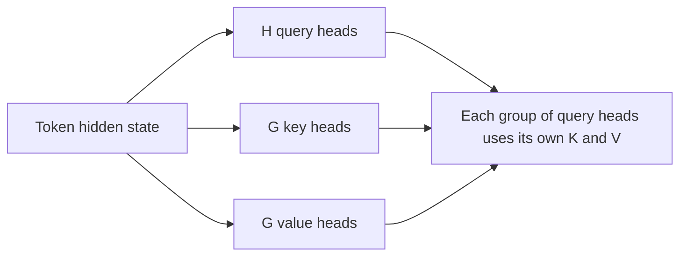

---
tags:
- engineering
- architecture
aliases:
- 分組查詢注意力
---

# Grouped-Query Attention

Grouped-query attention places query heads into groups, and each group shares one key head and one value head. It sits between standard multi-head attention and multi-query attention, reducing the KV cache while keeping more capacity than a single shared head. Ainslie et al. also showed how to convert an existing multi-head checkpoint into a grouped-query model with a small amount of additional training.

## Overview

Multi-query attention saves the most memory but can lose quality, because one key-value head must serve every query head. Grouped-query attention tunes the trade-off: with $G$ key-value groups and $H$ query heads, the cache scales with $G$. Choosing $G$ between $1$ and $H$ lets a model designer set the balance between memory and quality.

## Key concepts

- **Group**: a set of query heads that share one key head and one value head.
- **Number of groups $G$**: $G = H$ gives standard multi-head attention, and $G = 1$ gives multi-query attention.
- **Uptraining**: converting a multi-head checkpoint by averaging its key and value heads within groups, then training briefly.

## How it works

Each token's hidden state produces $H$ query vectors and $G$ key and value vectors. Query heads in group $g$ all attend over the keys and values of group $g$. During decoding, the cache stores $G$ key-value pairs per token.

## Key methods

The method is the grouping of heads and the uptraining recipe. The paper's contribution is showing that a multi-head checkpoint can be converted with a small fraction of its original pre-training compute.

## Results

The paper reports that grouped-query models trained from converted checkpoints approach the quality of multi-head attention while decoding at near multi-query speed. Figures depend on the group count and the benchmark, so readers should check the paper's tables.

## Limitations

- **Choice of groups**: the best $G$ depends on the model size and the target quality, and there is no closed-form rule.
- **Conversion quality**: converted models need some additional training, and their quality depends on how the heads are merged.
- **Partial saving**: the cache is smaller than multi-head attention but larger than multi-query attention.

## Open questions

- How does the best group count scale with model size, and is there a rule that transfers across architectures?
- Does grouped-query attention interact well with sliding-window or sparse attention?

## References

### Seminal papers

- Ainslie, J. et al. (2023). *GQA: Training Generalized Multi-Query Transformer Models from Multi-Head Checkpoints*. EMNLP 2023. https://arxiv.org/abs/2305.13245 — Introduces grouped-query attention and the uptraining recipe for converting multi-head checkpoints.

### Related work

- Shazeer, N. (2019). *Fast Transformer Decoding: One Write-Head is All You Need*. https://arxiv.org/abs/1911.02150 — The single-head case that grouped-query attention generalises.
- Kwon, W. et al. (2023). *Efficient Memory Management for Large Language Model Serving with PagedAttention*. SOSP 2023. https://arxiv.org/abs/2309.06180 — Shows how a smaller per-token cache also reduces the memory pressure that serving systems must manage.
- Dao, T. et al. (2022). *FlashAttention: Fast and Memory-Efficient Exact Attention with IO-Awareness*. NeurIPS 2022. https://arxiv.org/abs/2205.14135 — Complements grouped-query attention by reducing the traffic of the attention kernel itself.
- Pope, R. et al. (2023). *Efficiently Scaling Transformer Inference*. MLSys 2023. https://arxiv.org/abs/2211.05102 — Explains how attention layout affects cost when models are partitioned for inference.
