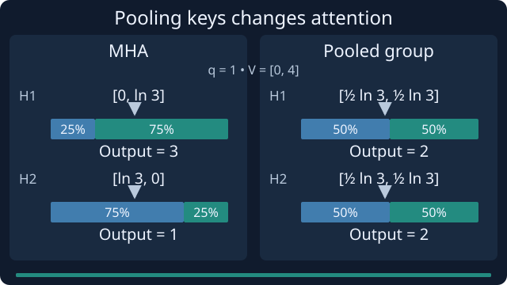

---
tags:
- engineering
- architecture
aliases:
- 分組查詢注意力
---

# Grouped-Query Attention

Grouped-query attention places query heads into groups, and each group shares one key head and one value head. It sits between standard multi-head attention and multi-query attention, reducing the KV cache while keeping more capacity than a single shared head. Ainslie et al. also showed how to convert an existing multi-head checkpoint into a grouped-query model with a small amount of additional training.

## Overview

Multi-query attention saves the most memory but can lose quality, because one key-value head must serve every query head. Grouped-query attention tunes the trade-off: with $G$ key-value groups and $H$ query heads, the cache scales with $G$. Choosing $G$ between $1$ and $H$ lets a model designer set the balance between memory and quality.

## Key concepts

- **Group**: a set of query heads that share one key head and one value head.
- **Number of groups $G$**: $G = H$ gives standard multi-head attention, and $G = 1$ gives multi-query attention.
- **Uptraining**: converting a multi-head checkpoint by averaging its key and value heads within groups, then training briefly.

## How it works

Each token's hidden state produces $H$ query vectors and $G$ key and value vectors. Query heads in group $g$ all attend over the keys and values of group $g$. During decoding, the cache stores $G$ key-value pairs per token.

*Original animated teaching diagram (CC BY-SA 4.0).* Eight query heads ($H=8$) are partitioned into two groups ($G=2$). Each group's four queries read from the same **key and value head**; **the queries themselves are not averaged**. With the head dimension and other cache factors held fixed, a token stores two KV pairs here instead of eight in MHA—a **4× reduction in KV-head count**, not a measured 4× speedup. Follow the moving pulses on MkDocs using the keyboard-operable **Play/Pause** button. Reduced-motion users see the static diagram first. [GitHub-compatible static overview](../../assets/concept-animations/gqa-head-sharing-still.svg).

## Key methods

The method is the grouping of heads and the uptraining recipe. The paper's contribution is showing that a multi-head checkpoint can be converted with a small fraction of its original pre-training compute.

### From an MHA checkpoint to GQA

*Original animated teaching diagram (CC BY-SA 4.0).* First, **mean-pool key and value projection matrices separately within each group**; then continue pretraining the converted checkpoint so it can adapt to the new sharing structure. For a group of $h=H/G$ original heads,

$$
\bar W_{K,g}=\frac{1}{h}\sum_{i\in g}W_{K,i}
$$

, and likewise for $W_V$. The scalar samples in the drawing (such as $0.2$ and $0.6$ averaging to $0.4$) stand in for *matrices*, not trained weights or model measurements. The training loop represents additional pretraining of the converted model, not a claim that only KV projections receive updates. See [Ainslie et al. (2023)](https://aclanthology.org/2023.emnlp-main.298/). The MkDocs player supports keyboard **Play/Pause** and reduced-motion fallback. [GitHub-compatible static overview](../../assets/concept-animations/gqa-uptraining-pooling-still.svg).

This conversion does not generally preserve the original MHA outputs; additional pretraining aims to recover quality, not establish functional equivalence.

### Worked example: pooling changes the attention output

Two scalar query heads use the same query $q=1$ and the same values $V=[0,4]$ over two tokens. Their original key logits are $[0,\ln 3]$ and $[\ln 3,0]$. Averaging the key projections within this group gives equal logits $[\ln 3/2,\ln 3/2]$ for both heads (the input states are fixed and the value projections are identical).

*Original animated teaching diagram, CC BY-SA 4.0.* Follow the logits, the two-token softmax weights (blue then teal), and the weighted output as they appear. The animation is a staged computation comparison, not a training trajectory. On MkDocs use the keyboard-accessible **Play/Pause** control; reduced-motion preferences show the still. [Static preview for GitHub](../../assets/concept-animations/gqa-pooling-output-drift-still.svg).

| Head | Original weights | Original output | Pooled weights | Pooled output |
|---|---|---:|---|---:|
| 1 | (0.25, 0.75) | 3 | (0.5, 0.5) | 2 |
| 2 | (0.75, 0.25) | 1 | (0.5, 0.5) | 2 |

Softmax gives these weights because the original exponentials are (1, 3) and (3, 1), whereas the pooled logits have identical exponentials. Each output is the weight on the second token multiplied by 4. Thus even with unchanged queries and values, the concatenated head outputs change from (3, 1) to (2, 2). An identity output projection would preserve this difference. The two-head group is a local example, not a claim that all groups or query vectors have identical outputs. The numbers are constructed, not model measurements; additional pretraining in Ainslie et al. (2023) adapts the converted model rather than guaranteeing exact preservation.

## Results

The paper reports that grouped-query models trained from converted checkpoints approach the quality of multi-head attention while decoding at near multi-query speed. Figures depend on the group count and the benchmark, so readers should check the paper's tables.

## Limitations

- **Choice of groups**: the best $G$ depends on the model size and the target quality, and there is no closed-form rule.
- **Conversion quality**: converted models need some additional training, and their quality depends on how the heads are merged.
- **Partial saving**: the cache is smaller than multi-head attention but larger than multi-query attention.

## Open questions

- How does the best group count scale with model size, and is there a rule that transfers across architectures?
- Does grouped-query attention interact well with sliding-window or sparse attention?

## References

### Seminal papers

- Ainslie, J. et al. (2023). *GQA: Training Generalized Multi-Query Transformer Models from Multi-Head Checkpoints*. EMNLP 2023. https://arxiv.org/abs/2305.13245 — Introduces grouped-query attention and the uptraining recipe for converting multi-head checkpoints.

### Related work

- Shazeer, N. (2019). *Fast Transformer Decoding: One Write-Head is All You Need*. https://arxiv.org/abs/1911.02150 — The single-head case that grouped-query attention generalises.
- Kwon, W. et al. (2023). *Efficient Memory Management for Large Language Model Serving with PagedAttention*. SOSP 2023. https://arxiv.org/abs/2309.06180 — Shows how a smaller per-token cache also reduces the memory pressure that serving systems must manage.
- Dao, T. et al. (2022). *FlashAttention: Fast and Memory-Efficient Exact Attention with IO-Awareness*. NeurIPS 2022. https://arxiv.org/abs/2205.14135 — Complements grouped-query attention by reducing the traffic of the attention kernel itself.
- Pope, R. et al. (2023). *Efficiently Scaling Transformer Inference*. MLSys 2023. https://arxiv.org/abs/2211.05102 — Explains how attention layout affects cost when models are partitioned for inference.
