# 分組查詢注意力

分組查詢注意力把查詢頭分成數組，每組共用一個 key 頭與一個 value 頭。它介於標準多頭注意力與多查詢注意力之間，在縮小 KV 快取的同時，保有比單一共用頭更多的容量。Ainslie et al. 也展示了如何以少量額外訓練，把既有的多頭檢查點轉換為分組查詢模型。

## 概述

多查詢注意力節省最多的記憶體，但可能損失品質，因為單一 key-value 頭必須服務所有查詢頭。分組查詢注意力調整了這個取捨：若有 $G$ 組 key-value 與 $H$ 個查詢頭，快取大小與 $G$ 成正比。把 $G$ 選在 $1$ 與 $H$ 之間，設計者就能決定記憶體與品質的平衡。

## 關鍵概念

- **分組**：共用一個 key 頭與一個 value 頭的一組查詢頭。
- **組數 $G$**：$G = H$ 即標準多頭注意力，$G = 1$ 即多查詢注意力。
- **向上訓練（uptraining）**：把多頭檢查點轉換為分組模型，做法是把組內的 key 與 value 頭平均合併，然後短暫訓練。

## 運作方式

每個 token 的隱藏狀態會產生 $H$ 個查詢向量，以及 $G$ 個 key 與 value 向量。第 $g$ 組的查詢頭都對第 $g$ 組的 key 與 value 做注意力。解碼時，快取每個 token 儲存 $G$ 組 key-value。

*原創教學動畫（CC BY-SA 4.0）。* 八個查詢頭（$H=8$）分成兩組（$G=2$），每組四個查詢頭共用同一組 **Key／Value 頭**；**查詢頭本身不會被平均**。在每個頭的維度及其他快取條件相同時，每個 Token 從 MHA 的八組 KV 降為兩組，即 **KV 頭數降低為四分之一**，但不代表實測推論速度增加四倍。MkDocs 提供可用鍵盤操作的**播放／暫停**；偏好減少動態效果時先顯示靜態圖。[GitHub 可直接閱讀的靜態圖](../../assets/concept-animations/gqa-head-sharing-still.svg)。

## 關鍵方法

這個方法是把頭分組，加上向上訓練的做法。論文的貢獻在於：多頭檢查點可以用其原始預訓練運算量的一小部分完成轉換。

### 從 MHA 檢查點轉換為 GQA

*原創教學動畫（CC BY-SA 4.0）。* 首先將**每組的 Key 與 Value 投影矩陣分別取平均**，再以額外預訓練讓轉換後的模型適應共用結構。若每組包含 $h=H/G$ 個原始頭，則 $\bar W_{K,g}=\frac{1}{h}\sum_{i\in g}W_{K,i}$，$W_V$ 亦然。動畫的 $0.2$、$0.6$ 平均成 $0.4$ 等純量只是**投影矩陣的教學替身**，並非訓練權重或模型實測結果。最右側循環代表轉換後模型的額外預訓練，不代表只有 KV 投影會更新。依據 [Ainslie et al.（2023）](https://aclanthology.org/2023.emnlp-main.298/)。MkDocs 提供鍵盤可操作的**播放／暫停**及減少動態效果回退。[GitHub 可直接閱讀的靜態圖](../../assets/concept-animations/gqa-uptraining-pooling-still.svg)。

## 結果

論文指出，由轉換後的檢查點訓練出的分組查詢模型，品質接近多頭注意力，同時解碼速度接近多查詢注意力。數字取決於組數與基準，應參考論文的表格。

## 限制

- **組數選擇**：最佳的 $G$ 取決於模型大小與目標品質，沒有封閉形式的規則。
- **轉換品質**：轉換後的模型需要額外訓練，其品質取決於頭的合併方式。
- **節省有限**：快取比多頭注意力小，但比多查詢注意力大。

## 開放問題

- 最佳組數如何隨模型大小變化？是否有能跨架構通用的規則？
- 分組查詢注意力與滑動視窗或稀疏注意力搭配時，效果如何？

## 參考文獻

### 奠基性論文

- Ainslie, J. et al. (2023). *GQA: Training Generalized Multi-Query Transformer Models from Multi-Head Checkpoints*. EMNLP 2023. https://arxiv.org/abs/2305.13245 — 提出分組查詢注意力，以及把多頭檢查點轉換的向上訓練做法。

### 相關研究

- Shazeer, N. (2019). *Fast Transformer Decoding: One Write-Head is All You Need*. https://arxiv.org/abs/1911.02150 — 分組查詢注意力所推廣的單一頭情形。
- Kwon, W. et al. (2023). *Efficient Memory Management for Large Language Model Serving with PagedAttention*. SOSP 2023. https://arxiv.org/abs/2309.06180 — 說明更小的每 token 快取，也能減輕服務系統必須管理的記憶體壓力。
- Dao, T. et al. (2022). *FlashAttention: Fast and Memory-Efficient Exact Attention with IO-Awareness*. NeurIPS 2022. https://arxiv.org/abs/2205.14135 — 從注意力核心本身減少記憶體流量，與分組查詢注意力互補。
- Pope, R. et al. (2023). *Efficiently Scaling Transformer Inference*. MLSys 2023. https://arxiv.org/abs/2211.05102 — 說明當模型為推論而分割時，注意力佈局如何影響成本。
