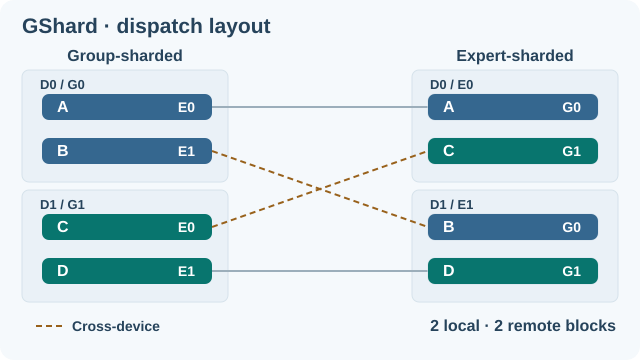

# GShard

!!! info "Part of Serving Mixture-of-Experts Models"
    This method page belongs to [Serving Mixture-of-Experts Models](moe-serving.md). It explains GShard in detail; the parent page compares it with the other methods.

GShard is a module of annotation APIs and an extension to the XLA compiler that shards a sparsely gated mixture-of-experts model across many devices. The authors use it to train a model with over 600 billion parameters, by annotating how the tensors should be split and letting the compiler generate the partitioned program. The paper evaluates it for training, so its serving consequences are discussed on the comparison page and in the other methods here.

## Problem

A model with many experts is too large for one device, so its experts must be spread across devices. Writing the communication between devices by hand for each model and each layout is error-prone and does not scale to many layouts. The problem is to express the parallel layout with a small set of annotations, and to let the compiler produce the device program.

## Core idea

GShard asks the programmer to annotate which tensor dimensions are split across devices, such as the expert dimension, and where the model should be replicated. The compiler, which GShard extends, then partitions the computation and inserts the communication. For a sparsely gated mixture-of-experts layer, the expert dimension is split across devices, and the tokens are routed to the devices that hold their experts.

## Procedure

1. Write the model with annotations marking the tensor dimensions to split across devices.
2. Annotate the expert layers so that each expert, or group of experts, lives on a device.
3. Compile the annotated model with the extended XLA compiler, which partitions the program.
4. Run the partitioned program, with the compiler inserting the communication that routing requires.
5. Check the layout against the devices and adjust the annotations if the communication dominates.

### Worked example: dispatch as a change of sharding axis

After gating, GShard packs token representations into expert-capacity slots and changes the partition of the dispatch buffer so that each device owns the input for its local experts.[^dispatch-layout] Consider a two-device slice with two groups, two experts and one nonempty slot per group-expert pair.

*Original instructional animation, CC BY-SA 4.0.* The left and right columns represent the same logical dispatch buffer under different layouts. A and D stay on their original device; B and C cross in opposite directions. The moving dots show block placement, not network timing or a serialized implementation. On MkDocs, use **Play/Pause** (Enter or Space); reduced-motion preferences show the still. On narrow screens the figure may be scrolled horizontally. [GitHub-readable static preview](../../assets/concept-animations/gshard-dispatch-layout-still.svg).

| Device | Before: group-sharded | After: expert-sharded |
|---|---|---|
| D0 | G0: A for E0, B for E1 | E0: A from G0, C from G1 |
| D1 | G1: C for E0, D for E1 | E1: B from G0, D from G1 |

There are two local blocks and two logical remote blocks in the forward dispatch. If every block is one activation vector of $h$ elements with $b$ bytes per element, remote dispatch carries $2hb$ logical bytes across the two devices in total. Returning equally sized expert outputs to their originating groups adds another $2hb$; the combine step then applies the gating weights. The animation isolates the layout exchange, not expert arithmetic, gating, capacity overflow, padding, collective overhead or backward communication. GShard's actual gating can select up to two experts per token; the four occupied slots here are already routed contributions, not a new gating rule. The counts are schematic, not measured traffic or latency.

**Why balanced expert counts do not determine communication.** Let each matrix row represent the originating group (G0 or G1), each column the destination expert (E0 or E1), and each entry the number of occupied slots. Group and expert ownership follow the animation: G0/E0 on D0 and G1/E1 on D1. Allow two slots per group-expert pair for this separate example.

| Occupied slots (G0; G1) | Expert totals (E0, E1) | Remote sends | Remote returns |
|---|---|---:|---:|
| (2, 0); (0, 2) | (2, 2) | 0 | 0 |
| (1, 1); (1, 1) — animation | (2, 2) | 2 | 2 |
| (0, 2); (2, 0) | (2, 2) | 4 | 4 |

Each device originates two contributions and each expert receives two contributions in all three cases. Only off-diagonal occupied slots cross devices, so the first and last cases have identical expert load but different useful remote payload counts. Empty slots carry no useful activation in this accounting; a padded collective may still transmit their allocated storage. These are hypothetical post-gating layouts, not measured bytes or a claim about the compiler's physical all-to-all implementation.

[^dispatch-layout]: Lepikhin et al., [GShard](https://arxiv.org/abs/2006.16668), describes group-local gating, expert computation and automatic sharding; this two-device example is original.

## Results

The paper reports training a sparsely gated mixture-of-experts model with automatic sharding beyond 600 billion parameters. It reports training a translation model from 100 languages to English on 2048 TPU v3 accelerators in 4 days. These are training results, and the paper's focus is training, so the serving consequences must be drawn from the design rather than from a reported serving benchmark.

## Limitations

- **Training focus.** The paper is about training the model. Serving has different batch sizes and latency needs, so the layout chosen for training may not be the best one for inference.
- **Compiler dependence.** The method depends on the XLA extension, so its benefits follow the compiler's support for the target hardware.
- **Routing communication.** Routing requires all-to-all traffic for every layer, and the traffic depends on how evenly tokens spread across experts.

## Connections

- The compiler that GShard extends is the subject of [XLA](../frameworks/compilers-and-kernels/xla.md), which is covered in the frameworks section.
- The architecture and routing are in the [mixture-of-experts theory pages](../../theory/models/mixture-of-experts/index.md).
- The serving alternatives are [DeepSpeed-MoE](deepspeed-moe.md) and [expert offloading](expert-offloading.md).

## Open questions

- What is the best expert layout for inference, when batch sizes are small and latency matters more than throughput?
- Can the annotations be inferred automatically from the serving workload, rather than written by the programmer?

## References

### Seminal papers

- Lepikhin, D. et al. (2020). *GShard: Scaling Giant Models with Conditional Computation and Automatic Sharding*. arXiv:2006.16668. https://arxiv.org/abs/2006.16668 — The primary paper: annotation APIs and an XLA extension for sharding a sparsely gated MoE model, with training results.
- Shazeer, N. et al. (2017). *Outrageously Large Neural Networks: The Sparsely-Gated Mixture-of-Experts Layer*. arXiv:1701.06538. https://arxiv.org/abs/1701.06538 — The sparsely gated mixture-of-experts layer that GShard shards.
- Fedus, W., Zoph, B. & Shazeer, N. (2022). *Switch Transformers: Scaling to Trillion Parameter Models with Simple and Efficient Sparsity*. Journal of Machine Learning Research 23(120):1–39. arXiv:2101.03961. https://arxiv.org/abs/2101.03961 — Top-1 routing, which simplifies the communication that GShard's layout must support.
- Rajbhandari, S. et al. (2022). *DeepSpeed-MoE: Advancing Mixture-of-Experts Inference and Training to Power Next-Generation AI Scale*. arXiv:2201.05596. https://arxiv.org/abs/2201.05596 — An MoE system that focuses on inference, for comparison with a training-first design.
- Eliseev, A. & Mazur, D. (2023). *Fast Inference of Mixture-of-Experts Language Models with Offloading*. arXiv:2312.17238. https://arxiv.org/abs/2312.17238 — Offloading as a way to serve MoE models on hardware with less memory.
