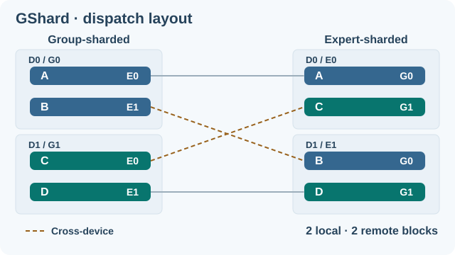

# GShard

!!! info "屬於混合專家模型的服務"
    本方法頁隸屬於[混合專家模型的服務](moe-serving.zh-TW.md)。它詳細說明 GShard；上層頁面則比較它與其他方法。

GShard 是一組標註 API 與 XLA 編譯器的擴充，用來把稀疏閘控的混合專家模型分片到許多裝置上。作者以它訓練超過 6000 億參數的模型：程式設計者為張量該如何切分加上標註，再由編譯器產生分割後的程式。論文評估的是訓練，因此推論的影響會在上層頁面與本頁的其他方法中討論。

## 問題

專家很多的模型對單一裝置來說太大，因此專家必須分散到多台裝置上。針對每個模型與每種配置手動撰寫裝置間的通訊，容易出錯，也無法擴展到許多種配置。問題在於：如何以一小組標註描述平行配置，並讓編譯器產生裝置上的程式。

## 核心想法

GShard 要求程式設計者標註哪些張量維度要跨裝置切分（例如專家維度），以及模型應在何處複製。接著，GShard 所擴充的編譯器會分割運算，並插入所需的通訊。對稀疏閘控的混合專家層而言，專家維度會跨裝置切分，token 則被路由到持有其專家的裝置。

## 程序

1. 撰寫模型，並標註要跨裝置切分的張量維度。
2. 為專家層加上標註，使每個專家或每組專家位於某台裝置上。
3. 以擴充後的 XLA 編譯器編譯已標註的模型，由它分割程式。
4. 執行分割後的程式，由編譯器插入路由所需的通訊。
5. 對照裝置檢查配置，若通訊佔主導，則調整標註。

### 算例：以分片軸的改變理解派送

完成閘控後，GShard 將 token 表徵放入各專家的容量槽位，並改變派送緩衝區的分片方式，讓每台裝置持有其本地專家的輸入。[^dispatch-layout] 以下取兩台裝置、兩個群組、兩個專家，每組群組與專家配對各有一個非空槽位。

*原創教學動畫，CC BY-SA 4.0。* 左右兩欄表示同一邏輯派送緩衝區的不同配置。A、D 留在原裝置；B、C 朝相反方向跨裝置。移動圓點表示區塊放置，不代表網路時序或序列化實作。在 MkDocs 使用 **播放／暫停**（Enter 或 Space）；減少動態效果偏好會顯示靜態圖。窄螢幕可水平捲動。[GitHub 可讀靜態預覽](../../assets/concept-animations/gshard-dispatch-layout-still.svg)。

| 裝置 | 派送前：依群組分片 | 派送後：依專家分片 |
|---|---|---|
| D0 | G0：送往 E0 的 A、送往 E1 的 B | E0：來自 G0 的 A、來自 G1 的 C |
| D1 | G1：送往 E0 的 C、送往 E1 的 D | E1：來自 G0 的 B、來自 G1 的 D |

正向派送包含兩個本地區塊及兩個邏輯跨裝置區塊。若每個區塊是一個含 $h$ 個元素、每元素 $b$ 位元組的 activation 向量，兩台裝置的跨裝置派送邏輯資料量合計為 $2hb$ 位元組。將相同大小的專家輸出送回原群組再增加 $2hb$ 位元組，之後合併步驟才套用閘控權重。動畫隔離配置交換，不包含專家運算、閘控、容量溢位、填充、集合通訊開銷或反向通訊。GShard 實際閘控可為每個 token 選擇最多兩個專家；此處四個已占用槽位是完成路由的貢獻項，不是新的閘控規則。所有計數皆為示意，非實測流量或延遲。

[^dispatch-layout]: Lepikhin 等人，[GShard](https://arxiv.org/abs/2006.16668)，說明群組內閘控、專家運算與自動分片；此兩裝置算例為原創。

## 結果

論文報告，以自動分片訓練超過 6000 億參數的稀疏閘控混合專家模型。論文也報告，在 2048 顆 TPU v3 加速器上，於 4 天內訓練了一個從 100 種語言翻譯成英文的模型。這些是訓練結果，論文的重點也在訓練，因此推論的影響應從設計推論，而非從論文中報告的推論基準得出。

## 限制

- **以訓練為主。** 論文談的是訓練模型。推論的批次大小與延遲需求不同，因此為訓練選擇的配置未必是推論的最佳配置。
- **依賴編譯器。** 此方法依賴 XLA 擴充，因此其效益取決於編譯器對目標硬體的支援。
- **路由的通訊。** 路由在每一層都需要全互連流量，而流量取決於 token 在專家之間分散的均勻程度。

## 關聯

- GShard 所擴充的編譯器是 [XLA](../frameworks/compilers-and-kernels/xla.zh-TW.md)，見框架與工具的編譯器與核心程式一節。
- 架構與路由見[混合專家理論頁面](../../theory/models/mixture-of-experts/index.zh-TW.md)。
- 其他服務方法為 [DeepSpeed-MoE](deepspeed-moe.zh-TW.md) 與[專家卸載](expert-offloading.zh-TW.md)。

## 開放問題

- 當批次小、延遲比吞吐量更重要時，推論最好的專家配置是什麼？
- 分片標註能否依服務工作負載自動推導，而不需要程式設計者手動撰寫？

## 參考文獻

### 重要論文

- Lepikhin, D. et al. (2020). *GShard: Scaling Giant Models with Conditional Computation and Automatic Sharding*. arXiv:2006.16668. https://arxiv.org/abs/2006.16668 — 主要論文：用於分片稀疏閘控 MoE 模型的標註 API 與 XLA 擴充，附有訓練結果。
- Shazeer, N. et al. (2017). *Outrageously Large Neural Networks: The Sparsely-Gated Mixture-of-Experts Layer*. arXiv:1701.06538. https://arxiv.org/abs/1701.06538 — GShard 所分片的稀疏閘控混合專家層。
- Fedus, W., Zoph, B. & Shazeer, N. (2022). *Switch Transformers: Scaling to Trillion Parameter Models with Simple and Efficient Sparsity*. Journal of Machine Learning Research 23(120):1–39. arXiv:2101.03961. https://arxiv.org/abs/2101.03961 — Top-1 路由，簡化了 GShard 配置所需支援的通訊。
- Rajbhandari, S. et al. (2022). *DeepSpeed-MoE: Advancing Mixture-of-Experts Inference and Training to Power Next-Generation AI Scale*. arXiv:2201.05596. https://arxiv.org/abs/2201.05596 — 以推論為主的 MoE 系統，與以訓練為主的設計比較。
- Eliseev, A. & Mazur, D. (2023). *Fast Inference of Mixture-of-Experts Language Models with Offloading*. arXiv:2312.17238. https://arxiv.org/abs/2312.17238 — 以卸載在記憶體較少的硬體上服務 MoE 模型的另一種做法。
