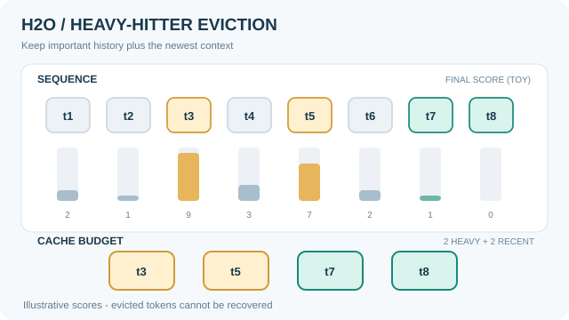
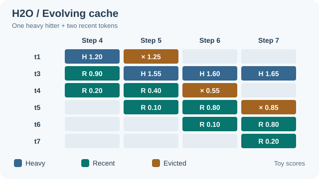

# H2O（重擊手預言機）

!!! info "屬於 KV 快取壓縮與淘汰"
    本方法頁隸屬於[KV 快取壓縮與淘汰](kv-cache-compression.zh-TW.md)。它詳細說明 H2O；上層頁面則比較它與其他方法。

H2O 是生成式推論中的 KV 快取淘汰策略。它保留一小組「重擊手」token，也就是累積獲得最多注意力的 token，加上一段近期 token 視窗，並淘汰其餘部分。作者報告，快取可以大幅縮小，而準確度損失很小，而且在 OPT 模型上的吞吐量增益很大。

## 問題

解碼器的快取會為每個生成的 token、每一層與每個注意力頭增加一筆資料。對長提示與大批次而言，這份快取可能超過模型權重，使一張 GPU 能容納的請求變少。單純丟棄最舊的 token 會失敗，因為有些早期 token 在整個生成過程中都很重要。

## 核心想法

作者觀察到注意力是稀疏的：一小部分 token 在各層中獲得大部分的注意力權重。他們稱這些 token 為重擊手。H2O 追蹤每個 token 累積獲得的注意力，在固定預算內保留重擊手與最近的 token，並淘汰其餘部分。作者把「保留哪些 token」的選擇框定為次模選擇問題，並在溫和的假設下給出理論保證。

### 動態示範：累積注意力與快取保留決策

[GitHub 靜態回退預覽](../../assets/concept-animations/h2o-heavy-hitter-selection-still.svg) · 在 MkDocs 網站可使用 **播放／暫停**（支援鍵盤按鈕操作）。

上方長條使用八個 Token 的**人工累積注意力分數** `[2, 1, 9, 3, 7, 2, 1, 0]`。在簡化的**四格快取預算**下，保留兩個重擊手 `t3`、`t5` 與兩個近期 Token `t7`、`t8`，淘汰其餘項目。分數、名額比例與選取結果都是**教學示意，不是實際注意力測量或 H2O 實驗結果**。真實演算法會隨解碼步驟更新分數，而且分數是基於當下可用的快取計算；被淘汰的內容不會因後續需求而自動恢復。H2O 用局部近似選取而非預知未來注意力。依據參考文獻中的 Zhang et al.（2023）。

*原創教學視覺，CC BY-SA 4.0。*

數字標籤是最終的示意分數；長條按同一比例揭示，標記沿路徑移到選定的快取槽位。這是固定資料的重播，不是解碼過程的即時模擬。

### 算例：跨解碼步驟的重擊手更替

[GitHub 靜態回退預覽](../../assets/concept-animations/h2o-evolving-cache-still.svg) · MkDocs 網站支援鍵盤操作的**播放／暫停**；偏好減少動態效果時顯示完整靜態圖。

簡化的單頭策略在最新兩個 token 之外保留一個重擊手。第 4 步保留 t1、t3、t4，累積分數分別為 1.20、0.90、0.20；t2 已先被淘汰。每個新步驟將注意力增量加到可用候選（含新 token），保護最新兩個 token，再從其餘候選中選擇累積分數最高者。

| 步驟 | 候選順序 | 注意力增量 | 淘汰 |
|---|---|---|---|
| 5 | t1, t3, t4, t5 | .05, .65, .20, .10 | t1 |
| 6 | t3, t4, t5, t6 | .05, .15, .70, .10 | t4 |
| 7 | t3, t5, t6, t7 | .05, .05, .70, .20 | t5 |

每列增量總和為 1。第 5 步的 t3 離開近期視窗，卻因分數 1.55 高於 t1 的 1.25 而成為重擊手。橘色格表示淘汰當下的分數，並非額外常駐位置；空白格表示不在快取內。已淘汰的 token 不參與後續分數更新。此算例呈現局部選擇，而非實作追蹤，也不代表未來注意力能找回被丟棄的內容。初始分數與增量皆為人工示意，非模型實測。動態重擊手策略見參考文獻 Zhang et al.（2023）。

*原創教學動畫，CC BY-SA 4.0。*

#### 重擊手何時更替？

第 4 步的累積分數差距為 0.30（1.20 減去 0.90）。第 5 步保護 t4 與 t5，因此只有當 t3 的新注意力增量比 t1 多出超過 0.30 時，t3 才會勝出。固定初始快取與近期 token 的增量，可得到以下受控比較：

| 第 5 步 t1、t3 的增量 | t1、t3 更新後的分數 | 重擊手 |
|---|---|---|
| .05、.65（動畫） | 1.25、1.55 | t3 |
| .35、.35 | 1.55、1.25 | t1 |
| .20、.50 | 1.40、1.40 | 同分 |

同分時需要指定平手處理規則，本簡化策略不預設該規則。t4 與 t5 的增量固定為 .20 與 .10，所以每列仍正規化為 1。第二列淘汰的是 t3 而非 t1，因此不能直接沿用動畫後續各欄：候選集合與注意力分布都可能不同。這些是替代的人工注意力列，不是同一模型的獨立實測結果。

## 程序

1. 設定快取預算，例如序列長度的一部分。
2. 在每個解碼步驟，把新 token 的 key 與 value 加入快取。
3. 跨步驟累積每個快取 token 的注意力分數。
4. 快取超過預算時，保留分數最高的 token 與近期視窗，淘汰其餘部分。
5. 以縮減後的快取繼續生成。

## 結果

論文在 OPT、LLaMA 與 GPT-NeoX 模型上進行評估。對 OPT-6.7B 與 OPT-30B，當重擊手占快取的 20% 時，摘要報告吞吐量最高為 DeepSpeed Zero-Inference 與 Hugging Face Accelerate 的 29 倍，為 FlexGen 的 3 倍。在相同批次大小下，它報告延遲最多降低 1.9 倍。這些比較的對象是卸載式推論系統，因此增益反映的是避免搬移的記憶體，不應解讀為相較於完整常駐的密集快取的增益。

## 限制

- **之後才重要的早期 token。** 在視窗中時獲得少量注意力的 token 可能被淘汰，之後若問題需要它，就無法回答。
- **累積分數只是近似。** 分數會跨步驟加總，因此有利於存在較久的 token，這種偏差可能誤判較新的內容。
- **注意力是在淘汰後的快取上計算的。** 分數來自縮減後的快取，因此策略可能偏離完整模型實際會注意的內容。
- **基準的選擇。** 最大的報告增益來自卸載式基準，而這類基準本來就很慢。

## 關聯

- 視窗方法必須保留的注意力匯聚點，見 [StreamingLLM](streamingllm.zh-TW.md)，它保留的是開頭的 token，而不是重擊手。
- 以量化取代淘汰的做法，見 [KIVI](kivi.zh-TW.md)。
- 讓被淘汰區塊能釋出重複使用的記憶體配置，是 [PagedAttention 與 vLLM](paged-attention.zh-TW.md)。

## 開放問題

- 重擊手的選擇能否使用下一個問題的查詢，而不是在問題出現之前累積的注意力？
- 當不同任務的注意力集中在不同層時，每一層的預算應如何設定？

## 參考文獻

### 重要論文

- Zhang, Z. et al. (2023). *H2O: Heavy-Hitter Oracle for Efficient Generative Inference of Large Language Models*. arXiv:2306.14048. https://arxiv.org/abs/2306.14048 — 主要論文：以近期視窗搭配重擊手淘汰，並提供 OPT 模型上的吞吐量結果。
- Xiao, G. et al. (2024). *Efficient Streaming Language Models with Attention Sinks*. ICLR 2024. arXiv:2309.17453. https://arxiv.org/abs/2309.17453 — 相反的策略，保留注意力匯聚點，而不是重擊手。
- Liu, Z. et al. (2024). *KIVI: A Tuning-Free Asymmetric 2bit Quantization for KV Cache*. arXiv:2402.02750. https://arxiv.org/abs/2402.02750 — 對同一快取進行量化，作為淘汰的替代方案。
- Kwon, W. et al. (2023). *Efficient Memory Management for Large Language Model Serving with PagedAttention*. SOSP 2023. arXiv:2309.06180. https://arxiv.org/abs/2309.06180 — 分頁式記憶體配置，被淘汰的區塊會在其中釋出以重複使用。
- Ainslie, J. et al. (2023). *GQA: Training Generalized Multi-Query Transformer Models from Multi-Head Checkpoints*. EMNLP 2023. arXiv:2305.13245. https://arxiv.org/abs/2305.13245 — 經過訓練的快取縮減，H2O 的事後方法與之比較。
