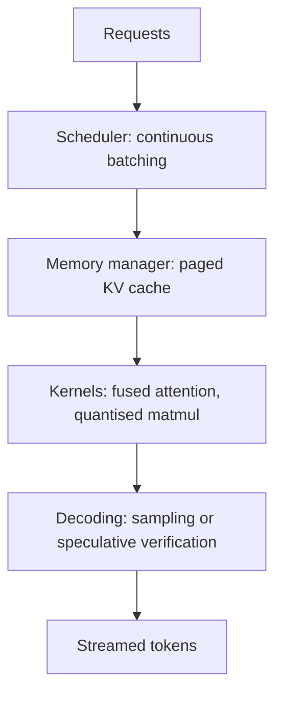

---
related:
- theory/models/transformer/kv-cache
- theory/models/transformer
tags:
- engineering
- efficiency
aliases:
- 推論最佳化
---

# Inference Optimization

Inference optimization is the set of techniques that make a trained model answer faster, serve more users per GPU, and cost less per token. For large language models the bottleneck is usually not arithmetic but memory: each generated token has to read the model weights and the cached keys and values of every earlier token.

## Overview

A model is trained once but served millions of times, so a small gain in serving efficiency compounds. Inference splits into two phases with very different hardware profiles:

- **Prefill** processes the whole prompt in parallel. It is compute-bound, because many tokens share each weight read.
- **Decoding** produces one token at a time. It is memory-bound, because each step reads the full weights and the whole [KV cache](../../theory/models/transformer/kv-cache/index.md) for one token of output.

Most techniques target one of these phases, and many trade latency against throughput.

## Key concepts

- **Latency vs. throughput**: time to first token and time per output token matter for chat; tokens per second per GPU matter for cost. Batching raises throughput but can delay individual requests.
- **Arithmetic intensity and the roofline**: the ratio of floating-point operations to bytes moved. A kernel is limited either by peak compute or by memory bandwidth, whichever it hits first. See [Memory hierarchy and bandwidth](../hardware/index.md).
- **KV cache**: stored keys and values that avoid recomputing attention over the prompt. Its size grows with sequence length, batch size and layer count, so it often limits how many requests fit on one device.
- **Continuous (iteration-level) batching**: new requests join a running batch as soon as another request finishes, instead of waiting for the whole batch to end.
- **Quantisation**: storing weights or activations in fewer bits to cut memory traffic. The methods are covered in [MLOps & Deployment](../mlops/index.md) and in the model compression material linked from the [Engineering overview](../index.md).

## How it works

A typical serving stack combines several layers:

The scheduler decides which requests run in each step. The memory manager decides where their KV cache lives. Kernels decide how fast each step runs on the hardware. Decoding decides how many tokens each step produces.

## Key methods

Each named method has its own page, which gives the problem, the core idea, the algorithm, the reported results and the limitations. The table compares them.

| Method | Problem it addresses | Core idea | Main trade-off | Page |
|---|---|---|---|---|
| Orca | Static batches leave the GPU idle on short requests | Schedule every model iteration, so requests join and leave | Memory fragmentation remains | [Orca](orca.md) |
| PagedAttention and vLLM | Contiguous KV-cache buffers waste memory | Store KV in blocks addressed through a block table | Needs a custom attention kernel | [PagedAttention and vLLM](paged-attention.md) |
| Speculative decoding | One token per full pass underuses the GPU | A draft model proposes tokens that the target verifies in one pass | Speedup depends on the acceptance rate | [Speculative decoding](speculative-decoding.md) |
| Multi-query attention | Each head keeps its own large KV cache | One shared key and value head for all queries | Some loss of quality | [Multi-query attention](multi-query-attention.md) |
| Grouped-query attention | Multi-query attention can lose too much quality | Groups of query heads share one key-value head | Cache is larger than multi-query | [Grouped-query attention](grouped-query-attention.md) |

Kernel-level fusion, which cuts memory traffic inside a single layer, is covered in [Fused kernels](fused-kernels.md).

Methods that shrink the cache after training, rather than by design, are compared on the [KV cache compression and eviction](kv-cache-compression.md) page: [H2O](h2o.md) and [StreamingLLM](streamingllm.md) drop tokens, while [KIVI](kivi.md) keeps every token at 2 bits.

## Connections

- The KV cache itself is explained in [Transformer KV cache](../../theory/models/transformer/kv-cache/index.md); this page covers how serving systems manage it.
- Hardware constraints, such as memory bandwidth and interconnects, set the ceiling for every technique here: see [AI Hardware](../hardware/index.md).
- Deployment concerns, including monitoring, cost and rollout, are in [MLOps & Deployment](../mlops/index.md).
- Weight quantisation and pruning change the model itself and are compared with serving-side methods in the model compression material.

## Applications

- **Chat services**: continuous batching and paged memory let a single GPU serve many concurrent users.
- **Code completion**: low latency matters most, so speculative decoding and small draft models are common.
- **Long-document question answering**: KV-cache memory dominates, which motivates grouped-query attention and cache eviction.
- **On-device assistants**: quantised weights and small models fit tight memory budgets, where bandwidth and power limits matter more than throughput.

## Open questions

- **Long contexts**: caches grow linearly with length. Eviction policies such as H2O and StreamingLLM drop tokens, which can hurt tasks that need the dropped content.
- **Mixing workloads**: scheduling prefill and decoding together can slow decoding. Chunked prefill is one answer, but the best policy depends on the service-level objective.
- **More variants**: hardware-specific kernels, disaggregated prefill and decode servers, and sparse or retrieval-based attention each trade accuracy, memory and engineering effort differently.
- **Measurement**: throughput and latency depend heavily on batch shape and prompt mix, so published numbers are hard to compare directly.

## References

### Seminal papers

- Yu, G.-I. et al. (2022). *Orca: A Distributed Serving System for Transformer-Based Generative Models*. OSDI 2022. https://www.usenix.org/conference/osdi22/presentation/yu — Introduces iteration-level scheduling, the basis of continuous batching in modern serving stacks.
- Kwon, W. et al. (2023). *Efficient Memory Management for Large Language Model Serving with PagedAttention*. SOSP 2023. https://arxiv.org/abs/2309.06180 — Describes paged KV-cache management and the vLLM serving system.
- Leviathan, Y., Kalman, M. & Matias, Y. (2023). *Fast Inference from Transformers via Speculative Decoding*. ICML 2023. https://arxiv.org/abs/2211.17192 — Proves that draft-and-verify decoding preserves the target model's output distribution while reducing latency.
- Dao, T. et al. (2022). *FlashAttention: Fast and Memory-Efficient Exact Attention with IO-Awareness*. NeurIPS 2022. https://arxiv.org/abs/2205.14135 — Computes exact attention with tiling so that fewer reads and writes go to slow GPU memory.
- Shazeer, N. (2019). *Fast Transformer Decoding: One Write-Head is All You Need*. https://arxiv.org/abs/1911.02150 — Proposes multi-query attention, which shares one key and value head across all queries to shrink the decoding cache.

### Surveys and papers on scaling

- Ainslie, J. et al. (2023). *GQA: Training Generalized Multi-Query Transformer Models from Multi-Head Checkpoints*. EMNLP 2023. https://arxiv.org/abs/2305.13245 — Shows how to convert multi-head checkpoints to grouped-query attention with little extra training.
- Pope, R. et al. (2023). *Efficiently Scaling Transformer Inference*. MLSys 2023. https://arxiv.org/abs/2211.05102 — Analyses how to partition models across chips to balance compute and memory for latency-sensitive and throughput-oriented inference.

### Articles and documentation

- Williams, S., Waterman, A. & Patterson, D. (2009). *Roofline: An Insightful Visual Performance Model for Multicore Architectures*. Communications of the ACM. https://escholarship.org/content/qt78h8v7mr/qt78h8v7mr.pdf — Defines the roofline model that relates arithmetic intensity to memory bandwidth and peak compute.
- vLLM project. *vLLM documentation*. https://docs.vllm.ai/ — Practical reference for paged attention, continuous batching and quantised serving in an open-source engine.
