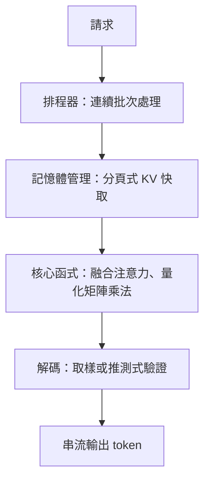

# 推論最佳化

推論最佳化是一組讓已訓練模型回答更快、每張 GPU 能服務更多使用者、且每個 token 成本更低的技術。對大型語言模型而言，瓶頸通常不在運算，而在記憶體：每生成一個 token，都要讀取模型權重，以及之前所有 token 已快取的 key 與 value。

## 概述

模型只訓練一次，卻會被服務數百萬次，因此服務效率的小幅提升會不斷累積。推論分成兩個階段，硬體需求差異很大：

- **預填充（prefill）** 會平行處理整段提示。它受算力限制，因為許多 token 共用同一次權重讀取。
- **解碼（decoding）** 一次只產生一個 token。它受記憶體頻寬限制，因為每一步都要讀取完整權重，以及該 token 之前整個 [KV 快取](../../theory/models/transformer/kv-cache/index.zh-TW.md)。

多數技術針對其中一個階段，而且許多技術需要在延遲與吞吐量之間取捨。

## 關鍵概念

- **延遲與吞吐量**：對聊天服務而言，首 token 時間與每個輸出 token 的時間很重要；對成本而言，每張 GPU 每秒產生的 token 數很重要。批次處理能提高吞吐量，但可能拖慢個別請求。
- **算術強度與屋線模型（roofline）**：浮點運算量與搬移位元組數的比值。一個核心函式的效能上限，取決於峰值算力或記憶體頻寬哪一個先到達。參見[記憶體階層與頻寬](../hardware/index.md)。
- **KV 快取**：儲存 key 與 value，避免重新計算提示上的注意力。其大小隨序列長度、批次大小與層數成長，因此常是單一裝置能容納多少請求的限制。
- **連續（逐迭代）批次處理**：某個請求結束後，新請求會立刻加入執行中的批次，而不是等整批結束。
- **量化**：以較少位元儲存權重或激活值，以減少記憶體流量。方法見 [MLOps 與部署](../mlops/index.zh-TW.md)，以及[工程總覽](../index.zh-TW.md)連結的模型壓縮內容。

## 運作方式

典型的服務系統會疊加數個層次：

排程器決定每一步執行哪些請求。記憶體管理器決定它們的 KV 快取放在哪裡。核心函式決定每一步在硬體上跑多快。解碼階段則決定每一步產生多少 token。

## 關鍵方法

每個具名方法都有自己的頁面，內容包括它要解決的問題、核心想法、演算法、報告的結果與限制。下表是它們的比較。

| 方法 | 要解決的問題 | 核心想法 | 主要取捨 | 頁面 |
|---|---|---|---|---|
| Orca | 靜態批次在短請求上讓 GPU 閒置 | 逐迭代排程，讓請求能隨時加入與離開 | 記憶體碎片仍然存在 | [Orca](orca.zh-TW.md) |
| PagedAttention 與 vLLM | 連續的 KV 快取緩衝區浪費記憶體 | 以區塊儲存 KV，並透過區塊表定址 | 需要專門的注意力核心 | [PagedAttention 與 vLLM](paged-attention.zh-TW.md) |
| 推測式解碼 | 每次完整傳播只產生一個 token，GPU 利用率低 | 草稿模型提出 token，目標模型一次傳播驗證 | 加速幅度取決於接受率 | [推測式解碼](speculative-decoding.zh-TW.md) |
| 多查詢注意力 | 每個頭各自保存的 KV 快取很大 | 所有查詢共用一組 key 與 value 頭 | 品質有些損失 | [多查詢注意力](multi-query-attention.zh-TW.md) |
| 分組查詢注意力 | 多查詢注意力可能損失太多品質 | 查詢頭分組，每組共用一組 key-value 頭 | 快取比多查詢大 | [分組查詢注意力](grouped-query-attention.zh-TW.md) |

會在單一層內減少記憶體存取的核心層融合，見[融合核心](fused-kernels.zh-TW.md)。

在訓練之後才縮小快取，而非在設計時就縮小，這類方法在[KV 快取壓縮與淘汰](kv-cache-compression.zh-TW.md)頁面中比較：[H2O](h2o.zh-TW.md) 與 [StreamingLLM](streamingllm.zh-TW.md) 丟棄 token，而 [KIVI](kivi.zh-TW.md) 則以 2 位元保留每一個 token。

## 相關連結

- KV 快取本身的說明見 [Transformer KV 快取](../../theory/models/transformer/kv-cache/index.zh-TW.md)；本頁說明服務系統如何管理它。
- 硬體限制，例如記憶體頻寬與互連，決定了這裡每項技術的上限，見 [AI 硬體](../hardware/index.md)。
- 部署相關議題，包括監控、成本與上線，見 [MLOps 與部署](../mlops/index.zh-TW.md)。
- 權重量化與剪枝會改變模型本身，其與服務端方法的比較見模型壓縮相關內容。

## 應用

- **聊天服務**：連續批次處理與分頁記憶體，讓單張 GPU 能同時服務大量使用者。
- **程式碼補全**：延遲最重要，因此推測式解碼與小型草稿模型很常見。
- **長文件問答**：KV 快取記憶體佔主導，因此促成分組查詢注意力與快取淘汰策略。
- **裝置端助理**：量化權重與小型模型能符合嚴格的記憶體預算，此時頻寬與功耗限制比吞吐量更關鍵。

## 開放問題

- **長上下文**：快取隨長度線性成長。H2O 與 StreamingLLM 等淘汰策略會丟棄 token，可能損害需要被丟棄內容的任務。
- **混合工作負載**：把預填充與解碼一起排程，可能拖慢解碼。分塊預填充是一種解法，但最佳策略取決於服務的延遲目標。
- **更多變體**：硬體專用核心、預填充與解碼分離的伺服器、稀疏或檢索式注意力，各自在準確度、記憶體與工程成本之間有不同取捨。
- **量測**：吞吐量與延遲高度依賴批次形狀與提示組合，因此已發表的數字難以直接比較。

## 參考文獻

### 奠基性論文

- Yu, G.-I. et al. (2022). *Orca: A Distributed Serving System for Transformer-Based Generative Models*. OSDI 2022. https://www.usenix.org/conference/osdi22/presentation/yu — 提出逐迭代排程，是現代服務系統連續批次處理的基礎。
- Kwon, W. et al. (2023). *Efficient Memory Management for Large Language Model Serving with PagedAttention*. SOSP 2023. https://arxiv.org/abs/2309.06180 — 說明分頁式 KV 快取管理與 vLLM 服務系統。
- Leviathan, Y., Kalman, M. & Matias, Y. (2023). *Fast Inference from Transformers via Speculative Decoding*. ICML 2023. https://arxiv.org/abs/2211.17192 — 證明草稿與驗證式解碼能在降低延遲的同時，保留目標模型的輸出分布。
- Dao, T. et al. (2022). *FlashAttention: Fast and Memory-Efficient Exact Attention with IO-Awareness*. NeurIPS 2022. https://arxiv.org/abs/2205.14135 — 以分塊計算精確注意力，減少對 GPU 慢速記憶體的讀寫。
- Shazeer, N. (2019). *Fast Transformer Decoding: One Write-Head is All You Need*. https://arxiv.org/abs/1911.02150 — 提出多查詢注意力，讓所有查詢共用一組 key 與 value 頭，以縮小解碼時的快取。

### 綜述與擴展相關論文

- Ainslie, J. et al. (2023). *GQA: Training Generalized Multi-Query Transformer Models from Multi-Head Checkpoints*. EMNLP 2023. https://arxiv.org/abs/2305.13245 — 說明如何以少量額外訓練，把多頭檢查點轉換為分組查詢注意力。
- Pope, R. et al. (2023). *Efficiently Scaling Transformer Inference*. MLSys 2023. https://arxiv.org/abs/2211.05102 — 分析如何把模型切分到多顆晶片上，以平衡延遲敏感與吞吐導向推論的計算與記憶體。

### 文章與文件

- Williams, S., Waterman, A. & Patterson, D. (2009). *Roofline: An Insightful Visual Performance Model for Multicore Architectures*. Communications of the ACM. https://escholarship.org/content/qt78h8v7mr/qt78h8v7mr.pdf — 定義屋線模型，把算術強度與記憶體頻寬、峰值算力關聯起來。
- vLLM project. *vLLM documentation*. https://docs.vllm.ai/ — 開源引擎中分頁注意力、連續批次處理與量化服務的實務參考。
