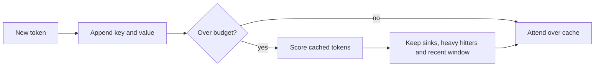

# KV Cache Compression and Eviction

KV cache compression and eviction are serving-time techniques that shrink the keys and values kept for earlier tokens. They store fewer bits per value, keep fewer tokens, or share entries across layers. They matter most when a model must hold long contexts or many requests at once, because the cache can then outweigh the model weights.

## Overview

The [KV cache](../../theory/models/transformer/kv-cache/index.md) holds one key and one value per token, for every layer and key-value head. Its size is

$$M_{\text{KV}} = 2 \cdot L \cdot H_{kv} \cdot d_h \cdot T \cdot b$$

where $L$ is the number of layers, $H_{kv}$ the number of key-value heads, $d_h$ the head dimension, $T$ the number of cached tokens and $b$ the bytes per value. The factor 2 counts keys and values. Each term can be reduced: keep fewer tokens (eviction), store fewer bits (quantisation), keep fewer heads or layers (architectural sharing), or move part of the cache to slower memory (offloading). [PagedAttention](paged-attention.md) then determines how well the kept entries are packed.

Most methods here are applied after training to an ordinary model, so they can be tested without retraining, though accuracy must be measured for each model and task. Cross-layer sharing is the exception, since it changes the architecture.

## Key concepts

- **Budget**: the number of cached tokens or bytes allowed per request. An eviction policy decides which entries fit.
- **Heavy hitters**: tokens that receive large attention weights over many decoding steps.
- **Attention sink**: an early token that receives large attention whatever its meaning.
- **Observation window**: the last tokens of a prompt, whose attention to earlier tokens is used to choose which entries to keep.
- **Outlier channels**: a few key or value dimensions with much larger magnitudes than the rest, which make low-bit storage hard. General methods are in [quantisation](../../theory/model-compression/quantisation/index.md).

## How it works

Eviction runs in a loop. Each cached token receives a score, usually from attention weights. When the cache exceeds its budget, the lowest-scoring entries are removed. H2O scores token $j$ by its accumulated attention, $s_j = \sum_t a_{t,j}$, summed over the decoding steps $t$, and keeps a mix of recent tokens and heavy hitters.

Attention sinks explain why recency alone is not enough. StreamingLLM found that a window keeping only the most recent keys and values works while the text fits inside it, but fails once earlier tokens are dropped. Keeping the entries of the first few tokens alongside the window restored stable generation over very long streams. The proposed reason is that softmax attention must place its weight somewhere, and early tokens, visible to every later token, become the default.

Quantisation acts on the stored tensors, and keys and values need different treatment. KIVI found that keys have outlier channels and should be quantised per channel, while values are better quantised per token. This asymmetry allowed 2-bit storage without tuning. KVQuant quantises keys before rotary position embedding is applied, uses non-uniform levels calibrated per layer, and stores a few outliers separately.

Cross-layer attention is a trained design. Adjacent layers share key and value heads, which roughly halves the cache again beyond multi-query attention, with close to the same accuracy in the small models trained for the study.

## Key methods

The methods differ in what they keep and what they change.

| Method | Family | What is kept or changed | Main trade-off |
|---|---|---|---|
| H2O | Eviction | Recent tokens plus tokens with the largest accumulated attention | Scores come from the past, so a token needed later may already be gone |
| StreamingLLM | Eviction | Initial sink tokens plus a sliding window | Drops all middle content, so it stabilises a stream rather than remembering it |
| SnapKV | Eviction | Per-head positions chosen by an observation window at the end of the prompt | Selection happens once, after prefill |
| KIVI | Quantisation | 2-bit storage, keys grouped per channel and values per token | Depends on the observed outlier structure of the models tested |
| KVQuant | Quantisation | Pre-RoPE keys, non-uniform levels, separately stored outliers | Needs calibration data and custom kernels |
| Cross-layer attention | Architecture | Adjacent layers share key and value heads | Must be trained into the model |

Eviction methods differ mainly in how they score tokens and when they score them. Quantisation methods differ in the axis they group values along.

## Connections

The [transformer KV cache](../../theory/models/transformer/kv-cache/index.md) page gives the basics; this page covers the serving-side mechanisms. Cross-layer sharing extends [multi-query attention](multi-query-attention.md) and [grouped-query attention](grouped-query-attention.md) across depth.

The brain comparison is loose but real. Cowan (2001) argued that short-term memory holds about three to five chunks, not the seven often quoted. A bounded store that must discard items to admit new ones is the common engineering problem, and eviction is an analogue of that capacity limit. Attention sinks have no obvious counterpart in human memory, and the cache is not a memory system in the cognitive sense. See [memory and learning in the brain](../../brain-mind/memory-learning/index.md).

## Applications

- **Long conversations**: a sink-plus-window cache lets a dialogue run with bounded memory. StreamingLLM reports stable modelling for streams of up to four million tokens.
- **Batch serving**: when the cache limits batch size, quantising it allows more requests per device. KIVI reports up to 4 times larger batches on the models it tested.
- **Long-context serving**: several details matter in a full stack.
  - Prefix caching shares blocks between requests, so eviction must not remove a block that another request still reads.
  - Scoring methods such as SnapKV need the end of the prompt, so eviction normally follows prefill.
  - Removing tokens changes the positions the model sees, so kept tokens need a numbering rule.
  - Models use the middle of long inputs less reliably than the ends (Liu et al., 2023), and eviction can delete that middle entirely. Test on retrieval, not only perplexity.

## Open questions

- **Query awareness**: H2O and StreamingLLM decide without seeing the question. SnapKV uses the prompt's end, but not the question itself when the question comes later. How to score tokens with the query in hand, without a second pass, is open.
- **Recall**: an early fact mentioned once can be evicted for good. Methods that fetch evicted entries from slower memory recover it, at added latency.
- **Stacking**: the accuracy cost of quantisation and eviction applied together is not well mapped, because errors can compound.
- **Sinks by design**: StreamingLLM reports that a dedicated placeholder token, used as a sink during pre-training, improves streaming. Whether sinks should be built into training rather than patched in afterwards is unsettled.

## References

### Seminal papers

- Zhang, Z. et al. (2023). *H2O: Heavy-Hitter Oracle for Efficient Generative Inference of Large Language Models*. NeurIPS 2023. https://arxiv.org/abs/2306.14048 — Eviction policy that keeps recent tokens and high-attention tokens, with a theoretical analysis of the eviction step.
- Xiao, G. et al. (2024). *Efficient Streaming Language Models with Attention Sinks*. ICLR 2024. https://arxiv.org/abs/2309.17453 — Shows that window attention fails once text exceeds the cache, and that keeping the initial tokens restores stable streaming generation.
- Liu, Z. et al. (2024). *KIVI: A Tuning-Free Asymmetric 2bit Quantization for KV Cache*. ICML 2024. https://arxiv.org/abs/2402.02750 — Two-bit cache quantisation with keys grouped per channel and values per token, requiring no tuning.
- Hooper, C. et al. (2024). *KVQuant: Towards 10 Million Context Length LLM Inference with KV Cache Quantization*. NeurIPS 2024. https://arxiv.org/abs/2401.18079 — Sub-4-bit cache quantisation with pre-RoPE key quantisation, non-uniform datatypes and separately stored outliers.
- Li, Y. et al. (2024). *SnapKV: LLM Knows What You are Looking for Before Generation*. arXiv preprint. https://arxiv.org/abs/2404.14469 — Selects per-head cache positions using an observation window at the end of the prompt, without fine-tuning.
- Brandon, W. et al. (2024). *Reducing Transformer Key-Value Cache Size with Cross-Layer Attention*. arXiv preprint. https://arxiv.org/abs/2405.12981 — Shares key and value heads between adjacent layers, reducing the cache beyond multi-query attention in small models trained from scratch.

### Surveys and textbooks

- Zhou, Z. et al. (2024). *A Survey on Efficient Inference for Large Language Models*. arXiv preprint. https://arxiv.org/abs/2404.14294 — Taxonomy of data-, model- and system-level methods for cheaper LLM inference, including cache management.

### Articles and documentation

- Liu, N. F. et al. (2023). *Lost in the Middle: How Language Models Use Long Contexts*. arXiv preprint. https://arxiv.org/abs/2307.03172 — Shows that models use information at the start and end of long inputs better than information in the middle, which matters when eviction removes content.
- Cowan, N. (2001). *The magical number 4 in short-term memory: A reconsideration of mental storage capacity*. Behavioral and Brain Sciences. https://doi.org/10.1017/S0140525X01003922 — Target article arguing that short-term memory holds about three to five chunks rather than seven.
