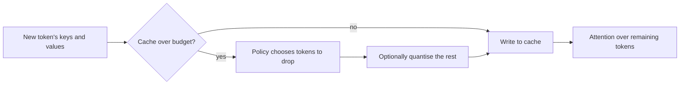

# KV Cache Compression and Eviction

!!! info "Part of Inference Optimization"
    This page sits under [Inference Optimization](index.md). It compares the serving-side ways of shrinking the KV cache; each named method has its own page.

During decoding, a transformer stores the keys and values of every earlier token so that it does not recompute attention over the prompt. That cache grows with the sequence length, the batch size and the number of layers, and it often decides how many requests fit on one GPU. Compression and eviction shrink the cache at serving time, so that more requests or longer contexts fit in the same memory.

## Overview

The KV cache is a memory problem, not a compute problem. In long-context serving, one request can hold a cache larger than the model's weights, which limits the batch size and therefore the throughput. Three families of method address this without retraining the model: store each cached value in fewer bits, keep only a subset of the tokens, or change which tokens the model attends to at all. They can be combined, and each has a different failure mode on tasks that need distant detail.

## Key concepts

- **Cache budget.** The number of tokens or bytes kept for one request. Eviction methods fix the budget and remove what does not fit.
- **Eviction.** Removing cached tokens. The policy decides which tokens to keep, usually from the attention that they have received.
- **Attention sink.** The first few tokens of a sequence receive large attention scores whatever their content. Keeping them can stabilise generation even when most of the middle is removed.
- **Quantised cache.** Storing keys and values in fewer bits, such as 2 or 4 bits, with a scale per group. Keys and values often need different schemes.
- **Recent window.** The most recent tokens, which are almost always kept, because the next token depends on them most.

## How it works

A serving system applies compression at the point where new keys and values are written, or periodically when the cache exceeds its budget.

The policy and the budget set the trade-off. A larger budget keeps more content and saves less memory. A quantised cache keeps every token but at lower precision.

## Key methods

Each named method has its own page, which gives the problem, the core idea, the algorithm, the reported results and the limitations. The table compares them.

| Method | Problem it addresses | Core idea | Main trade-off | Page |
|---|---|---|---|---|
| H2O | The cache grows with every token, though a few tokens get most of the attention | Keep the heavy-hitter tokens and a recent window, and evict the rest | Tasks that need an evicted early token can fail | [H2O](h2o.md) |
| StreamingLLM | Generation must run on streams far longer than the window | Keep the attention sinks and a recent window, so the model runs without a full cache | Distant content is lost, so it does not extend memory for recall | [StreamingLLM](streamingllm.md) |
| KIVI | The cache is too large in bytes, not in tokens | Quantise keys per channel and values per token to 2 bits, with no tuning | Quality depends on the group size and the model | [KIVI](kivi.md) |

Architectural reductions, such as [grouped-query attention](grouped-query-attention.md) and [multi-query attention](multi-query-attention.md), shrink the cache by design, so they need training a new model. The methods on this page apply to an existing model.

## Results

The reported gains are large, but each one depends on its own baseline, model and task, so the numbers should be read with their setup. H2O reports throughput gains of up to 29× over several offloading inference systems on OPT models. StreamingLLM reports up to 22.2× speed-up over sliding-window recomputation. KIVI reports 2.6× less peak memory, including weights, and 2.35× to 3.47× throughput on a real LLM workload. These numbers compare against different baselines, so they are not directly comparable.

## Trade-offs

- **Recall of distant content.** Eviction keeps recent and important tokens, so a fact stated once early in a long input can be lost. Methods that retrieve evicted entries on demand reduce this loss at extra latency.
- **Precision.** Quantising to 2 bits saves the most memory, but it adds error to every attention step. Keys and values need different treatment, because they have different statistics.
- **Interaction with batching.** A smaller cache allows a larger batch, but the scheduler must handle requests whose caches are compressed differently.
- **Evaluation.** Quality on short benchmarks often hides losses that appear on long retrieval tasks, so long-context evaluation is needed before deployment.

## Connections

- The cache itself and the survey of compression families are covered in [Transformer KV cache](../../theory/models/transformer/kv-cache/index.md).
- The memory layout that makes eviction practical is [PagedAttention and vLLM](paged-attention.md), where freed blocks can be reused.
- Architectural alternatives are [multi-query attention](multi-query-attention.md) and [grouped-query attention](grouped-query-attention.md).

## Open questions

- Can eviction keep retrieval quality on tasks where the needed fact is never in the recent window?
- Should a serving system choose the budget per request, based on the prompt, rather than fixing it for all requests?
- How do cache compression and speculative decoding interact, when the draft and target models each hold a cache?

## References

### Seminal papers

- Zhang, Z. et al. (2023). *H2O: Heavy-Hitter Oracle for Efficient Generative Inference of Large Language Models*. arXiv:2306.14048. https://arxiv.org/abs/2306.14048 — Eviction that keeps the tokens with the largest accumulated attention, with a recent window, and reports large throughput gains.
- Xiao, G. et al. (2024). *Efficient Streaming Language Models with Attention Sinks*. ICLR 2024. arXiv:2309.17453. https://arxiv.org/abs/2309.17453 — Identifies attention sinks and keeps them with a recent window for stable streaming generation.
- Liu, Z. et al. (2024). *KIVI: A Tuning-Free Asymmetric 2bit Quantization for KV Cache*. arXiv:2402.02750. https://arxiv.org/abs/2402.02750 — Two-bit KV-cache quantisation, with keys and values quantised along different axes, and no tuning.
- Kwon, W. et al. (2023). *Efficient Memory Management for Large Language Model Serving with PagedAttention*. SOSP 2023. arXiv:2309.06180. https://arxiv.org/abs/2309.06180 — Paged cache management, which lets eviction and sharing free memory in fixed-size blocks.

### Surveys and papers on scaling

- Ainslie, J. et al. (2023). *GQA: Training Generalized Multi-Query Transformer Models from Multi-Head Checkpoints*. EMNLP 2023. arXiv:2305.13245. https://arxiv.org/abs/2305.13245 — Architectural reduction of the cache by sharing key and value heads, the trained-in alternative to eviction.
- Shazeer, N. (2019). *Fast Transformer Decoding: One Write-Head is All You Need*. arXiv:1911.02150. https://arxiv.org/abs/1911.02150 — Multi-query attention, the earliest architectural reduction of the decoding cache.
