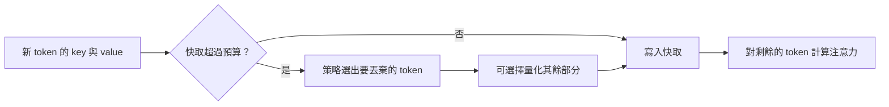

# KV 快取壓縮與淘汰

!!! info "屬於推論最佳化"
    本頁隸屬於[推論最佳化](index.zh-TW.md)。它比較在服務端縮小 KV 快取的各種方法；每個具名方法各有自己的頁面。

解碼時，Transformer 會儲存每個先前 token 的 key 與 value，使它不必對提示重新計算注意力。這份快取會隨序列長度、批次大小與層數增加，往往決定一張 GPU 能容納多少請求。壓縮與淘汰在服務時縮小快取，使同樣的記憶體能容納更多請求或更長的上下文。

## 概述

KV 快取是記憶體問題，而不是運算問題。在長上下文服務中，單一請求的快取可能比模型權重還大，這會限制批次大小，進而限制吞吐量。有三類方法可以在不重新訓練模型的情況下處理這個問題：以較少的位元儲存每個快取值、只保留部分 token，或改變模型實際注意的 token。這些方法可以組合使用，而且每一種在需要遠端細節的任務上，失敗的方式都不同。

## 關鍵概念

- **快取預算。** 每個請求保留的 token 數或位元組數。淘汰方法會固定預算，並移除放不下的部分。
- **淘汰。** 移除快取中的 token。淘汰策略決定保留哪些 token，通常依據它們已獲得的注意力。
- **注意力匯聚點（attention sink）。** 序列開頭的幾個 token，不論內容為何都會獲得較大的注意力分數。即使移除大部分中段，保留它們仍能穩定生成。
- **量化快取。** 以 2 或 4 位元等較少的位元儲存 key 與 value，每組附帶一個縮放係數。key 與 value 通常需要不同的方案。
- **近期視窗。** 最近的 token，幾乎總是會保留，因為下一個 token 最依賴它們。

## 運作方式

服務系統在寫入新的 key 與 value 時套用壓縮，或在快取超過預算時定期套用。

策略與預算決定了取捨。預算越大，保留的內容越多，節省的記憶體越少。量化快取會保留每個 token，但精度較低。

## 關鍵方法

每個具名方法各有自己的頁面，說明問題、核心想法、演算法、報告的結果與限制。下表比較它們。

| 方法 | 處理的問題 | 核心想法 | 主要取捨 | 頁面 |
|---|---|---|---|---|
| H2O | 快取隨每個 token 增長，但少數 token 獲得大部分注意力 | 保留重擊手 token 與近期視窗，淘汰其餘部分 | 需要被淘汰之早期 token 的任務可能失敗 | [H2O](h2o.zh-TW.md) |
| StreamingLLM | 生成必須在遠長於視窗的串流上執行 | 保留注意力匯聚點與近期視窗，無需完整快取即可執行 | 遠端內容遺失，因此它不能用來擴充回憶能力 | [StreamingLLM](streamingllm.zh-TW.md) |
| KIVI | 快取以位元組計算過大，而非以 token 數計算 | 無需調校，把 key 依通道、value 依 token 量化為 2 位元 | 品質取決於分組大小與模型 | [KIVI](kivi.zh-TW.md) |

架構上的縮減，例如[分組查詢注意力](grouped-query-attention.zh-TW.md)與[多查詢注意力](multi-query-attention.zh-TW.md)，是在設計時就縮小快取，因此需要訓練新模型。本頁的方法則適用於既有模型。

## 結果

報告的增益很大，但每一項都取決於自己的基準、模型與任務，因此應連同實驗設定一起閱讀。H2O 報告在 OPT 模型上，相較於數個卸載式推論系統，吞吐量最高提升 29 倍。StreamingLLM 報告相較於滑動視窗重新計算，最高加速 22.2 倍。KIVI 報告包含權重在內的峰值記憶體降低為 2.6 倍，並在真實的 LLM 工作負載上達到 2.35 至 3.47 倍的吞吐量。這些數字的比較基準不同，因此無法直接互相比較。

## 取捨

- **遠端內容的回憶。** 淘汰會保留近期與重要的 token，因此長輸入中只出現一次的早期事實可能遺失。能按需取回被淘汰條目的方法可以減少這種損失，但會增加延遲。
- **精度。** 量化為 2 位元節省最多記憶體，但每一步注意力都會增加誤差。key 與 value 的統計特性不同，需要不同的處理方式。
- **與批次處理的互動。** 較小的快取允許較大的批次，但排程器必須處理壓縮方式不同的請求。
- **評估。** 短基準上的品質常掩蓋了長上下文檢索任務中才會出現的損失，因此部署前需要長上下文評估。

## 關聯

- 快取本身與壓縮方法的概覽，見 [Transformer KV 快取](../../theory/models/transformer/kv-cache/index.zh-TW.md)。
- 讓淘汰在實務上可行的記憶體配置，是 [PagedAttention 與 vLLM](paged-attention.zh-TW.md)，其中釋出的區塊可以重複使用。
- 架構上的替代方案是[多查詢注意力](multi-query-attention.zh-TW.md)與[分組查詢注意力](grouped-query-attention.zh-TW.md)。

## 開放問題

- 在所需事實從不位於近期視窗內的任務上，淘汰能否維持檢索品質？
- 服務系統是否應依提示為每個請求選擇預算，而不是對所有請求固定一個預算？
- 當草稿模型與目標模型各自持有快取時，快取壓縮與投機解碼如何互動？

## 參考文獻

### 重要論文

- Zhang, Z. et al. (2023). *H2O: Heavy-Hitter Oracle for Efficient Generative Inference of Large Language Models*. arXiv:2306.14048. https://arxiv.org/abs/2306.14048 — 以累積注意力最大的 token 為淘汰依據，並保留近期視窗，報告大幅的吞吐量增益。
- Xiao, G. et al. (2024). *Efficient Streaming Language Models with Attention Sinks*. ICLR 2024. arXiv:2309.17453. https://arxiv.org/abs/2309.17453 — 找出注意力匯聚點，並與近期視窗一同保留，以穩定串流生成。
- Liu, Z. et al. (2024). *KIVI: A Tuning-Free Asymmetric 2bit Quantization for KV Cache*. arXiv:2402.02750. https://arxiv.org/abs/2402.02750 — 2 位元 KV 快取量化，key 依通道、value 依 token 量化，且無需調校。
- Kwon, W. et al. (2023). *Efficient Memory Management for Large Language Model Serving with PagedAttention*. SOSP 2023. arXiv:2309.06180. https://arxiv.org/abs/2309.06180 — 分頁式快取配置，使被淘汰的區塊能釋出並重複使用。

### 規模化相關的調查與論文

- Ainslie, J. et al. (2023). *GQA: Training Generalized Multi-Query Transformer Models from Multi-Head Checkpoints*. EMNLP 2023. arXiv:2305.13245. https://arxiv.org/abs/2305.13245 — 透過共享 key 與 value 頭來縮減架構上的快取，是淘汰之外經過訓練的替代方案。
- Shazeer, N. (2019). *Fast Transformer Decoding: One Write-Head is All You Need*. arXiv:1911.02150. https://arxiv.org/abs/1911.02150 — 多查詢注意力，是解碼快取最早的架構縮減。
