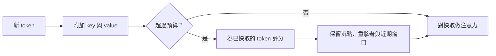

# KV 快取壓縮與淘汰

KV 快取壓縮與淘汰是在服務階段使用的技術，用來縮小為先前 token 保留的 key 與 value 所占的記憶體。它們每個值儲存較少的位元、保留較少的 token，或在各層之間共用條目。當模型必須同時容納長上下文或大量請求時，這些技術最為重要，因為此時快取的大小可能超過模型權重。

## 概述

[KV 快取](../../theory/models/transformer/kv-cache/index.zh-TW.md)為每個 token、每一層與每個 key-value 頭各保存一個 key 與一個 value。其大小為

$$M_{\text{KV}} = 2 \cdot L \cdot H_{kv} \cdot d_h \cdot T \cdot b$$

其中 $L$ 為層數，$H_{kv}$ 為 key-value 頭的數量，$d_h$ 為每個頭的維度，$T$ 為已快取的 token 數，$b$ 為每個值的位元組數。係數 2 代表 key 與 value 兩者。每一項都可以縮減：保留較少的 token（淘汰）、儲存較少的位元（量化）、保留較少的頭或層（架構共用），或把部分快取移到較慢但較便宜的記憶體（卸載）。[分頁注意力](paged-attention.zh-TW.md)則決定保留下來的條目能被多有效率地裝載。

本頁的大多數方法都是在訓練後套用於一般的模型，因此不必重新訓練即可測試，但仍須針對每個模型與任務量測準確度。跨層共用是例外，因為它會改變架構。

## 關鍵概念

- **預算**：每個請求允許的快取 token 數或位元組數。淘汰策略要決定哪些條目可以放進預算。
- **重擊者（heavy hitters）**：在許多解碼步驟中都獲得大量注意力權重的 token。
- **注意力沉點（attention sink）**：無論語意為何，都會獲得大量注意力的早期 token。
- **觀察窗口**：提示最後幾個 token，它們對先前 token 的注意力被用來選擇要保留哪些條目。
- **離群通道**：少數 key 或 value 維度的量級遠大於其他維度，使低位元儲存變得困難。一般方法見[量化](../../theory/model-compression/quantisation/index.zh-TW.md)。

## 運作方式

淘汰是一個循環。每個已快取的 token 都會取得一個分數，通常來自注意力權重。當快取超過預算時，分數最低的條目會被移除。H2O 以累積注意力為 token $j$ 評分，$s_j = \sum_t a_{t,j}$，即把各解碼步驟 $t$ 中分配給它的權重加總，並保留最近的 token 與重擊者的組合。

注意力沉點說明了為什麼只看近期並不足夠。StreamingLLM 發現，只保留最近 key 與 value 的窗口，在文字仍落在窗口內時運作良好，但一旦較早的 token 被丟棄就會失效。把前幾個 token 的條目與窗口一起保留，則能在極長的串流中恢復穩定生成。其提出的理由是：softmax 注意力必須把權重分配到某處，而早期 token 對之後的每個 token 都可見，因此會成為預設的去處。

量化作用於儲存的張量，而 key 與 value 需要不同的處理方式。KIVI 發現 key 具有離群通道，應依通道量化；value 則較適合依 token 量化。這種不對稱使其能在不調參的情況下以 2 位元儲存。KVQuant 則在套用旋轉位置編碼（RoPE）之前量化 key，使用依層校準的非均勻量化級距，並把少數離群值另外儲存。

跨層注意力是一種需要訓練的設計。相鄰的層共用 key 與 value 頭，使快取在多查詢注意力之上再大約減半，而準確度與小型模型上的原始注意力相近。

## 關鍵方法

這些方法的差異在於它們保留什麼、改變什麼。

| 方法 | 類別 | 保留或改變的內容 | 主要取捨 |
|---|---|---|---|
| H2O | 淘汰 | 近期 token 加上累積注意力最高的 token | 分數來自過去，之後才需要的 token 可能已被丟棄 |
| StreamingLLM | 淘汰 | 初始沉點 token 加上滑動窗口 | 丟棄所有中段內容，因此它穩定的是串流，而非記住內容 |
| SnapKV | 淘汰 | 由提示末端觀察窗口為每個頭選出的位置 | 選擇只在預填充之後做一次 |
| KIVI | 量化 | 2 位元儲存，key 依通道分組、value 依 token 分組 | 依賴所測試模型的離群通道結構 |
| KVQuant | 量化 | 套用 RoPE 之前的 key、非均勻量化級距、另外儲存的離群值 | 需要校準資料與專用核心函式 |
| 跨層注意力 | 架構 | 相鄰層共用 key 與 value 頭 | 必須在訓練時納入模型 |

淘汰方法的差異主要在於如何為 token 評分，以及何時評分。量化方法的差異則在於沿哪個軸分組數值。

## 相關連結

[Transformer KV 快取](../../theory/models/transformer/kv-cache/index.zh-TW.md)頁面提供基礎知識；本頁說明服務端的機制。跨層共用則把[多查詢注意力](multi-query-attention.zh-TW.md)與[分組查詢注意力](grouped-query-attention.zh-TW.md)的想法沿深度方向延伸。

大腦的對照是鬆散的，但確實存在。Cowan（2001）主張短期記憶大約只能容納三到五個組塊，而不是常被引用的七個。一個必須丟棄舊項目才能容納新項目的有限儲存空間，是共同的工程問題，而淘汰可以視為這種容量限制的類比。注意力沉點在人類記憶中沒有明顯的對應，而且快取在認知意義上也不是記憶系統。參見[大腦中的記憶與學習](../../brain-mind/memory-learning/index.zh-TW.md)。

## 應用

- **長對話**：沉點加窗口的快取讓對話能以有界的記憶體持續進行。StreamingLLM 報告在多達四百萬個 token 的串流上仍能穩定建模。
- **批次服務**：當快取限制了批次大小，量化快取可讓單一裝置容納更多請求。KIVI 報告在其測試的模型上，批次最多可大 4 倍。
- **長上下文服務**：完整的服務堆疊中有幾個細節很重要。
  - 前綴快取會在請求之間共用區塊，因此淘汰不可移除另一個請求仍在讀取的區塊。
  - SnapKV 這類評分方法需要提示末端的資訊，因此淘汰通常在預填充之後進行。
  - 移除 token 會改變模型看到的位置，因此保留下來的 token 需要編號規則。
  - 模型使用長輸入中段資訊的可靠度，低於使用開頭與結尾（Liu et al., 2023）；而淘汰可能把中段內容整段刪除。因此應以檢索任務測試，而不只看困惑度。

## 開放問題

- **查詢感知**：H2O 與 StreamingLLM 在不知道問題的情況下做決定。SnapKV 使用提示的末端，但當問題在後面出現時，它無法使用問題本身。如何在不做第二次前向傳播的情況下，依據手上的查詢為 token 評分，仍是開放問題。
- **回想**：只提過一次的早期事實可能被永久淘汰。能從較慢記憶體取回被淘汰條目的方法可以找回它們，但會增加延遲。
- **疊加**：量化與淘汰同時使用時，準確度損失如何，目前還不清楚，因為誤差可能會互相累積。
- **內建沉點**：StreamingLLM 報告，在預訓練時以專用的佔位 token 作為沉點，能改善串流效果。沉點應在訓練時內建，還是事後補上，尚無定論。

## 參考文獻

### 奠基性論文

- Zhang, Z. et al. (2023). *H2O: Heavy-Hitter Oracle for Efficient Generative Inference of Large Language Models*. NeurIPS 2023. https://arxiv.org/abs/2306.14048 — 保留近期 token 與高注意力 token 的淘汰策略，並附有淘汰步驟的理論分析。
- Xiao, G. et al. (2024). *Efficient Streaming Language Models with Attention Sinks*. ICLR 2024. https://arxiv.org/abs/2309.17453 — 說明文字超過快取後，窗口注意力就會失效，而保留初始 token 能恢復穩定的串流生成。
- Liu, Z. et al. (2024). *KIVI: A Tuning-Free Asymmetric 2bit Quantization for KV Cache*. ICML 2024. https://arxiv.org/abs/2402.02750 — 2 位元快取量化，key 依通道分組、value 依 token 分組，且不需調參。
- Hooper, C. et al. (2024). *KVQuant: Towards 10 Million Context Length LLM Inference with KV Cache Quantization*. NeurIPS 2024. https://arxiv.org/abs/2401.18079 — 低於 4 位元的快取量化，包含 RoPE 之前的 key 量化、非均勻資料型別與另外儲存的離群值。
- Li, Y. et al. (2024). *SnapKV: LLM Knows What You are Looking for Before Generation*. arXiv preprint. https://arxiv.org/abs/2404.14469 — 利用提示末端的觀察窗口，為每個頭選擇快取位置，且不需微調。
- Brandon, W. et al. (2024). *Reducing Transformer Key-Value Cache Size with Cross-Layer Attention*. arXiv preprint. https://arxiv.org/abs/2405.12981 — 相鄰層共用 key 與 value 頭，在從頭訓練的小型模型中，使快取比多查詢注意力再小。

### 綜述與教科書

- Zhou, Z. et al. (2024). *A Survey on Efficient Inference for Large Language Models*. arXiv preprint. https://arxiv.org/abs/2404.14294 — 依資料、模型與系統層級，整理降低 LLM 推論成本的方法分類，包含快取管理。

### 文章與文件

- Liu, N. F. et al. (2023). *Lost in the Middle: How Language Models Use Long Contexts*. arXiv preprint. https://arxiv.org/abs/2307.03172 — 說明模型對長輸入開頭與結尾資訊的運用，優於對中段資訊的運用，這在淘汰移除內容時很重要。
- Cowan, N. (2001). *The magical number 4 in short-term memory: A reconsideration of mental storage capacity*. Behavioral and Brain Sciences. https://doi.org/10.1017/S0140525X01003922 — 主要文章，主張短期記憶大約只能容納三到五個組塊，而非七個。
