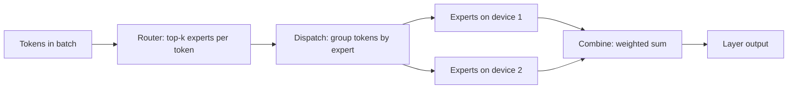

# Serving Mixture-of-Experts Models

A mixture-of-experts (MoE) model sends each token through only a few of many expert sub-networks, so most of its parameters are idle for any one token. Serving it is harder than the per-token cost suggests: every expert must be stored somewhere, tokens must reach the devices that hold their experts, and uneven routing leaves some devices overloaded.

## Overview

In a standard transformer, the feedforward block after attention is dense: every token uses the same weights. An MoE layer replaces that block with several expert feedforward networks and a small router that picks a few of them for each token. Shazeer et al. introduced this sparsely gated layer in 2017, and Fedus et al. simplified its routing to one expert per token in the Switch Transformer. Mixtral 8x7B, an open-weight model, places eight experts in each layer and sends each token to two.[^1]

Serving adds three problems to this design:

- **Memory.** All experts must be available somewhere, so memory follows the total parameter count, not the active one.
- **Communication.** When experts sit on different devices, tokens travel to them and their outputs travel back.
- **Balance.** A router that favours a few experts overloads their devices, and each step waits for the slowest one.

## Key concepts

- **Expert**: a feedforward sub-network, usually the same shape as its peers.
- **Router (gate)**: a learned layer that scores the experts for each token; the top-k scores pick the experts.
- **Total and active parameters**: total parameters include every expert; active parameters are those a token uses, plus shared parts such as attention. Mixtral has 47 billion total and 13 billion active parameters per token.[^1]
- **Capacity and token dropping**: a cap on the tokens one expert takes per batch. Tokens over the cap skip it.
- **All-to-all exchange**: a collective operation that sends each token to the devices holding its experts and returns the results.
- **Expert offloading**: keeping inactive expert weights in CPU memory or on disk, and moving them to the GPU when the router selects them.

## How it works

During decoding, one MoE layer runs four steps:

1. The router scores every expert for every token in the batch and keeps the top k.
2. Tokens are grouped by expert. If the experts live on other devices, this grouping becomes an all-to-all send.
3. Each expert multiplies the tokens it received by its weights.
4. Outputs return to their source, are scaled by the router weights, and are summed per token.

For a token using k of N experts, compute is about k/N of the full expert block, while storage is the whole block. That gap drives both MoE's efficiency and its serving difficulty.

**Batching erodes the saving.** Each decoding step reads every expert that any token in the batch selects, so the read set grows with batch size. The table below is an illustrative calculation, not a measurement. It assumes each token picks two of eight experts uniformly and independently, which real routers only approximate.[^2]

| Tokens in the batch | Expected distinct experts read (of 8) |
|---|---|
| 1 | 2.0 |
| 4 | 5.5 |
| 8 | 7.2 |
| 16 | 7.9 |

At moderate batch sizes most experts are read on every step, and the bandwidth saving largely disappears. Offloading methods are therefore most attractive for a single user, where the batch is one token.

## Key methods

Each method targets a different part of the problem. Their results come from their own papers, with different models and hardware, so the figures are not comparable across rows.

| Approach | What it addresses | Core idea | Trade-off | Source |
|---|---|---|---|---|
| Expert parallelism with all-to-all | Experts do not fit on one device | Shard experts across devices; two all-to-all exchanges per layer | Communication grows with tokens per step; needs fast links | GShard (Lepikhin et al. 2020) |
| Capacity-limited top-1 routing | Unbounded work on popular experts | Cap tokens per expert; overflow tokens skip the expert | Skipped tokens change the output | Switch Transformer (Fedus et al. 2021) |
| Dropless block-sparse computation | Padding waste, or dropped tokens | Express expert work as block-sparse matrix products | Needs specialised GPU kernels | MegaBlocks (Gale et al. 2022) |
| Expert offloading and caching | Expert weights exceed GPU memory | Keep experts in host memory, cache hot ones on the GPU, prefetch | Transfer delay on cache misses | Eliseev and Mazur (2023); Pre-gated MoE (Hwang et al. 2023); MoE-Infinity (Xue et al. 2024) |

GShard scaled a translation model past 600 billion parameters with automatic sharding. Switch Transformer reported up to a sevenfold pre-training speed-up over T5 baselines at equal compute, and MegaBlocks up to 40 percent faster training than Tutel. Both are training results. For a single user, MoE-Infinity reports per-token latency improvements of 3.1 to 16.7 times over several serving systems.[^3]

**Load balance.** Routers tend to favour a few experts, so training usually adds an auxiliary loss toward even use. DeepSeek-V3 instead adjusts a per-expert routing bias by observed load, calling this auxiliary-loss-free balancing.[^4] At serving time, replicating popular experts across devices is a common remedy.

## Connections

- **Transformer.** In the [Transformer](../../theory/models/transformer/index.md), MoE usually replaces only the feedforward block. Attention, and so the [KV cache](../../theory/models/transformer/kv-cache/index.md), is unchanged; [KV cache compression](kv-cache-compression.md) still applies.
- **Training.** Expert parallelism began as a training technique; see [Distributed training](../distributed-training/index.md).
- **Compression.** [Model compression](../../theory/model-compression/index.md) shrinks stored weights; MoE keeps them all and activates few. The two can be combined.
- **Hardware.** All-to-all and offloading costs depend on interconnect and host-device bandwidth; see [AI Hardware](../hardware/index.md).
- **Brain.** Using part of a network per input resembles [sparse coding](../../brain-mind/computational-neuroscience/sparse-coding/index.md), but the analogy is loose, so this page does not rely on it.

## Applications

- **Personal machines.** Offloading lets one consumer GPU run a model too large for its memory, more slowly.[^3]
- **Large cloud services.** DeepSeek-V3 has 671 billion total and 37 billion active parameters.[^4] At one byte per parameter, its weights (about 671 GB) are several times the memory of a typical single accelerator, so its experts must be spread across devices.

## Open questions

- **Specialisation against balance.** Forcing even use can weaken specialisation, while specialised experts can concentrate load.
- **Predictable routing.** Prefetching needs the next layer's experts to be predictable, and caching needs experts to recur. Both depend on the data.
- **Batch size.** Offloading suits small batches; large ones need most experts resident. The crossover depends on hardware and routing variety.

## References

### Seminal papers

- Shazeer, N. et al. (2017). *Outrageously Large Neural Networks: The Sparsely-Gated Mixture-of-Experts Layer*. arXiv preprint. https://arxiv.org/abs/1701.06538 — Introduces the sparsely gated MoE layer, with a trainable gate.
- Lepikhin, D. et al. (2020). *GShard: Scaling Giant Models with Conditional Computation and Automatic Sharding*. arXiv preprint. https://arxiv.org/abs/2006.16668 — Shards sparsely gated experts across accelerators with annotations.
- Fedus, W., Zoph, B. & Shazeer, N. (2021). *Switch Transformers: Scaling to Trillion Parameter Models with Simple and Efficient Sparsity*. arXiv preprint. https://arxiv.org/abs/2101.03961 — Routes each token to one expert and studies sparse-model stability.
- Gale, T. et al. (2022). *MegaBlocks: Efficient Sparse Training with Mixture-of-Experts*. arXiv preprint. https://arxiv.org/abs/2211.15841 — Computes experts as block-sparse operations, so no tokens are dropped.
- Eliseev, A. & Mazur, D. (2023). *Fast Inference of Mixture-of-Experts Language Models with Offloading*. arXiv preprint. https://arxiv.org/abs/2312.17238 — Offloads experts to run MoE language models on consumer hardware.
- Hwang, R. et al. (2023). *Pre-gated MoE: An Algorithm-System Co-Design for Fast and Scalable Mixture-of-Expert Inference*. arXiv preprint. https://arxiv.org/abs/2308.12066 — Pre-gates expert selection so expert weights can be fetched early.
- Xue, L. et al. (2024). *MoE-Infinity: Efficient MoE Inference on Personal Machines with Sparsity-Aware Expert Cache*. arXiv preprint. https://arxiv.org/abs/2401.14361 — Caches and prefetches experts for single-user machines using traced activation patterns.

### Surveys and textbooks

- Cai, W. et al. (2024). *A Survey on Mixture of Experts in Large Language Models*. arXiv preprint. https://arxiv.org/abs/2407.06204 — Surveys MoE designs across algorithms and systems.

### Articles and documentation

- Jiang, A. Q. et al. (2024). *Mixtral of Experts*. arXiv preprint. https://arxiv.org/abs/2401.04088 — Introduces an open-weight sparse model with eight experts and two chosen per token.
- DeepSeek-AI (2024). *DeepSeek-V3 Technical Report*. arXiv preprint. https://arxiv.org/abs/2412.19437 — Technical report for a large MoE model, with auxiliary-loss-free load balancing.

[^1]: Jiang et al. (2024) state 47 billion parameters accessible per token, 13 billion used during inference, and an Apache 2.0 release.
[^2]: With B tokens each choosing 2 of 8 experts uniformly and independently, the expected count of distinct experts is 8 × (1 − 0.75^B). Real routers are skewed, so the true count may be lower. Computed here, not measured.
[^3]: Xue et al. (2024) report these latency figures for batch size one, on DeepSeek and Mixtral models, in their own setup.
[^4]: DeepSeek-AI (2024) state 671 billion total and 37 billion activated parameters per token.
