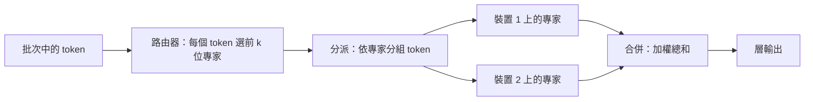

# 混合專家模型服務

混合專家（MoE）模型讓每個 token 只經過眾多專家子網路中的少數幾個，因此對任一 token 而言，大部分參數都是閒置的。服務這類模型比單看每個 token 的運算成本更困難：每位專家都必須儲存在某處，token 必須送到持有其專家的裝置，而路由不均會讓部分裝置過載。

## 概述

在標準 Transformer 中，注意力之後的前饋區塊是稠密的：每個 token 使用同一組權重。MoE 層則以數個專家前饋網路，加上一個小型路由器取代該區塊，由路由器為每個 token 挑選少數幾位專家。Shazeer 等人於 2017 年提出這種稀疏門控層，Fedus 等人則在 Switch Transformer 中把路由簡化為每個 token 只選一位專家。開放權重模型 Mixtral 8x7B 在每層放置八位專家，並把每個 token 送到其中兩位。[^1]

服務會在這個設計上再加入三個問題：

- **記憶體。** 所有專家都必須存放在某處，因此記憶體取決於總參數量，而非活躍參數量。
- **通訊。** 當專家位於不同裝置時，token 必須送過去，其輸出再送回來。
- **平衡。** 路由器若偏好少數專家，這些專家所在的裝置就會過載，而每一步都要等最慢的裝置完成。

## 關鍵概念

- **專家（expert）**：一個前饋子網路，通常與同層其他專家形狀相同。
- **路由器（router，或稱閘門 gate）**：一個學習得到的層，為每個 token 替專家評分；分數最高的前 k 位被選中。
- **總參數與活躍參數**：總參數包含所有專家；活躍參數是一個 token 實際使用的部分，加上注意力等共用部分。Mixtral 的總參數為 470 億，每個 token 活躍的參數為 130 億。[^1]
- **容量與 token 丟棄**：限制一個批次中每位專家能處理的 token 數量。超過上限的 token 會略過該專家。
- **全對全交換（all-to-all）**：一種集體通訊運算，把每個 token 送到持有其專家的裝置，並把結果送回。
- **專家卸載（expert offloading）**：把未使用的專家權重放在 CPU 記憶體或磁碟上，待路由器選中時再搬到 GPU。

## 運作方式

解碼期間，一個 MoE 層執行四個步驟：

1. 路由器為批次中的每個 token 替所有專家評分，並保留前 k 位。
2. token 依專家分組。若專家位於其他裝置，這一步會變成全對全的傳送。
3. 每位專家把收到的 token 乘上其權重。
4. 輸出送回來源，依路由權重縮放，再依 token 加總。

對於使用 N 位專家中 k 位的 token，前饋運算量約為執行全部專家的 k/N，但儲存的權重是整個 N 位專家區塊。這個落差既是 MoE 效率的來源，也是服務困難的根源。

**批次會侵蝕這項節省。** 每個解碼步驟都要讀取批次中任一 token 所選的每位專家，因此讀取的專家集合會隨批次大小增加。下表是示意計算，而非實測。它假設每個 token 在八位專家中獨立、均勻地選取兩位；真實路由器只是近似於此。[^2]

| 批次中的 token 數 | 預期讀取的不同專家數（共 8 位） |
|---|---|
| 1 | 2.0 |
| 4 | 5.5 |
| 8 | 7.2 |
| 16 | 7.9 |

在中等批次大小下，多數專家在每一步都會被讀取，頻寬上的節省大致消失。因此，卸載方法在單一使用者（批次只有一個 token）的情境下最具吸引力。

## 關鍵方法

各種方法針對問題的不同部分。它們的結果來自各自的論文，使用的模型與硬體不同，因此表中各列的數字不能直接比較。

| 做法 | 解決的問題 | 核心想法 | 主要取捨 | 來源 |
|---|---|---|---|---|
| 專家平行與全對全 | 專家無法放進單一裝置 | 把專家分片到各裝置，每層進行兩次全對全交換 | 通訊量隨每步的 token 數增加；需要快速互連 | GShard（Lepikhin 等人，2020） |
| 容量受限的 top-1 路由 | 熱門專家的工作量無上限 | 限制每位專家的 token 數；超過的 token 略過該專家 | 被略過的 token 會改變輸出 | Switch Transformer（Fedus 等人，2021） |
| 無丟棄的區塊稀疏運算 | 填充造成的浪費，或丟棄 token | 把專家運算表示為區塊稀疏矩陣乘法 | 需要專用的 GPU 核心函式 | MegaBlocks（Gale 等人，2022） |
| 專家卸載與快取 | 專家權重超過 GPU 記憶體 | 專家放在主機記憶體，常用者快取於 GPU，並預先載入 | 快取未命中時會有傳輸延遲 | Eliseev 與 Mazur（2023）；Pre-gated MoE（Hwang 等人，2023）；MoE-Infinity（Xue 等人，2024） |

GShard 以自動分片把翻譯模型擴展到超過 6000 億參數。Switch Transformer 報告在相同運算量下，預訓練速度最高可達 T5 基準的七倍；MegaBlocks 則報告端到端訓練最高快 40%，超過 Tutel 函式庫。兩者都是訓練結果。在單一使用者情境下，MoE-Infinity 報告相較數個服務系統，每個 token 的延遲改善達 3.1 至 16.7 倍。[^3]

**負載平衡。** 路由器傾向偏好少數專家，因此訓練時通常加入輔助損失，推動路由趨於均勻。DeepSeek-V3 則依觀察到的負載調整每位專家在路由分數中的偏置，稱之為無輔助損失的平衡。[^4] 在服務階段，把熱門專家複製到多個裝置上，是常見的補救方法。

## 相關連結

- **Transformer。** 在 [Transformer](../../theory/models/transformer/index.zh-TW.md) 中，MoE 通常只取代前饋區塊。注意力，以及因此的 [KV 快取](../../theory/models/transformer/kv-cache/index.zh-TW.md)，都不變；[KV 快取壓縮](kv-cache-compression.zh-TW.md)仍然適用。
- **訓練。** 專家平行最初是一種訓練技術；參見[分散式訓練](../distributed-training/index.zh-TW.md)。
- **壓縮。** [模型壓縮](../../theory/model-compression/index.zh-TW.md)縮小儲存的權重；MoE 則保留全部權重、只啟動少數。兩者可以結合。
- **硬體。** 全對全與卸載的成本取決於互連與主機到裝置的頻寬；參見 [AI 硬體](../hardware/index.zh-TW.md)。
- **大腦。** 讓每個輸入只使用網路的一部分，類似[稀疏編碼](../../brain-mind/computational-neuroscience/sparse-coding/index.zh-TW.md)，但這個類比並不嚴謹，因此本頁不依賴它。

## 應用

- **個人電腦。** 卸載讓單張消費級 GPU 能執行權重超過其記憶體的模型，但速度較慢。[^3]
- **大型雲端服務。** DeepSeek-V3 的總參數為 6710 億，每個 token 活躍的參數為 370 億。[^4] 以每個參數一個位元組計算，其權重約 671 GB，為一般單張加速器記憶體的數倍，因此專家必須分布在多個裝置上。

## 開放問題

- **專精與平衡的取捨。** 強制均勻使用可能削弱專精；但讓專家高度專精，又可能使負載集中。
- **路由的可預測性。** 預先載入需要下一層的專家可被預測，快取則需要專家會重複出現。兩者都取決於資料。
- **批次大小。** 卸載適合小批次；大批次則需要多數專家常駐 GPU 記憶體。交叉點取決於硬體與路由的多樣性。

## 參考文獻

### 奠基性論文

- Shazeer, N. et al. (2017). *Outrageously Large Neural Networks: The Sparsely-Gated Mixture-of-Experts Layer*. arXiv preprint. https://arxiv.org/abs/1701.06538 — 提出稀疏門控 MoE 層，其中可訓練的閘門為每個輸入選出少數專家。
- Lepikhin, D. et al. (2020). *GShard: Scaling Giant Models with Conditional Computation and Automatic Sharding*. arXiv preprint. https://arxiv.org/abs/2006.16668 — 以標註與編譯器擴充，把稀疏門控專家分片到多個加速器上。
- Fedus, W., Zoph, B. & Shazeer, N. (2021). *Switch Transformers: Scaling to Trillion Parameter Models with Simple and Efficient Sparsity*. arXiv preprint. https://arxiv.org/abs/2101.03961 — 把路由簡化為每個 token 一位專家，並研究稀疏模型的穩定性。
- Gale, T. et al. (2022). *MegaBlocks: Efficient Sparse Training with Mixture-of-Experts*. arXiv preprint. https://arxiv.org/abs/2211.15841 — 把專家運算表示為區塊稀疏運算，因此不需要丟棄 token。
- Eliseev, A. & Mazur, D. (2023). *Fast Inference of Mixture-of-Experts Language Models with Offloading*. arXiv preprint. https://arxiv.org/abs/2312.17238 — 以專家卸載，在消費級硬體上執行 MoE 語言模型。
- Hwang, R. et al. (2023). *Pre-gated MoE: An Algorithm-System Co-Design for Fast and Scalable Mixture-of-Expert Inference*. arXiv preprint. https://arxiv.org/abs/2308.12066 — 以預先閘控來決定專家，使專家權重能及早載入。
- Xue, L. et al. (2024). *MoE-Infinity: Efficient MoE Inference on Personal Machines with Sparsity-Aware Expert Cache*. arXiv preprint. https://arxiv.org/abs/2401.14361 — 針對單一使用者的機器，以基於追蹤啟動模式的專家快取進行替換與預先載入。

### 綜述與教科書

- Cai, W. et al. (2024). *A Survey on Mixture of Experts in Large Language Models*. arXiv preprint. https://arxiv.org/abs/2407.06204 — 從演算法與系統兩方面綜述 MoE 設計。

### 文章與文件

- Jiang, A. Q. et al. (2024). *Mixtral of Experts*. arXiv preprint. https://arxiv.org/abs/2401.04088 — 介紹一個開放權重稀疏模型，每層八位專家，每個 token 選用兩位。
- DeepSeek-AI (2024). *DeepSeek-V3 Technical Report*. arXiv preprint. https://arxiv.org/abs/2412.19437 — 大型 MoE 模型的技術報告，包含無輔助損失的負載平衡策略。

[^1]: Jiang 等人（2024）指出，每個 token 可存取 470 億參數，推論時使用 130 億；基礎與指令模型以 Apache 2.0 授權釋出。
[^2]: 若 B 個 token 各自在 8 位專家中獨立、均勻地選取 2 位，不同專家的預期數量為 8 × (1 − 0.75^B)。真實路由器有偏斜，實際數量可能更少。此為本頁計算，並非實測。
[^3]: Xue 等人（2024）在批次大小為一、於 DeepSeek 與 Mixtral 模型上報告這些延遲數字，數據來自其自身的實驗設定。
[^4]: DeepSeek-AI（2024）指出，每個 token 的總參數為 6710 億，活躍參數為 370 億。
