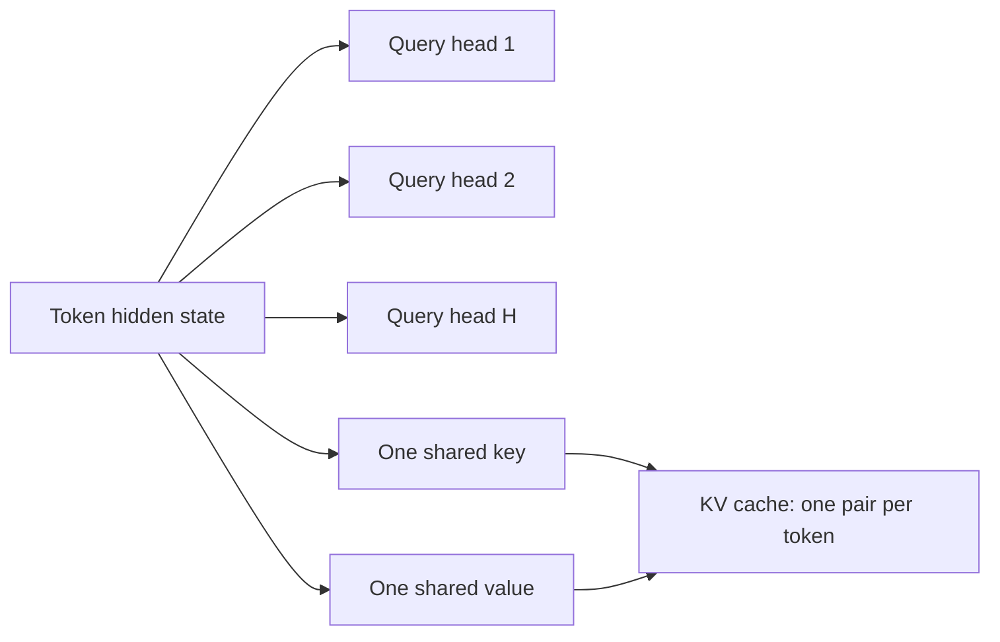

---
tags:
- engineering
- architecture
aliases:
- 多查詢注意力
---

# Multi-Query Attention

Multi-query attention shares a single key head and a single value head across all query heads of an attention layer. The KV cache becomes about as many times smaller as there are heads, which makes decoding far less memory-bound.

## Overview

In standard multi-head attention, each head keeps its own keys and values. At inference time the KV cache grows with the number of heads, and every decoding step reads all of it. Multi-query attention, proposed by Shazeer in 2019, keeps all the query heads but gives them one shared key-value head, so the cache and the bandwidth needed to read it shrink by the head count.

## Key concepts

- **Query heads**: the separate projections that each compute their own attention pattern. Multi-query attention keeps them all.
- **Shared key-value head**: a single key and value projection used by every query head.
- **Cache size**: with $H$ heads, the cache per token shrinks from $H$ key-value pairs to one.

## How it works

For each token, the layer computes $H$ query vectors but only one key vector and one value vector. During decoding, the cache stores one key and one value per token. Every query head attends over that shared cache, so the attention computation is unchanged in form while the memory traffic per step falls.

## Key methods

The method is a change to the attention layer's projections, not a new kernel. Its evidence is that decoding speed improves for the same model size, at some cost in quality.

## Results

Shazeer (2019) reports faster incremental decoding with a small quality loss on translation tasks, which is the trade-off the method is designed to make. Later work, including grouped-query attention, found that the quality gap can be recovered with more key-value heads.

## Limitations

- **Quality loss**: a single key-value head has less capacity than separate heads, which can hurt tasks that need varied attention patterns.
- **Training cost**: models must be trained with this structure. Existing multi-head checkpoints do not convert directly.
- **Diminishing returns**: once the cache is small, other costs such as weights and compute dominate.

## Open questions

- How many key-value heads are needed before quality matches standard multi-head attention for large language models?
- Does the trade-off differ between training from scratch and converting an existing model?

## References

### Seminal papers

- Shazeer, N. (2019). *Fast Transformer Decoding: One Write-Head is All You Need*. https://arxiv.org/abs/1911.02150 — Proposes sharing a single key and value head across all query heads to speed up incremental decoding.

### Related work

- Ainslie, J. et al. (2023). *GQA: Training Generalized Multi-Query Transformer Models from Multi-Head Checkpoints*. EMNLP 2023. https://arxiv.org/abs/2305.13245 — Generalises the idea to groups of key-value heads, which recovers quality while keeping most of the memory saving.
- Dao, T. et al. (2022). *FlashAttention: Fast and Memory-Efficient Exact Attention with IO-Awareness*. NeurIPS 2022. https://arxiv.org/abs/2205.14135 — Addresses the attention memory traffic that multi-query attention also reduces, through a different mechanism.
- Williams, S., Waterman, A. & Patterson, D. (2009). *Roofline: An Insightful Visual Performance Model for Multicore Architectures*. Communications of the ACM. https://escholarship.org/content/qt78h8v7mr/qt78h8v7mr.pdf — Explains why reducing bytes read per token can speed up memory-bound decoding.
- Pope, R. et al. (2023). *Efficiently Scaling Transformer Inference*. MLSys 2023. https://arxiv.org/abs/2211.05102 — Describes how attention layout affects cost when inference is partitioned across chips.
